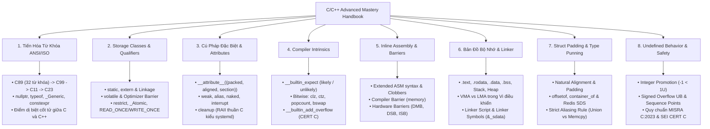

# C/C++ ADVANCED MASTERY HANDBOOK & SYSTEM REFERENCE
# Cẩm Nang Ôn Tập Chuyên Sâu C/C++: Từ Khóa ANSI, Cú Pháp Ẩn, Phần Tử `__...__` & Bản Chất Phần Cứng

> **Dành cho:** Kỹ sư Lập trình Nhúng (Embedded Systems), Linux Kernel / System Programming, và Kỹ sư Phần mềm muốn nắm bản chất sâu của C/C++.
> **Nguồn tham khảo tổng hợp:** 
> - Kho tham khảo cá nhân: [`thinh1210/C_programming`](https://github.com/thinh1210/C_programming)
> - Tiêu chuẩn ISO/IEC: C89/90, C99, C11, C17, C23 và C++11, C++17, C++20, C++23.
> - Sách kinh điển: *The C Programming Language (K&R)*, *Expert C Programming: Deep C Secrets (Peter van der Linden)*, *C Traps and Pitfalls (Andrew Koenig)*, *Effective C (Robert C. Seacord)*, *Modern C (Jens Gustedt)*, *Effective Modern C++ (Scott Meyers)*.
> - Quy chuẩn công nghiệp: *MISRA C:2012 / MISRA C:2023*, *SEI CERT C Coding Standard*.
> - Tài liệu chính thức: *GCC & Clang Compiler Manuals (GNU Compiler Collection)*.

---

## 🗺️ Bản Đồ Tri Thức (Map of Content - MOC)

---

## 📚 Danh Mục Các Chuyên Đề Chi Tiết

Mỗi chuyên đề dưới đây được biên soạn toàn diện, có lý thuyết chuyên sâu, phân tích mã máy Assembly (GCC/Clang), các cạm bẫy thực tế và ví dụ minh họa kiểm chứng:

1. **[[01_Keywords_Evolution_C89_to_C23|Chuyên đề 01: Toàn Bộ Từ Khóa ANSI/ISO C & C++ (C89 đến C23, C++23)]]**
   - Bảng tổng hợp đối chiếu đầy đủ các từ khóa qua các thời kỳ.
   - Phân tích chi tiết cách dùng, ngữ cảnh và sự khác biệt ngữ nghĩa giữa C và C++ (ví dụ: `auto`, `register`, `const`, `inline`, kích thước `sizeof('a')`).

2. **[[02_Storage_Classes_and_Type_Qualifiers|Chuyên đề 02: Storage Classes, Linkage & Type Qualifiers Chuyên Sâu]]**
   - Khảo sát bản chất `static` (3 vai trò), `extern` (cơ chế Tentative Definitions, `extern "C"`).
   - Mổ xẻ `volatile`: Tại sao compiler tối ưu hóa sai nếu thiếu `volatile`, khi nào `volatile` không đủ bảo vệ đa luồng.
   - Sức mạnh tối ưu của `restrict` và từ khóa `_Atomic`, `_Thread_local`.

3. **[[03_Special_Syntax_and_GCC_Attributes|Chuyên đề 03: Các Cú Pháp Đặc Biệt, Dấu Gạch Dưới Kép `__...__` & Compiler Attributes]]**
   - Giải mã bộ thuộc tính GCC/Clang: `__attribute__((packed))`, `aligned`, `section`, `weak`, `alias`, `naked`, `interrupt`, `constructor`, `destructor`.
   - **Kỹ thuật tối mật:** `__attribute__((cleanup))` để hiện thực hóa cơ chế **RAII (Resource Acquisition Is Initialization)** tự động dọn dẹp tài nguyên thuần C.
   - Chuẩn hóa C23 / C++11 với cú pháp `[[attribute]]`.

4. **[[04_Compiler_Builtins_and_Intrinsics|Chuyên đề 04: Compiler Built-ins & Hardware Intrinsics (`__builtin_...`)]]**
   - Tối ưu hóa dự đoán rẽ nhánh đường ống CPU: `__builtin_expect` và macro `likely()` / `unlikely()` của Linux Kernel.
   - Tập lệnh xử lý bit đơn chu kỳ của phần cứng: `__builtin_clz`, `__builtin_ctz`, `__builtin_popcount`, `__builtin_bswap32/64`.
   - Toán tử an toàn chống tràn số bảo mật theo chuẩn SEI CERT: `__builtin_add_overflow`.

5. **[[05_Inline_Assembly_and_Barriers|Chuyên đề 05: Khí Giới Tối Thượng: Inline Assembly & Rào Chắn Bộ Nhớ (Barriers)]]**
   - Cú pháp GCC Extended Inline Assembly: `__asm__ __volatile__` với output, input và clobber list.
   - Phân biệt triệt để **Compiler Barrier** (`asm volatile("" ::: "memory")`) và **CPU Hardware Memory Barrier** (`dmb`, `dsb`, `isb` trên ARM).

6. **[[06_Memory_Layout_and_Linker_Internals|Chuyên đề 06: Bản Đồ Bộ Nhớ, VMA/LMA & Linker Script Trong Lập Trình Nhúng]]**
   - Phân tích chi tiết các phân vùng: `.text`, `.rodata`, `.data`, `.bss`, Stack, Heap.
   - Bản chất cốt tử của **VMA (Virtual Memory Address)** và **LMA (Load Memory Address)** trong nạp vi điều khiển.
   - Giải mã bí mật Linker Symbols: Tại sao `&_sdata` là địa chỉ chứ không phải giá trị biến.

7. **[[07_Struct_Padding_Alignment_and_Punning|Chuyên đề 07: Cấu Trúc Bộ Nhớ Struct Padding, Alignment & Type Punning]]**
   - Nguyên tắc căn chỉnh tự nhiên (Natural Alignment Rule) của CPU 32-bit / 64-bit.
   - Macro tính toán độ lệch `offsetof` và `container_of` của Linux Kernel.
   - Hiểm họa vi phạm **Strict Aliasing Rule**: So sánh `union` punning vs `memcpy` vs ép kiểu con trỏ.

8. **[[08_Undefined_Behavior_and_Safety_Standards|Chuyên đề 08: Cạm Bẫy Hành Vi Bất Định (Undefined Behavior) & Chuẩn MISRA-C / CERT]]**
   - Tràn số nguyên có dấu (Signed Overflow UB) vs Unsigned Wrap-around.
   - Cạm bẫy ép kiểu ngầm định (Integer Promotion): Tại sao `-1 > sizeof(int)` lại ra kết quả đúng (TRUE).
   - Sequence points, unsequenced side effects, dangling pointers.
   - 10 quy tắc vàng sống còn từ **MISRA C:2023** và **SEI CERT C**.

9. **[[09_Recommended_Resources_and_Repos|Chuyên đề 09: Thư Viện Tài Nguyên, GitHub Repos & Sách Kinh Điển Khuyên Đọc]]**
   - Danh sách các repo mã nguồn mở mẫu mực, công cụ phân tích tĩnh, sách gối đầu giường và tài liệu chuẩn.

---

## 🧪 Phòng Thực Nghiệm (Code Lab)
Kèm theo cẩm nang là bộ mã nguồn kiểm chứng thực tế tại thư mục [`code_lab/`](file:///home/thinh/Obsidian/C_Cpp_Mastery_Handbook/code_lab/), sẵn sàng biên dịch với `make run`:
- `01_packed_vs_aligned.c`: Khảo sát struct size, bus alignment.
- `02_raii_cleanup.c`: Demo Smart Pointer và Auto-Mutex RAII thuần C bằng `__attribute__((cleanup))`.
- `03_branch_predict.c`: Kiểm chứng `__builtin_expect` (`likely`/`unlikely`) và bitwise intrinsics.
- `04_generic_macro.c`: Triển khai Overloading tĩnh trong C11 bằng `_Generic`.
- `05_strict_aliasing.c`: Tái hiện bug optimizer kinh điển do vi phạm Strict Aliasing Rule.
- `06_safe_overflow.c`: Phát hiện tràn số học an toàn bằng `__builtin_add_overflow`.
- `07_linux_kernel_list.c`: Intrusive Linked List và macro `container_of` của Linux Kernel.
- `08_redis_sds_packed.c`: Cấu trúc chuỗi động SDS của Redis (`__attribute__((packed))` và truy cập `s[-1]`).
- `09_linux_read_write_once.c`: Kỹ thuật ép kiểu Volatile `READ_ONCE()` & `WRITE_ONCE()` của Linux Kernel.
- `10_systemd_raii_autoptr.c`: Hệ thống macro `_cleanup_` và chuyển giao quyền sở hữu (Ownership Transfer) của systemd.
- `11_cpp_embedded_keywords.cpp`: Thực nghiệm các từ khóa C++20 cho nhúng (explicit, mutable, constexpr, consteval, constinit, reinterpret_cast, concepts).
