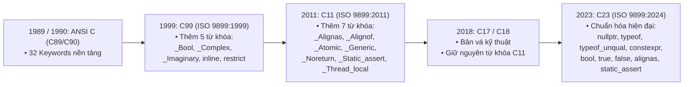
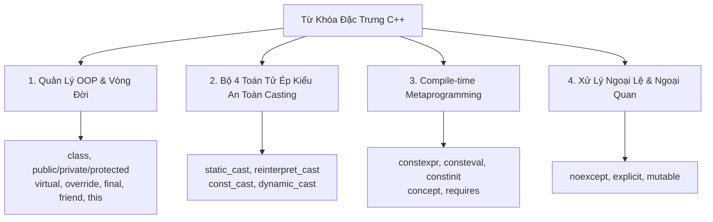

# CHUYÊN ĐỀ 01: TOÀN BỘ TỪ KHÓA ANSI/ISO C & C++ (C89 ĐẾN C23, C++23)

> Thuộc bộ cẩm nang: [[00_C_Cpp_Mastery_Index|C/C++ Mastery Handbook]]

---

## 1. Dòng Chảy Lịch Sử & Sự Phát Triển Của Từ Khóa

Ngôn ngữ C luôn tuân thủ triết lý tối giản: *"Chỉ cung cấp những gì tối thiểu cần thiết để viết mã hiệu quả cấp hệ thống"*. Tuy nhiên, qua hơn 4 thập kỷ, bộ từ khóa đã được mở rộng để đáp ứng nhu cầu tính toán song song, tối ưu hóa phần cứng và an toàn bộ nhớ.



---

## 2. Bảng Tổng Hợp 32 Từ Khóa ANSI C (C89/C90)

Đây là 32 từ khóa gốc bất biến tạo nên toàn bộ cấu trúc nền tảng của C.

| Nhóm chức năng | Từ khóa | Mục đích chính | Điểm đặc biệt & Cạm bẫy ít người biết |
| :--- | :--- | :--- | :--- |
| **Kiểu nguyên thủy** | `void` | Kiểu rỗng (không giá trị, con trỏ tổng quát) | `sizeof(void)` không hợp lệ theo chuẩn ANSI C (nhưng GCC coi là 1 byte để cho phép pointer arithmetic). |
| | `char` | Kiểu ký tự / số nguyên nhỏ nhất (ít nhất 8 bit) | Theo chuẩn ANSI, `char` không mặc định là `signed` hay `unsigned`. Nó tùy thuộc vào trình biên dịch và kiến trúc chip! (Ví dụ: x86 GCC mặc định `signed char`, nhưng ARM GCC mặc định `unsigned char`). Luôn dùng `int8_t` hoặc `uint8_t` trong embedded! |
| | `short` | Số nguyên ngắn (tối thiểu 16 bit) | `short` là cách viết tắt của `short int`. |
| | `int` | Số nguyên tự nhiên của kiến trúc CPU | Kích thước thay đổi tùy kiến trúc: 16-bit trên AVR/8051, 32-bit trên ARM Cortex-M/x86, 64-bit trên một số kiến trúc chuyên biệt. |
| | `long` | Số nguyên dài (tối thiểu 32 bit) | Trên Windows 64-bit (LLP64), `long` chỉ có 32-bit! Trên Linux 64-bit (LP64), `long` có 64-bit. |
| | `float` | Số thực dấu phẩy động độ chính xác đơn (IEEE 754) | Thao tác trên chip không có FPU (Hardware Floating Point Unit) sẽ kéo theo thư viện phần mềm mô phỏng rất chậm và tốn Flash. |
| | `double` | Số thực dấu phẩy động độ chính xác kép | Hằng số `1.0` mặc định là `double`. Nếu viết `float f = 1.0;` sẽ bị ngầm định chuyển đổi type conversion. |
| | `signed` | Định nghĩa kiểu số có dấu (bù hai - two's complement) | C23 chính thức chuẩn hóa biểu diễn số có dấu bắt buộc là Two's complement. |
| | `unsigned` | Định nghĩa kiểu số không dấu | Khi tính toán tràn số (overflow), số unsigned được chuẩn xác định là modulo $2^N$ (không phải Undefined Behavior). |
| **Kiểu dẫn xuất** | `struct` | Gom nhóm các trường dữ liệu | Gây hiện tượng Struct Padding và Data Alignment (xem chi tiết tại [[07_Struct_Padding_Alignment_and_Punning]]). |
| | `union` | Các trường dùng chung một vùng nhớ vật lý | Kích thước bằng trường lớn nhất. Dùng trong Type Punning và giải mã bản tin viễn thông. |
| | `enum` | Định nghĩa tập hợp các hằng số nguyên có tên | Kích thước của `enum` do compiler tự quyết định (thường là `int`, nhưng có thể bị co lại thành `char` nếu dùng cờ `-fshort-enums`). |
| | `typedef` | Đặt bí danh cho kiểu dữ liệu | Không tạo ra kiểu mới, chỉ tạo alias. Cẩn thận khi kết hợp với `const` pointer: `typedef char* PSTR; const PSTR p;` thì `p` là con trỏ hằng (`char * const p`), KHÔNG PHẢI con trỏ tới hằng (`const char * p`)! |
| **Storage Class** | `auto` | Biến cục bộ trên Stack (mặc định) | Trong C, `auto` chỉ xác định storage duration tự động (cục bộ). Trong C++11 trở đi, `auto` bị đổi hoàn toàn thành Type Inference (suy luận kiểu). |
| | `register` | Gợi ý lưu biến vào thanh ghi CPU | Không thể dùng toán tử lấy địa chỉ `&` lên biến `register`. Trong C++17, từ khóa này đã bị loại bỏ hoàn toàn. |
| | `static` | Lưu trữ tĩnh / Internal linkage | Có 3 ngữ nghĩa hoàn toàn khác nhau (xem [[02_Storage_Classes_and_Type_Qualifiers]]). |
| | `extern` | Khai báo biến/hàm ở translation unit khác | Bản chất chỉ tạo tham chiếu External Linkage, không cấp phát bộ nhớ. |
| **Type Qualifier**| `const` | Đánh dấu biến chỉ đọc (read-only) | Trong C, `const` KHÔNG tạo ra một compile-time constant thực sự (không thể dùng `const int N = 10; int arr[N];` trong C89). Trong C++, `const` mặc định là compile-time constant và có internal linkage. |
| | `volatile` | Báo cho compiler biết giá trị có thể đổi bất ngờ | Vô hiệu hóa việc cache biến vào CPU register và ngăn compiler xóa lệnh (xem [[02_Storage_Classes_and_Type_Qualifiers]]). |
| **Cấu trúc rẽ nhánh**| `if`, `else` | Rẽ nhánh có điều kiện | Lưu ý lỗi "Dangling Else" - `else` luôn kết cặp với `if` gần nó nhất chưa có `else`. |
| | `switch`, `case`, `default` | Rẽ nhánh đa trường hợp | `case` chỉ chấp nhận Integer Constant Expression. Hiện tượng **Fallthrough** nếu quên `break` (từng được dùng trong kỹ thuật tối ưu nổi tiếng *Duff's Device*). |
| **Cấu trúc lặp** | `for`, `while`, `do` | Vòng lặp | `do-while(0)` là pattern kinh điển trong viết Macro an toàn. Trong C89, không được khai báo biến trong biểu thức khởi tạo của `for(int i=0;...)`. |
| | `break` | Thoát khỏi vòng lặp hoặc `switch` gần nhất | Không thể dùng `break` để thoát khỏi một khối lệnh `{}` bình thường. |
| | `continue` | Bỏ qua phần còn lại của vòng lặp hiện tại | Trong `for`, `continue` nhảy đến biểu thức bước nhảy (iteration expression); trong `while`, nó nhảy về kiểm tra điều kiện. |
| **Nhảy & Trả về** | `goto` | Nhảy vô điều kiện tới label | Dù bị xem là "hại não", trong Linux Kernel `goto` là chuẩn mực để dọn dẹp tài nguyên tập trung (Error handling and cleanup pattern). |
| | `return` | Trả về từ hàm | `return;` trong hàm có kiểu trả về khác `void` là Undefined Behavior. |
| **Toán tử đặc biệt**| `sizeof` | Đo kích thước theo số byte (size_t) | Là toán tử lúc compile-time (trừ trường hợp VLA trong C99). Biểu thức bên trong `sizeof(expr)` KHÔNG bao giờ được thực thi (No side-effects)! Ví dụ: `int i = 0; sizeof(i++);` thì `i` vẫn bằng 0! |

---

## 3. Các Từ Khóa Bổ Sung Từ C99 Đến C23

### 3.1. Kỷ Nguyên C99: Đột Phá Tính Toán & Vectorization
Tại sao các từ khóa mới trong C99 lại bắt đầu bằng dấu gạch dưới và chữ hoa (`_Bool`, `_Complex`)?
> **Lý do tương thích ngược (Backward Compatibility):** Hàng triệu dòng code C legacy đã tự viết `#define bool int` hoặc `typedef int bool`. Để không làm vỡ code cũ của lập trình viên, ISO quy định từ khóa chuẩn của ngôn ngữ phải bắt đầu bằng `_Chữ_Hoa`. Đồng thời cung cấp header `<stdbool.h>` định nghĩa `bool` trỏ về `_Bool`.

1. **`_Bool`**: Kiểu dữ liệu logic chuẩn (lưu giá trị 0 hoặc 1). Gán bất kỳ giá trị khác 0 nào vào `_Bool` sẽ luôn tự chuẩn hóa thành 1.
2. **`_Complex` & `_Imaginary`**: Hỗ trợ số phức nguyên bản ở cấp độ ngôn ngữ (đi kèm `<complex.h>`).
3. **`inline`**: Gợi ý compiler chèn thân hàm trực tiếp vào vị trí gọi để triệt tiêu chi phí gọi hàm (Call overhead).
4. **`restrict`**: Áp dụng cho con trỏ. Cam kết với compiler rằng con trỏ này là **con trỏ duy nhất** trỏ đến vùng nhớ đó trong suốt vòng đời của nó. Giúp compiler tự do tối ưu hóa SIMD/Vectorization mà không sợ hiệu ứng trùng lắp bộ nhớ (Pointer Aliasing).

### 3.2. Kỷ Nguyên C11: Song Song Hóa & Type-Generic
1. **`_Generic`**: Vũ khí mạnh nhất của C11 để thực hiện **Compile-time Function Overloading** dựa trên kiểu của biểu thức mà không cần đến C++.
   ```c
   #define print_val(x) _Generic((x), \
       int: printf("Integer: %d\n", x), \
       double: printf("Double: %f\n", x), \
       char*: printf("String: %s\n", x), \
       default: printf("Unknown type\n"))
   ```
2. **`_Atomic`**: Định nghĩa biến nguyên tử cho lập trình đa luồng (Lock-free Programming), đi kèm thư viện `<stdatomic.h>`.
3. **`_Alignas` & `_Alignof`**: Kiểm soát căn chỉnh địa chỉ bộ nhớ theo chuẩn hóa (thay thế thuộc tính `__attribute__((aligned))` của GCC).
4. **`_Static_assert`**: Kiểm tra điều kiện ngay tại thời điểm biên dịch (Compile-time Assert). Ví dụ: `_Static_assert(sizeof(void*) == 4, "Yeu cau he thong 32-bit!");`.
5. **`_Thread_local`**: Biến cục bộ của riêng từng thread (Thread-local storage).
6. **`_Noreturn`**: Báo hiệu hàm không bao giờ trả về (ví dụ hàm `exit()`, `abort()` hoặc vòng lặp vô tận của Kernel OS).

### 3.3. Kỷ Nguyên C23: Hiện Đại Hóa Toàn Diện
C23 là cuộc cách mạng lớn nhất của C trong 20 năm qua:
- **`nullptr`**: Con trỏ null chuẩn hóa có kiểu riêng `nullptr_t`, chấm dứt sự mập mờ giữa số nguyên `0` và `(void*)0`.
- **`typeof` & `typeof_unqual`**: Lấy kiểu dữ liệu của biến hoặc biểu thức (trước đây là GCC extension `__typeof__`). `typeof_unqual` sẽ tước bỏ các hạn định `const`, `volatile`.
- **`constexpr`**: Định nghĩa hằng số thực sự lúc biên dịch (áp dụng cho đối tượng dữ liệu).
- **Loại bỏ tiền tố `_`**: Các từ khóa `bool`, `true`, `false`, `alignas`, `alignof`, `static_assert`, `thread_local` chính thức trở thành từ khóa hạng nhất (First-class keywords) mà không cần include header!

---

## 4. Bảng So Sánh Toàn Diện: C vs C++ (Những Khác Biệt Cốt Tử)

Nhiều lập trình viên lầm tưởng C++ là tập mẹ hoàn hảo của C (C is a strict subset of C++). Đây là quan niệm **hoàn toàn sai lầm**. Dưới đây là những điểm khác biệt ngữ nghĩa sâu sắc:

| Đặc tính / Từ khóa | Ngôn ngữ C | Ngôn ngữ C++ | Hậu quả / Cạm bẫy |
| :--- | :--- | :--- | :--- |
| **`sizeof('a')`** | `sizeof(int)` (Thường là **4 bytes**) | `sizeof(char)` (Luôn là **1 byte**) | Trong C, character constant có kiểu `int`. Trong C++, nó có kiểu `char`. |
| **`const` variable** | Biến chỉ đọc (Read-only variable), mặc định có **External Linkage**. | Hằng số biên dịch (Compile-time constant), mặc định có **Internal Linkage**. | Trong C: `const int N = 5; int a[N];` là VLA (Variable Length Array)! Trong C++: `a[N]` là mảng kích thước tĩnh. |
| **Con trỏ `void*`** | Tự động ngầm định ép kiểu sang mọi con trỏ khác: `int *p = malloc(10);` (Hợp lệ). | **Cấm** ngầm định ép kiểu từ `void*`. Bắt buộc phải explicit cast: `int *p = (int*)malloc(10);` | Code C hợp lệ nhưng ném vào trình biên dịch `g++` sẽ báo lỗi compile ngay lập tức! |
| **Hàm rỗng `void foo()`** | Nghĩa là hàm nhận **số lượng đối số bất kỳ** (Unspecified arguments). | Nghĩa là hàm **không nhận đối số nào** (tương đương `void foo(void)` trong C). | Muốn viết hàm không nhận đối số trong C, bắt buộc phải viết rõ `void foo(void)`. |
| **Từ khóa `auto`** | Chỉ định Storage duration tự động (cục bộ trên stack). | Suy luận kiểu tự động (Type deduction) tại thời điểm biên dịch (từ C++11). | Viết `auto x = 10;` trong C89 là lỗi cú pháp hoặc bị hiểu sai. |
| **Khởi tạo Struct** | Cho phép Designated Initializers theo thứ tự bất kỳ: `struct S s = {.b = 2, .a = 1};` | C++20 mới hỗ trợ designated initializers nhưng **bắt buộc phải theo đúng thứ tự khai báo** trong struct. | Code struct C99 đưa sang C++ có thể bị lỗi biên dịch nếu đảo thứ tự trường. |
| **Từ khóa mới trong C++** | Không tồn tại. Các định danh như `new`, `delete`, `class`, `template`, `virtual`, `try`, `catch` có thể đặt tên biến trong C. | Là các từ khóa được bảo lưu nghiêm ngặt. | Mã nguồn C dùng biến `int new;` hoặc `int class;` sẽ không thể biên dịch bằng trình biên dịch C++. |

---

## 5. Các Từ Khóa Đặc Biệt Của C++ (Kèm Ví Dụ Thực Chiến Cho Kỹ Sư C)

Khi chuyển dịch từ C sang C++ trong các dự án nhúng hiện đại (Embedded C++ / C++20), nhiều kỹ sư C thường bị choáng ngợp bởi số lượng từ khóa mới. Dưới đây là giải thích bản chất kèm mã nguồn ví dụ thực tế cho từng nhóm từ khóa cốt lõi:



---

### 5.1. Nhóm Quản Lý Vòng Đời & Lập Trình Hướng Đối Tượng (OOP)

Trong C thuần, để tạo tính hướng đối tượng, ta thường dùng `struct` chứa các con trỏ hàm và truyền thủ công con trỏ `self` (ví dụ: `void uart_send(struct UartDevice *self, uint8_t byte)`). C++ chuẩn hóa mô hình này ở cấp độ ngôn ngữ:

#### 1. `class`, `public`, `private`, `protected`
- `class`: Mặc định các thành viên là `private` (ngược với `struct` trong C++ mặc định là `public`).
- `private`: Chỉ nội bộ các phương thức của class được truy cập (đóng gói tuyệt đối, tương đương biến `static` trong file `.c`).
- `protected`: Cho phép class con kế thừa được truy cập, nhưng bên ngoài thì không.
- `public`: Giao diện công khai ra ngoài.

#### 2. `this` — Con Trỏ Trỏ Tới Instance Hiện Tại
- Tương đương hoàn toàn với tham số con trỏ `self` mà bạn tự truyền trong C:
```cpp
class GpioPin {
private:
    uint8_t pin_number;
public:
    GpioPin(uint8_t pin) {
        this->pin_number = pin; // Phân biệt giữa tham số pin và biến thành viên pin_number
    }
};
```

#### 3. `virtual`, `override`, `final` — Đa Hình & Bảng Hàm Ảo (vtable)
- **`virtual`**: Yêu cầu compiler tạo bảng con trỏ hàm ảo (**vtable**). Khi gọi hàm qua con trỏ lớp cha, CPU sẽ tra bảng vtable để gọi đúng hàm của lớp con (tương đương bảng callback trong C).
- **`override`**: Bắt buộc compiler kiểm tra hàm lớp con có đúng chữ ký (signature) với lớp cha hay không. Nếu viết sai tên hoặc sai kiểu tham số, compiler sẽ báo lỗi ngay lập tức!
- **`final`**: Cấm không cho bất kỳ lớp nào kế thừa tiếp, hoặc cấm ghi đè phương thức ảo này (giúp compiler tối ưu hóa **Devirtualization**, bỏ qua vtable để gọi trực tiếp mã máy siêu tốc!).

```cpp
// Lớp cơ sở trừu tượng (Interface Driver)
class UartDriver {
public:
    virtual ~UartDriver() = default; // Bắt buộc destructor ảo để tránh leak
    virtual void send_byte(uint8_t b) = 0; // Pure virtual function (= 0)
};

// Lớp con hiện thực cho phần cứng STM32
class Stm32Uart final : public UartDriver { // 'final' ở class: cấm kế thừa tiếp
public:
    void send_byte(uint8_t b) override {   // 'override': bảo vệ gõ nhầm chữ ký
        USART1->DR = b;
    }
};
```

#### 4. `friend` — Phá Vỡ Rào Cản Đóng Gói Có Kiểm Soát
Cho phép một hàm hoặc class bên ngoài có quyền truy cập vào các thành viên `private` của class này. Rất hay dùng khi viết **Unit Test** hoặc các lớp phần cứng liên kết chặt chẽ:
```cpp
class BatterySensor {
private:
    float raw_voltage;
    // Cấp quyền cho class BatteryTester đọc biến private raw_voltage:
    friend class BatteryTester; 
};
```

---

### 5.2. Nhóm 4 Toán Tử Ép Kiểu An Toàn (Casting Operators)

Trong C thuần, ép kiểu thô `(Type)val` quá nguy hiểm vì nó có thể ép bất kỳ thứ gì sang bất kỳ thứ gì mà không cảnh báo. C++ chia thành 4 toán tử rõ ràng:

#### 1. `static_cast<T>(v)` — Ép Kiểu Lúc Compile Có Kiểm Tra Logic
Dùng để chuyển đổi giữa các kiểu dữ liệu có liên quan (số nguyên sang số thực, enum class sang int, upcast con trỏ). Compiler sẽ từ chối nếu hai kiểu hoàn toàn không liên quan:
```cpp
double adc_raw = 3.14159;
int adc_val = static_cast<int>(adc_raw); // Rõ ràng, an toàn

enum class State : uint8_t { IDLE = 0, RUNNING = 1 };
uint8_t raw = static_cast<uint8_t>(State::RUNNING);
```

#### 2. `reinterpret_cast<T>(v)` — Ép Kiểu Thô Cấp Phần Cứng (Bản Chất C-Style Cast)
Ép kiểu thô giữa các con trỏ hoặc giữa số nguyên địa chỉ và con trỏ. **Đây là toán tử bắt buộc phải dùng khi lập trình nhúng để map địa chỉ thanh ghi phần cứng:**
```cpp
// Ánh xạ địa chỉ vật lý của thanh ghi GPIO sang con trỏ struct
struct GPIO_TypeDef {
    volatile uint32_t MODER;
    volatile uint32_t ODR;
};

// C++ chuẩn mực:
auto* GPIOA = reinterpret_cast<GPIO_TypeDef*>(0x40020000UL);
GPIOA->ODR |= (1 << 5); // Bật LED Pin 5
```

#### 3. `const_cast<T>(v)` — Gỡ Bỏ Thuộc Tính `const` / `volatile`
Chỉ dùng duy nhất khi phải giao tiếp với các thư viện C legacy nhận tham số `char*` dù bên trong không hề chỉnh sửa chuỗi:
```cpp
void legacy_c_print(char *str); // Thư viện C cũ không khai báo const char*

void modern_wrapper(const char *msg) {
    // Tạm thời gỡ bỏ const để gọi hàm C cũ:
    legacy_c_print(const_cast<char*>(msg)); 
}
```

#### 4. `dynamic_cast<T>(v)` — Ép Kiểu Đa Hình An Toàn Lúc Runtime (RTTI)
Kiểm tra xem con trỏ lớp cha có thực sự trỏ tới đối tượng lớp con mong muốn hay không lúc chạy (nếu sai trả về `nullptr`).
> [!NOTE]
> Trong lập trình nhúng, `dynamic_cast` đòi hỏi **RTTI (Run-Time Type Information)** làm phình to Flash và tốn RAM. Do đó, các dự án nhúng thường biên dịch với cờ **`-fno-rtti`** và cấm dùng `dynamic_cast`.

---

### 5.3. Nhóm Tính Toán Lúc Biên Dịch (Compile-Time Metaprogramming)

C++ hiện đại đưa tối đa các phép tính về thời điểm biên dịch để khi nạp vào vi điều khiển, CPU **tốn đúng 0 chu kỳ xung nhịp và 0 byte RAM**!

#### 1. `constexpr` (C++11) — Hàm / Biến Tính Toán Lúc Biên Dịch
Nếu tham số truyền vào là hằng số, hàm sẽ được thực thi ngay trong quá trình biên dịch:
```cpp
constexpr uint32_t calculate_baud_divisor(uint32_t clock_hz, uint32_t baud) {
    return clock_hz / (16 * baud);
}

// Giá trị được tính sẵn lúc compile và nhúng thẳng vào Flash!
constexpr uint32_t UART_DIVISOR = calculate_baud_divisor(84000000, 115200);
```

#### 2. `consteval` (C++20) — Bắt Buộc 100% Phải Chạy Lúc Compile
Khác với `constexpr` (có thể chạy lúc runtime nếu truyền biến số), `consteval` **BẮT BUỘC PHẢI CHẠY LÚC BIÊN DỊCH**. Nếu truyền biến runtime, compiler sẽ báo lỗi lập tức:
```cpp
consteval uint32_t generate_crc32(const char* str) {
    // Thuật toán băm chuỗi lúc compile...
    uint32_t hash = 0;
    while (*str) hash = (hash * 31) + *str++;
    return hash;
}

constexpr auto id1 = generate_crc32("SENSOR_TEMP"); // OK: Chạy lúc compile!
// int x = 10; generate_crc32(x); // LỖI BIÊN DỊCH NGAY!
```

#### 3. `constinit` (C++20) — Chống Lỗi Khởi Tạo Biến Toàn Cục
Trong C++, nếu hai file `.cpp` có hai biến toàn cục phụ thuộc lẫn nhau, thứ tự khởi tạo của chúng là không xác định (**Static Initialization Order Fiasco**).
`constinit` cam kết rằng biến toàn cục này **bắt buộc phải được khởi tạo giá trị tĩnh trước khi bất kỳ đoạn code nào chạy**:
```cpp
// Đảm bảo g_system_state khởi tạo tĩnh trong .data/.bss, không qua hàm dựng runtime:
constinit uint32_t g_system_state = calculate_baud_divisor(16000000, 9600);
```

#### 4. `concept` & `requires` (C++20) — Siêu Vũ Khí Ràng Buộc Kiểu Cho Template
Trong C++ cũ, Template báo lỗi hàng trăm dòng không thể đọc nổi (Template vomits). C++20 đưa ra `concept` để đặt điều kiện kiểm tra kiểu cực kỳ thanh lịch:
```cpp
#include <concepts>

// Định nghĩa Concept: Thiết bị phần cứng bắt buộc phải có phương thức write_byte(uint8_t)
template<typename T>
concept OutputDevice = requires(T dev, uint8_t byte) {
    { dev.write_byte(byte) } -> std::same_as<void>;
};

// Hàm template chỉ chấp nhận các Driver thỏa mãn Concept OutputDevice:
template<OutputDevice T>
void send_alert(T& device, uint8_t code) {
    device.write_byte(code);
}
```

---

### 5.4. Nhóm Xử Lý Ngoại Lệ & Ngoại Quan (Safety & Modifiers)

#### 1. `noexcept` — Cam Kết Không Ném Ngoại Lệ
Trong hệ thống nhúng, cơ chế C++ Exceptions thường bị tắt bằng cờ `-fno-exceptions` vì chi phí Stack Unwinding quá lớn.
Từ khóa `noexcept` báo cho compiler: *"Hàm này cam kết 100% không bao giờ ném Exception"*. Compiler sẽ tối ưu hóa triệt để, không sinh mã dọn dẹp phụ trợ:
```cpp
void isr_handler(void) noexcept {
    // Trình biên dịch sinh mã máy siêu tinh gọn, không tốn bảng ngoại lệ
}
```

#### 2. `explicit` — Ngăn Chặn Ép Kiểu Ngầm Định Nguy Hiểm
Khi một Constructor chỉ nhận 1 tham số, C++ cho phép phép gán ngầm định `Obj o = 10;`. Điều này gây ra những bug không thể phát hiện bằng mắt thường:
```cpp
class SafeBuffer {
public:
    // Thêm 'explicit': CẤM ngầm định ép kiểu số nguyên thành SafeBuffer!
    explicit SafeBuffer(size_t size) { ... }
};

void process_buffer(SafeBuffer buf);

// process_buffer(100); // LỖI BIÊN DỊCH! (Nếu không có explicit, code này sẽ tự tạo buffer 100 bytes!)
process_buffer(SafeBuffer(100)); // Hợp lệ, rõ ràng ý định!
```

#### 3. `mutable` — Cho Phép Sửa Biến Trong Hàm `const`
Trong C++, phương thức `const` cam kết không làm thay đổi trạng thái đối tượng. Nhưng nếu ta cần bảo vệ đa luồng bằng Mutex hoặc đếm số lần đọc Cache thì sao?
Từ khóa `mutable` cho phép biến đó **vẫn có thể bị sửa đổi ngay cả bên trong hàm `const`**:
```cpp
class SensorReader {
private:
    float cached_value;
    mutable uint32_t read_count; // Cho phép sửa dù hàm là const

public:
    float get_value() const {
        read_count++; // Hợp lệ nhờ từ khóa 'mutable'!
        return cached_value;
    }
};
```

