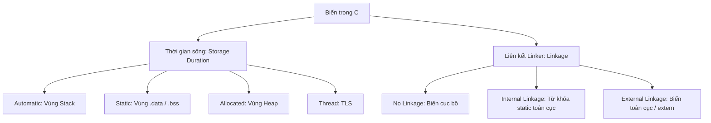
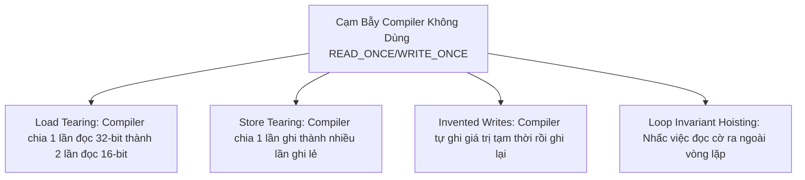

# CHUYÊN ĐỀ 02: STORAGE CLASSES, LINKAGE & TYPE QUALIFIERS CHUYÊN SÂU

> Thuộc bộ cẩm nang: [[00_C_Cpp_Mastery_Index|C/C++ Mastery Handbook]]  
> Kế thừa và mở rộng từ: [`thinh1210/C_programming - Lesson 1 & Lesson 2`](https://github.com/thinh1210/C_programming)

---

## 1. Storage Classes & Bản Chất Của Linkage (Liên Kết Ký Hiệu)

Mỗi biến trong C/C++ được xác định bởi hai thuộc tính cốt lõi:
1. **Storage Duration (Thời gian tồn tại của vùng nhớ):** Automatic (trên Stack), Static (tồn tại suốt chương trình trong RAM), Thread (riêng cho thread), hoặc Allocated (trên Heap).
2. **Linkage (Phạm vi nhìn thấy của ký hiệu đối với Linker):**
   - **No Linkage:** Chỉ nhìn thấy bên trong khối lệnh `{}` (Block scope).
   - **Internal Linkage:** Chỉ nhìn thấy trong phạm vi file biên dịch hiện tại (`.c` / Translation Unit). Linker không nhìn thấy ra ngoài.
   - **External Linkage:** Được Linker giải quyết xuyên suốt toàn bộ các file object (`.o`) của toàn dự án.



---

## 2. Giải Mã 3 Bản Thể Của Từ Khóa `static`

Từ khóa `static` là một trong những từ khóa gây bối rối nhất vì cùng một từ nhưng mang ngữ nghĩa khác biệt hoàn toàn tùy vị trí đặt:

### 2.1. Local Static Variable (Static cục bộ trong hàm)
- **Vị trí bộ nhớ:** Không nằm trên Stack mà được cấp phát cố định trong phân vùng `.data` (nếu có khởi tạo) hoặc `.bss` (nếu không khởi tạo hoặc khởi tạo bằng 0).
- **Vòng đời:** Tồn tại suốt thời gian chạy của chương trình.
- **Phạm vi:** Vẫn giữ nguyên phạm vi truy cập (Scope) cục bộ bên trong hàm đó.
- **Ứng dụng:** Lưu trạng thái giữa các lần gọi hàm (ví dụ: đếm số lần hàm được gọi, bộ đệm buffer nội bộ của driver, trạng thái của FSM).
- **Lưu ý Thread-Safety:**
  - Trong **C**: Biến local static **không an toàn** trong môi trường đa luồng (Race Condition).
  - Trong **C++11 trở đi (Magic Statics):** Trình biên dịch sinh mã khóa luồng ngầm định (Thread-safe initialization) để đảm bảo biến chỉ được khởi tạo một lần duy nhất kể cả khi nhiều luồng cùng gọi hàm đồng thời.

### 2.2. Global Static Variable & Function (Static toàn cục / Internal Linkage)
- **Ý nghĩa cốt tử:** Hạn chế phạm vi ký hiệu (Symbol Visibility) chỉ trong nội bộ Translation Unit (`.c`).
- **Triết lý Lập trình Nhúng:** Đây là cơ chế **đóng gói (Encapsulation)** mạnh mẽ nhất trong C (tương đương với `private` trong C++).
- **Nguyên tắc vàng:** Bất kỳ biến toàn cục hoặc hàm helper nào không cần gọi từ file khác **BẮT BUỘC PHẢI KHAI BÁO `static`**.
  - Tránh xung đột tên (Symbol Collision) khi dự án phình to hàng trăm file.
  - Cho phép trình biên dịch tối ưu hóa mạnh tay (Inlining, loại bỏ Dead Code) vì compiler biết chắc chắn không có file `.c` nào khác gọi đến hàm này.

### 2.3. Class Member Static (Trong C++)
- Thành viên tĩnh của Class thuộc về bản thân Class chứ không thuộc về bất kỳ instance nào (dùng chung cho mọi đối tượng).

---

## 3. Khám Phá Bí Mật Của `extern` & Cạm Bẫy Tentative Definitions

### 3.1. Bản chất của `extern`
`extern` thông báo cho Compiler: *"Biến hoặc hàm này tồn tại, có kiểu dữ liệu như thế này, nhưng vùng nhớ của nó được định nghĩa ở một file khác. Hãy để Linker giải quyết địa chỉ sau!"*

### 3.2. Cạm bẫy "Tentative Definition" trong C
Hãy xét đoạn code C sau đặt ở phạm vi toàn cục:
```c
int count;   // Đây là khai báo hay định nghĩa?
int count;   // Viết lại lần 2 có bị lỗi không?
int count;   // Viết lại lần 3?
```
> **Sự thật kinh ngạc:** Đoạn mã trên **hoàn toàn hợp lệ trong C** nhưng là **lỗi biên dịch nghiêm trọng trong C++**!
> 
> Trong C, khai báo toàn cục không có giá trị khởi tạo và không có `extern` được gọi là **Tentative Definition**. Trình biên dịch gom tất cả các Tentative Definition cùng tên trong một file thành một định nghĩa duy nhất và đưa vào phân vùng `.bss` (Common Symbol).
> 
> **Tuy nhiên:** Nếu viết `#include "header.h"` chứa `int count;` vào nhiều file `.c`, tùy vào cờ compiler (`-fcommon` vs `-fno-common`), Linker có thể gộp chúng làm một hoặc ném ra lỗi `multiple definition of 'count'`.
> 
> **Quy tắc bất biến:** Trong header file (`.h`), **chỉ được phép dùng `extern`**:
> ```c
> // In file.h:
> extern int g_system_tick; // Khai báo (Declaration)
> 
> // In file.c:
> int g_system_tick = 0;    // Định nghĩa (Definition) duy nhất
> ```

### 3.3. Bí mật `extern "C"` trong tương thích C / C++
Khi trình biên dịch C++ biên dịch một hàm, nó thực hiện cơ chế **Name Mangling** (đổi tên hàm để nhúng thông tin kiểu tham số phục vụ Function Overloading). Ví dụ: `void uart_init(int baud)` có thể bị đổi thành `_Z9uart_initi`.

Trình biên dịch C thuần thì **không bao giờ đổi tên** (giữ nguyên `uart_init`). Kết quả: Linker C++ tìm `_Z9uart_initi` trong thư viện C và báo lỗi `undefined reference`!

```c
#ifdef __cplusplus
extern "C" {
#endif

void uart_init(int baudrate);
uint8_t uart_read_byte(void);

#ifdef __cplusplus
}
#endif
```
`extern "C"` ép trình biên dịch C++ sử dụng quy ước liên kết (C Linkage Convention) của ngôn ngữ C thuần.

---

## 4. Bóc Tách Bản Chất `const` — Con Trỏ Hằng vs Hằng Con Trỏ

### 4.1. Quy tắc Xoắn Ốc / Kim Đồng Hồ (Clockwise/Spiral Rule)
Để giải mã bất kỳ khai báo con trỏ phức tạp nào chứa `const`, hãy đọc từ **Tên biến ngược sang trái**:

```c
const int * ptr1;        // Đọc: ptr1 là con trỏ trỏ tới "int hằng" (Pointer to const)
                         // -> Không được sửa *ptr1, nhưng ptr1 có thể trỏ đi nơi khác.

int const * ptr2;        // Tương đương const int * ptr1 (vẫn là Pointer to const).

int * const ptr3;        // Đọc: ptr3 là "con trỏ hằng" trỏ tới int (Const pointer)
                         // -> Địa chỉ ptr3 cố định, nhưng có thể sửa giá trị *ptr3!

const int * const ptr4;  // Con trỏ hằng trỏ tới int hằng. Cố định cả hai!
```

> **Ứng dụng thanh ghi nhúng:**
> - Thanh ghi ngoại vi đọc dữ liệu (Read-Only Register): `const volatile uint32_t * const REG = (uint32_t*)0x40021000;`

### 4.2. Khác biệt sâu xa giữa `const` trong C và C++
Trong C:
```c
const int BUFFER_SIZE = 128;
int my_array[BUFFER_SIZE]; // Trong C89: LỖI BIÊN DỊCH! Trong C99: Trở thành VLA!
```
Tại sao? Vì trong C, `BUFFER_SIZE` thực chất là một **biến chỉ đọc (Read-only variable)** nằm trong bộ nhớ RAM hoặc `.rodata`, không phải một hằng số thực sự (Literal Constant).
Trong C++, `const` mặc định là **Compile-time Constant** (nó thay thế trực tiếp giá trị vào mã máy giống `#define` nhưng có kiểu an toàn).

---

## 5. Trái Tim Của Lập Trình Nhúng: Phân Tích Chuyên Sâu Từ Khóa `volatile`

### 5.1. Tại sao Compiler lại tối ưu hóa code của bạn?
Trình biên dịch hiện đại (với các cờ tối ưu `-O2`, `-O3`, `-Os`) giả định rằng: **"Giá trị của một biến trong bộ nhớ chỉ thay đổi nếu có một dòng lệnh mã nguồn C trong luồng đó trực tiếp gán giá trị cho nó"**.

Hãy xem ví dụ kinh điển sau:
```c
uint8_t *flag_reg = (uint8_t*)0x40001000; // Thanh ghi trạng thái phần cứng

void wait_for_ready(void) {
    while (*flag_reg == 0) {
        // Chờ phần cứng bật cờ sẵn sàng
    }
}
```
**Trình biên dịch tối ưu hóa sẽ làm gì?**
Compiler nhận định: Trong thân vòng lặp `while`, biến `*flag_reg` không hề bị thay đổi. Vậy đọc đi đọc lại từ RAM làm gì cho chậm?
Compiler sẽ sinh ra mã Assembly tương đương:
```asm
LDR R0, =0x40001000
LDRB R1, [R0]        ; Đọc giá trị từ RAM vào thanh ghi CPU R1 đúng 1 lần
loop:
CMP R1, #0           ; So sánh thanh ghi R1 với 0
BEQ loop             ; Nếu bằng 0, nhảy lặp lại vô tận mà KHÔNG THÈM ĐỌC LẠI RAM!
```
**Hậu quả:** CPU bị treo vĩnh viễn trong vòng lặp (Infinite Loop), dù phần cứng bên ngoài đã đổi giá trị của thanh ghi `0x40001000` thành `1`!

### 5.2. `volatile` Giải Quyết Điều Gì?
Khi khai báo:
```c
volatile uint8_t *flag_reg = (volatile uint8_t*)0x40001000;
```
Từ khóa `volatile` là một **chỉ thị cấm tối ưu hóa (Optimizer Invalidation)**:
1. Mọi thao tác ĐỌC biến `volatile` phải được chuyển dịch thành lệnh đọc thực tế từ địa chỉ bộ nhớ (không được lấy từ CPU cache hay CPU register).
2. Mọi thao tác GHI biến `volatile` phải được ghi trực tiếp ngay lập tức xuống bộ nhớ (không được trì hoãn hoặc xóa bỏ - Dead Store Elimination).
3. Compiler không được tự ý đảo thứ tự (Reorder) các thao tác đọc/ghi biến `volatile` với nhau.

### 5.3. 3 Kịch Bản Bắt Buộc Dùng `volatile` Trong Lập Trình Nhúng
1. **Memory-Mapped Peripheral Registers:** Ánh xạ thanh ghi phần cứng (GPIO, UART, Timer, SPI).
2. **Biến cờ dùng chung giữa ISR (Ngắt) và Main Loop:**
   ```c
   volatile uint8_t g_button_pressed = 0;

   void EXTI0_IRQHandler(void) {
       g_button_pressed = 1; // Được ngắt phần cứng gọi
   }

   int main(void) {
       while (1) {
           if (g_button_pressed) {
               g_button_pressed = 0;
               handle_event();
           }
       }
   }
   ```
3. **Bộ đệm truyền thông DMA hoặc bộ nhớ chia sẻ giữa nhiều Core CPU.**

### 5.4. Những Hiểu Lầm Chết Người Về `volatile`
> [!CAUTION]
> 1. **`volatile` KHÔNG ĐẢM BẢO TÍNH NGUYÊN TỬ (NOT ATOMIC):**
>    Một câu lệnh đơn giản như `g_counter++;` trên biến `volatile` thực chất gồm 3 chu kỳ máy:
>    - `LDR R0, [addr]` (Đọc)
>    - `ADD R0, R0, #1` (Cộng)
>    - `STR R0, [addr]` (Ghi)
>    Nếu ngắt ISR nhảy vào giữa chu kỳ này, dữ liệu bị sai lệch hoàn toàn! Phải dùng `_Atomic` hoặc tắt ngắt để bảo vệ.
>
> 2. **`volatile` KHÔNG PHẢI LÀ HARDWARE MEMORY BARRIER:**
>    `volatile` ngăn compiler đảo lệnh, nhưng **KHÔNG NGĂN ĐƯỢC CPU Out-of-Order Execution** của các vi xử lý đa lõi mạnh như ARM Cortex-A hay x86. Muốn ngăn CPU reorder ở cấp độ phần cứng, bắt buộc phải dùng lệnh Memory Barrier (`dmb`, `dsb`, `isb`).

---

## 6. Vũ Khí Tối Ưu Hóa: Từ Khóa `restrict`

Được giới thiệu trong C99, `restrict` là lời cam kết của lập trình viên với trình biên dịch:
*"Con trỏ này là lối truy cập DUY NHẤT đến vùng nhớ mà nó trỏ tới trong phạm vi này. Không có con trỏ nào khác trỏ trùng vùng nhớ này (No Pointer Aliasing)."*

### So Sánh Mã Máy Sinh Ra:
```c
// Không có restrict
void add_no_restrict(int *a, int *b, int *val) {
    *a += *val;
    *b += *val;
}
```
Ở hàm trên, Compiler lo sợ rằng con trỏ `a` và `val` có thể trỏ cùng một địa chỉ bộ nhớ (`a == val`). Do đó, sau khi `*a` thay đổi, compiler **buộc phải nạp lại `*val` từ RAM lần thứ hai** trước khi cộng vào `*b`.

```c
// Có restrict
void add_restrict(int * restrict a, int * restrict b, int * restrict val) {
    *a += *val;
    *b += *val;
}
```
Nhờ có `restrict`, compiler tự tin nạp `*val` vào thanh ghi CPU đúng một lần duy nhất và dùng lại cho cả hai phép cộng, đồng thời có thể áp dụng lệnh SIMD song song hóa hoàn toàn!

---

## 7. Mổ Xẻ Mã Nguồn Thực Tế: Linux Kernel Xử Lý `volatile` Bằng `READ_ONCE()` & `WRITE_ONCE()`

Trong tài liệu chính thức của Linux Kernel ([`Documentation/process/volatile-considered-harmful.rst`](https://www.kernel.org/doc/html/latest/process/volatile-considered-harmful.html)), Linus Torvalds và các maintainer cốt cán đưa ra một tuyên bố nổi tiếng:
> *"Việc khai báo một biến là `volatile` gần như luôn luôn là một sai lầm về mặt kiến trúc hệ điều hành."*

### Tại sao Linux Kernel lại "ghét" khai báo `volatile int x;` trực tiếp?
1. **Làm tê liệt khả năng tối ưu hóa:** Nếu khai báo một biến `volatile`, compiler bị cấm lưu biến đó vào thanh ghi CPU trong **mọi câu lệnh**. Dù bạn chỉ đọc biến đó để tính toán logic nội bộ hàng trăm lần, CPU vẫn phải ra lệnh đọc từ RAM hàng trăm lần, làm suy giảm nghiêm trọng hiệu năng.
2. **Ảo tưởng an toàn:** `volatile` không cung cấp rào chắn đồng bộ (Memory Barrier) và không đảm bảo tính nguyên tử (Atomicity).

### Giải Pháp Của Bậc Thầy: "Ép Kiểu Volatile Đúng Thời Điểm" (Volatile Casting on Access)
Thay vì biến biến thành `volatile` vĩnh viễn, Linux Kernel giữ nguyên biến là biến bình thường, nhưng khi cần đọc/ghi an toàn đa luồng mà không cần dùng Mutex nặng nề, họ sử dụng cặp macro huyền thoại trong [`include/linux/compiler.h`](https://elixir.bootlin.com/linux/latest/source/include/linux/compiler.h):

```c
#define __READ_ONCE(x)  (*(const volatile typeof(x) *)&(x))
#define __WRITE_ONCE(x, val) do { *(volatile typeof(x) *)&(x) = (val); } while (0)
```

### Cặp Macro Này Ngăn Chặn 4 Lỗi Tối Ưu Hóa Tinh Vi Của Compiler:



1. **Ngăn chặn Load / Store Tearing:**
   Trên một số kiến trúc CPU, nếu không ép kiểu `volatile`, trình biên dịch có thể tối ưu bằng cách chia lệnh đọc/ghi biến 32-bit hoặc 64-bit thành hai lệnh 16-bit riêng lẻ. Nếu một luồng khác can thiệp ở giữa, luồng hiện tại sẽ đọc phải nửa giá trị cũ và nửa giá trị mới (dữ liệu rác)!
2. **Ngăn chặn Loop Invariant Hoisting:**
   Khi một luồng đợi cờ dừng từ luồng khác:
   ```c
   // Code chuẩn Linux Kernel:
   while (!READ_ONCE(thread_should_stop)) {
       do_work();
   }
   ```
   Nhờ có `READ_ONCE()`, compiler bị ép phải đọc lại biến `thread_should_stop` từ RAM sau mỗi vòng lặp, thay vì lưu tạm vào thanh ghi CPU rồi lặp vô tận!
3. **Mã sạch và kiểm soát tinh vi:**
   Biến chỉ là `volatile` tại đúng vị trí gọi `READ_ONCE()`. Ở các đoạn code khác cần tốc độ cao, CPU vẫn tự do cache biến vào thanh ghi.

