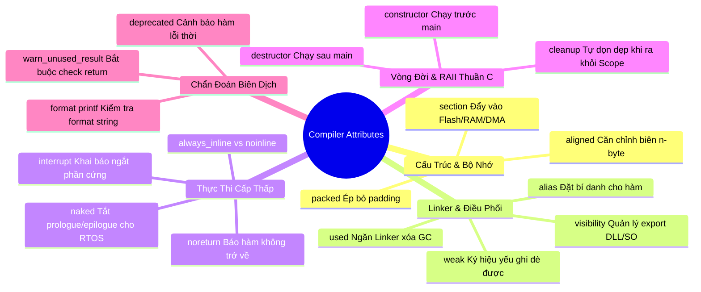

# CHUYÊN ĐỀ 03: CÚ PHÁP ĐẶC BIỆT, DẤU GẠCH DƯỚI KÉP `__...__` & COMPILER ATTRIBUTES

> Thuộc bộ cẩm nang: [[00_C_Cpp_Mastery_Index|C/C++ Mastery Handbook]]  
> Tham khảo: [`thinh1210/C_programming - Lesson 2`](https://github.com/thinh1210/C_programming), GNU GCC Compiler Manual & C23 Standard.

---

## 1. Thế Giới Của Dấu Gạch Dưới Kép `__...__`

Trong tiêu chuẩn ISO C và ISO C++, có một quy định bất khả xâm phạm về không gian tên (Namespace Preservation):
> **Quy tắc chuẩn:** Mọi định danh (identifier) bắt đầu bằng hai dấu gạch dưới `__` hoặc một dấu gạch dưới theo sau bởi một chữ hoa `_A` đến `_Z` đều được **BẢO LƯU CHO TRÌNH BIÊN DỊCH VÀ THƯ VIỆN CHUẨN**.

Lập trình viên không được tự ý đặt tên biến như `int __my_var;`. Ngược lại, khi bạn nhìn thấy `__...`, đó là dấu hiệu của:
1. **Phần mở rộng của Trình biên dịch (Compiler Extensions):** Ví dụ `__attribute__`, `__builtin_...`, `__asm__`, `__typeof__`.
2. **Predefined Macro tiêu chuẩn:** `__FILE__`, `__LINE__`, `__func__`, `__cplusplus`.
3. **Từ khóa dự phòng trước C23:** `_Bool`, `_Generic`, `_Alignas`.

---

## 2. Toàn Thư Về GCC/Clang Attributes: `__attribute__((...))`

Trình biên dịch GCC và Clang cung cấp cơ chế gán siêu dữ liệu (Metadata) cho hàm, biến hoặc kiểu dữ liệu thông qua thuộc tính `__attribute__((...))`. 
*(Lưu ý: Từ C23 và C++11, cú pháp này được chuẩn hóa thành `[[attribute]]`).*



---

### 2.1. Nhóm Điều Khiển Cấu Trúc Bộ Nhớ

#### 1. `__attribute__((packed))` — Ép Bỏ Toàn Bộ Padding
- **Tác dụng:** Ép trình biên dịch không được chèn các byte đệm (Padding Bytes) vào cấu trúc struct. Các trường sẽ nằm san sát nhau từng byte một.
- **Ứng dụng:** Bắt buộc phải dùng khi định nghĩa khung gói tin giao tiếp mạng (TCP/IP header), gói tin CAN Bus, Modbus, hoặc cấu trúc file nhị phân ghi xuống Flash/SD Card.
- **Hiểm họa Bus Fault trên ARM Cortex:**
  ```c
  struct __attribute__((packed)) SensorFrame {
      uint8_t  cmd;       // Offset 0 (1 byte)
      uint32_t timestamp; // Offset 1 (4 bytes) -> NẰM Ở ĐỊA CHỈ LẺ!
      uint16_t data;      // Offset 5 (2 bytes)
  };
  ```
  > [!WARNING]
  > Trên kiến trúc ARM Cortex-M0/M0+, vi xử lý **không hỗ trợ đọc số 32-bit từ địa chỉ không chia hết cho 4 (Unaligned Memory Access)**. Nếu bạn viết `uint32_t *p = &frame.timestamp; uint32_t val = *p;`, chip sẽ lập tức ném ra lỗi phần cứng **HardFault / BusFault (UsageFault INVSTATE/UNALIGNED)** khiến hệ thống bị treo ngay lập tức!
  > Trên Cortex-M3/M4/M7, chip hỗ trợ Unaligned Access nhưng sẽ mất 2 chu kỳ nạp bộ nhớ thay vì 1 chu kỳ.

#### 2. `__attribute__((aligned(n)))` — Ép Căn Chỉnh Biên
- **Tác dụng:** Ép biến hoặc cấu trúc dữ liệu bắt đầu tại một địa chỉ chia hết cho `n` bytes (với `n` là lũy thừa của 2).
- **Ứng dụng:**
  - Căn chỉnh bộ đệm DMA (Direct Memory Access) theo biên 32 bytes hoặc 64 bytes để khớp với Cache Line của CPU (tránh lỗi xung đột Cache Coherency).
  - Tối ưu hóa tập lệnh véc-tơ SIMD (AVX/NEON) yêu cầu dữ liệu căn chỉnh 16 hoặc 32 bytes.

#### 3. `__attribute__((section(".tên_section")))` — Điều Hướng Phân Vùng Bộ Nhớ
- **Tác dụng:** Chỉ định chính xác vị trí phân vùng mà Linker phải đặt hàm hoặc biến đó vào.
- **Ứng dụng thực tế trong Nhúng:**
  ```c
  // Đẩy hàm xử lý ngắt khẩn cấp lên RAM để chạy với tốc độ tối đa (0-wait state)
  void __attribute__((section(".ramfunc"))) critical_motor_shutdown(void) {
      GPIO_PORTA->ODR &= ~MOTOR_ENABLE_PIN;
  }

  // Đẩy bảng tra cứu cố định vào một sector Flash riêng biệt
  const uint32_t __attribute__((section(".calib_data"))) CALIBRATION_TABLE[64] = { ... };

  // Đặt bộ đệm truyền nhận mạng vào vùng nhớ SRAM không bị Cache (No-cache RAM)
  uint8_t __attribute__((section(".dma_buffer"))) dma_rx_ring[1024];
  ```

---

### 2.2. Nhóm Linker & Liên Kết Ký Hiệu

#### 1. `__attribute__((weak))` — Ký Hiệu Yếu (Weak Symbol)
- **Bản chất:** Báo cho Linker biết: *"Đây chỉ là hàm/biến mặc định. Nếu ở bất kỳ file nào khác trong dự án có một hàm trùng tên mà không có thuộc tính weak (Strong Symbol), Linker hãy tự động lấy hàm của người dùng và vứt bỏ hàm weak này đi mà không báo lỗi multiple definition!"*
- **Kiến trúc SDK chuẩn công nghiệp (STM32 HAL, ESP-IDF, Zephyr):**
  ```c
  // Trong thư viện của hãng (stm32f4xx_it.c):
  void __attribute__((weak)) HAL_UART_RxCpltCallback(UART_HandleTypeDef *huart) {
      // Hàm rỗng mặc định phòng khi user không cần dùng
      (void)huart;
  }

  // Trong code ứng dụng của bạn (main.c):
  // Tự động ghi đè hàm của hãng mà không cần sửa file thư viện gốc!
  void HAL_UART_RxCpltCallback(UART_HandleTypeDef *huart) {
      rx_buffer[rx_index++] = huart->Instance->DR;
  }
  ```

#### 2. `__attribute__((alias("tên_gốc")))` — Bí Danh Cho Hàm
- Thường kết hợp với `weak` để gom tất cả các hàm ngắt chưa sử dụng về một hàm bẫy lỗi duy nhất (`Default_Handler`), giúp tiết kiệm bộ nhớ Flash cực lớn:
  ```c
  void Default_Handler(void) {
      while(1); // Treo debug nếu có ngắt lạ nhảy vào
  }

  // Mọi ngắt ngoại vi đều trỏ về Default_Handler nếu lập trình viên chưa viết hàm xử lý
  void WWDG_IRQHandler(void) __attribute__((weak, alias("Default_Handler")));
  void USART1_IRQHandler(void) __attribute__((weak, alias("Default_Handler")));
  ```

#### 3. `__attribute__((used))`
- Ngăn chặn tùy chọn Linker Garbage Collection (`gcc -Wl,--gc-sections`) vô tình xóa bỏ các biến hoặc bảng Vector Table không được gọi trực tiếp từ hàm `main()`.

---

### 2.3. Nhóm Thực Thi Cấp Thấp & RTOS Kernel

#### 1. `__attribute__((naked))` — Tước Bỏ Hoàn Toàn Prologue và Epilogue
Khi biên dịch một hàm thông thường, compiler luôn tự động chèn:
- **Prologue:** Đẩy con trỏ Frame và các thanh ghi bảo lưu vào Stack (`push {r4-r7, lr}`).
- **Epilogue:** Phục hồi thanh ghi và trở về (`pop {r4-r7, pc}`).
- **Tại sao cần `naked`?** Khi viết bộ chuyển đổi ngữ cảnh (**Context Switcher**) cho hệ điều hành thời gian thực (FreeRTOS, RT-Thread) hoặc trình khởi động (Bootloader), lập trình viên cần **tự tay kiểm soát 100% thanh ghi Stack Pointer (SP) bằng lệnh Assembly**, không để compiler can thiệp làm hỏng cấu trúc Stack Frame của Task!
  ```c
  void __attribute__((naked)) PendSV_Handler(void) {
      __asm volatile (
          "mrs r0, psp                \n"
          "isb                        \n"
          "ldr r3, =pxCurrentTCB      \n"
          "ldr r2, [r3]               \n"
          "stmdb r0!, {r4-r11}        \n" // Tự lưu ngữ cảnh tác vụ cũ
          "str r0, [r2]               \n"
          // ... chọn tác vụ mới ...
          "bx r14                     \n"
      );
  }
  ```

#### 2. `__attribute__((constructor))` & `__attribute__((destructor))`
- Hàm có thuộc tính `constructor` sẽ được hệ thống nạp vào phân vùng `.init_array` và được CPU **tự động gọi thực thi TRƯỚC CẢ KHI HÀM `main()` BẮT ĐẦU CHẠY**!
- `destructor` được đặt vào `.fini_array` và chạy sau khi `main()` gọi lệnh `exit()`.
- Có thể đặt độ ưu tiên từ 101 trở lên: `__attribute__((constructor(101)))` chạy trước priority 102.
- **Ứng dụng:** Khởi tạo bộ sinh số ngẫu nhiên phần cứng, nạp bảng tra cứu driver ngoại vi tự động trước khi vào `main()`.

---

### 2.4. Vũ Khí Bí Mật: `__attribute__((cleanup))` — Hiện Thực Hóa RAII Thuần C

Trong C++, tính năng sáng giá nhất là **RAII (Resource Acquisition Is Initialization)**: Khi một đối tượng ra khỏi tầm vực (Scope), hàm Destructor của nó tự động được gọi (ví dụ: `std::lock_guard` tự động unlock Mutex, `std::unique_ptr` tự động free bộ nhớ).

Trong C thuần, lập trình viên thường xuyên bị lỗi **rò rỉ bộ nhớ (Memory Leak)** hoặc **treo khóa Mutex (Deadlock)** khi hàm có nhiều nhánh `return` sớm hoặc `goto error`.

> **Giải pháp tối mật của GCC/Clang:** `__attribute__((cleanup(cleanup_function)))`
> Gán thuộc tính này lên biến cục bộ, trình biên dịch sẽ **tự động gọi hàm `cleanup_function(&biến)` ngay khi biến đó vượt ra khỏi dấu ngoặc nhọn `{}`**!

```c
#include <stdio.h>
#include <stdlib.h>

// Hàm tự động giải phóng vùng nhớ
void autofree(void *p) {
    void **ptr = (void**)p;
    if (*ptr) {
        printf("[RAII] Tu dong free vung nho tai dia chi: %p\n", *ptr);
        free(*ptr);
        *ptr = NULL;
    }
}

#define AUTO_FREE __attribute__((cleanup(autofree)))

void test_raii_in_c(void) {
    printf("--- Bat dau ham test_raii ---\n");
    
    // Cấp phát bộ nhớ với thuộc tính tự động dọn dẹp
    AUTO_FREE char *buffer = (char*)malloc(256);
    snprintf(buffer, 256, "Hello Pure C RAII!");
    
    printf("Su dung buffer: %s\n", buffer);

    if (1) {
        // Cho dù hàm return sớm ở đây, buffer VẪN ĐƯỢC TỰ ĐỘNG GIẢI PHÓNG!
        return;
    }
    
    printf("Dong nay khong bao gio chay toi!\n");
}
// Ngay khi thoát hàm, compiler tự động chèn lệnh gọi: autofree(&buffer);
```

*(Kỹ thuật này là cốt lõi được sử dụng trong toàn bộ mã nguồn của systemd và thư viện GLib `g_autoptr`).*

---

### 2.5. Nhóm Bắt Lỗi Biên Dịch (Compile-time Diagnostics)

1. **`__attribute__((format(printf, format_idx, first_to_check)))`**:
   - Khi bạn tự viết hàm in log: `void my_log(const char *fmt, ...);`.
   - Nếu không có thuộc tính này, nếu bạn truyền sai kiểu: `my_log("%s", 12345);`, compiler sẽ không hề báo lỗi, dẫn đến Crash Crash tại Runtime!
   - Thêm thuộc tính: `void my_log(const char *fmt, ...) __attribute__((format(printf, 1, 2)));` -> Compiler sẽ phân tích chuỗi format y hệt như hàm `printf` của thư viện chuẩn và ném cảnh báo Warning ngay lúc biên dịch!

2. **`__attribute__((warn_unused_result))` (C23 / C++17: `[[nodiscard]]`)**:
   - Ép người gọi hàm bắt buộc phải kiểm tra giá trị trả về. Nếu gọi hàm mà bỏ qua giá trị trả về, compiler sẽ báo lỗi cảnh báo. Cực kỳ hữu dụng cho các hàm an toàn như `check_crc()`, `malloc()`, `mutex_lock()`.

---

## 3. Các Predefined Macros Chuẩn & Cú Pháp Biến Đổi Tham Số

1. **Thông tin gỡ lỗi thời gian thực:**
   - `__FILE__`: Tên file mã nguồn hiện tại.
   - `__LINE__`: Dòng code hiện tại trong file.
   - `__func__`: Tên hàm hiện tại (theo C99 là định danh cục bộ ngầm định `static const char __func__[] = "ten_ham";`).
   - `__DATE__` & `__TIME__`: Ngày giờ biên dịch (dùng nhúng Version Firmware).

2. **Kiểm tra môi trường:**
   - `__STDC_VERSION__`: Giá trị phiên bản chuẩn C (`199901L` cho C99, `201112L` cho C11, `201710L` cho C17, `202311L` cho C23).
   - `__cplusplus`: Được định nghĩa khi biên dịch bằng trình biên dịch C++.

3. **Cạm bẫy Macro đa biến `__VA_ARGS__` và dấu `##`:**
   ```c
   // Cách cũ: Nếu ... không có đối số nào, dấu phẩy thừa sẽ gây lỗi cú pháp!
   // GCC dùng toán tử đặc biệt '##' để xóa dấu phẩy thừa nếu không có tham số:
   #define LOG_DEBUG(fmt, ...) printf("[DEBUG] " fmt, ##__VA_ARGS__)

   // Chuẩn hóa hiện đại trong C23 và C++20:
   #define LOG_MODERN(fmt, ...) printf("[DEBUG] " fmt __VA_OPT__(,) __VA_ARGS__)
   ```

---

## 4. Mổ Xẻ Mã Nguồn Thực Tế: Cách Các Dự Án Lớn Sử Dụng Attributes

### 4.1. Dự Án systemd: Triệt Tiêu Memory Leak Bằng Hệ Thống `_cleanup_` Macro
Trong mã nguồn [`systemd/src/basic/alloc-util.h`](https://github.com/systemd/systemd), toàn bộ các nhà phát triển Linux không bao giờ gọi hàm `free()` hoặc `close()` thủ công. Họ định nghĩa:

```c
// Định nghĩa macro cleanup tổng quát
#define _cleanup_(f) __attribute__((cleanup(f)))

// Hàm giải phóng con trỏ gián tiếp
static inline void freep(void *p) {
    free(*(void**)p);
}

// Hàm đóng file descriptor
static inline void closep(int *fd) {
    if (*fd >= 0) {
        close(*fd);
        *fd = -1;
    }
}

// Các macro chuyên dụng thường dùng khắp systemd:
#define _cleanup_free_  _cleanup_(freep)
#define _cleanup_close_ _cleanup_(closep)
```

**Cách lập trình viên systemd áp dụng vào một hàm nghiệp vụ phức tạp:**
```c
int load_system_config(const char *path, char **out_data) {
    // Tự động đóng fd khi thoát hàm, dù thoát ở bất kỳ nhánh nào!
    _cleanup_close_ int fd = -1;
    // Tự động giải phóng buffer nếu hàm bị lỗi return sớm!
    _cleanup_free_ char *temp_buf = NULL;

    fd = open(path, O_RDONLY);
    if (fd < 0)
        return -errno; // fd không cần đóng, temp_buf chưa cấp phát -> An toàn!

    temp_buf = malloc(4096);
    if (!temp_buf)
        return -ENOMEM; // fd TỰ ĐỘNG ĐƯỢC ĐÓNG! Không sợ leak descriptor!

    ssize_t n = read(fd, temp_buf, 4095);
    if (n < 0)
        return -errno; // fd TỰ ĐỘNG ĐÓNG, temp_buf TỰ ĐỘNG FREE! Không tốn dòng code dọn dẹp nào!

    temp_buf[n] = '\0';
    *out_data = temp_buf;
    temp_buf = NULL; // "Tước quyền sở hữu" (Transfer Ownership): gán NULL để khi thoát hàm freep không free biến này!
    
    return 0; // fd tự động đóng tại đây, out_data bàn giao cho caller an toàn!
}
```
> **Bài học kiến trúc:** Kỹ thuật `temp_buf = NULL` để chuyển giao quyền sở hữu bộ nhớ (Ownership Transfer) tương đương với `std::move()` trong C++ hiện đại!

---

### 4.2. Dự Án Zephyr RTOS: Khởi Tạo Driver Tự Động Bằng Linker Section
Trong các hệ thống nhúng truyền thống, file `main.c` thường chứa hàng chục dòng lệnh khởi tạo dài dòng:
```c
uart_init();
gpio_init();
spi_init();
sensor_init();
```
Trong **Zephyr RTOS**, các kỹ sư sử dụng thuộc tính `__attribute__((section(...)))` kết hợp với Linker Script để tạo ra kiến trúc **Tự Động Đăng Ký Driver (Zero-cost Self-registering Drivers)** ([`zephyr/include/zephyr/device.h`](https://github.com/zephyrproject-rtos/zephyr)):

```c
#define DEVICE_DEFINE(dev_name, init_fn, pm_action_cb, data_ptr, cfg_ptr, level, prio) \
    static const struct device __device_##dev_name                  \
    __attribute__((section(".z_device_" #level STRINGIFY(prio))))   \
    __attribute__((used)) = {                                       \
        .name = #dev_name,                                          \
        .init = (init_fn),                                          \
        .data = (data_ptr),                                         \
        .config = (cfg_ptr),                                        \
    }
```
**Bản chất phần cứng:**
1. Mỗi driver chỉ cần khai báo `DEVICE_DEFINE(uart0, uart_init, ...);`.
2. Trình biên dịch đẩy cấu trúc `__device_uart0` vào một phân vùng Linker có thứ tự tăng dần theo độ ưu tiên `level` và `prio`.
3. Khi hệ điều hành khởi động, nhân Zephyr chỉ cần duyệt một vòng lặp đơn giản từ địa chỉ đầu `__device_start` đến `__device_end` và gọi con trỏ hàm `.init()` của từng driver. File `main()` hoàn toàn không cần biết có những driver nào đang tồn tại!

---

### 4.3. Dự Án FreeRTOS: Chuyển Ngữ Cảnh Bằng `__attribute__((naked))`
Trong mã nguồn [`FreeRTOS/Source/portable/GCC/ARM_CM4F/port.c`](https://github.com/FreeRTOS/FreeRTOS-Kernel), hàm chuyển đổi ngữ cảnh ngắt PendSV được định nghĩa bắt buộc phải có thuộc tính `naked`:

```c
void xPortPendSVHandler( void ) __attribute__ (( naked ));
void xPortPendSVHandler( void )
{
    __asm volatile
    (
        "   mrs r0, psp                         \n" /* Nạp Process Stack Pointer vào R0 */
        "   isb                                 \n"
        "   ldr r3, pxCurrentTCBConst           \n" /* Lấy con trỏ Task Control Block hiện tại */
        "   ldr r2, [r3]                        \n"
        "   stmdb r0!, {r4-r11, r14}            \n" /* Tự tay đẩy các thanh ghi CPU còn lại vào Stack */
        "   str r0, [r2]                        \n" /* Lưu đỉnh Stack Pointer mới vào TCB của Task cũ */
        "   stmdb sp!, {r3}                     \n"
        "   mov r0, %0                          \n"
        "   msr basepri, r0                     \n" /* Che chắn ngắt để chọn Task mới */
        "   dsb                                 \n"
        "   isb                                 \n"
        "   bl vTaskSwitchContext               \n" /* Chọn Task có độ ưu tiên cao nhất tiếp theo */
        "   mov r0, #0                          \n"
        "   msr basepri, r0                     \n"
        "   ldmia sp!, {r3}                     \n"
        "   ldr r1, [r3]                        \n"
        "   ldr r0, [r1]                        \n" /* Lấy đỉnh Stack của Task mới */
        "   ldmia r0!, {r4-r11, r14}            \n" /* Phục hồi ngữ cảnh thanh ghi của Task mới */
        "   msr psp, r0                         \n"
        "   isb                                 \n"
        "   bx r14                              \n" /* Trở về thực thi Task mới mượt mà! */
        "                                       \n"
        "   .align 4                            \n"
        "pxCurrentTCBConst: .word pxCurrentTCB  \n"
        ::"i"(configMAX_SYSCALL_INTERRUPT_PRIORITY)
    );
}
```
Nếu thiếu `__attribute__((naked))`, compiler sẽ chèn lệnh `push {r7, lr}` ở đầu hàm và `pop {r7, pc}` ở cuối hàm, làm phá hủy cấu trúc khung ngăn xếp (Stack Frame) mà Task mới đang kỳ vọng, dẫn tới hệ thống lập tức sụp đổ vì HardFault!

