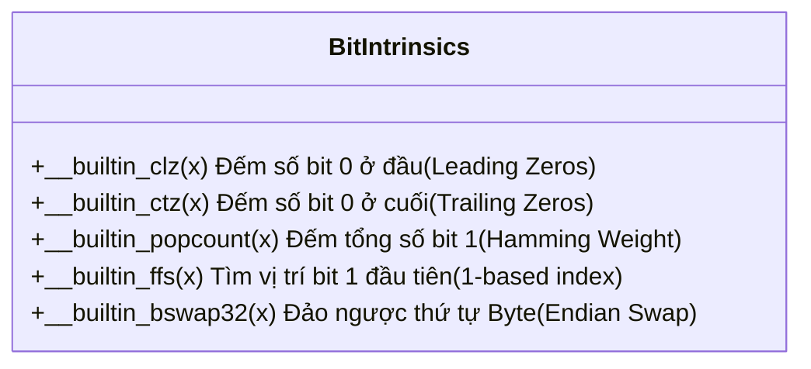

# CHUYÊN ĐỀ 04: COMPILER BUILT-INS & HARDWARE INTRINSICS (`__builtin_...`)

> Thuộc bộ cẩm nang: [[00_C_Cpp_Mastery_Index|C/C++ Mastery Handbook]]  
> Tham khảo: GNU GCC Built-in Functions Manual, Linux Kernel Source Code & SEI CERT C Coding Standard.

---

## 1. Compiler Built-ins Là Gì? Tại Sao Cần Dùng?

Khi bạn gọi một hàm trong thư viện chuẩn như `memcpy()`, `abs()`, hoặc thực hiện các thuật toán đếm bit bằng vòng lặp, CPU thường phải thực hiện nhiều bước: nhảy vào hàm, tốn chi phí Stack Frame, và thực thi hàng chục câu lệnh cơ bản.

**Compiler Built-ins (Hàm nội tại)** là các hàm được viết sẵn trực tiếp bên trong nhân của trình biên dịch GCC / Clang:
1. **Không tốn chi phí gọi hàm (Zero Overhead):** Compiler thay thế trực tiếp hàm nội tại bằng một hoặc vài lệnh hợp ngữ Assembly tối ưu nhất của vi xử lý mục tiêu (Target Architecture).
2. **Khai phá sức mạnh tập lệnh đặc thù của CPU:** Gọi trực tiếp các lệnh phần cứng đặc biệt như đếm bit, đảo byte endianness, nhân cộng dồn DSP, kiểm tra cờ tràn số (Overflow Flag).

---

## 2. Tối Ưu Hóa Phân Nhánh: `__builtin_expect` & Cặp Macro Huyền Thoại `likely()` / `unlikely()`

### 2.1. Bản chất đường ống lệnh (Instruction Pipeline) & Branch Prediction
Bộ xử lý hiện đại (ARM Cortex, x86) nạp trước hàng loạt lệnh vào đường ống (Pipeline) để thực thi siêu tốc. Khi gặp câu lệnh rẽ nhánh `if-else`:
- Nếu CPU đoán đúng: Quá trình thực thi diễn ra liên tục, tốc độ tối đa.
- Nếu CPU đoán sai (Branch Misprediction): Toàn bộ pipeline bị xóa sạch (Pipeline Flush), CPU bị nghẽn (Stall) mất từ 10 đến 20 chu kỳ xung nhịp để nạp lại lệnh từ bộ nhớ!

### 2.2. Giải pháp `__builtin_expect(long exp, long c)`
Hàm này gợi ý cho trình biên dịch: *"Biểu thức `exp` gần như chắc chắn sẽ có giá trị bằng hằng số `c`"*.
Từ đó, Compiler sắp xếp mã máy Assembly sao cho nhánh có xác suất cao nằm thẳng hàng tiếp theo trong bộ nhớ Cache Line, còn nhánh ít xảy ra được đẩy ra xa.

### 2.3. Cặp Macro Kinh Điển Của Linux Kernel
```c
// Báo cho CPU biết: Điều kiện x RẤT CÓ THỂ LÀ ĐÚNG (x == 1)
#define likely(x)       __builtin_expect(!!(x), 1)

// Báo cho CPU biết: Điều kiện x RẤT HIẾM KHI XẢY RA (x == 0)
#define unlikely(x)     __builtin_expect(!!(x), 0)
```
*(Ghi chú: Cú pháp `!!(x)` dùng để chuẩn hóa mọi giá trị khác 0 về chính xác số nguyên 1).*

**Ứng dụng thực tế trong Firmware / Driver:**
```c
int send_packet(uint8_t *buffer, size_t len) {
    // Trường hợp buffer bị NULL là cực kỳ hiếm gặp (chỉ khi có lỗi hệ thống)
    if (unlikely(buffer == NULL || len == 0)) {
        log_error("Invalid packet pointer!");
        return -EINVAL; // Nhánh này được đẩy sang một vị trí phụ trong Flash
    }

    // Luồng xử lý chính: Đường ống CPU chạy thẳng băng không bị rẽ nhánh!
    DMA_Transmit(buffer, len);
    return 0;
}
```

---

## 3. Thao Tác Bit Cực Tốc (Bit Manipulation Intrinsics)

Trong các bài toán viễn thông, nén dữ liệu, mã hóa và hệ điều hành thời gian thực (RTOS Scheduler), các thao tác tìm bit thường là nút thắt cổ chai hiệu năng nếu dùng vòng lặp `for`. GCC cung cấp các hàm nội tại ánh xạ trực tiếp về 1 lệnh Assembly của CPU:



### 3.1. `__builtin_clz(x)` — Count Leading Zeros
- **Mã máy tương đương:** Trên ARM, ánh xạ thẳng vào lệnh `CLZ` (1 chu kỳ xung nhịp).
- **Ứng dụng tối thượng trong RTOS Task Scheduler:**
  Để tìm Task có độ ưu tiên cao nhất đang ở trạng thái Ready trong 32 mức ưu tiên, FreeRTOS sử dụng một biến bitmap `ReadyPriorityBitmap`:
  ```c
  // Tính độ ưu tiên cao nhất trong 1 chu kỳ máy mà không cần duyệt mảng!
  uint32_t highest_prio = 31 - __builtin_clz(ReadyPriorityBitmap);
  ```
- **Ứng dụng tính $\lfloor\log_2(x)\rfloor$:**
  ```c
  uint32_t fast_log2(uint32_t x) {
      return 31 - __builtin_clz(x);
  }
  ```

### 3.2. `__builtin_ctz(x)` — Count Trailing Zeros
- Đếm số lượng bit 0 tính từ bit thấp nhất (LSB) lên.
- **Ứng dụng:** Quét tìm kênh ngắt ngoại vi nào đang kích hoạt trong thanh ghi cờ ngắt Pending Register.

> [!CAUTION]
> **Cạm bẫy Undefined Behavior:**
> Nếu `x == 0`, kết quả của `__builtin_clz(0)` và `__builtin_ctz(0)` là **HÀNH VI BẤT ĐỊNH (Undefined Behavior)** trên đa số CPU! Bắt buộc phải kiểm tra `if (x != 0)` trước khi gọi hoặc dùng hàm phiên bản an toàn `__builtin_clzg(x, fallback)` trong các compiler mới.

### 3.3. `__builtin_popcount(x)` — Đếm Số Lượng Bit 1
- Đếm tổng số bit 1 trong một số nguyên (Population Count / Hamming Weight).
- Ứng dụng: Tính toán mã sửa lỗi (ECC / Parity Check), thuật toán mật mã học, đếm số lượng cảm biến đang bật trên xe ô tô.

### 3.4. `__builtin_bswap16`, `__builtin_bswap32`, `__builtin_bswap64` — Đảo Ngược Byte
- Chuyển đổi giữa Little-Endian và Big-Endian (Network Byte Order).
- Trên ARM Cortex-M, hàm này được biên dịch thành duy nhất một lệnh `REV` hoặc `REV16`. Nhanh hơn gấp 10 lần việc tự dịch bit thủ công `((x << 24) | ...)`!

---

## 4. Kiểm Tra Lúc Biên Dịch (Compile-time Type & Constant Checks)

### 4.1. `__builtin_types_compatible_p(type1, type2)`
- Trả về `1` nếu hai kiểu dữ liệu hoàn toàn tương thích (bỏ qua `const`/`volatile`), ngược lại trả về `0`.
- Là nền tảng để viết các Macro kiểm tra an toàn kiểu dữ liệu trong C (trước khi có C11 `_Generic`).

### 4.2. `__builtin_constant_p(expr)`
- Trả về `1` nếu biểu thức `expr` có thể tính toán thành một **hằng số cố định lúc biên dịch**, ngược lại trả về `0` (phải tính lúc runtime).
- **Ứng dụng thiết kế Driver thông minh:**
  ```c
  #define delay_us(t) do { \
      if (__builtin_constant_p(t) && (t) <= 10) { \
          /* Nếu thời gian là hằng số cực nhỏ, chèn chuỗi lệnh NOP */ \
          __asm__ volatile ("nop; nop; nop;"); \
      } else { \
          /* Nếu là biến số hoặc thời gian dài, gọi hàm đếm Timer */ \
          timer_busy_wait_us(t); \
      } \
  } while (0)
  ```

---

## 5. Phát Hiện Tràn Số An Toàn Tuyệt Đối (Checked Arithmetic - SEI CERT C)

### 5.1. Cạm bẫy chết người khi kiểm tra tràn số thủ công
Hãy xem đoạn code quen thuộc sau:
```c
int a = ...;
int b = ...;
if (a + b < a) { // KIỂM TRA TRÀN SỐ?
    handle_overflow_error();
}
```
> [!CAUTION]
> **Đây là một trong những nguyên nhân gây lỗ hổng bảo mật nghiêm trọng nhất thế giới!**
> Theo chuẩn ISO C, **tràn số nguyên có dấu (Signed Integer Overflow) là Undefined Behavior (UB)**.
> Trình biên dịch hiện đại được phép suy luận rằng: *"Theo toán học, $a + b$ luôn lớn hơn $a$ khi $b > 0$. Do đó điều kiện $(a + b < a)$ không bao giờ xảy ra!"*
> Kết quả: **Trình biên dịch âm thầm XÓA BỎ HOÀN TOÀN khối lệnh kiểm tra `if` của bạn khi bật `-O2`!** Kẻ tấn công có thể dễ dàng khai thác lỗi Buffer Overflow.

### 5.2. Giải pháp chuẩn mực: `__builtin_add_overflow` (Có từ GCC 5 và Clang 3.8)
Cung cấp các hàm kiểm tra tràn số học trực tiếp từ cờ tràn số (Overflow Flag `V` hoặc Carry Flag `C`) của CPU:
- `bool __builtin_add_overflow (type1 a, type2 b, type3 *res)`
- `bool __builtin_sub_overflow (type1 a, type2 b, type3 *res)`
- `bool __builtin_mul_overflow (type1 a, type2 b, type3 *res)`

**Cách dùng đúng:**
```c
int32_t a = 2000000000;
int32_t b = 1000000000;
int32_t result;

if (__builtin_add_overflow(a, b, &result)) {
    // Bắt chính xác lỗi tràn số mà không bị compiler xóa bỏ!
    printf("CANH BAO: Phep cong bi tran so nguyen!\n");
} else {
    printf("Ket qua hop le: %d\n", result);
}
```

---

## 6. Điều Khiển Luồng Thực Thi Tuyệt Đối

1. **`__builtin_unreachable()`**:
   - Báo cho bộ tối ưu hóa biết: *"Nhánh này không bao giờ có thể xảy ra trong thực tế"*.
   - Cho phép compiler loại bỏ các câu lệnh kiểm tra thừa, thu nhỏ kích thước file binary tối đa.
   - *Cảnh báo:* Nếu vì lỗi phần cứng hoặc logic mà code nhảy vào đây, chương trình sẽ rơi vào trạng thái Undefined Behavior khó lường nhất.
2. **`__builtin_trap()`**:
   - Chèn ngay một lệnh bất hợp pháp (Illegal Instruction / Trap instruction) làm CPU lập tức crash crash và dừng chương trình. Dùng khi phát hiện vi phạm bảo mật hoặc tràn ngăn xếp (Stack Smashing).
