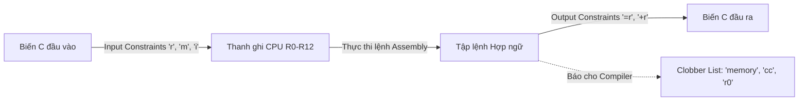
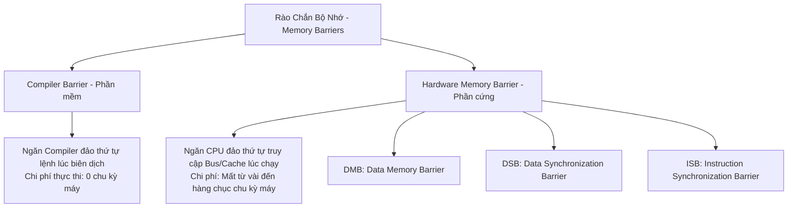

# CHUYÊN ĐỀ 05: INLINE ASSEMBLY & RÀO CHẮN BỘ NHỚ (MEMORY BARRIERS)

> Thuộc bộ cẩm nang: [[00_C_Cpp_Mastery_Index|C/C++ Mastery Handbook]]  
> Tham khảo: GNU Assembler Manual, ARM Cortex-M Programming Guide & Linux Kernel Memory Barriers (`Documentation/memory-barriers.txt`).

---

## 1. Bản Chất Của GCC Extended Inline Assembly

Trong lập trình nhúng và hệ điều hành, có những thao tác phần cứng mà ngôn ngữ C thuần **không thể biểu diễn được**:
- Thao tác trực tiếp với các thanh ghi đặc biệt của CPU (như thanh ghi trạng thái `APSR`, thanh ghi con trỏ ngăn xếp `MSP`/`PSP`, thanh ghi điều khiển ngắt `PRIMASK`/`BASEPRI`).
- Thực thi các tập lệnh đặc biệt: `WFI` (Wait For Interrupt - chuyển CPU vào chế độ ngủ tiết kiệm điện), `NOP` (No Operation), `CPSID`/`CPSIE` (Bật/Tắt ngắt toàn cục).
- Viết các đoạn mã yêu cầu tính toán chính xác tuyệt đối từng chu kỳ xung nhịp (Clock-cycle deterministic code).

GCC cung cấp cú pháp **Extended Inline Assembly**:
```c
__asm__ __volatile__ (
    "Assembler Template"    // Chuỗi lệnh Assembly
    : Output Operands       // Danh sách tham số đầu ra (ghi vào biến C)
    : Input Operands        // Danh sách tham số đầu vào (đọc từ biến C)
    : Clobbers              // Danh sách thanh ghi / bộ nhớ bị thay đổi
);
```



---

## 2. Giải Mã Cú Pháp & Các Ràng Buộc (Constraints) Cốt Tử

### 2.1. Ý nghĩa của từ khóa `__volatile__` trong Assembly
Nếu không có `__volatile__`, trình biên dịch có quyền:
- **Xóa bỏ đoạn ASM** nếu nó thấy không có biến đầu ra (Output) nào được sử dụng sau đó (Dead code elimination).
- **Di chuyển vị trí đoạn ASM** ra ngoài vòng lặp nếu nó cho rằng đoạn ASM đó không phụ thuộc vào dữ liệu trong vòng lặp.
> **Quy tắc vàng:** Trong Embedded và Kernel, luôn luôn dùng `__asm__ __volatile__` để ép compiler giữ nguyên vị trí và số lần thực thi của đoạn mã hợp ngữ!

### 2.2. Bảng Ký Tự Ràng Buộc (Constraint Characters) Thường Gặp

| Ký tự | Tên gọi | Ý nghĩa đối với Trình biên dịch |
| :--- | :--- | :--- |
| `"r"` | Register | Yêu cầu compiler nạp biến C vào một thanh ghi đa năng khả dụng bất kỳ của CPU. |
| `"=r"` | Write-only | Ghi kết quả từ thanh ghi CPU vào biến C này. Giá trị cũ của biến bị ghi đè. |
| `"+r"` | Read-Write | Vừa đọc giá trị ban đầu của biến vào thanh ghi, vừa ghi kết quả mới trở lại biến sau khi ASM chạy xong. |
| `"m"` | Memory | Không nạp vào thanh ghi CPU mà trỏ thẳng tới địa chỉ ô nhớ RAM của biến (tiết kiệm thanh ghi). |
| `"i"` | Immediate | Giá trị là một hằng số nguyên trực tiếp (không tốn thanh ghi). |

### 2.3. Danh sách Clobber List — Bảo Vệ Toàn Vẹn Hệ Thống
Clobber list báo cho compiler biết những tài nguyên nào đã bị đoạn mã Assembly làm biến đổi mà compiler không biết:
- `"cc"`: Đoạn code có làm thay đổi các cờ điều kiện trạng thái của CPU (Zero, Carry, Negative, Overflow flags).
- `"r0"`, `"r1"`, `"lr"`: Tên các thanh ghi cụ thể bị đoạn code ghi đè.
- **`"memory"` (Tối quan trọng):** Báo cho compiler biết đoạn ASM này có thể đọc hoặc ghi vào **bất kỳ ô nhớ nào trong RAM**!

---

## 3. Mổ Xẻ Hai Bản Thể: Compiler Barrier vs Hardware Memory Barrier

Đây là một trong những chủ đề phân loại kỹ sư hệ thống giỏi và kỹ sư thông thường. Khi lập trình đa luồng (SMP), giao tiếp DMA hoặc lập trình vi điều khiển hiệu năng cao (ARM Cortex-M7/Cortex-A):



---

### 3.1. Compiler Memory Barrier (Rào Chắn Cấp Trình Biên Dịch)

```c
// Cú pháp chuẩn Compiler Barrier trong GCC/Clang:
#define COMPILER_BARRIER() __asm__ __volatile__("" ::: "memory")
```
- **Cách thức hoạt động:** Đoạn ASM này **hoàn toàn rỗng `""`** (không hề sinh ra bất kỳ một lệnh máy nào cho CPU, **tốn đúng 0 chu kỳ xung nhịp**).
- **Tuy nhiên, sự kỳ diệu nằm ở `::: "memory"`:**
  1. Ép trình biên dịch phải xả (flush) toàn bộ các giá trị đang tạm lưu trong thanh ghi CPU ghi trở lại vào RAM trước rào chắn.
  2. Vô hiệu hóa toàn bộ các bản sao bộ nhớ đang lưu trong thanh ghi; sau rào chắn, nếu cần đọc biến nào, compiler bắt buộc phải nạp lại từ RAM.
  3. Cấm tuyệt đối compiler tự ý tráo đổi vị trí các dòng lệnh đọc/ghi bộ nhớ từ trước rào chắn ra sau rào chắn và ngược lại.

---

### 3.2. Hardware Memory Barrier (Rào Chắn Cấp Kiến Trúc Phần Cứng CPU)

Các CPU hiện đại (như ARMv7-M, ARMv7-A, ARMv8-A) sở hữu cơ chế thực thi lệnh không theo thứ tự (**Out-of-Order Execution**), bộ đệm ghi (**Store Buffer / Write Buffer**), và các đường ống truyền dữ liệu song song đa cấp.
> Dù trình biên dịch sinh mã lệnh đúng thứ tự, **bản thân phần cứng CPU vẫn có thể đảo lộn thứ tự ghi dữ liệu ra bus phần cứng**!

Kiến trúc ARM định nghĩa 3 lệnh rào chắn phần cứng chuyên biệt:

#### 1. `DMB` (Data Memory Barrier)
- Đảm bảo rằng **mọi thao tác truy cập dữ liệu bộ nhớ (Load/Store) nằm trước lệnh DMB phải được hoàn tất** trước khi bất kỳ thao tác truy cập bộ nhớ nào nằm sau lệnh DMB được thực hiện.
- **Ứng dụng:** Cực kỳ quan trọng khi lập trình chia sẻ dữ liệu giữa 2 Core CPU hoặc giữa CPU và khối DMA:
  ```c
  // Chuẩn bị dữ liệu cho DMA
  dma_buffer[0] = data1;
  dma_buffer[1] = data2;

  // Rào chắn phần cứng: Đảm bảo dữ liệu đã vào RAM trước khi DMA chạy!
  __asm__ volatile ("dmb" ::: "memory");

  // Kích hoạt DMA
  DMA1_Channel1->CCR |= DMA_CCR_EN;
  ```

#### 2. `DSB` (Data Synchronization Barrier)
- Mạnh hơn `DMB`. CPU sẽ **dừng hoàn toàn việc thực thi bất kỳ lệnh nào tiếp theo** cho đến khi tất cả các giao dịch bộ nhớ và bus trước đó hoàn tất 100%.
- **Ứng dụng:** Bắt buộc phải dùng khi cấu hình các thanh ghi hệ thống hoặc chuyển đổi ngữ cảnh ngắt:
  ```c
  // Tắt ngắt ngoại vi
  NVIC_DisableIRQ(USART1_IRQn);
  
  // Đảm bảo lệnh tắt ngắt đã có hiệu lực trên Bus ngoại vi trước khi code chạy tiếp!
  __asm__ volatile ("dsb" ::: "memory");
  ```

#### 3. `ISB` (Instruction Synchronization Barrier)
- Xóa sạch toàn bộ đường ống lệnh (Flush Pipeline) của CPU và nạp lại các lệnh từ bộ nhớ/Cache.
- **Ứng dụng:**
  - Sau khi cấu hình lại bảng phân quyền bộ nhớ phần cứng (MPU - Memory Protection Unit).
  - Sau khi nạp firmware mới (Self-modifying code / Bootloader) vào Flash/RAM.

---

## 4. Các Ví Dụ Kinh Điển Trong Lập Trình Nhúng

### 4.1. Tắt / Bật Ngắt Toàn Cục An Toàn (Critical Section)
```c
// Hàm tắt ngắt toàn cục và lưu lại trạng thái cũ
static inline uint32_t enter_critical_section(void) {
    uint32_t primask;
    __asm__ __volatile__ (
        "mrs %0, primask \n\t" // Đọc thanh ghi cờ ngắt PRIMASK vào biến primask
        "cpsid i         \n\t" // Tắt ngắt (Change Processor State Interrupt Disable)
        : "=r" (primask)
        :
        : "memory"
    );
    return primask;
}

// Hàm phục hồi trạng thái ngắt cũ
static inline void exit_critical_section(uint32_t primask) {
    __asm__ __volatile__ (
        "msr primask, %0 \n\t" // Phục hồi lại giá trị cũ của PRIMASK
        :
        : "r" (primask)
        : "memory"
    );
}
```

### 4.2. Thao Tác Khóa Nguyên Tử Bằng Phần Cứng (LDREX / STREX)
Thay vì tắt ngắt (làm tăng độ trễ ngắt Interrupt Latency), các chip ARM Cortex hỗ trợ cặp lệnh Load-Exclusive (`LDREX`) và Store-Exclusive (`STREX`) để thực hiện các thao tác nguyên tử (Atomic Operations) chuẩn phần cứng:
```c
static inline uint32_t atomic_add(volatile uint32_t *addr, uint32_t val) {
    uint32_t result, temp;
    __asm__ __volatile__ (
        "1: ldrex   %0, [%2]        \n\t" // Đọc độc quyền ô nhớ
        "   add     %0, %0, %3      \n\t" // Cộng giá trị
        "   strex   %1, %0, [%2]    \n\t" // Ghi thử lại ô nhớ; temp = 0 nếu thành công
        "   cmp     %1, #0          \n\t"
        "   bne     1b              \n\t" // Nếu xung đột, thử lại từ đầu
        : "=&r" (result), "=&r" (temp)
        : "r" (addr), "r" (val)
        : "cc", "memory"
    );
    return result;
}
```
*(Đây chính là cơ chế cơ bản cấu thành nên thư viện `<stdatomic.h>` và các Mutex không khóa của RTOS).*
