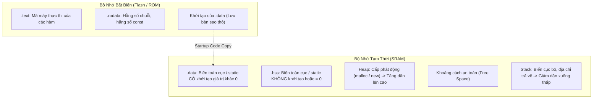
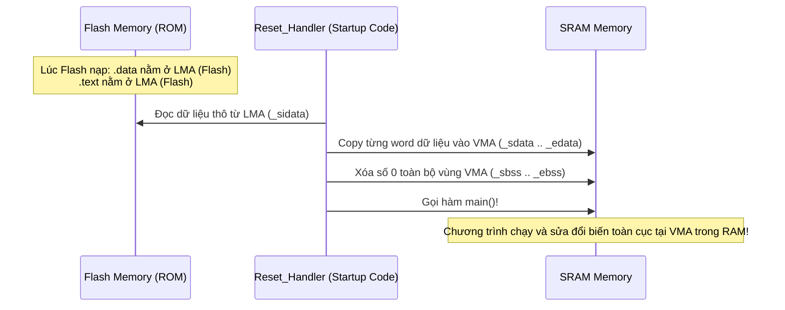

# CHUYÊN ĐỀ 06: BẢN ĐỒ BỘ NHỚ, VMA/LMA & LINKER SCRIPT TRONG LẬP TRÌNH NHÚNG

> Thuộc bộ cẩm nang: [[00_C_Cpp_Mastery_Index|C/C++ Mastery Handbook]]  
> Kế thừa và mở rộng trực tiếp từ: [`thinh1210/C_programming - Lesson 2: MemoryLayout & Linker`](https://github.com/thinh1210/C_programming)

---

## 1. Toàn Cảnh Bản Đồ Bộ Nhớ (Memory Segments)

Khi một chương trình C/C++ được biên dịch và nạp vào hệ thống nhúng (Microcontroller / SoC), bộ nhớ được phân chia thành 6 phân vùng cốt lõi:



---

## 2. Chi Tiết Các Phân Vùng Bộ Nhớ

### 2.1. Phân vùng `.text` (Code Segment)
- **Vị trí vật lý:** Nằm hoàn toàn trong bộ nhớ Flash/ROM.
- **Thuộc tính:** Chỉ đọc (Read-Only) và có thể thực thi (Executable).
- **Chứa:** Mã máy Assembly của tất cả các hàm trong chương trình, bảng vector ngắt (Interrupt Vector Table).
- **Lưu ý:** CPU đọc lệnh trực tiếp từ Flash thông qua cơ chế XIP (Execute In Place).

### 2.2. Phân vùng `.rodata` (Read-Only Data)
- **Vị trí vật lý:** Flash/ROM.
- **Thuộc tính:** Chỉ đọc.
- **Chứa:**
  - Hằng số chuỗi: `"Hello World\n"`.
  - Các biến toàn cục được khai báo `const`.
  - Bảng tra cứu dữ liệu (Lookup Tables) tĩnh.

### 2.3. Phân vùng `.data` (Initialized Data)
- **Vị trí vật lý:** Chiếm dung lượng ở **CẢ HAI NƠI**: Flash (chứa giá trị khởi tạo ban đầu) và RAM (chứa vùng nhớ làm việc lúc chạy).
- **Chứa:** Biến toàn cục (Global) và biến tĩnh (Static) có gán giá trị ban đầu khác `0`.
  ```c
  int g_counter = 42;          // Nằm trong .data
  static int s_flag = 0xAA;     // Nằm trong .data
  ```
- **Thực nghiệm (Từ repo `thinh1210/C_programming`):**
  Nếu bạn khai báo một mảng lớn có khởi tạo: `int arr[1000] = {1, 2, 3};`, file nhị phân `.bin` hoặc `.hex` nạp vào Flash **sẽ phình to thêm đúng 4000 bytes**!

### 2.4. Phân vùng `.bss` (Block Started by Symbol)
- **Vị trí vật lý:** **CHỈ CHIẾM DUNG LƯỢNG TRONG RAM**, KHÔNG tốn một byte nào trong file nhị phân Flash!
- **Chứa:** Biến toàn cục và biến tĩnh **không khởi tạo** hoặc được **khởi tạo bằng `0`**.
  ```c
  int g_buffer[1024];           // Nằm trong .bss (Tốn 4KB RAM, tốn 0 byte Flash)
  static int s_state = 0;       // Nằm trong .bss
  ```
- **Tại sao lại tiết kiệm Flash?** File thực thi ELF chỉ cần lưu đúng 2 thông tin: *"Bắt đầu vùng .bss ở địa chỉ nào"* và *"Kích thước .bss là bao nhiêu bytes"*. Khi khởi động chip, code khởi động (Startup Code) sẽ dùng vòng lặp ghi đè số `0` lên toàn bộ vùng này trong RAM!

### 2.5. Phân vùng Ngăn Xếp (Stack) & Vùng Đống (Heap)

| Đặc tính | Phân vùng Stack (Ngăn xếp) | Phân vùng Heap (Vùng đống) |
| :--- | :--- | :--- |
| **Quản lý** | Tự động hoàn toàn bởi CPU (thanh ghi SP). | Lập trình viên tự quản lý qua `malloc/free` hoặc `new/delete`. |
| **Chiều tăng trưởng** | Tăng trưởng **từ địa chỉ cao xuống địa chỉ thấp** (trên đa số chip ARM/x86). | Tăng trưởng **từ địa chỉ thấp lên địa chỉ cao**. |
| **Chứa gì?** | Biến cục bộ hàm, tham số truyền vào hàm, địa chỉ trả về (LR - Link Register), Context khi xảy ra ngắt. | Dữ liệu cấp phát động có kích thước thay đổi lúc chạy. |
| **Tốc độ** | Cực nhanh (chỉ cần trừ thanh ghi Stack Pointer). | Chậm (phải duyệt tìm block trống trong bộ nhớ). |
| **Mối nguy** | **Stack Overflow:** Gọi đệ quy vô tận hoặc khai báo mảng cục bộ quá lớn `char buf[2048];` làm tràn Stack đè vào Heap/Data gây HardFault! | **Memory Leak** và **Phân mảnh bộ nhớ (Heap Fragmentation)**: Trong hệ thống nhúng chạy 24/7, phân mảnh heap sẽ làm `malloc` thất bại dù tổng RAM còn trống! |

---

## 3. Khái Niệm Cốt Tử: VMA (Virtual/Execution Address) vs LMA (Load Memory Address)

Một trong những khác biệt lớn nhất giữa lập trình ứng dụng máy tính (Linux App) và lập trình vi điều khiển bare-metal là khái niệm **VMA** và **LMA**:

- **LMA (Load Memory Address):** Địa chỉ mà dữ liệu được nạp vào lúc ghi Flash (Burn/Flash Firmware). Khi chip mất điện, dữ liệu nằm ở đây.
- **VMA (Virtual / Run-time Memory Address):** Địa chỉ ô nhớ mà CPU **thực tế truy cập và xử lý** khi chương trình đang chạy.



- Đối với `.text`: VMA = LMA (đều nằm trong Flash, CPU đọc trực tiếp từ Flash).
- Đối với `.data`: 
  - **LMA nằm trong Flash** (để giữ nguyên giá trị khởi tạo khi tắt nguồn).
  - **VMA nằm trong RAM** (vì biến toàn cục cần phải được ghi đè, sửa đổi giá trị lúc chạy).

---

## 4. Giải Phẫu Linker Script (`.ld`) Chuẩn Nhúng

Linker Script là bản thiết kế tối thượng quy định cách Linker sắp xếp các Object Files (`.o`) vào bộ nhớ vật lý của chip:

```ld
/* Định nghĩa vùng nhớ vật lý của chip STM32F4 */
MEMORY
{
    FLASH (rx)  : ORIGIN = 0x08000000, LENGTH = 512K
    RAM   (rwx) : ORIGIN = 0x20000000, LENGTH = 128K
}

SECTIONS
{
    /* 1. Đặt Vector Table và mã máy vào Flash */
    .text :
    {
        . = ALIGN(4);
        KEEP(*(.isr_vector))  /* Giữ lại bảng ngắt, cấm linker xóa */
        *(.text)              /* Toàn bộ code .text của các file .c */
        *(.text*)
        *(.rodata)            /* Toàn bộ hằng số .rodata */
        *(.rodata*)
        . = ALIGN(4);
        _etext = .;           /* Đánh dấu điểm kết thúc của code */
    } > FLASH

    /* 2. Điểm xuất phát của dữ liệu .data nằm trong Flash (LMA) */
    _sidata = LOADADDR(.data);

    /* 3. Phân vùng .data: Thực thi ở RAM nhưng nạp từ Flash */
    .data :
    {
        . = ALIGN(4);
        _sdata = .;           /* VMA bắt đầu của .data trong RAM */
        *(.data)
        *(.data*)
        . = ALIGN(4);
        _edata = .;           /* VMA kết thúc của .data trong RAM */
    } > RAM AT> FLASH         /* VMA ở RAM, LMA ở FLASH! */

    /* 4. Phân vùng .bss: Chỉ nằm trong RAM */
    .bss :
    {
        . = ALIGN(4);
        _sbss = .;            /* Điểm bắt đầu .bss trong RAM */
        *(.bss)
        *(.bss*)
        *(COMMON)
        . = ALIGN(4);
        _ebss = .;            /* Điểm kết thúc .bss trong RAM */
    } > RAM

    /* Đỉnh của Stack nằm ở cuối bộ nhớ RAM */
    _estack = ORIGIN(RAM) + LENGTH(RAM);
}
```

---

## 5. Bí Mật Sống Còn Của Linker Symbols Trong Mã C

Hãy quan sát đoạn mã khởi động (Startup Code) kinh điển sau được viết bằng C:

```c
// Khai báo các ký hiệu từ Linker Script
extern uint32_t _sidata; // Địa chỉ bắt đầu của .data trong FLASH (LMA)
extern uint32_t _sdata;  // Địa chỉ bắt đầu của .data trong RAM (VMA)
extern uint32_t _edata;  // Địa chỉ kết thúc của .data trong RAM
extern uint32_t _sbss;   // Địa chỉ bắt đầu của .bss trong RAM
extern uint32_t _ebss;   // Địa chỉ kết thúc của .bss trong RAM

void Reset_Handler(void) {
    // 1. Sao chép phân vùng .data từ Flash sang RAM
    uint32_t *pSrc = &_sidata; // TẠI SAO BẮT BUỘC PHẢI DÙNG DẤU '&' ???
    uint32_t *pDst = &_sdata;

    while (pDst < &_edata) {
        *pDst++ = *pSrc++;
    }

    // 2. Xóa số 0 cho toàn bộ phân vùng .bss trong RAM
    uint32_t *pBss = &_sbss;
    while (pBss < &_ebss) {
        *pBss++ = 0;
    }

    // 3. Khởi tạo Clock và nhảy vào hàm main() của ứng dụng
    SystemInit();
    main();

    // Nếu main kết thúc, rơi vào vòng lặp vô tận
    while (1);
}
```

### Cạm Bẫy Trí Mạng: Tại Sao Bắt Buộc Dùng `&_sdata` Mà Không Được Dùng `_sdata`?
> [!CAUTION]
> **Bản chất của Linker Symbol:**
> Khi bạn khai báo `int x = 10;`, compiler cấp phát một ô nhớ 4 bytes trong RAM chứa giá trị 10. `x` là giá trị (10), còn `&x` là địa chỉ ô nhớ.
> 
> Nhưng **Linker Symbol KHÔNG PHẢI LÀ BIẾN!** Linker Script không hề cấp phát bất kỳ byte bộ nhớ nào cho `_sdata`. `_sdata` chỉ là **MỘT MỤC TỪ ĐIỂN TRONG BẢNG KÝ HIỆU (Symbol Table) ĐẠI DIỆN CHO MỘT ĐỊA CHỈ**!
> 
> Nếu bạn viết `uint32_t *pDst = _sdata;` (không có dấu `&`), CPU sẽ nạp **4 byte dữ liệu đầu tiên nằm tại địa chỉ đó** để làm con trỏ địa chỉ! Kết quả là con trỏ trỏ lung tung gây ra sụp đổ bộ nhớ (HardFault / Segmentation Fault) ngay lập tức!
> 
> **Quy tắc bất biến:** Đối với mọi Symbol được định nghĩa trong file Linker Script, **luôn luôn dùng toán tử lấy địa chỉ `&symbol` trong code C**!
