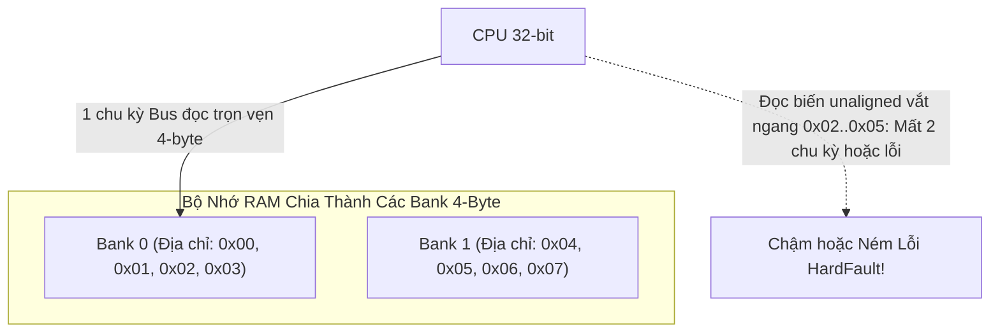
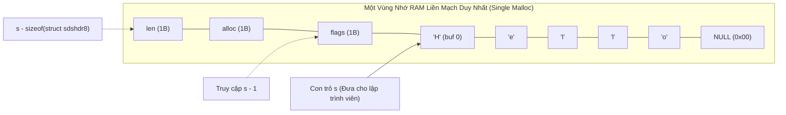

# CHUYÊN ĐỀ 07: STRUCT PADDING, ALIGNMENT & TYPE PUNNING

> Thuộc bộ cẩm nang: [[00_C_Cpp_Mastery_Index|C/C++ Mastery Handbook]]  
> Kế thừa và mở rộng từ: [`thinh1210/C_programming - Lesson 2: Struct, Union & Bitfields`](https://github.com/thinh1210/C_programming)

---

## 1. Bản Chất Căn Chỉnh Dữ Liệu Tự Nhiên (Natural Alignment Rule)

Nhiều lập trình viên mới bắt đầu thường nghĩ bộ nhớ RAM là một chuỗi các byte độc lập có thể đọc bất kỳ byte nào với tốc độ như nhau. 
**Thực tế phần cứng:** Bus dữ liệu giữa CPU và RAM được thiết kế theo kích thước **Word** (32-bit = 4 bytes trên chip 32-bit, 64-bit = 8 bytes trên chip 64-bit).



> **Quy tắc căn chỉnh tự nhiên (Natural Alignment Rule):**
> Một biến có kích thước $K$ bytes **phải được đặt tại địa chỉ bộ nhớ chia hết cho $K$**:
> - `char` (1 byte): Có thể đặt tại bất kỳ địa chỉ nào ($0x00, 0x01, 0x02\dots$).
> - `int16_t` (2 bytes): Phải đặt tại địa chỉ chẵn chia hết cho 2 ($0x00, 0x02, 0x04\dots$).
> - `int32_t`, `float`, con trỏ (4 bytes trên hệ 32-bit): Phải đặt tại địa chỉ chia hết cho 4 ($0x00, 0x04, 0x08\dots$).
> - `int64_t`, `double` (8 bytes): Phải đặt tại địa chỉ chia hết cho 8 ($0x00, 0x08, 0x10\dots$).

---

## 2. Giải Phẫu Cơ Chế Tính Struct Padding

Khi định nghĩa một `struct`, trình biên dịch tự động chèn thêm các byte rác vô hình (gọi là **Padding Bytes**) để thỏa mãn 2 quy tắc nghiêm ngặt:

1. **Quy tắc 1 (Internal Padding):** Mỗi thành viên trong struct phải bắt đầu tại một độ lệch (Offset) chia hết cho yêu cầu căn chỉnh của chính thành viên đó.
2. **Quy tắc 2 (Tail / End Padding):** Tổng kích thước `sizeof` của toàn bộ struct bắt buộc phải là **bội số của thành viên có kích thước lớn nhất** trong struct.
   *(Lý do: Để khi bạn tạo một mảng các struct `struct S arr[10];`, phần tử thứ hai `arr[1]` vẫn thỏa mãn căn chỉnh hoàn hảo cho mọi thành viên bên trong nó).*

### 2.1. So Sánh Hai Cách Sắp Xếp Biến Cùng Dữ Liệu

Hãy xem cấu trúc lưu thông tin cảm biến sau:

#### Cách 1: Sắp xếp lộn xộn (Gây lãng phí bộ nhớ tồi tệ)
```c
struct SensorBad {
    uint8_t  id;        // 1 byte  | Offset 0
    // [Padding 3 bytes để căn chỉnh cho timestamp chia hết cho 4]
    uint32_t timestamp; // 4 bytes | Offset 4
    uint8_t  status;    // 1 byte  | Offset 8
    // [Padding 1 byte để căn chỉnh cho value chia hết cho 2]
    uint16_t value;     // 2 bytes | Offset 10
    uint8_t  checksum;  // 1 byte  | Offset 12
    // [Tail Padding 3 bytes để tổng kích thước chia hết cho 4 (max member là uint32_t)]
};
```
- **Tổng kích thước `sizeof(struct SensorBad)` = 16 bytes!**
- Dữ liệu thực tế: $1 + 4 + 1 + 2 + 1 = 9$ bytes.
- **Lãng phí tới 7 bytes (chiếm gần 44% dung lượng bộ nhớ)!** Nếu có mảng 10,000 phần tử, bạn vừa ném qua cửa sổ 70KB RAM quý giá!

#### Cách 2: Sắp xếp tối ưu (Giảm dần kích thước - Greedy Order)
```c
struct SensorGood {
    uint32_t timestamp; // 4 bytes | Offset 0
    uint16_t value;     // 2 bytes | Offset 4
    uint8_t  id;        // 1 byte  | Offset 6
    uint8_t  status;    // 1 byte  | Offset 7
    uint8_t  checksum;  // 1 byte  | Offset 8
    // [Tail Padding 3 bytes để tổng kích thước chia hết cho 4]
};
```
- **Tổng kích thước `sizeof(struct SensorGood)` = 12 bytes!**
- Tiết kiệm ngay lập tức 25% bộ nhớ mà không cần can thiệp cờ compiler.

---

## 3. Macro `offsetof` & Vũ Khí Tối Thượng `container_of` Của Linux Kernel

### 3.1. Macro chuẩn `offsetof` (trong `<stddef.h>`)
Lấy độ lệch tính bằng byte của một trường so với địa chỉ đầu của struct:
```c
#define offsetof(TYPE, MEMBER) ((size_t)&((TYPE *)0)->MEMBER)
```
*Giải thích:* Giả lập một con trỏ kiểu `TYPE*` trỏ vào địa chỉ `0`. Sau đó lấy địa chỉ của trường `MEMBER`. Vì gốc là 0 nên địa chỉ của trường chính là khoảng cách offset!

### 3.2. Macro `container_of` Trong Linux Kernel
Trong lập trình hướng đối tượng bằng C hoặc cấu trúc dữ liệu Intrusive Linked List của Linux Kernel: Khi bạn chỉ có con trỏ trỏ tới một thành viên nhỏ bên trong struct, làm sao tìm ngược lại con trỏ trỏ tới toàn bộ struct bao ngoài nó?

```c
#define container_of(ptr, type, member) ({                      \
    const typeof( ((type *)0)->member ) *__mptr = (ptr);    \
    (type *)( (char *)__mptr - offsetof(type, member) );})
```

- **Ứng dụng:** Cho phép nhúng một `struct list_head` vào bất kỳ đối tượng nào (Driver, Timer, Network Socket) mà không cần cấp phát thêm node trung gian.

---

## 4. Hiểm Họa Vi Phạm Strict Aliasing Rule & Type Punning

### 4.1. Type Punning Là Gì?
Type Punning là hành vi **truy cập cùng một vùng nhớ vật lý dưới nhiều kiểu dữ liệu khác nhau** (ví dụ: xem các byte thô của một biến `float` dưới dạng số nguyên `uint32_t` để xử lý bit).

### 4.2. Quy Tắc Strict Aliasing Rule
Theo tiêu chuẩn ISO C:
> **Strict Aliasing Rule:** Trình biên dịch được phép giả định rằng **hai con trỏ thuộc hai kiểu dữ liệu khác nhau (không tương thích) KHÔNG BAO GIỜ trỏ vào cùng một vùng nhớ** (ngoại trừ kiểu `char*` hoặc `unsigned char*`).

### 4.3. Bug Tối Ưu Hóa Khét Tiếng Khi Ép Kiểu Con Trỏ Sai
Xét đoạn code sau cố tình ép kiểu con trỏ:
```c
uint32_t swap_float_bits(float *f, uint32_t *u) {
    *f = 3.14f;
    // Vi phạm nghiêm trọng Strict Aliasing Rule:
    uint32_t *p_alias = (uint32_t*)f;
    *p_alias = 0x12345678;
    return *u;
}
```
**Trình biên dịch tối ưu hóa `-O2` sẽ làm gì?**
Vì `f` là con trỏ `float*` và `p_alias` là `uint32_t*`, compiler tin chắc rằng việc ghi vào `*p_alias` không hề ảnh hưởng đến giá trị của `*f`. Compiler có thể tự do đảo thứ tự lệnh, nạp trước giá trị cũ của `*f` vào thanh ghi và bỏ qua lệnh ghi `*p_alias`! Kết quả: Giá trị tính toán ra sai lệch hoàn toàn lúc chạy!

### 4.4. 3 Cách Thực Hiện Type Punning An Toàn Tuyệt Đối

#### Cách 1: Sử dụng `union` (Chuẩn mực trong C99/C11/C23)
Tiêu chuẩn C quy định rõ ràng (Annex J.5.7): Ghi vào một trường của union và đọc ra từ một trường khác là **hoàn toàn hợp lệ và có hành vi xác định trong C** (Defined Behavior).
```c
union FloatUint {
    float f;
    uint32_t u;
};

union FloatUint pun;
pun.f = 3.14f;
uint32_t raw_bits = pun.u; // 100% hợp lệ trong C!
```
*(Lưu ý: Trong chuẩn C++ thuần, hành vi đọc trường khác của union technically là Undefined Behavior, dù GCC/Clang vẫn hỗ trợ như một extension).*

#### Cách 2: Sử dụng `memcpy` (Vua an toàn cho cả C và C++)
```c
float f = 3.14f;
uint32_t raw_bits;
memcpy(&raw_bits, &f, sizeof(float));
```
> [!TIP]
> Bạn lo sợ `memcpy` sẽ làm chậm chương trình?
> **Thực tế:** Mọi trình biên dịch hiện đại (GCC, Clang, MSVC) đều nhận diện được `memcpy` với kích thước cố định nhỏ (4 hoặc 8 bytes). Chúng **triệt tiêu hoàn toàn lệnh gọi hàm `memcpy`** và biên dịch thẳng thành **duy nhất 1 lệnh chuyển thanh ghi CPU (Zero Runtime Cost)**!

#### Cách 3: Ép kiểu qua con trỏ ký tự `uint8_t*` / `char*`
Tiêu chuẩn ISO quy định `char*`, `signed char*`, và `unsigned char*` là ngoại lệ duy nhất được phép Alias bất kỳ vùng nhớ của mọi kiểu dữ liệu.

---

## 5. Bản Chất & Nguy Cơ Của Trường Bit (Bit-Fields)

Bit-fields cho phép chia nhỏ một từ nhớ thành các nhóm bit cụ thể:
```c
struct RegisterCtrl {
    uint32_t enable     : 1;  // Bit 0: Cho phép hoạt động
    uint32_t mode       : 3;  // Bit 1..3: Chế độ hoạt động (0..7)
    uint32_t prescaler  : 4;  // Bit 4..7: Bộ chia tần
    uint32_t reserved   : 24; // Bit còn lại
};
```

### Các Cạm Bẫy Sống Còn Khi Dùng Bit-fields:
1. **Không thể lấy địa chỉ:** Toán tử `&` không thể áp dụng lên trường bit (`&reg.enable` là lỗi biên dịch vì CPU chỉ có thể đánh địa chỉ tới byte, không thể đánh địa chỉ tới từng bit đơn lẻ).
2. **Thứ tự bit phụ thuộc Compiler & Endianness:** Chuẩn C **không quy định** trường bit đầu tiên nằm ở LSB (bit thấp nhất) hay MSB (bit cao nhất). Việc này phụ thuộc hoàn toàn vào ABI của từng compiler. Do đó, dùng bit-fields để ánh xạ trực tiếp gói tin mạng truyền qua mạng khác kiến trúc là cực kỳ nguy hiểm!
3. **Hiểm họa Race Condition trong đa luồng:** Khi một thread ghi vào `reg.enable` và một thread khác ghi vào `reg.mode`, mặc dù hai biến khác nhau, CPU vẫn phải đọc toàn bộ 32-bit word, sửa bit và ghi đè lại. Hai luồng sẽ ghi đè lên nhau gây lỗi dữ liệu bí ẩn!

---

## 6. Mổ Xẻ Mã Nguồn Thực Tế: Nghệ Thuật Sắp Đặt Cấu Trúc Dữ Liệu Trong Linux Kernel & Redis

### 6.1. Redis SDS (Simple Dynamic Strings): Đỉnh Cao Của `__attribute__((packed))` & Flexible Array Member
Trong cơ sở dữ liệu in-memory tốc độ cao **Redis** ([`src/sds.h`](https://github.com/redis/redis/blob/unstable/src/sds.h)), Salvatore Sanfilippo (antirez) đã sáng tạo ra cấu trúc chuỗi động nhanh nhất thế giới.

#### Vấn đề của chuỗi C truyền thống:
- Hàm `strlen(s)` tốn độ phức tạp $O(N)$ vì phải quét tìm ký tự `\0`.
- Nối chuỗi hay bị tràn bộ đệm (Buffer Overflow).
- Không an toàn nhị phân (Binary Safe) vì không lưu được ký tự `\0` nằm giữa dữ liệu.

#### Thiết kế thiên tài của Redis:
Thay vì tạo một con trỏ trỏ tới struct header rồi struct header lại trỏ tới buffer dữ liệu (tốn 2 lần cấp phát `malloc` và gây phân mảnh bộ nhớ), Redis gom toàn bộ vào **một khối bộ nhớ duy nhất liên tục**:

```c
/* Header cho chuỗi có độ dài dưới 256 bytes */
struct __attribute__((__packed__)) sdshdr8 {
    uint8_t len;         /* Số byte thực tế đang dùng (O(1) strlen) */
    uint8_t alloc;       /* Tổng số byte đã cấp phát (trừ header và byte null) */
    unsigned char flags; /* 3 bit thấp là loại SDS (SDS_TYPE_8, 16, 32...), 5 bit cao chưa dùng */
    char buf[];          /* Flexible Array Member - Nằm ngay sát sau flags! */
};
```



#### Tại sao bắt buộc phải dùng `__attribute__((__packed__))`?
1. **Triệt tiêu khoảng trống Padding:** Nếu không có `packed`, compiler sẽ tự động chèn thêm padding bytes vào giữa `flags` và `buf[]` tùy thuộc vào kiến trúc CPU.
2. **Kỹ thuật lùi con trỏ `s[-1]`:** 
   Redis đưa cho lập trình viên con trỏ `s` trỏ thẳng vào `buf[0]`. 
   Nhờ đó, biến `s` **vẫn tương thích 100% với các hàm C chuẩn** như `printf("%s", s);` hoặc `strcat()`.
   Khi Redis cần kiểm tra kiểu chuỗi hoặc độ dài, họ chỉ cần viết:
   ```c
   unsigned char flags = s[-1]; // Đọc ngược lại 1 byte phía trước con trỏ!
   ```
   Nếu có padding, vị trí `s[-1]` sẽ là byte rác! Nhờ `packed`, `flags` luôn luôn nằm chính xác ở vị trí `s[-1]`!

---

### 6.2. Linux Kernel Intrusive Linked List (`struct list_head`)
Hầu hết các sách giáo khoa dạy cấu trúc dữ liệu theo phong cách:
```c
struct Node {
    void *data;          // Con trỏ dữ liệu
    struct Node *next;   // Con trỏ node tiếp theo
    struct Node *prev;
};
```
Cách này bị cộng đồng phát triển Linux Kernel xem là tệ hại vì:
- Mỗi node phải cấp phát 2 lần: `malloc(sizeof(Node))` và `malloc(sizeof(Data))`.
- Dữ liệu bị phân mảnh khắp RAM, gây Cache Miss triền miên.
- Ép kiểu `void*` không an toàn lúc biên dịch.

#### Cuộc Cách Mạng Intrusive List Trong [`include/linux/list.h`](https://elixir.bootlin.com/linux/latest/source/include/linux/list.h):
Thay vì struct bọc ngoài chứa dữ liệu, Linux Kernel **nhúng thẳng cấu trúc liên kết vào bên trong đối tượng**:

```c
struct list_head {
    struct list_head *next, *prev;
};

// Cấu trúc đối tượng nghiệp vụ (Ví dụ: Thiết bị mạng hoặc Nhiệm vụ tiến trình)
struct task_struct {
    int pid;
    char comm[16];
    struct list_head task_list; // Nhúng list_head vào đây!
    struct list_head run_list;  // Có thể cùng lúc nằm trong nhiều danh sách khác nhau!
};
```

#### Kết hợp với `container_of` để duyệt danh sách siêu tốc:
```c
#define list_entry(ptr, type, member) \
    container_of(ptr, type, member)

#define list_for_each_entry(pos, head, member) \
    for (pos = list_entry((head)->next, typeof(*pos), member); \
         &pos->member != (head); \
         pos = list_entry(pos->member.next, typeof(*pos), member))
```
- Không tốn một byte bộ nhớ phụ nào cho việc quản lý danh sách.
- 0 lần gọi `malloc` trung gian.
- Dữ liệu nằm trọn vẹn trong một khối nhớ duy nhất, tối ưu hóa tối đa CPU L1/L2 Data Cache.

