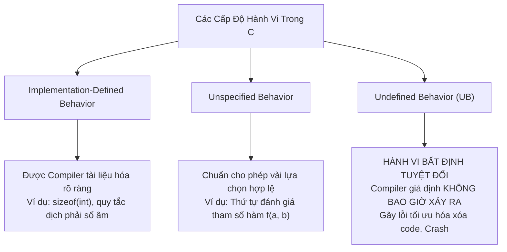
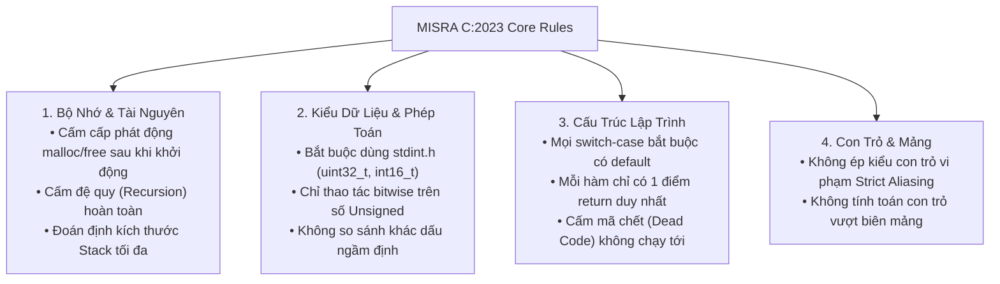

# CHUYÊN ĐỀ 08: HÀNH VI BẤT ĐỊNH (UNDEFINED BEHAVIOR) & QUY CHUẨN AN TOÀN MISRA-C / SEI CERT

> Thuộc bộ cẩm nang: [[00_C_Cpp_Mastery_Index|C/C++ Mastery Handbook]]  
> Tham khảo: ISO/IEC 9899 Annex J, MISRA C:2023 Guidelines, SEI CERT C Coding Standard.

---

## 1. Phân Biệt 3 Cấp Độ Hành Vi Trong Tiêu Chuẩn C

Để hiểu sâu về C, lập trình viên bắt buộc phải phân biệt được 3 khái niệm pháp lý trong văn bản tiêu chuẩn ISO C:



1. **Implementation-Defined Behavior (Hành vi do trình biên dịch quy định):** Chuẩn C cho phép mỗi trình biên dịch tự chọn cách xử lý nhưng **bắt buộc phải ghi rõ trong tài liệu hướng dẫn**. (Ví dụ: `char` mặc định là có dấu hay không dấu; phép dịch phải số nguyên âm có giữ lại bit dấu hay không).
2. **Unspecified Behavior (Hành vi không chỉ định cụ thể):** Chuẩn C đưa ra danh sách các khả năng hợp lệ và compiler có quyền chọn bất kỳ cách nào mà không cần giải thích. (Ví dụ: Thứ tự tính toán các tham số khi truyền vào hàm `printf("%d %d", f(), g());` - chuẩn không quy định `f()` chạy trước hay `g()` chạy trước!).
3. **Undefined Behavior (Hành vi bất định - UB):** **CƠN ÁC MỘNG LỚN NHẤT CỦA LẬP TRÌNH VIÊN C/C++**. Tiêu chuẩn ISO không áp đặt bất kỳ yêu cầu nào; chương trình có thể chạy bình thường, có thể crash, hoặc tệ nhất là **trình biên dịch âm thầm xóa bỏ hoàn toàn đoạn mã kiểm tra lỗi của bạn**!

---

## 2. Top 10 Cạm Bẫy Undefined Behavior Chết Người Nhất

### 2.1. Cạm bẫy Ép Kiểu Ngầm Định (Integer Promotion & Signed/Unsigned Comparison)
Hãy xem biểu thức logic đơn giản sau:
```c
int s = -1;
unsigned int u = 1;

if (s < u) {
    printf("-1 nho hon 1: DUNG!");
} else {
    printf("-1 lon hon 1: SAI!");
}
```
> **Kết quả gây sốc:** Màn hình in ra **"-1 lon hon 1: SAI!"**
> 
> **Giải mã:** Trong C, khi so sánh giữa một số nguyên có dấu (`int`) và một số nguyên không dấu (`unsigned int`) có cùng kích thước (cùng 32-bit):
> Theo luật **Usual Arithmetic Conversions**, số có dấu `s` bị ép kiểu ngầm định thành `unsigned int`.
> Giá trị bit `-1` dạng bù hai (`0xFFFFFFFF`) khi chuyển sang số unsigned sẽ trở thành **4,294,967,295**!
> Biểu thức trở thành: `4294967295 < 1` -> **KẾT QUẢ LÀ FALSE**!

### 2.2. Tràn Số Nguyên Có Dấu (Signed Integer Overflow)
- Trong C, **tràn số nguyên không dấu (Unsigned)** được chuẩn quy định rõ ràng là phép toán modulo $2^N$ (Defined Behavior).
- Ngược lại, **tràn số nguyên có dấu (Signed)** là **Undefined Behavior**!
```c
// LỖI NGHIÊM TRỌNG:
int i = INT_MAX;
i++; // UNDEFINED BEHAVIOR!
```
Bộ tối ưu hóa của GCC (`-O2`) sẽ giả định `i + 1 > i` luôn luôn đúng và xóa sạch mọi câu lệnh kiểm tra tràn số phía sau!

### 2.3. Vi Phạm Điểm Trình Tự (Unsequenced Modifications / Sequence Points)
```c
i = i++;                       // UB!
a[i] = i++;                    // UB!
printf("%d %d\n", ++i, ++i);   // UB! (Thứ tự đánh giá không xác định)
```
Chuẩn C quy định: Giữa hai điểm trình tự (Sequence Point), một đối tượng ô nhớ **chỉ được phép sửa đổi giá trị tối đa 1 lần duy nhất**. Nếu vừa đọc vừa sửa hoặc sửa 2 lần mà không có điểm trình tự ngăn cách -> Undefined Behavior!

### 2.4. Dịch Bit Vượt Quá Kích Thước Kiểu Dữ Liệu
```c
uint32_t val = 1;
uint32_t bad1 = val << 32;     // UB! Dịch quá hoặc bằng số bit của kiểu dữ liệu (32-bit)
uint32_t bad2 = val << -1;     // UB! Dịch với số âm
```
Trên chip x86, lệnh dịch bit dùng modulo 32 (`32 % 32 = 0`), nên `val << 32` thực chất là `val << 0` trả về 1! Trên ARM, lệnh dịch bit có thể trả về 0! Chuẩn C coi đây là UB để không ép buộc kiến trúc phần cứng.

### 2.5. Ghi Đè Lên Chuỗi Hằng Số (String Literal Modification)
```c
char *str = "Hello World"; // "Hello World" nằm ở phân vùng .rodata trong Flash/ROM!
str[0] = 'h';              // HARD FAULT / SEGMENTATION FAULT!
```
Luôn dùng `const char *str = "Hello World";` để compiler bắt lỗi ngay lúc viết code. Nếu muốn sửa chuỗi, phải khai báo mảng: `char str[] = "Hello World";` (sẽ được copy lên Stack).

---

## 3. Quy Chuẩn An Toàn Ngành Nhúng: MISRA C (2012 / 2023)

Trong các ngành công nghiệp đòi hỏi an toàn tính mạng con người (Ô tô tự hành - ISO 26262, Hàng không vũ trụ - DO-178C, Thiết bị y tế - IEC 62304), mã nguồn C bắt buộc phải tuân thủ bộ quy chuẩn **MISRA C**.



### 5 Quy Tắc Vàng Của MISRA C Bắt Buộc Phải Nhớ:
1. **Rule 10.1 & 10.4:** Thao tác dịch bit (`<<`, `>>`) và phép toán bitwise (`&`, `|`, `^`, `~`) **CHỈ ĐƯỢC PHÉP THỰC HIỆN TRÊN KIỂU SỐ NGUYÊN KHÔNG DẤU (UNSIGNED)**.
   *(Lý do: Dịch phải số âm phụ thuộc phần cứng, dịch trái tràn số có dấu là UB).*
2. **Rule 21.3:** **NGHIÊM CẤM SỬ DỤNG BỘ NHỚ ĐỘNG (`malloc`, `free`, `realloc`, `calloc`)** trong quá trình vận hành của hệ thống nhúng.
   *(Lý do: Nguy cơ phân mảnh RAM và rò rỉ bộ nhớ dẫn tới treo xe/rơi máy bay).*
3. **Rule 17.2:** **NGHIÊM CẤM SỬ DỤNG HÀM ĐỆ QUY (RECURSION)** trực tiếp hoặc gián tiếp.
   *(Lý do: Không thể tính toán giới hạn đỉnh Stack tối đa lúc compile, nguy cơ tràn Stack bất thình lình).*
4. **Rule 16.4:** Mọi câu lệnh `switch` **bắt buộc phải có nhánh `default`** để bẫy các trạng thái lỗi hoặc nhiễu bức xạ phần cứng làm nhảy sai thanh ghi.
5. **Rule 4.6:** Cấm dùng các kiểu nguyên thủy mơ hồ `int`, `short`, `long`. **Bắt buộc phải dùng các kiểu có kích thước cố định trong `<stdint.h>`** (`uint32_t`, `int16_t`...).

---

## 4. Chuẩn An Toàn An Ninh Mạng: SEI CERT C

Do Viện Kỹ nghệ Phần mềm thuộc Đại học Carnegie Mellon (Mỹ) phát triển, tập trung vào việc ngăn chặn các lỗ hổng bảo mật có thể bị Hacker tấn công từ xa:

- **INT30-C / INT32-C:** Luôn kiểm tra điều kiện biên trước khi thực hiện phép tính số học để chống tấn công Integer Overflow.
- **ARR30-C:** Cấm tuyệt đối việc tạo con trỏ hoặc chỉ số nằm ngoài kích thước mảng (nguyên nhân của mọi lỗi Buffer Overflow và thực thi mã độc tùy ý).
- **MEM30-C:** Không bao giờ truy cập vùng nhớ sau khi đã `free` (Chống lỗ hổng Use-After-Free).
- **STR31-C:** Đảm bảo chuỗi ký tự luôn có ký tự kết thúc `\0` (Cấm sử dụng hàm nguy hiểm `strcpy`, `gets`; thay thế bằng `strncpy`, `snprintf`).

---

## 5. Công Cụ Hiện Đại Bắt Toàn Bộ Lỗi UB Lúc Biên Dịch & Chạy

Để quét sạch mọi lỗi UB mà không cần đợi phần cứng bị treo:
1. **Cờ cảnh báo khắt khe của GCC/Clang:**
   ```bash
   gcc -Wall -Wextra -Wpedantic -Wshadow -Wstrict-aliasing=2 -Wconversion -std=c11
   ```
2. **Bộ khử lỗi thời gian thực (Google Sanitizers - Bật khi chạy test trên PC):**
   ```bash
   # Bắt lỗi bộ nhớ, rò rỉ RAM và Undefined Behavior:
   gcc -fsanitize=address,undefined,leak -g my_program.c -o my_program
   ```
   Nếu code có bất kỳ lỗi truy cập ngoài mảng, con trỏ NULL, hay tràn số, chương trình sẽ lập tức dừng lại và chỉ rõ chính xác dòng code vi phạm kèm Call Stack chi tiết!

---

## 6. Mổ Xẻ Mã Nguồn Thực Tế: Phòng Vệ An Toàn Trong Linux Kernel & SQLite

### 6.1. Linux Kernel: Tại Sao Cấm `kmalloc(n * sizeof(T))`?
Trong quá khứ, hàng trăm lỗ hổng bảo mật nghiêm trọng (CVE) trong nhân Linux xuất phát từ cách viết tưởng chừng rất ngây thơ:
```c
// LỖI BẢO MẬT KINH ĐIỂN TRONG DRIVER CŨ:
void *buf = kmalloc(count * sizeof(struct item), GFP_KERNEL);
```
**Kịch bản kẻ tấn công khai thác (Exploit Scenario):**
Nếu `count` do người dùng truyền vào từ `ioctl` là một số rất lớn (ví dụ: `count = 0x40000001` và `sizeof(item) = 4`):
Phép nhân `count * 4` sẽ bị **tràn số nguyên 32-bit (Integer Overflow)**:
$0x40000001 \times 4 = 0x100000004 \equiv 4 \text{ bytes}$ (Modulo $2^{32}$).
1. Hàm `kmalloc` nhận tham số là `4 bytes` và cấp phát thành công một vùng đệm tí hon 4 bytes!
2. Ngay sau đó, driver dùng vòng lặp `for (i = 0; i < count; i++)` để chép hàng triệu phần tử vào vùng đệm 4 bytes đó!
3. **Hậu quả:** Ghi đè toàn bộ bộ nhớ nhân hệ điều hành (Kernel Heap Overflow), hacker chiếm quyền root hoặc kiểm soát thiết bị!

#### Giải Pháp Chuẩn Mực Trong [`include/linux/slab.h`](https://elixir.bootlin.com/linux/latest/source/include/linux/slab.h):
Nhân Linux hiện đại cấm lập trình viên tự nhân kích thước. Thay vào đó, bắt buộc phải dùng `kmalloc_array()` hoặc `kcalloc()`:
```c
static inline void *kmalloc_array(size_t n, size_t size, gfp_t flags) {
    size_t bytes;
    // Kiểm tra tràn số bằng macro check_mul_overflow trước khi cấp phát:
    if (unlikely(check_mul_overflow(n, size, &bytes)))
        return NULL; // Từ chối cấp phát ngay lập tức!
    return kmalloc(bytes, flags);
}
```

---

### 6.2. Dự Án SQLite: Lập Trình Phòng Thủ Tuyệt Đối (Defensive Programming)
Với hơn 1 nghìn tỷ cơ sở dữ liệu SQLite đang hoạt động trên toàn cầu (mọi điện thoại Android, iOS, trình duyệt Chrome đều dùng SQLite), tác giả D. Richard Hipp áp dụng triết lý: *"Mọi hàm phải giả định rằng thế giới xung quanh đang cố tình phá hoại nó"*.

Trong mã nguồn SQLite ([`sqlite3.c`](https://github.com/sqlite/sqlite)):
1. **Kiểm tra biên cứng trước phép nhân:**
   ```c
   /* Cấp phát mảng an toàn trong SQLite */
   void *sqlite3MallocArray(u64 n, u64 sz) {
       if (sz <= 0 || n >= 0x7FFFFFFF / sz) {
           return 0; /* Phát hiện nguy cơ tràn số -> Trả về NULL */
       }
       return sqlite3Malloc(n * sz);
   }
   ```
2. **Kỹ thuật `testcase()` Macro:**
   Bên cạnh các lệnh `assert()`, SQLite chèn hàng chục nghìn macro `testcase()` vào mọi nhánh rẽ điều kiện (kể cả những nhánh 1 phần triệu khả năng xảy ra) để đảm bảo bộ kiểm thử tự động đạt độ bao phủ nhánh **100% Branch Coverage** trước khi phát hành phiên bản mới!

