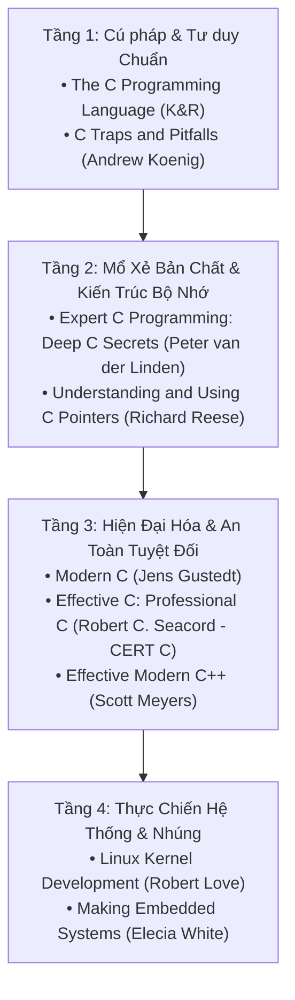

# CHUYÊN ĐỀ 09: THƯ VIỆN TÀI NGUYÊN, GITHUB REPOS & SÁCH KINH ĐIỂN KHUYÊN ĐỌC

> Thuộc bộ cẩm nang: [[00_C_Cpp_Mastery_Index|C/C++ Mastery Handbook]]

---

## 1. Top Sách Gối Đầu Giường Cho Kỹ Sư C/C++ Chuyên Sâu

Để đi từ mức "biết viết code" lên mức "làm chủ bản chất hệ thống", đây là những cuốn sách kinh điển đã đào tạo nên nhiều thế hệ kỹ sư kernel và nhúng hàng đầu thế giới:

### 1.1. *Expert C Programming: Deep C Secrets* — Peter van der Linden
- **Tại sao phải đọc?** Cuốn sách kinh điển hài hước nhưng cực kỳ uyên thâm của kỹ sư Sun Microsystems. Sách mổ xẻ tận gốc rễ:
  - Bản chất tại sao mảng (Array) và con trỏ (Pointer) **KHÔNG HỀ GIỐNG NHAU** trong C.
  - Thuật toán giải mã mọi cú pháp khai báo hàm/con trỏ phức tạp (The Piece of Cake algorithm / `cdecl`).
  - Cấu trúc file nhị phân ELF, Linker, Dynamic Linking và bí mật các phân vùng bộ nhớ.

### 1.2. *C Traps and Pitfalls* — Andrew Koenig (AT&T Bell Labs)
- Phân tích toàn bộ các lỗi tiềm ẩn từ cấp độ từ vựng (Lexical), cú pháp (Syntactic), ngữ nghĩa (Semantic) đến lỗi liên kết (Linker traps). Giúp bạn hiểu vì sao `if (x = y)` hay lỗi thiếu `break` trong `switch` lại nguy hiểm.

### 1.3. *Effective C: An Introduction to Professional C Programming* — Robert C. Seacord
- Tác giả là trưởng nhóm nghiên cứu tiêu chuẩn bảo mật SEI CERT C tại Đại học Carnegie Mellon. Cuốn sách hướng dẫn lập trình C hiện đại (C11/C17/C23) loại bỏ hoàn toàn các lỗ hổng tràn bộ đệm, lỗi Undefined Behavior và tấn công bộ nhớ.

### 1.4. *Modern C* — Jens Gustedt (ISO C Committee Member)
- Cập nhật toàn bộ các tính năng mới nhất của C hiện đại: C11 `_Generic`, Concurrency model (`<threads.h>`, `<stdatomic.h>`), Sequence points, Memory ordering và các idiom C thế kỷ 21.

---

## 2. Các GitHub Repositories Mẫu Mực Nên Clone & Nghiên Cứu

Khi muốn học phong cách lập trình C/C++ đỉnh cao (Clean Code, Kiến trúc hiệu năng cao, Tối ưu phần cứng), hãy đọc trực tiếp mã nguồn của các dự án lớn:

| Dự án / Repository | Đường dẫn GitHub | Điểm tinh hoa cần học tập |
| :--- | :--- | :--- |
| **Kho tham khảo cá nhân** | [`thinh1210/C_programming`](https://github.com/thinh1210/C_programming) | **Rất trực quan cho Embedded C:** Slide Marp, bài tập FSM (State Machine chống dội phím), Bitwise macros, Callback/Table-driven, Struct padding và Linker data/bss. |
| **Linux Kernel Source** | [`torvalds/linux`](https://github.com/torvalds/linux) | Đỉnh cao của C hệ thống: Intrusive Linked List (`include/linux/list.h`), Macro `container_of`, `likely()`/`unlikely()`, Memory Barriers (`dmb`/`dsb`), Lockless Ring Buffer. |
| **Redis In-Memory Database** | [`redis/redis`](https://github.com/redis/redis) | Phong cách C thuần túy (Pure ANSI C) đẹp và dễ đọc nhất thế giới. Cấu trúc Dynamic String (`sds.c`), bảng băm lũy tiến (`dict.c`), bộ nhớ nén (`ziplist.c`). |
| **Zephyr RTOS** | [`zephyrproject-rtos/zephyr`](https://github.com/zephyrproject-rtos/zephyr) | Hệ điều hành thời gian thực thế hệ mới cho IoT/Nhúng. Sử dụng triệt để các thuộc tính GCC (`__attribute__((section, packed, cleanup))`), CMake hiện đại, Device Tree và Driver API trừu tượng hóa. |
| **FreeRTOS Kernel** | [`FreeRTOS/FreeRTOS-Kernel`](https://github.com/FreeRTOS/FreeRTOS-Kernel) | Bộ lập lịch Task Scheduler siêu tinh gọn, context switching assembly (`port.c`), quản lý hàng đợi Queue và bộ cấp phát heap tĩnh/động (`heap_1` đến `heap_5`). |
| **Awesome-C & Awesome-Embedded** | [`oz123/awesome-c`](https://github.com/oz123/awesome-c) | Danh mục chọn lọc toàn bộ các thư viện C xuất sắc nhất (Networking, Parsing, Data Structures, Unit Testing). |

---

## 3. Các Công Cụ & Trang Tra Cứu Trực Tuyến Bất Ly Thân

1. **[Compiler Explorer (godbolt.org)](https://godbolt.org):**
   - Công cụ tra cứu mã máy Assembly số 1 thế giới. Cho phép bạn gõ một đoạn code C/C++ và xem ngay lập tức compiler (GCC, Clang, ARM GCC) sinh ra mã Assembly tương ứng với các cờ tối ưu `-O0`, `-O2`, `-O3`, `-Os`.
   - Giúp bạn kiểm chứng trực tiếp: `volatile` thay đổi mã máy như thế nào, `restrict` giúp tối ưu ra sao, và `__builtin_expect` bố trí rẽ nhánh như thế nào.

2. **[cppreference.com (C and C++ Reference)](https://en.cppreference.com/w/c):**
   - Trang bách khoa toàn thư chuẩn mực và cập nhật nhanh nhất về mọi từ khóa, hàm thư viện, hằng số và thuộc tính của C89, C99, C11, C17, C23 và C++23.

3. **[C-FAQ (Steve Summit)](http://c-faq.com/):**
   - Bộ sưu tập giải đáp hơn 400 câu hỏi hóc búa nhất về ngôn ngữ C từ nhóm tin `comp.lang.c` của Usenet. Tất cả những hiểu lầm về mảng vs con trỏ, `NULL` vs `0`, `malloc(0)` đều được làm sáng tỏ tại đây.
