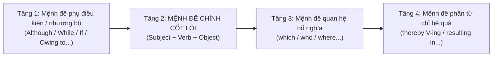

# 🔬 Cẩm Nang Mổ Xẻ & Xây Dựng Câu Dài Hoàn Chỉnh (Complex Sentences & Clause Anatomy)

Viết câu dài (Complex & Compound-Complex Sentences) trong IELTS Writing không đơn thuần là "kéo dài câu", mà là kỹ thuật **kết nối logic đa tầng** giữa các mệnh đề. Một câu dài đạt điểm cao phải đảm bảo: **1 Mệnh đề chính vững vàng (Main Clause) + Các Mệnh đề phụ (Subordinate Clauses) bổ trợ chính xác + Tuyệt đối không mắc lỗi Run-on hay Comma Splice**.

---

## 🏗️ I. Mô Hình "Khối Lego" Của Câu Dài Học Thuật

Một câu dài học thuật hoàn chỉnh thường được cấu tạo từ 4 tầng kết nối:

---

## 🎯 II. Phân Tích Chuyên Sâu 5 Mẫu Câu Dài & Khó Kinh Điển (Kèm Mổ Xẻ Mệnh Đề)

---

### 📌 Mẫu 1: Câu Đa Tầng Nhượng Bộ + Quan Hệ Bổ Nghĩa + Điều Kiện Hạn Định (Task 2)

#### 📝 Câu ví dụ:
> *"Although money allows people to afford luxuries and treats, **which certainly do bring temporary enjoyment and satisfaction**, a substantial number of people are happy without excessive wealth, **provided that they have sufficient financial resources to cover their essential survival necessities**."*

#### 🔬 PHÂN TÍCH MỆNH ĐỀ NGAY SAU ĐOẠN VÍ DỤ:
1. **Mệnh đề 1 (Mệnh đề phụ chỉ sự nhượng bộ - Concession Clause):**
   - *Thành phần:* `[Although]` (Liên từ phụ thuộc) + `[money]` (S1) + `[allows]` (V1) + `[people]` (O1) + `[to afford luxuries and treats]` (To-Infinitive phrase).
   - *Chức năng:* Thừa nhận một sự thật hiển nhiên (tiền mua được đồ xa xỉ) trước khi đưa ra luận điểm chính mang tính phản biện.
2. **Mệnh đề 2 (Mệnh đề quan hệ không xác định - Non-defining Relative Clause):**
   - *Thành phần:* `[which]` (Đại từ quan hệ thay thế cho cả cụm *luxuries and treats*) + `[certainly do bring]` (Trợ động từ *do* nhấn mạnh + Động từ chính) + `[temporary enjoyment and satisfaction]` (Cụm danh từ tân ngữ).
   - *Chức năng:* Bổ nghĩa sâu về bản chất của đồ xa xỉ (chỉ đem lại niềm vui tạm thời).
3. **Mệnh đề 3 (MỆNH ĐỀ ĐỘC LẬP CHÍNH - MAIN INDEPENDENT CLAUSE):**
   - *Thành phần:* `[a substantial number of people]` (S_main) + `[are]` (V_main linking verb) + `[happy without excessive wealth]` (Complement & Prep phrase).
   - *Chức năng:* **Trọng tâm ý nghĩa của toàn câu** — khẳng định nhiều người vẫn hạnh phúc mà không cần quá nhiều tiền.
4. **Mệnh đề 4 (Mệnh đề phụ chỉ điều kiện - Conditional Clause với 'provided that'):**
   - *Thành phần:* `[provided that]` (Liên từ điều kiện = *as long as / if*) + `[they]` (S4) + `[have]` (V4) + `[sufficient financial resources]` (O4) + `[to cover their essential survival necessities]` (Cụm chỉ mục đích).
   - *Chức năng:* Đặt ra điều kiện biên để mệnh đề chính đúng (miễn là đủ sống).

> 💡 **Công thức tự ghép câu:**
> `Although S1 + V1 + O1, which + V2 + O2, S_main + V_main + C, provided that S3 + V3 + O3.`

---

### 📌 Mẫu 2: Câu Đảo Ngữ Nhấn Mạnh (Inversion) + Quan Hệ Ghép 'Both of Which' (Task 2)

#### 📝 Câu ví dụ:
> *"Not only does higher education promote the acquisition of specialist academic knowledge, but it also cultivates analytical thinking and intellectual curiosity, **both of which are widely acknowledged as indispensable transferable skills in the modern job market**."*

#### 🔬 PHÂN TÍCH MỆNH ĐỀ NGAY SAU ĐOẠN VÍ DỤ:
1. **Mệnh đề 1 (Mệnh đề đảo ngữ phía trước với 'Not only'):**
   - *Thành phần:* `[Not only]` + `[does]` (Trợ động từ đảo lên trước chủ ngữ) + `[higher education]` (S1) + `[promote]` (V1 nguyên mẫu) + `[the acquisition of specialist academic knowledge]` (Cụm danh từ tân ngữ).
   - *Chức năng:* Tạo điểm nhấn học thuật và làm tăng ngữ điệu trang trọng (Academic tone).
2. **Mệnh đề 2 (Mệnh đề liên kết 'but it also' - Đồng vị đẳng lập):**
   - *Thành phần:* `[but]` (Liên từ kết hợp) + `[it]` (S2 quy chiếu về *higher education*) + `[also cultivates]` (V2) + `[analytical thinking and intellectual curiosity]` (Cụm tân ngữ song hành O2).
   - *Chức năng:* Nêu bật giá trị thứ hai quan trọng hơn giá trị thứ nhất.
3. **Mệnh đề 3 (Mệnh đề quan hệ định lượng - Quantifying Relative Clause):**
   - *Thành phần:* `[both of which]` (Đại từ quan hệ chỉ lượng thay thế cho 2 kỹ năng: *analytical thinking* và *intellectual curiosity*) + `[are widely acknowledged as]` (V3 bị động) + `[indispensable transferable skills...]` (Cụm danh từ bổ ngữ).
   - *Chức năng:* Nâng tầm hai kỹ năng trên thành luận cứ sắc bén phục vụ thị trường lao động.

> 💡 **Công thức tự ghép câu:**
> `Not only does S1 + V1 + O1, but it also + V2 + (O2a & O2b), both/all of which are + V3_passive + as [Danh từ].`

---

### 📌 Mẫu 3: Câu Bắt Đầu Bằng Cụm Giới Từ Nhân Quả + Mệnh Đề Quan Hệ Đan Xen + Bị Động Khách Quan (Task 2)

#### 📝 Câu ví dụ:
> *"Owing to the severe financial strain **that an unprecedented surge in chronic ailments imposes on public healthcare**, it is widely argued **that governments should mandate physical education in schools while simultaneously curbing the consumption of ultra-processed foods through fiscal taxation**."*

#### 🔬 PHÂN TÍCH MỆNH ĐỀ NGAY SAU ĐOẠN VÍ DỤ:
1. **Cụm giới từ mở đầu kèm Mệnh đề quan hệ xác định (Prepositional Phrase containing Defining Relative Clause):**
   - *Cụm giới từ:* `[Owing to]` (Giới từ chỉ nguyên nhân) + `[the severe financial strain]` (Danh từ trung tâm).
   - *Mệnh đề quan hệ lồng ghép:* `[that]` (Đại từ quan hệ làm tân ngữ) + `[an unprecedented surge in chronic ailments]` (S_rel) + `[imposes on public healthcare]` (V_rel + Prep phrase).
   - *Chức năng:* Nêu rõ nguyên nhân gốc rễ và bối cảnh áp lực tài chính y tế.
2. **Mệnh đề chính dùng Chủ ngữ giả (Dummy Subject Clause):**
   - *Thành phần:* `[It]` (Chủ ngữ giả) + `[is widely argued]` (V_main bị động khách quan).
   - *Chức năng:* Tạo tính khách quan tuyệt đối cho bài luận học thuật (tránh dùng "I think").
3. **Mệnh đề danh từ làm Tân ngữ thật (Noun Clause acting as Real Subject):**
   - *Thành phần:* `[that]` (Liên từ nối) + `[governments]` (S_sub) + `[should mandate]` (V_sub 1) + `[physical education in schools]` (O_sub 1) + `[while simultaneously curbing...]` (Cụm phân từ rút gọn chỉ hành động song song).
   - *Chức năng:* Chứa toàn bộ nội dung của lời đề xuất/giải pháp chính sách.

> 💡 **Công thức tự ghép câu:**
> `Owing to [Noun] that S_rel + V_rel + O_rel, it is widely argued that S_main + should V1 + O1 while simultaneously V2-ing + O2.`

---

### 📌 Mẫu 4: So Sánh Đối Nghịch Đa Tầng + Mệnh Đề 'Where' + Rút Gọn Phân Từ Hệ Quả (Task 1 Report)

#### 📝 Câu ví dụ:
> *"This trend was diametrically reversed among citizens with no formal qualifications, **where the figure stood at a mere 9% for younger cohorts but surged dramatically to 72% in the oldest demographic**, **resulting in an unprecedented educational divide across generations**."*

#### 🔬 PHÂN TÍCH MỆNH ĐỀ NGAY SAU ĐOẠN VÍ DỤ:
1. **Mệnh đề độc lập chính (Main Clause):**
   - *Thành phần:* `[This trend]` (S_main) + `[was diametrically reversed]` (V_main bị động) + `[among citizens with no formal qualifications]` (Giới từ chỉ nhóm đối tượng).
   - *Chức năng:* Báo cáo xu hướng chung (xu hướng hoàn toàn đảo ngược).
2. **Mệnh đề quan hệ chỉ ngữ cảnh/nhóm (Relative Clause with 'where'):**
   - *Thành phần:* `[where]` (Trạng từ quan hệ thay thế cho nhóm đối tượng trên) + `[the figure]` (S2) + `[stood at a mere 9% for younger cohorts]` (V2a + số liệu mốc 1) + `[but]` (Liên từ đẳng lập) + `[surged dramatically to 72% in the oldest demographic]` (V2b + số liệu mốc 2).
   - *Chức năng:* Cung cấp chi tiết số liệu so sánh trực diện giữa người trẻ và người già.
3. **Mệnh đề phân từ hiện tại chỉ kết quả (Present Participle Clause of Result):**
   - *Thành phần:* `[resulting in]` (Phân từ V-ing đóng vai trò rút gọn cho *which resulted in*) + `[an unprecedented educational divide across generations]` (Cụm danh từ tân ngữ chỉ kết quả/hệ quả).
   - *Chức năng:* Đưa ra nhận xét tổng kết về sự phân hóa thế hệ mà không cần mở một câu mới.

> 💡 **Công thức tự ghép câu:**
> `S_main + was [Adverb] reversed among [Group], where S2 + V2a + but V2b, resulting in [Noun Phrase].`

---

### 📌 Mẫu 5: Quá Khứ Hoàn Thành Bị Động + Phân Từ Kép Đồng Thời (Task 1 Map / Process)

#### 📝 Câu ví dụ:
> *"By 1985, substantial housing estates had been erected to the east of Fonton, **thereby narrowing the geographical distance between the two settlements** and **laying the groundwork for their eventual unification into a single metropolitan hub**."*

#### 🔬 PHÂN TÍCH MỆNH ĐỀ NGAY SAU ĐOẠN VÍ DỤ:
1. **Mệnh đề độc lập chính ở thì Quá khứ hoàn thành (Past Perfect Passive Clause):**
   - *Thành phần:* `[By 1985]` (Cụm trạng từ chỉ mốc hoàn tất) + `[substantial housing estates]` (S_main) + `[had been erected]` (V_main quá khứ hoàn thành bị động) + `[to the east of Fonton]` (Cụm giới từ phương hướng).
   - *Chức năng:* Mô tả một công trình đã xây xong trước một thời điểm trong quá khứ.
2. **Mệnh đề phân từ song song 1 (First Participle Phrase with 'thereby'):**
   - *Thành phần:* `[thereby]` (Trạng từ: bằng cách đó) + `[narrowing]` (V-ing 1) + `[the geographical distance between the two settlements]` (Tân ngữ 1).
   - *Chức năng:* Chỉ ra tác động vật lý trực tiếp của việc xây nhà.
3. **Mệnh đề phân từ song song 2 (Second Participle Phrase linked by 'and'):**
   - *Thành phần:* `[and]` (Liên từ nối 2 phân từ) + `[laying]` (V-ing 2) + `[the groundwork for their eventual unification into a single metropolitan hub]` (Collocation tân ngữ: đặt nền móng cho...).
   - *Chức năng:* Chỉ ra tầm nhìn quy hoạch lâu dài (sáp nhập thành một đô thị).

> 💡 **Công thức tự ghép câu:**
> `By [Năm], S_main + had been V-ed_passive + [Prep Phrase], thereby V-ing 1 + O1 and V-ing 2 + O2.`

---

## 🛠️ III. Quy Trình 4 Bước "Lắp Ghép Lego" Để Bạn Tự Viết Câu Dài

Khi bạn muốn viết một câu dài phức tạp từ một ý tưởng đơn giản, hãy làm theo 4 bước sau:

### 🧩 Ví dụ thực hành: Ý tưởng ban đầu: *"Traffic is bad in cities. People take buses. Air gets cleaner."*

- **Bước 1: Viết Mệnh đề chính (Core Independent Clause):**
  - *Câu lõi:* `Local authorities should upgrade public bus networks.`
- **Bước 2: Mở rộng danh từ bằng Mệnh đề quan hệ (Relative Clause):**
  - *Mở rộng:* `Local authorities should upgrade public bus networks, which currently suffer from severe delays and overcrowding.`
- **Bước 3: Bổ sung nguyên nhân hoặc điều kiện bằng Mệnh đề trạng ngữ (Adverbial Clause):**
  - *Thêm phía trước:* `Since private vehicle usage is the primary contributor to urban gridlock, local authorities should upgrade public bus networks, which currently suffer from severe delays and overcrowding...`
- **Bước 4: Chốt hạ bằng Mệnh đề phân từ chỉ hệ quả (Resulting Participle Clause):**
  - *Thêm đuôi:* `..., thereby encouraging commuters to leave their cars at home and significantly improving ambient air quality.`

#### 🏆 Câu hoàn chỉnh cuối cùng:
> *"Since private vehicle usage is the primary contributor to urban gridlock, local authorities should upgrade public bus networks, which currently suffer from severe delays and overcrowding, **thereby encouraging commuters to leave their cars at home and significantly improving ambient air quality**."*
> *(37 từ, cấu trúc 4 tầng, mượt mà, đạt chuẩn Band 8.5 - 9.0)*

---

## 🔗 IV. Nghệ Thuật Liên Kết Với Câu Trước (Inter-Sentence Cohesion & Flow)

Để đạt điểm **Band 8.0 - 9.0** ở tiêu chí **Coherence & Cohesion**, các câu dài không được đứng cô lập mà phải có **chất kết dính** móc xích vào câu đứng trước. Dưới đây là 5 kỹ thuật liên kết câu chuyên nghiệp:

### 1. Kỹ thuật "Danh từ vỏ bọc" (Shell Nouns / Summary Nouns)
- **Cách dùng:** Sử dụng cụm từ `This/These + [Danh từ trừu tượng]` ở đầu câu sau để tóm tắt trọn vẹn cả một hiện tượng/lập luận phức tạp ở câu trước.
- **Bảng Shell Nouns thông dụng:**
  - *Chỉ vấn đề/thực trạng:* `This phenomenon`, `This predicament`, `This worrying dilemma`, `This issue`.
  - *Chỉ giải pháp:* `These pragmatic measures`, `This intervention`, `Such initiatives`.
  - *Chỉ quan điểm:* `This assertion`, `This line of reasoning`, `This contention`.
  - *Chỉ xu hướng:* `This persistent trend`, `This dramatic shift`, `Such trajectories`.
- **Ví dụ liên kết:**
  - *Câu trước:* *More young people are leaving rural areas to seek employment in metropolitan centers.*
  - *Câu sau:* `This massive demographic shift exerts severe pressure on urban public infrastructure.`

### 2. Nguyên tắc "Thông tin cũ làm bệ phóng cho thông tin mới" (Given-New Information Flow)
- **Cách dùng:** Đưa thông tin mà người đọc **đã biết ở câu trước (Given)** lên phần đầu của câu sau (chủ ngữ hoặc trạng ngữ mở đầu), sau đó mới đưa ra **thông tin mới (New)** ở phần vị ngữ.
- **Ví dụ liên kết:**
  - *Câu trước:* *Schools often fail to educate students about the dangers of ultra-processed foods.*
  - *Câu sau:* `Without this foundational nutritional knowledge, young individuals inevitably gravitate towards cheap fast food options.` *(Cụm "this foundational nutritional knowledge" là thông tin cũ từ câu trước $\rightarrow$ làm bệ phóng đưa ra thông tin mới là "sa vào thức ăn nhanh").*

### 3. Chuỗi từ vựng móc xích & Paraphrasing (Lexical Chaining)
- **Cách dùng:** Thay thế từ khóa ở câu trước bằng từ đồng nghĩa học thuật hoặc chuyển đổi từ loại (Nominalization: Biến động từ ở câu trước thành danh từ ở câu sau).
- **Ví dụ liên kết:**
  - *Câu trước:* *Offenders are not given a chance to **retrain** and learn new skills.*
  - *Câu sau:* `Without adequate **vocational retraining**, their chances of securing legitimate employment are practically nonexistent.` *(retrain $\rightarrow$ vocational retraining).*

### 4. Phép quy chiếu thay thế (Anaphoric Reference)
- **Cách dùng:** Dùng các cặp đại từ để đối chiếu mà không cần lặp lại danh từ dài dòng.
  - `The former ... the latter` (Cái nhắc trước ... cái nhắc sau).
  - `That of / Those of` (Thay thế danh từ số ít / số nhiều đã nhắc đến).
  - `Both of which / Neither of which` (Quy chiếu cho 2 đối tượng vừa nêu).
- **Ví dụ liên kết:**
  - *Câu trước:* *Some value academic qualifications, while others prioritize practical experience.*
  - *Câu sau:* `While the former is vital for specialised professions, the latter holds greater appeal in dynamic business environments.`

### 5. Bộ từ nối liên kết logic theo chức năng (Transition Taxonomy)
| Chức năng liên kết | Các từ/cụm nối câu mạnh mẽ (Inter-sentence Linkers) |
| :--- | :--- |
| **Tương phản đối lập (Contrast)** | `However,` `In sharp contrast,` `Conversely,` `On the other hand,` `Nevertheless,` |
| **Nguyên nhân - Hệ quả (Cause & Effect)** | `Consequently,` `As a direct result,` `For this reason,` `Owing to this,` |
| **Bổ sung tầng bậc (Addition / Elaboration)** | `Furthermore,` `Moreover,` `Not only that, but...` `In other words,` |
| **Minh họa cụ thể (Exemplification)** | `For instance,` `A compelling case in point is...` `This is evidenced by...` |
| **Chuyển dịch đối tượng (Topic Transition)** | `Turning to...` `In terms of...` `With regards to...` `Meanwhile,...` |
