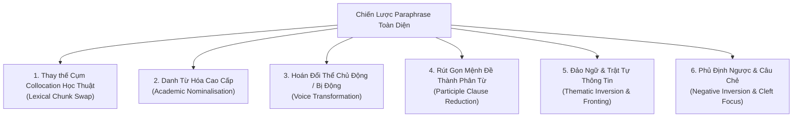

# 🔄 Cẩm Nang Làm Chủ Kỹ Thuật Paraphrase & Biến Đổi Câu (Paraphrasing Mastery & Sentence Transformations)

> [!TIP] Bản Đồ Chiến Lược Paraphrase
> Paraphrase không phải là việc tra từ điển rồi thay thế từng từ đơn lẻ một cách cơ học (dễ dẫn đến lỗi sai ngữ cảnh - collocation clash).
> Trong IELTS Academic Band 8.0 - 9.0, **Paraphrase đỉnh cao là nghệ thuật tái cấu trúc thông tin (Information Restructuring)**, kết hợp giữa:
> 1. **Mức độ Từ & Cụm từ:** Thay thế cả khối ngữ nghĩa (Collocation & Chunk substitution).
> 2. **Mức độ Ngữ pháp:** Biến đổi từ loại (Word class shift), danh từ hóa (Nominalisation), đổi thể chủ/bị động.
> 3. **Mức độ Cả câu:** Đổi chủ ngữ (Subject re-orientation), đảo trật tự thông tin (Thematic fronting), dùng mệnh đề phân từ hoặc câu chẻ (Cleft sentences).

---

## 🏛️ I. 6 Vũ Khí Paraphrase Bậc Thầy Trong IELTS (The 6 Pillars)

---

### 1. 💎 Vũ Khí 1: Thay Thế Cả Cụm Từ Cố Định (Lexical Chunk Substitution)
- **Sai lầm phổ biến:** Thay từng chữ đơn lẻ khiến câu mất tự nhiên (VD: *big city* $\rightarrow$ *enormous town* ❌).
- **Cách viết Band 8.5+:** Thay toàn bộ cụm danh từ/động từ bằng một khối học thuật tương đương.

| Cụm diễn đạt thông thường | Cụm Paraphrase Học Thuật C1/C2 | Ngữ cảnh ứng dụng |
| :--- | :--- | :--- |
| **solve the problem** | `address / tackle / mitigate the issue` | Task 2 (Problem & Solution) |
| **cause environmental damage** | `inflict severe ecological degradation` | Task 2 (Environment) |
| **spend money on** | `allocate financial resources to / channel funds into` | Task 1 & Task 2 (Economy/Budget) |
| **build new houses** | `erect substantial residential complexes` | Task 1 (Map) |
| **be replaced by** | `be superseded by / give way to / be supplanted by` | Task 1 (Map) |
| **clean the water** | `subject the water to rigorous purification` | Task 1 (Process) |
| **people who don't have jobs** | `the unemployed populace / job seekers / those facing joblessness` | Task 1 & Task 2 (Society) |

---

### 2. 🧱 Vũ Khí 2: Kỹ Thuật Danh Từ Hóa (Academic Nominalisation)
Biến động từ hoặc tính từ thành cụm danh từ để tăng tính khách quan, súc tích và trang trọng của văn phong học thuật.

- **Câu gốc (Dùng động từ):**
  > *"Because the government **invested heavily** in renewable energy, the air quality **improved significantly**."*
- **Biến thể Paraphrase (Danh từ hóa):**
  > *"**Heavy governmental investment** in renewable energy led to **a significant improvement** in air quality."*
  > *(Hoặc:* *"The substantial enhancement of atmospheric quality was attributable to rigorous public funding for green energy."*)*

💡 **Công thức chuyển đổi:**
`Because S + V + Adv` $\rightarrow$ `Adjective + Noun + resulted in / brought about / was responsible for + Noun Phrase.`

---

### 3. 🔄 Vũ Khí 3: Hoán Đổi Thể Chủ Động $\leftrightarrow$ Thể Bị Động (Voice Transformation)
- Trong **Task 1 Process:** Bắt buộc dùng bị động để làm nổi bật đối tượng được xử lý thay vì người làm.
- Trong **Task 2:** Dùng bị động khách quan (Impersonal Passive) để thể hiện quan điểm một cách học thuật.

- **Ví dụ Task 1 Process:**
  - *Chủ động:* A heavy roller crushes the clay into a fine powder.
  - *Bị động:* `The clay is pulverized into a fine consistency by a heavy roller.`
- **Ví dụ Task 2 Opinion:**
  - *Chủ động:* Many people think that university education is unnecessary.
  - *Bị động khách quan:* `It is widely asserted that tertiary education is superfluous in the modern labor market.`

---

### 4. ✂️ Vũ Khí 4: Rút Gọn Mệnh Đề Thành Phân Từ (Participle Clause Reduction)
Thay thế mệnh đề quan hệ rườm rà `which was...` hoặc mệnh đề thời gian `after they have...` bằng cụm phân từ `V-ing` (chủ động) hoặc `V-ed` (bị động).

- **Câu gốc:**
  > *"After the bricks have been shaped into identical blocks, they are transferred to a drying oven which operates for 48 hours."*
- **Biến thể Paraphrase (Phân từ kép):**
  > *"**Once shaped into uniform blocks**, the bricks are transferred to a drying oven **operating for 48 hours**."*

---

### 5. 🔀 Vũ Khí 5: Đảo Trật Tự Thông Tin & Đảo Ngữ (Thematic Fronting & Inversion)
Đưa thông tin phụ hoặc trạng ngữ lên đầu câu để tạo sự móc nối nhịp nhàng với câu trước (*Given $\rightarrow$ New Information Flow*).

- **Câu gốc:**
  > *"An intricate network of footpaths links these accommodation huts together."*
- **Biến thể Đảo Ngữ Phân Từ:**
  > *"**Linking these accommodation huts is** an intricate network of footpaths."*
- **Biến thể Đảo Giới Từ Không Gian:**
  > *"**Encircling the newly built huts lies** an extensive pedestrian network."*

---

### 6. ⚖️ Vũ Khí 6: Kỹ Thuật Phủ Định Ngược (Negative-to-Positive Restatement)
Diễn đạt một ý khẳng định thông qua việc phủ định điều ngược lại, tạo độ tinh tế trong diễn đạt.

- **Câu gốc:**
  > *"Physical education is very important for children."*
- **Biến thể Phủ định ngược:**
  > *"The role of physical education in adolescent development **cannot be overstated / is by no means negligible**."*
- **Biến thể:**
  > *"Few initiatives are **as vital to** juvenile well-being as compulsory physical training."*

---

## 🎯 II. Ma Trận Chuyển Đổi Cả Câu (Sentence-Level Transformation Matrix)

Dưới đây là phương pháp tạo ra **3 biến thể câu hoàn toàn khác biệt** từ một câu gốc, giúp bạn làm chủ mọi cấu trúc phòng thi:

### 📌 Ví dụ thực chiến 1 (Task 1 Map):
> **Câu gốc:** *"A new large hospital was built to the north of the town center to replace the old farmland."*

1. **Biến thể 1 (Danh từ hóa + Chủ ngữ mới):**
   > *"The northern sector of the town center witnessed **the construction of a state-of-the-art medical facility on former agricultural land**."*
2. **Biến thể 2 (Đảo ngữ vị trí + Mệnh đề phân từ nhường chỗ):**
   > *"North of the town center, the preexisting farmland was **demolished to make way for an expansive hospital**."*
3. **Biến thể 3 (Câu chẻ nhấn mạnh + Bị động hoàn thành):**
   > *"What was once arable land situated north of the town center **has been completely superseded by a modern regional hospital**."*

---

### 📌 Ví dụ thực chiến 2 (Task 2 Argument):
> **Câu gốc:** *"High salaries motivate workers to be more productive and stay loyal to the company."*

1. **Biến thể 1 (Danh từ hóa + Động từ tác động C2):**
   > *"Lucrative remuneration acts as **a powerful catalyst for elevated worker productivity and organizational loyalty**."*
2. **Biến thể 2 (Cấu trúc đảo ngữ 'Not only... but also...'):**
   > *"Not only does generous financial compensation **spur workforce efficiency**, but it also **fosters long-term employee retention**."*
3. **Biến thể 3 (Mệnh đề quan hệ + Điều kiện tiền đề):**
   > *"Employees who receive substantial financial rewards tend to demonstrate **greater industriousness**, which in turn **cements their commitment to the enterprise**."*

---

## 📚 III. Cách Khai Thác Kỹ Thuật Này Trong Từng Bài Mẫu Của Bạn
Trong mỗi bài mẫu của thư mục `Writing/task1/` và `Writing/task2/`:
1. **Tại bảng từ vựng:** Đọc cột `🔄 Các cách Paraphrase tương đương` để nạp 2 - 3 cụm từ thay thế cho từ vựng gốc.
2. **Tại phần phân tích câu:** Xem kỹ mục `🔄 3 Phương án Paraphrase cả câu` để học cách hoán đổi giữa *Danh từ hóa*, *Đảo cấu trúc ngữ pháp*, và *Hoán đổi từ vựng*.
