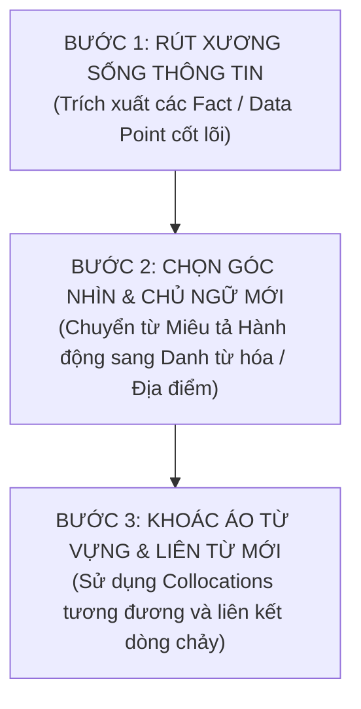

# 👨‍🏫 Bài Giảng Masterclass: Nghệ Thuật Paraphrase Cả Đoạn Văn (Paragraph-Level Paraphrasing & Discourse Rewriting)

> [!TIP] Lời Khuyên Của Giáo Viên (Teacher's Note)
> Đa số học sinh luyện IELTS chỉ dừng lại ở việc tra từ điển rồi thay thế từng từ đơn lẻ (*word-by-word replacement*). Cách làm này khiến câu văn bị "gãy", văn phong thiếu tự nhiên và dễ bị giám khảo trừ điểm Lexical Resource vì dùng sai ngữ cảnh (*collocation clash*).
> 
> Ở đẳng cấp **Band 8.5 - 9.0**, bạn cần làm chủ kỹ thuật **Paragraph-Level Paraphrasing (Tái Cấu Trúc Toàn Diện Cả Đoạn Văn)**:
> 1. Giữ nguyên 100% sự thật và số liệu của đề bài.
> 2. Thay đổi hoàn toàn góc nhìn và chủ ngữ của câu (*Thematic Subject Shift*).
> 3. Thay đổi toàn bộ bộ khung ngữ pháp (*Syntactic Restructuring*).
> 4. Thay thế trọn vẹn mạng lưới liên kết và từ vựng học thuật (*Lexical Field Substitution*).

---

## 🧭 I. Quy Trình 3 Bước Tự Viết Lại Cả Đoạn Văn (The Teacher's 3-Step Method)

---

## 🏛️ II. Thực Chiến 1: Dạng Map (Grange Park Redevelopment)

### 📌 Đoạn văn gốc trong bài mẫu (Band 9.0):
> *"Looking first at the northern half and the center of the park, access from Arnold Avenue remains unchanged. In the north-western corner, the rose garden and its surrounding benches have been preserved in their original state. Conversely, the pond previously situated in the north-east, which was originally designated for water plants, has been removed to make way for a children's play area. In the very heart of the park, the old bandstand, once encircled by seats, has been demolished and superseded by a substantial amphitheatre for concerts."*

---

### 👨‍🏫 Giáo viên hướng dẫn phân tích "Xương sống thông tin" (Semantic Anchors):
1. **Fact 1:** Cổng Arnold Avenue ở phía Bắc $\rightarrow$ Giữ nguyên vị trí.
2. **Fact 2:** Vườn hồng góc Tây Bắc $\rightarrow$ Giữ nguyên trạng kèm ghế đá.
3. **Fact 3:** Hồ cây thủy sinh góc Đông Bắc $\rightarrow$ Bị xóa bỏ, thay bằng khu vui chơi trẻ em.
4. **Fact 4:** Khán đài kèn đồng (bandstand) ở trung tâm $\rightarrow$ Bị dỡ bỏ, thay bằng nhà hát lộ thiên (amphitheatre).

---

### 🌟 Biến thể Đoạn văn 1 (Phong cách: Lấy Công trình Mới làm Chủ ngữ trung tâm):
> *"Regarding the park’s northern perimeter and central grounds, pedestrian entry via Arnold Avenue persists in its original location. While the north-western rose garden alongside its peripheral benches was left completely unaltered, a stark contrast unfolded in the north-eastern quadrant, where a dedicated play zone for children supplanted the former aquatic plant pond. Meanwhile, at the core of the park, the historic seated bandstand was flattened to clear space for an extensive concert amphitheatre."*

#### 🔍 Lời thầy giảng giải chi tiết từng câu:
- **Câu 1:** Thay vì dùng `Looking first at...`, thầy đổi sang cụm giới từ trang trọng `Regarding the park's northern perimeter and central grounds...`. Thay động từ `remains unchanged` bằng `persists in its original location` (*tiếp tục tồn tại ở vị trí ban đầu*).
- **Câu 2:** Thầy ghép 2 câu tương phản thành **1 câu phức duy nhất** bằng liên từ `While... a stark contrast unfolded in...`. Cụm từ `supplanted the former aquatic plant pond` thay thế mượt mà cho `has been removed to make way for`.
- **Câu 3:** Thay vì viết `the old bandstand was demolished`, thầy dùng động từ mạnh `was flattened to clear space for an extensive concert amphitheatre`.

---

### 🌟 Biến thể Đoạn văn 2 (Phong cách: Danh từ hóa & Không gian làm bệ đỡ):
> *"Focusing on structural alterations across the northern zone and park center, no modifications affected the Arnold Avenue entrance. Pristine preservation was granted to the rose garden in the north-west, whereas radical redevelopment occurred in the north-east, substituting the water flora pond with a recreational ground for youngsters. Today, occupying the park's nucleus is a massive open-air amphitheatre, which decisively superseded the archaic bandstand."*

#### 🔍 Lời thầy giảng giải chi tiết từng câu:
- **Kỹ thuật Đảo ngữ không gian (Locative Inversion):** Câu cuối thầy dùng `Today, occupying the park's nucleus is a massive open-air amphitheatre...` đưa vị trí trọng tâm lên đầu câu, giúp tạo nhịp điệu cực kỳ ấn tượng trong mắt giám khảo.
- **Kỹ thuật Danh từ hóa:** `Pristine preservation was granted to...` (*Sự bảo tồn nguyên sơ được dành cho khu vườn hồng*).

---

## ⚙️ III. Thực Chiến 2: Dạng Process (Sản Xuất Gạch Công Nghiệp)

### 📌 Đoạn văn gốc trong bài mẫu (Band 9.0):
> *"At the initial stage of production, clay is extracted from the ground by a large digger. The harvested material is then deposited onto a metal grid to filter out oversized particles, after which it passes through a set of heavy rollers to be crushed into a fine consistency. Following this, sand and water are added to the pulverized clay to form a pliable paste. This mixture is subsequently shaped into individual bricks either by slicing it with a wire cutter or by pressing it into specialized moulds. Once shaped, the moist bricks are transferred to a drying oven, where they are left to dehydrate for 24 to 48 hours."*

---

### 🌟 Đoạn văn Paraphrase Mới (Phong cách Kỹ thuật Tinh gọn - Technical Precision):
> *"The manufacturing sequence commences with heavy machinery excavating raw clay from quarry deposits. This extracted resource is subsequently tipped across a metallic screen to eliminate coarse impurities before rotating cylinders pulverize the mineral into a powdery consistency. Next, the incorporation of sand and water transforms the crushed clay into a workable dough, which is then sliced with wire cutters or stamped into custom moulds to yield uniform rectangular blocks. To finalize this preparation stage, the damp bricks are relocated into an oven for dehydration, remaining enclosed for 24 to 48 hours to shed residual moisture."*

#### 🔍 Lời thầy giảng giải chi tiết:
1. `extracted from the ground by a large digger` $\rightarrow$ `heavy machinery excavating raw clay from quarry deposits` *(Danh từ hóa chủ ngữ từ dụng cụ thành máy móc cơ giới)*.
2. `filter out oversized particles` $\rightarrow$ `eliminate coarse impurities`.
3. `a pliable paste` $\rightarrow$ `a workable dough` *(Dùng từ vựng vật liệu chuẩn xác)*.
4. `where they are left to dehydrate for 24 to 48 hours` $\rightarrow$ `remaining enclosed for 24 to 48 hours to shed residual moisture` *(Dùng cụm phân từ V-ing miêu tả trạng thái và cụm từ đắt giá 'shed residual moisture' - rũ bỏ hơi ẩm còn sót lại)*.

---

## 📝 IV. Thực Chiến 3: Task 2 Thảo Luận Hai Quan Điểm (Đại Học vs Đi Làm)

### 📌 Đoạn văn gốc trong bài mẫu:
> *"On the one hand, a university education holds undeniable merit for specific professional paths. For careers such as medicine, law, or engineering, having a formal academic degree is a legal prerequisite and non-negotiable. Furthermore, higher education promotes the development of useful skills, not just academic knowledge, for example analytical thinking, research skills and intellectual curiosity, which are valuable transferable skills in the modern job market."*

---

### 🌟 Đoạn văn Paraphrase Mới (Phong cách Học thuật C2 - High-Density Academic Prose):
> *"Advocates of tertiary education legitimately maintain that university credentials remain irreplaceable within specialized vocations. In regulated fields such as healthcare, jurisprudence, and civil engineering, obtaining accredited degree qualifications constitutes a statutory prerequisite that cannot be circumvented. Beyond professional licensing, academic institutions function as cognitive incubators, cultivating higher-order intellectual competencies—notably analytical deduction, empirical inquiry, and intellectual curiosity—which serve as versatile, career-long assets in a dynamic knowledge economy."*

#### 🔍 Lời thầy giảng giải chi tiết:
- `medicine, law, or engineering` $\rightarrow$ `healthcare, jurisprudence, and civil engineering` *(Nâng cấp tên ngành nghề sang thuật ngữ học thuật chuyên sâu)*.
- `a legal prerequisite and non-negotiable` $\rightarrow$ `a statutory prerequisite that cannot be circumvented` *(statutory prerequisite = điều kiện tiên quyết luật định; cannot be circumvented = không thể né tránh)*.
- `promotes the development of useful skills` $\rightarrow$ `function as cognitive incubators, cultivating higher-order intellectual competencies` *(Kỹ thuật ẩn dụ học thuật C2: lò ấp tư duy nhận thức)*.

---

## 🎯 V. Bài Tập Vận Dụng Dành Cho Bạn (Homework & Self-Practice)
Thầy giao cho bạn một thử thách nhỏ để rèn luyện:
1. Hãy chọn **Overview** của một bài Map bất kỳ trong vault.
2. Sử dụng kỹ thuật **Rút xương sống thông tin** (Liệt kê 2 ý chính ra giấy).
3. Thử viết lại đoạn Overview đó theo **2 phiên bản**:
   - Phiên bản A: Dùng **Danh từ hóa** (`The period witnessed the expansion...`).
   - Phiên bản B: Dùng **Mệnh đề nhượng bộ** (`While Area A underwent rapid urbanization, Area B...`).
