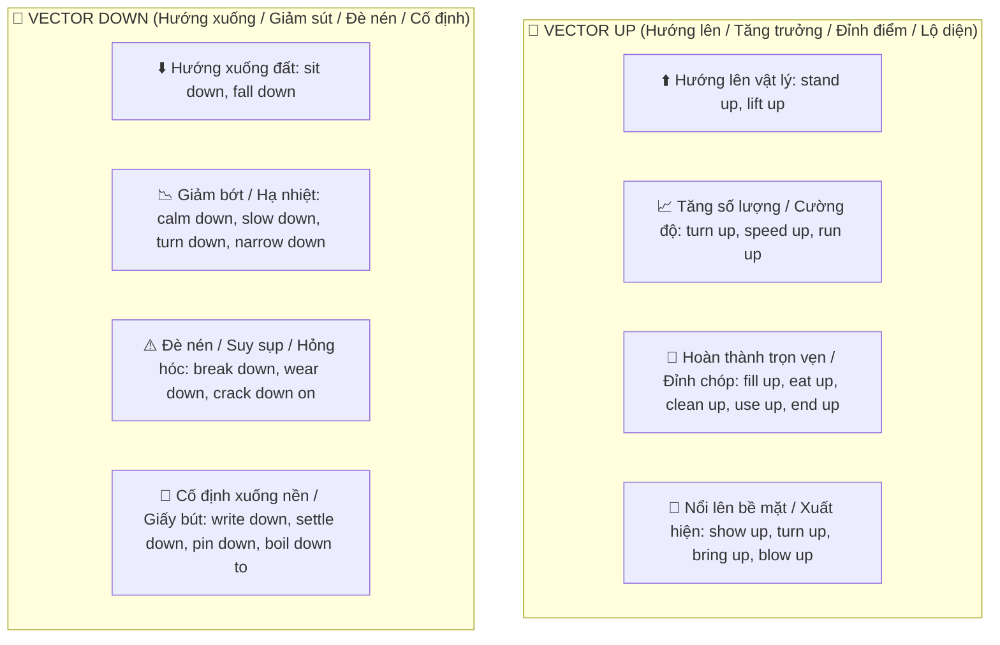
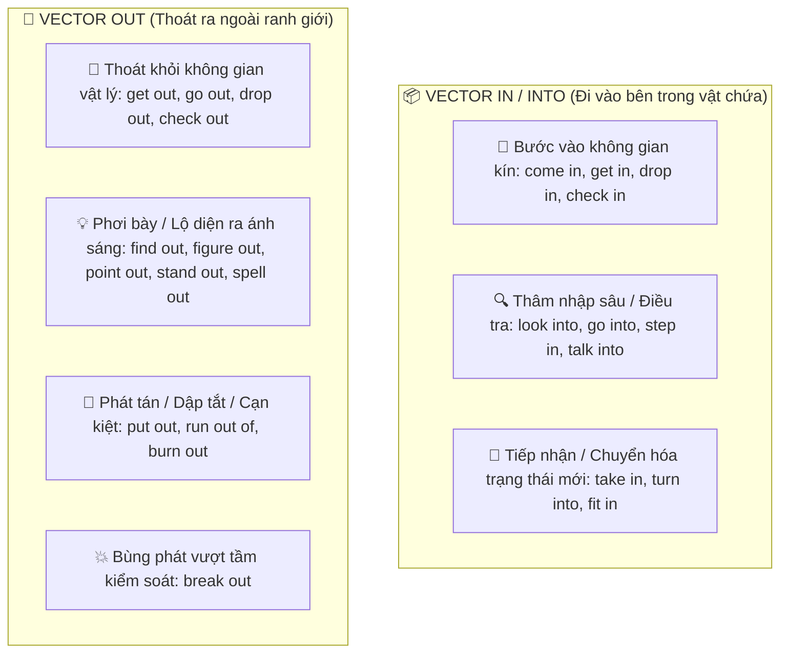
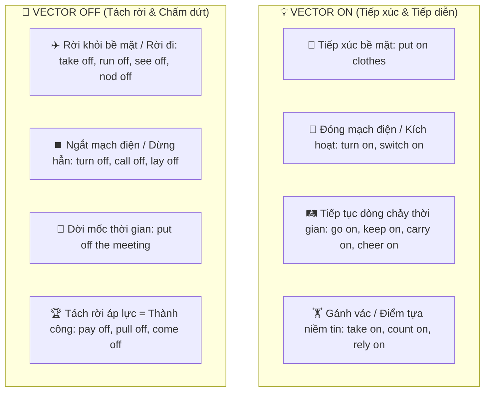
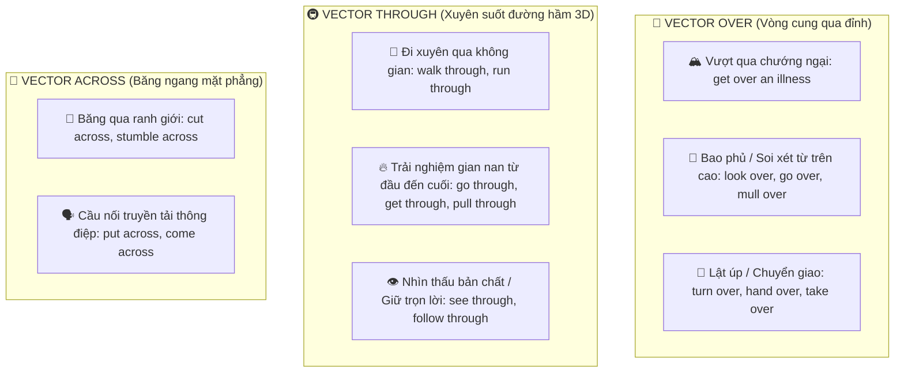
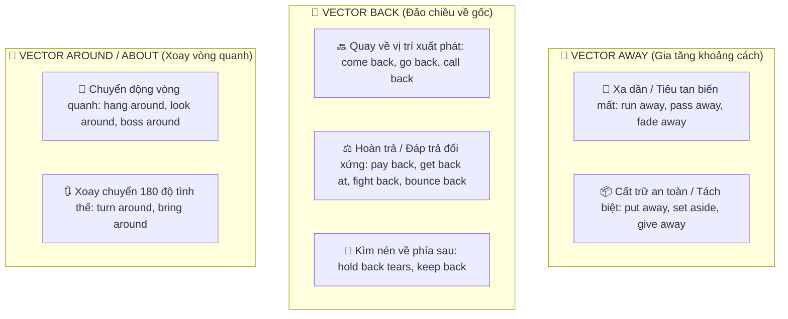

# 🧭 3.5. Phrasal Verbs & Particle Mechanics Hub (Trung Tâm Giải Mã Cụm Động Từ & Giới Từ)

> [!NOTE]
> **Phrasal Verbs (Cụm động từ)** không phải là những mảnh ghép ngẫu nhiên cần học vẹt! 
> Trong Ngôn ngữ học Tri nhận (*Cognitive Linguistics*), người bản xứ không ghi nhớ 200+ cụm từ một cách máy móc. Họ nhìn nhận **Tiểu từ / Giới từ (Particles / Prepositions)** như những **Tọa độ Không gian 3 Chiều (Spatial Schemas & Vectors)**. 
> Khi kết hợp một Động từ gốc chỉ hành vi vật lý với một Tiểu từ chỉ phương hướng/tọa độ, não bộ con người tự động kích hoạt **Ẩn dụ Ý niệm (Conceptual Metaphor)** để biến đổi nghĩa đen thành nghĩa bóng một cách vô cùng logic và chuẩn xác.

---

## 📑 BẢN ĐỒ ĐIỀU HƯỚNG CHUYÊN ĐỀ (MASTER DIRECTORY)

### 📂 20 Động Từ Gốc Cốt Lõi (Tách Thành Từng File Chuyên Biệt):
* **Nhóm 1 (Chuyển Động & Tái Cấu Trúc):**
  * 🔄 **[[TURN|1. TURN]]**: *turn down (từ chối/vặn nhỏ), turn up (xuất hiện/vặn to), turn out (hóa ra), turn into, turn over...*
  * 🏃 **[[RUN|2. RUN]]**: *run out of (hết sạch), run into (tình cờ gặp), run down (suy sụp/chỉ trích), run over, run up against...*
  * 💥 **[[BREAK|3. BREAK]]**: *break down (hỏng hóc/suy sụp), break out (bùng phát), break up (chia tay), break through, break off...*
  * 💰 **[[PAY|4. PAY]]**: *pay off (thành công/trả sạch nợ), pay back (trả đũa/trả nợ), pay down, pay out, pay up...*
  * 🏗️ **[[SET|5. SET]]**: *set up (thiết lập/dựng lên), set off (khởi hành/kích nổ), set aside (để dành), set back, set out...*
* **Nhóm 2 (Định Vị, Đặt Để & Quan Sát):**
  * 🚶 **[[COME|6. COME]]**: *come across (tình cờ bắt gặp), come down with (mắc bệnh), come about (xảy ra), come off, come into...*
  * 📥 **[[PUT|7. PUT]]**: *put off (trì hoãn), put up with (chịu đựng), put out (dập tắt), put down, put across, put forward...*
  * 📦 **[[BRING|8. BRING]]**: *bring up (nuôi nấng/nêu vấn đề), bring about (gây ra), bring out (làm nổi bật), bring off, bring in...*
  * 👀 **[[LOOK|9. LOOK]]**: *look into (điều tra), look forward to (mong đợi), look down on (coi thường), look up to (ngưỡng mộ)...*
* **Nhóm 3 (Chuyển Đổi Trạng Thái & Kiến Tạo):**
  * 🚀 **[[GET|10. GET]]**: *get over (vượt qua cú sốc), get along with (hòa hợp), get by (xoay sở sống), get rid of, get through...*
  * 🛠️ **[[MAKE|11. MAKE]]**: *make up (bịa chuyện/làm lành), make out (nhận ra/hiểu thấu), make off with (cuỗm đồ), make up for...*
  * 🤲 **[[TAKE|12. TAKE]]**: *take off (cất cánh/cởi đồ/phất lên), take on (gánh vác), take in (nuốt trọn/bị lừa), take over...*
  * 🚶 **[[GO|13. GO]]**: *go off (bom nổ/chuông reo/thiu chua), go through (trải qua giông bão), go back on (nuốt lời), go ahead...*
* **Nhóm 4 (Tương Tác Xã Hội, Duy Trì & Rung Động):**
  * 🎁 **[[GIVE|14. GIVE]]**: *give up (từ bỏ), give in (nhượng bộ), give off (tỏa mùi/khí), give away, give out...*
  * 🍂 **[[FALL|15. FALL]]**: *fall apart (tan vỡ), fall through (thất bại), fall for (say đắm/mắc bẫy), fall back on, fall behind...*
  * ✊ **[[HOLD|16. HOLD]]**: *hold back (kìm nén), hold on (chờ chút/bám chặt), hold off (hoãn), hold out (cầm cự), hold up...*
  * 🛡️ **[[KEEP|17. KEEP]]**: *keep up with (theo kịp), keep on (tiếp tục), keep away (tránh xa), keep down (kiểm soát)...*
  * 🧍 **[[STAND|18. STAND]]**: *stand up for (bênh vực), stand down (từ chức), stand by (sát cánh), stand in (thay thế)...*
  * ✂️ **[[CUT|19. CUT]]**: *cut off (ngắt điện/cô lập), cut in (chen ngang), cut out (loại bỏ), cut across, cut short...*
  * 🤾 **[[THROW|20. THROW]]**: *throw away (vứt bỏ), throw up (nôn mửa/bỏ việc), throw back, throw out, throw in...*
* **Nhóm 5 (Mở Rộng Các Động Từ Thông Dụng Khác):**
  * 🌟 **[[EXTENDED_COMMON_VERBS|21. EXTENDED_COMMON_VERBS]]**: *cheer up, show up, calm down, settle down, boil down to, figure out, find out, stand out, burn out, check in, fit in, call off, show off, lay off, carry on, count on, mull over, pass away, see through, follow through, pull through...*

---

## 1. Bản chất Cốt lõi: Phân biệt Preposition vs. Particle

| Tiêu chí | Giới từ thực thụ (Preposition) | Tiểu từ / Phó từ (Adverbial Particle) |
| :--- | :--- | :--- |
| **Bản chất ngữ pháp** | Là từ nối, **bắt buộc phải có Tân ngữ (Object)** đi sau để tạo cụm giới từ. | Là phó từ chỉ hướng/trạng thái, **đi sát động từ** để biến đổi ý nghĩa của động từ. |
| **Vị trí trong câu** | Luôn đứng trước danh từ: *He ran **into the room**.* | Có thể đứng trước hoặc sau tân ngữ: *He turned **off** the light* = *He turned the light **off**.* |
| **Chức năng chính** | Xác định vị trí/thời gian của danh từ đi sau đối với chủ ngữ. | Định hướng chuyển động, điểm kết thúc, hoặc trạng thái biến đổi của hành động. |
| **Trong Phrasal Verb** | Tạo nên *Prepositional Verbs* (không tách được tân ngữ). | Tạo nên *Phrasal Verbs* thực thụ (thường có thể tách tân ngữ). |

---

## 2. 5 Sơ Đồ Không Gian Tri Nhận (Mermaid Schemas)

#### 🔺 Trục 1: Trục Thẳng Đứng (Vertical Axis) — UP vs. DOWN


#### 📦 Trục 2: Vật Chứa & Không Gian (Container Axis) — IN / INTO vs. OUT


#### 🔌 Trục 3: Tiếp Xúc & Tiến Trình (Contact & Flow Axis) — ON vs. OFF


#### 🌈 Trục 4: Vòng Cung & Xuyên Suốt (Arc & Penetration Axis) — OVER, THROUGH, ACROSS


#### 🔄 Trục 5: Khoảng Cách & Đảo Chiều (Distance & Reversal Axis) — AWAY, BACK, AROUND


---

## 3. Quy Trình 3 Bước Đoán Nghĩa Phrasal Verb Mới Lạ

Khi bắt gặp một cụm động từ hoàn toàn mới:
```
[ 1. ĐỘNG TỪ GỐC ] ➔ Hành vi cơ thể vật lý là gì?
       +
[ 2. TIỂU TỪ ]     ➔ Vector không gian đẩy hướng về đâu? Điểm kết thúc ở đâu?
       ↓
[ 3. BỐI CẢNH ]    ➔ Đang nói về tình cảm, thời gian, công việc hay tiền bạc?
       ↓
[ NGHĨA BÓNG LOGIC ]
```
* *Ví dụ:* `iron out problems`
  * *Iron:* Dùng bàn là ủi phẳng.
  * *Out:* Kéo căng nếp gấp phơi ra ngoài phẳng phiu.
  * *Bối cảnh:* Mâu thuẫn bất đồng trong công việc.
  * ➔ **Nghĩa:** Giải quyết êm thấm các trở ngại, là phẳng mọi khúc mắc.
