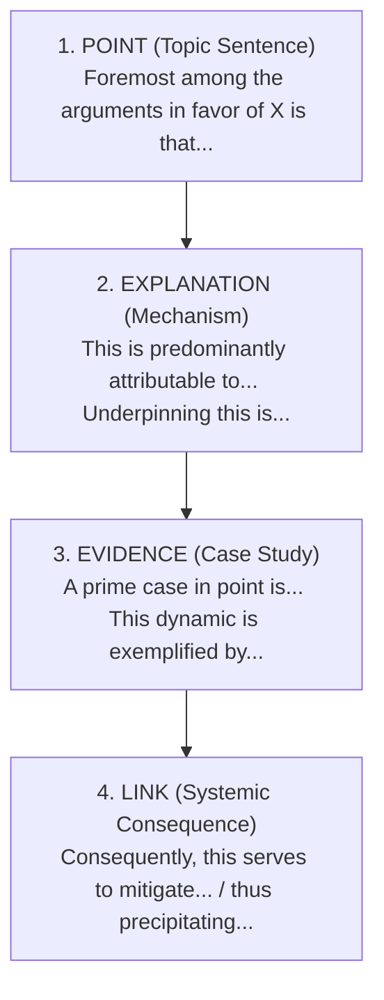

# ✍️ 6.3. IELTS Writing Task 2: Body Paragraph Architecture (PEEL)
*(Khung Mẫu Câu Xây Dựng Đoạn Thân Bài: Luận Điểm, Cơ Chế Giải Thích, Dẫn Chứng & Hệ Quả)*

> [!NOTE]
> Một đoạn thân bài (*Body Paragraph*) đạt điểm Band 8.0 - 9.0 tiêu chí Coherence & Cohesion phải có **cấu trúc khối PEEL chuẩn mực**:
> * **P - Point (Topic Sentence):** Nêu luận điểm trọng tâm duy nhất của đoạn.
> * **E - Explanation (Causality & Mechanism):** Đào sâu giải thích cơ chế "tại sao điều đó xảy ra" bằng các cụm danh từ học thuật.
> * **E - Evidence / Example:** Đưa ra dẫn chứng thực tiễn hoặc mô hình điển hình (*case study*).
> * **L - Link / Consequence:** Chốt lại hệ quả trực tiếp và liên kết ngược lại với luận đề chính (*Thesis*).

---

## 🏗️ SƠ ĐỒ KHỐI PEEL CHO THÂN BÀI HỌC THUẬT

---

### 1. Mẫu câu Viết Topic Sentence (Point)
Câu đầu tiên của thân bài phải báo hiệu ngay cho người đọc biết đoạn này nói về điều gì:

#### A. Đoạn Thân bài 1 (Mặt lợi / Luận điểm đầu tiên):
* **`Foremost among the rationales in favor of [Topic] is [Noun Phrase / That Clause]...`**
  * *Ví dụ:* *"**Foremost among the rationales in favor of universal healthcare subsidization is** the profound correlation between baseline population wellbeing and aggregate economic productivity."*
* **`The primary justification for [Topic] resides in its capacity to [Verb]...`**
  * *Ví dụ:* *"**The primary justification for renewable energy mandates resides in their capacity to** decouple industrial expansion from atmospheric degradation."*
* **`At the core of this perspective lies the premise that [Clause]...`**

#### B. Đoạn Thân bài 2 (Mặt đối lập / Luận điểm tăng cấp):
* **`Equally compelling is the argument that [Topic] exerts [Noun Phrase]...`**
  * *Ví dụ:* *"**Equally compelling is the argument that** early technical apprenticeships foster substantially higher career adaptability than purely theoretical schooling."*
* **`On a systemic level, another non-negligible advantage of [Topic] is [Noun Phrase]...`**
* **`Beyond immediate economic considerations, [Topic] carries profound ramifications for [Societal Dimension]...`**

---

### 2. Mẫu câu Đào Sâu Giải Thích Cơ Chế (Explanation & Causality)
Đừng chỉ nêu khẩu hiệu chung chung; hãy giải thích **bằng cách nào** và **tại sao**:

* **`This dynamic is predominantly attributable to [Noun Phrase], wherein [Subordinate Clause]...`**
  * *Ví dụ:* *"This dynamic is **predominantly attributable to institutional resource concentration**, wherein prestigious metropolises absorb the vast preponderance of venture capital, leaving peripheral townships fiscally starved."*
* **`The underlying mechanism stems from the fact that [Clause]; consequently, [Result]...`**
  * *Ví dụ:* *"**The underlying mechanism stems from the fact that** physical exercise stimulates neurotrophic factor synthesis; **consequently**, cognitive degeneration in aging demographics is markedly curtailed."*
* **`In the absence of [Precondition], [Negative subject] is virtually inevitable.`**
  * *Ví dụ:* *"**In the absence of rigorous statutory enforcement**, corporate self-regulation regarding environmental effluents is virtually futile."*
* **`By virtue of [Noun Phrase], individuals / institutions are empowered to [Verb]...`**

---

### 3. Mẫu câu Đưa Dẫn Chứng Học Thuật (Evidence & Exemplification)
Tránh đưa những dẫn chứng mang tính bịa đặt số liệu lộ liễu (*"According to a survey by Oxford in 2021, 89.4%..."*). Hãy dùng **mô hình điển hình (case studies)** hoặc **hiện tượng được công nhận rộng rãi**:

* **`A prime case in point is [Noun Phrase / Clause]...`**
  * *Ví dụ:* *"**A prime case in point is** the Danish offshore wind ecosystem, wherein sustained public-private consortia reduced levelized energy costs below those of thermal power plants."*
* **`This paradigm is cogently exemplified by [Noun Phrase]...`**
  * *Ví dụ:* *"**This socio-economic paradigm is cogently exemplified by** the post-industrial revival of Bilbao, Spain, wherein targeted architectural investments rejuvenated the entire regional economy."*
* **`Empirical manifestations of this dynamic are readily discernible across [Context]...`**
  * *Ví dụ:* *"**Empirical manifestations of this dynamic are readily discernible across** Nordic municipalities that instituted congestion tariffs, registering immediate drops in paediatric asthma admissions."*

---

### 4. Mẫu câu Chốt Hệ Quả & Liên Kết Ngược Lại Đề Bài (Link & Consequence)

* **`[Main Clause], thus serving to [Verb Phrase]...`**
  * *Ví dụ:* *"Such curricular modernizations bridge theoretical knowledge with vocational utility, **thus serving to alleviate chronic structural underemployment among youthful cohorts**."*
* **`Consequently, it becomes manifest that [Topic] constitutes [Noun Phrase]...`**
  * *Ví dụ:* *"**Consequently, it becomes manifest that** state-subsidized public transport constitutes not merely an infrastructural convenience, but a foundational pillar of socio-economic equity."*
* **`Viewed through this lens, [Action] represents an indispensable catalyst for [Desired Outcome]...`**

---

## 🎯 ĐOẠN THÂN BÀI MẪU HOÀN CHỈNH ĐẠT CHUẨN PEEL BAND 8.5+

> ✍️ **Thân bài mẫu (Topic: Should public transport be made completely free?):**
> 
> * **[POINT - Topic Sentence]:**
>   *"**Foremost among the rationales in favor of zero-fare public transit is its capacity to mitigate systemic metropolitan gridlock while accelerating urban decarbonization.**"*
> 
> * **[EXPLANATION - Cơ chế giải thích]:**
>   *"**This environmental transformation is predominantly attributable to the elimination of financial barriers**, which incentivizes a substantial proportion of daily commuters to abandon private vehicular transport. When modal shifts occur en masse, the volume of single-occupancy automobiles on arterial roadways contracts sharply; **consequently, both aggregate fossil combustion and idling emissions are curtailed substantially.**"*
> 
> * **[EXAMPLE - Dẫn chứng điển hình]:**
>   *"**A prime case in point is the nation of Luxembourg**, which eliminated standard fares across all domestic rail and bus networks in 2020. Empirical monitoring over the subsequent quadrennium revealed not only a measurable alleviation of vehicular congestion along cross-border corridors, but also a quantifiable surge in multimodal commuter satisfaction."*
> 
> * **[LINK - Hệ quả chốt lại luận đề]:**
>   *"**Viewed through this analytical lens, universal fare abolition constitutes an indispensable catalyst for sustainable urban ecosystems**, decisively vindicating the allocation of public subsidies."*

---
*Tài liệu thuộc chuyên đề: English Grammar & Cohesion — 6. IELTS Writing Sentence Patterns.*
