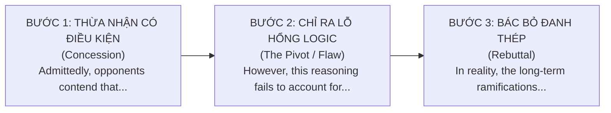

# ✍️ 6.4. IELTS Writing Task 2: Counter-Argument & Rebuttal Master
*(Kỹ Thuật Phản Biện Đa Chiều & Bác Bỏ Luận Điểm Đối Phương Chuẩn Band 8.5+)*

> [!NOTE]
> Trong tiêu chí **Task Response Band 8.0 - 9.0**, giám khảo đánh giá rất cao khả năng **Critical Thinking (Tư duy phản biện)**. Thay vì chỉ viết phiến diện 1 chiều (*one-sided*), một bài luận xuất sắc biết cách:
> 1. **Thừa nhận một cách công bằng lý lẽ của phe đối lập (Concession)**.
> 2. **Chỉ ra lỗ hổng logic hoặc tính ngắn hạn của lý lẽ đó (Pivot / Flaw identification)**.
> 3. **Bác bỏ đanh thép bằng luận cứ và bằng chứng vượt trội (Rebuttal)**.

---

## 🏗️ CẤU TRÚC 3 BƯỚC CỦA ĐOẠN PHẢN BIỆN (THE CONCESSION-REBUTTAL ARC)

---

### 1. Mẫu câu Thừa nhận Luận điểm Đối phương (Concession Starters)
Bắt đầu bằng sự công tâm học thuật:

* **`Admittedly, it is frequently asserted by detractors that [Opposing View]...`**
  * *Ví dụ:* *"**Admittedly, it is frequently asserted by detractors that** transitioning to renewable energy imposes prohibitive upfront capital expenditures on national treasuries."*
* **`Notwithstanding the ostensible validity of the argument that [Opposing Claim], [Pivot]...`**
  * *Ví dụ:* *"**Notwithstanding the ostensible validity of the argument that** standardized examinations provide an objective metric of student competency, **this pedagogical methodology overlooks multifaceted intelligences**."*
* **`It is readily acknowledged that [Point of Side A]; proponents often cite [Reason]...`**
  * *Ví dụ:* *"**It is readily acknowledged that** private vehicular mobility confers immediate personal convenience; **proponents often cite** point-to-point transit flexibility."*
* **`Critics of this proposal raise legitimate apprehensions regarding [Concern]...`**

---

### 2. Mẫu câu Bẻ Gãy & Chỉ Ra Lỗ Hổng Logic (The Pivot / Flaw Identification)
Sau dấu chấm hoặc dấu chấm phẩy, lật ngược vấn đề:

* **`However, such an assertion suffers from a fundamental logical fallacy, namely that [Explanation of Flaw]...`**
  * *Ngữ cảnh:* Chỉ ra ngụy biện logic (*fallacy*).
  * *Ví dụ:* *"**However, such an assertion suffers from a fundamental logical fallacy, namely that** it conflates immediate fiscal outlay with net long-term societal cost."*
    *(Tuy nhiên, khẳng định như vậy mắc phải một lỗi ngụy biện logic căn bản, cụ thể là nó đánh đồng chi phí tài khóa ban đầu với tổng chi phí xã hội dài hạn.)*
* **`Upon closer empirical scrutiny, this line of reasoning proves myopic / untenable because [Clause]...`**
  * *Ngữ cảnh:* Chỉ ra góc nhìn thiển cận (*myopic*) hoặc không thể đứng vững (*untenable*).
  * *Ví dụ:* *"**Upon closer empirical scrutiny, this line of reasoning proves remarkably myopic**, failing to recognize that preventive public healthcare expenditure drastically curtails future emergency room burdens."*
* **`This perspective rests on the flawed assumption that [Premise], whereas in reality, [Fact]...`**
* **`What this viewpoint conspicuously overlooks is [Crucial Omission]...`**

---

### 3. Mẫu câu Bác Bỏ Đanh Thép Bằng Luận Cứ Vượt Trội (The Rebuttal)

* **`In reality, the preponderance of evidence indicates that [Superior Reality]...`**
  * *Ví dụ:* *"**In reality, the preponderance of economic evidence indicates that** green energy sectors generate substantially more net domestic jobs per million dollars invested than legacy fossil industries."*
* **`The perceived drawbacks are decisively outweighed by [Long-term Dividend]...`**
  * *Ví dụ:* *"**The perceived short-term administrative disruptions are decisively outweighed by** the enduring socio-economic dividends of educational digitization."*
* **`Far from [Negative Claim], [Subject] actually serves to [Positive Outcome]...`**
  * *Ngữ cảnh:* Không những không gây hại mà trái lại còn mang lại điều tốt (*idiom `far from`*).
  * *Ví dụ:* *"**Far from eroding national cultural identity**, sensible international immigration **actually serves to invigorate** domestic innovation ecosystems."*

---

## 🎯 ĐOẠN PHẢN BIỆN MẪU HOÀN CHỈNH (BAND 8.5+)

> ✍️ **Topic: Should art subjects be eliminated from school curricula to make room for STEM?**
> 
> *"**Admittedly, critics of arts education contend that** in an increasingly technocratic global economy, prioritizing STEM subjects offers far more direct pathways to gainful employment. **Proponents of this view often cite** soaring industry demand for software engineers and biomedical researchers. 
> 
> **However, upon closer pedagogical scrutiny, this line of reasoning proves remarkably myopic, as it rests on the flawed assumption that** analytical proficiency operates independently of creative thinking. **What this viewpoint conspicuously overlooks is that** cutting-edge scientific innovation fundamentally relies on divergent conceptualization — a cognitive faculty nurtured primarily through artistic exploration. 
> 
> **Far from being an ornamental luxury**, design thinking and visual storytelling are now central to product engineering and architecture. **Consequently, eliminating arts subjects would inadvertently cripple the very creative dynamism that modern high-tech industries require**, rendering curriculum truncation a profoundly self-defeating endeavor."*

---
*Tài liệu thuộc chuyên đề: English Grammar & Cohesion — 6. IELTS Writing Sentence Patterns.*
