# 🗺️ English Grammar & Cohesion Dashboard

Chào mừng bạn đến với góc học tập **Ngữ pháp, Kỹ năng Liên kết câu & Kho Mẫu câu Luyện thi IELTS (Grammar, Cohesion & IELTS Patterns)**. Đây là nơi tổng hợp các quy tắc ngữ pháp cốt lõi, cách sử dụng giới từ, danh động từ, các phương pháp viết câu mạch lạc và hệ thống **mẫu câu chuyên sâu chia theo từng phần thi IELTS Speaking & Writing**.

---

## 📌 Sơ đồ lộ trình học tập (Learning Path)

```mermaid
graph TD
    Index["Grammar & Cohesion<br>(Mục lục chính)"] --> Sub1["🟢 1. Tenses & Core Grammar<br>(Các thì cơ bản)"]
    Index --> Sub2["🧩 2. Sentence Structures & Writing<br>(Cấu trúc câu & Viết câu)"]
    Index --> Sub3["📍 3. Prepositions & Gerunds<br>(Giới từ & Danh động từ)"]
    Index --> Sub4["⚡ 4. Advanced Grammar Topics<br>(Ngữ pháp nâng cao)"]
    Index --> Sub5["🗣️ 5. IELTS Speaking Patterns<br>(Mẫu câu Speaking Part 1, 2, 3)"]
    Index --> Sub6["✍️ 6. IELTS Writing Patterns<br>(Mẫu câu Writing Task 1 & 2)"]

    Sub1 --> P1["1.1. Present Tenses"]
    Sub1 --> P2["1.2. Past Tenses"]
    Sub1 --> P3["1.3. Future Tenses"]

    Sub2 --> S1["2.1. Sentence Elements"]
    Sub2 --> S2["2.2. Preposition Clauses"]
    Sub2 --> S3["2.3. Sentence Linkers"]
    Sub2 --> S4["2.4. Complex Sentences"]
    Sub2 --> S5["2.5. Paraphrasing Mastery"]
    Sub2 --> S6["2.6. Discourse Rewriting"]
    Sub2 --> S7["2.7. Speaking vs. Writing Frames"]

    Sub3 --> G1["3.1. Basic Prepositions"]
    Sub3 --> G2["3.2. Gerunds & Infinitives"]
    Sub3 --> G3["3.3. Advanced Prepositions"]
    Sub3 --> G4["3.4. Rare & Complex Prepositions"]

    Sub4 --> A1["4.1. Passive Voice"]
    Sub4 --> A2["4.2. Reported Speech"]
    Sub4 --> A3["4.3. Exclamatory"]
    Sub4 --> A4["4.4. Inversion"]
    Sub4 --> A5["4.5. Conditionals & Wish"]
    Sub4 --> A6["4.6. Subjunctive"]
    Sub4 --> A7["4.7. Cleft Sentences"]

    Sub5 --> Sp1["5.1. Part 1 Daily Topics"]
    Sub5 --> Sp2["5.2. Part 2 Storytelling Arc"]
    Sub5 --> Sp3["5.3. Part 3 Deep Analysis"]
    Sub5 --> Sp4["5.4. Buying Time & Hesitation"]
    Sub5 --> Sp5["5.5. Natural Fillers & Clefts"]
    Sub5 --> Sp6["5.6. Speaking Progression & Lexical Swaps"]

    Sub6 --> W1["6.1. Task 1 Trends & Processes"]
    Sub6 --> W2["6.2. Task 2 Intros & Theses"]
    Sub6 --> W3["6.3. Task 2 PEEL Body Architecture"]
    Sub6 --> W4["6.4. Task 2 Counter-Argument"]
    Sub6 --> W5["6.5. Task 2 Conclusions & Outlook"]
    Sub6 --> W6["6.6. Writing Progression & Lexical Swaps"]
```

---

## 📚 Danh mục các chuyên đề học tập

Dưới đây là các chủ đề chi tiết giúp bạn tra cứu và học tập một cách hệ thống theo từng thư mục con:

### 📁 1. Tenses & Core Grammar (Các thì & Ngữ pháp cốt lõi)
*   🟢 **[[1. Tenses & Core Grammar/1.1. Present Tenses|1.1. Present Tenses (Các thì Hiện tại)]]**: Công thức, cách dùng, dấu hiệu và lưu ý về động từ trạng thái (State verbs).
*   🟡 **[[1. Tenses & Core Grammar/1.2. Past Tenses|1.2. Past Tenses (Các thì Quá khứ)]]**: Phối hợp các thì quá khứ trong câu chuyện, quy tắc phát âm đuôi "-ed".
*   🔵 **[[1. Tenses & Core Grammar/1.3. Future Tenses|1.3. Future Tenses (Các thì Tương lai)]]**: Công thức tương lai và phân biệt bẫy *Will* vs. *Be going to* vs. *Present Continuous*.

### 📁 2. Sentence Structures & Writing (Cấu trúc câu & Kỹ thuật viết)
*   🧩 **[[2. Sentence Structures & Writing/2.1. Sentence Elements & Types|2.1. Sentence Elements & Types (Thành phần & Cấu trúc câu)]]**: Phân tích S-V-O-C-A, 4 kiểu câu (Simple, Compound, Complex, Compound-Complex) và các lỗi viết câu kinh điển.
*   🔗 **[[2. Sentence Structures & Writing/2.2. Connecting Clauses with Prepositions|2.2. Connecting Clauses with Prepositions (Nối câu bằng giới từ)]]**: Nối câu dùng *despite, due to* hoặc mệnh đề quan hệ với giới từ (*in which, to whom*).
*   🌉 **[[2. Sentence Structures & Writing/2.3. Sentence Linkers & Paragraph Cohesion|2.3. Sentence Linkers & Paragraph Cohesion (Từ nối & Liên kết câu)]]**: Cách dùng từ nối transition words và các công cụ giúp liên kết đoạn văn mạch lạc.
*   🔬 **[[2. Sentence Structures & Writing/2.4. Complex Sentences & Clause Breakdown|2.4. Complex Sentences & Clause Breakdown (Mổ xẻ câu phức đa tầng)]]**: Giải phẫu mô hình khối Lego của câu dài học thuật, tránh lỗi Comma Splice và Run-on sentences.
*   🔄 **[[2. Sentence Structures & Writing/2.5. Paraphrasing Mastery & Sentence Transformations|2.5. Paraphrasing Mastery & Sentence Transformations (Làm chủ Paraphrase)]]**: 6 kỹ thuật biến đổi câu linh hoạt (Chuyển dạng từ, bị động, đảo ngữ, cấu trúc tương đương).
*   📝 **[[2. Sentence Structures & Writing/2.6. Paragraph Paraphrasing & Discourse Rewriting|2.6. Paragraph Paraphrasing & Discourse Rewriting (Viết lại đoạn văn)]]**: Phương pháp nâng cấp đoạn văn Band 5.5 - 6.0 lên Band 8.0+, xử lý mạch logic và cấu trúc diễn ngôn.
*   🗣️✍️ **[[2. Sentence Structures & Writing/2.7. Speaking vs. Writing Sentence Patterns & Master Frames|2.7. Speaking vs. Writing: Sentence Patterns & Master Frames (Kho mẫu câu Nói vs. Viết)]]**: Phân hóa rạch ròi mẫu câu cho IELTS Speaking vs. IELTS Writing / Paper theo 7 chức năng giao tiếp, kèm các đoạn văn đối chiếu thực chiến và bảng cạm bẫy văn phong (*Register Traps*).

### 📁 3. Prepositions, Gerunds & Infinitives (Giới từ, Danh động từ & Nguyên mẫu)
*   📍 **[[3. Prepositions, Gerunds & Infinitives/3.1. Basic Prepositions (Giới từ cơ bản)|3.1. Basic Prepositions (Giới từ cơ bản)]]**: Quy tắc tam giác giới từ *In - On - At* và collocations giới từ cơ bản, kèm bài tập thực hành.
*   🔄 **[[3. Prepositions, Gerunds & Infinitives/3.2. Gerunds & Infinitives|3.2. Gerunds & Infinitives (Danh động từ & Động từ nguyên mẫu)]]**: Phân biệt *V-ing* vs. *to V*, các động từ đi với cả hai dạng nhưng nghĩa thay đổi.
*   ⚡ **[[3. Prepositions, Gerunds & Infinitives/3.3. Advanced Prepositions (Giới từ nâng cao)|3.3. Advanced Prepositions (Giới từ nâng cao)]]**: Giới từ chỉ tác nhân, công cụ, nguyên nhân, cụm giới từ phức tạp, các collocations C1-C2 và bài tập nâng cao.
*   💎 **[[3. Prepositions, Gerunds & Infinitives/3.4. Rare & Complex Academic Prepositions (Giới từ khó & độc lạ)|3.4. Rare & Complex Academic Prepositions (Giới từ khó & độc lạ)]]**: Tổng hợp các giới từ đơn C1-C2 hiếm gặp (*notwithstanding, barring, pending, athwart*), giới từ mượn gốc Latinh/Pháp (*vis-à-vis, sans, pace, circa*), cụm giới từ phức hợp 3-4 từ (*by virtue of, in lieu of, under the auspices of*), và phân tích đoạn văn học thuật thực chiến.

### 📁 4. Advanced Grammar Topics (Chuyên đề ngữ pháp nâng cao)
*   🔄 **[[4. Advanced Grammar Topics/4.1. Passive Voice (Câu bị động)|4.1. Passive Voice (Câu bị động)]]**: Bị động cho 12 thì, bị động truyền khiến (*have/get sth done*), bị động kép với động từ tường thuật, và đảo ngữ bị động.
*   🗣️ **[[4. Advanced Grammar Topics/4.2. Reported Speech (Câu gián tiếp)|4.2. Reported Speech (Câu gián tiếp)]]**: Quy tắc lùi thì, đổi trạng từ và các động từ tường thuật đặc biệt (*suggest, deny, offer...*).
*   😮 **[[4. Advanced Grammar Topics/4.3. Exclamatory Sentences (Câu cảm thán)|4.3. Exclamatory Sentences (Câu cảm thán)]]**: Cấu trúc cảm thán nâng cao với *What, How, So, Such* và giao tiếp thực tế.
*   🔄 **[[4. Advanced Grammar Topics/4.4. Inversion (Đảo ngữ)|4.4. Inversion (Đảo ngữ)]]**: Đảo ngữ phủ định, đảo ngữ với *Only, No sooner, So/Such* và đảo ngữ câu điều kiện.
*   🌀 **[[4. Advanced Grammar Topics/4.5. Conditionals & Wish (Câu điều kiện & Ước)|4.5. Conditionals & Wish (Câu điều kiện & Câu ước)]]**: Điều kiện loại 0-3, điều kiện hỗn hợp (Mixed), các từ thay thế *If*, và cấu trúc câu ước *Wish / If only*.
*   🧠 **[[4. Advanced Grammar Topics/4.6. Subjunctive Mood (Thức giả định)|4.6. Subjunctive Mood (Thức giả định)]]**: Giả định hiện tại (động từ nguyên mẫu không chia sau *suggest, essential*) và giả định quá khứ (*It's time, Would rather, As if*).
*   🧩 **[[4. Advanced Grammar Topics/4.7. Cleft Sentences (Câu chẻ nhấn mạnh)|4.7. Cleft Sentences (Câu chẻ nhấn mạnh)]]**: Câu chẻ nhấn mạnh chủ ngữ, tân ngữ, trạng ngữ với *It is/was... that* và câu chẻ với *What*.

### 📁 5. IELTS Speaking Sentence Patterns (Kho mẫu câu luyện thi Speaking)
*   🗣️ **[[5. IELTS Speaking Sentence Patterns/5.1. Part 1 - Daily & Personal Topics|5.1. Part 1: Daily & Personal Topics (Mẫu câu phản xạ Part 1)]]**: Bày tỏ sở thích & ác cảm, thói quen & tần suất, đối chiếu quá khứ - hiện tại, giả định tương lai.
*   📖 **[[5. IELTS Speaking Sentence Patterns/5.2. Part 2 - Long Turn & Storytelling|5.2. Part 2: Long Turn & Storytelling (Kể chuyện & mô tả Part 2)]]**: Khung 4 bước dẫn chuyện (Opening ➔ Details ➔ Climax / Twist ➔ Reflection & Takeaways).
*   🧠 **[[5. IELTS Speaking Sentence Patterns/5.3. Part 3 - Abstract Discussion & Deep Analysis|5.3. Part 3: Abstract Discussion & Deep Analysis (Phân tích chuyên sâu Part 3)]]**: So sánh nhóm đối tượng, dự báo xu hướng tương lai, phân tích tác động dây chuyền, đánh giá con dao 2 lưỡi.
*   ⏳ **[[5. IELTS Speaking Sentence Patterns/5.4. Buying Time, Hesitation & Clarification|5.4. Buying Time, Hesitation & Clarification (Câu giờ & xử lý câu khó)]]**: Kỹ thuật câu giờ tự nhiên, xử lý câu hỏi chưa có kinh nghiệm, tự sửa lỗi trơn tru và nhờ giám khảo diễn đạt lại.
*   🎶 **[[5. IELTS Speaking Sentence Patterns/5.5. Natural Fillers, Discourse Markers & Clefts|5.5. Natural Fillers, Discourse Markers & Clefts (Từ đệm & câu chẻ nói)]]**: Liên từ khẩu ngữ tạo độ mượt, fillers có ý nghĩa, và câu chẻ (*Wh-cleft / It-cleft*) tạo điểm nhấn cảm xúc.
*   🔄 **[[5. IELTS Speaking Sentence Patterns/5.6. Speaking Progression & Lexical Swaps (Mẫu câu Bậc thang từ Cơ bản đến Nâng cao & Hoán đổi Từ vựng)|5.6. Speaking Progression & Lexical Swaps (Bậc thang & Hoán đổi từ vựng)]]**: Khung câu 3 cấp độ (Band 5.5 ➔ 6.5 ➔ 8.5+), ma trận hoán đổi Trạng từ - Tính từ - Danh từ theo module cho 5 chức năng văn nói cốt lõi kèm giải thích lý do viết.

### 📁 6. IELTS Writing Sentence Patterns (Kho mẫu câu luyện thi Writing)
*   📊 **[[6. IELTS Writing Sentence Patterns/6.1. Task 1 - Data Trends, Comparisons & Processes|6.1. Task 1: Data Trends, Comparisons & Processes (Báo cáo biểu đồ & số liệu)]]**: Mẫu câu paraphrase đề bài, câu Overview bậc thầy, miêu tả xu hướng biến động, so sánh tỷ lệ, bản đồ & quy trình.
*   🎯 **[[6. IELTS Writing Sentence Patterns/6.2. Task 2 - Introductions & Thesis Statements|6.2. Task 2: Introductions & Thesis Statements (Mở bài & Thesis statement)]]**: Công thức mở bài 2 câu chuẩn học thuật và bộ Thesis Statements đanh thép cho cả 5 dạng đề thi Task 2.
*   🏗️ **[[6. IELTS Writing Sentence Patterns/6.3. Task 2 - Body Paragraph Architecture (PEEL)|6.3. Task 2: Body Paragraph Architecture (Thân bài chuẩn PEEL)]]**: Mẫu câu Topic sentence (Point), giải thích cơ chế (Explanation), dẫn chứng điển hình (Evidence), và chốt hệ quả (Link).
*   ⚔️ **[[6. IELTS Writing Sentence Patterns/6.4. Task 2 - Counter-Argument & Rebuttal Master|6.4. Task 2: Counter-Argument & Rebuttal Master (Phản biện & bác bỏ)]]**: Kỹ thuật 3 bước (Concession ➔ Pivot / Flaw ➔ Rebuttal) thể hiện tư duy phản biện Band 8.5+.
*   🏁 **[[6. IELTS Writing Sentence Patterns/6.5. Task 2 - Conclusions & Strategic Recommendations|6.5. Task 2: Conclusions & Strategic Recommendations (Kết bài & khuyến nghị)]]**: Công thức kết bài 2 câu tái khẳng định lập trường và đúc kết tầm nhìn chiến lược.
*   🔄 **[[6. IELTS Writing Sentence Patterns/6.6. Writing Progression & Lexical Swaps (Mẫu câu Bậc thang từ Cơ bản đến Nâng cao & Hoán đổi Từ vựng)|6.6. Writing Progression & Lexical Swaps (Bậc thang & Hoán đổi từ vựng)]]**: Khung câu 3 cấp độ học thuật (Band 5.5 ➔ 6.5 ➔ 8.5+), kỹ thuật Danh từ hóa (Nominalization), ma trận hoán đổi Trạng từ - Tính từ - Danh từ theo module cho 5 chức năng học thuật kèm giải thích lý do viết.

---

## 💡 Mẹo sử dụng Obsidian hiệu quả
- **Phím tắt nhanh:** Nhấn `Ctrl + Click` (hoặc `Cmd + Click`) vào các link màu xanh để nhảy nhanh đến note học tập.
- **Tập luyện hàng ngày:** Sử dụng thư mục `5` trước mỗi buổi luyện nói Speaking và thư mục `6` khi lập dàn ý / viết bài Writing Task 1 & Task 2.

---
*Cập nhật: 2026-10-13 bởi Antigravity Assistant.*
