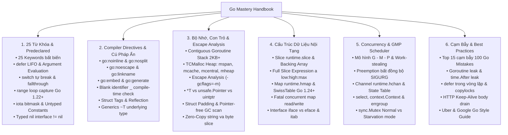

# GO (GOLANG) ADVANCED MASTERY HANDBOOK & RUNTIME REFERENCE
# Cẩm Nang Ôn Tập Chuyên Sâu Go (Golang): Từ Khóa, Cú Pháp `//go:...`, Nội Tạng Runtime & Lập Trình Bất Đồng Bộ

> **Dành cho:** Kỹ sư Hệ thống phân tán (Distributed Systems), Kỹ sư Hạ tầng Đám mây (Cloud-Native / Kubernetes / Microservices), và Kỹ sư Phần mềm muốn nắm vững bản chất bên dưới trình biên dịch và Go Runtime.
> **Nguồn tham khảo tổng hợp:**
> - Đặc tả ngôn ngữ chính thức: *The Go Programming Language Specification* & *The Go Memory Model* (`go.dev/ref/spec`, `go.dev/ref/mem`).
> - Sách kinh điển: *The Go Programming Language* (Alan A. A. Donovan & Brian W. Kernighan), *100 Go Mistakes and How to Avoid Them* (Teiva Harsanyi), *Concurrency in Go* (Katherine Cox-Buday), *Efficient Go: Data-Driven Performance Optimization* (Bartłomiej Płóciennik), *Go Internals* (Changkun Ou).
> - Quy chuẩn công nghiệp: *Uber Go Style Guide*, *Google Go Style Decisions*, *Effective Go*.
> - Mã nguồn sản xuất thực tế: Go Standard Library & Runtime (`src/runtime`, `src/sync`), *Kubernetes* (`kubernetes/kubernetes`), *Docker / Moby* (`moby/moby`), *Prometheus* (`prometheus/prometheus`), *etcd* (`etcd-io/etcd`), *CockroachDB* (`cockroachdb/cockroach`).

---

## 🗺️ Bản Đồ Tri Thức (Map of Content - MOC)

---

## 📚 Danh Mục Các Chuyên Đề Chi Tiết

Mỗi chuyên đề dưới đây được biên soạn toàn diện, đi sâu vào cấu trúc dữ liệu của Go Runtime (`src/runtime`), phân tích trình biên dịch (`gc`), các cạm bẫy thực tế trên môi trường Production và mổ xẻ mã nguồn từ các dự án Cloud-Native hàng đầu:

1. **[[01_Keywords_and_Predeclared_Identifiers|Chuyên đề 01: Toàn Bộ 25 Từ Khóa Duy Nhất & Định Danh Tiền Khai Báo (Predeclared Identifiers)]]**
   - Phân tích toàn diện 25 từ khóa tối giản của Go và bản chất dưới tầng trình biên dịch/runtime.
   - Cơ chế `defer` (`_defer` struct pool, đánh giá đối số ngay lúc đăng ký, sửa đổi named return values), `fallthrough` khác C như thế nào, và sự thay đổi lịch sử của biến vòng lặp `range` từ Go 1.22+.
   - Giải mã nhóm **Predeclared Identifiers**: `iota` bitmask, hằng số không kiểu (Untyped Constants), `make` vs `new`, `clear`, và cạm bẫy kinh điển nhất của Go: **Typed `nil` interface $\neq$ `nil`**.

2. **[[02_Compiler_Directives_and_Special_Syntax|Chuyên đề 02: Chỉ Thị Trình Biên Dịch (`//go:...`), Build Tags & Các Cú Pháp Đặc Biệt]]**
   - Khám phá các chỉ thị "ngầm" tương đương `__attribute__` trong C: `//go:noinline`, `//go:nosplit`, `//go:noescape`, `//go:linkname` (cùng cơ chế khóa bảo mật từ Go 1.23+), `//go:uintptrescapes`, `//go:norace`, `//go:embed`, `//go:generate`.
   - Cú pháp đặc trưng: Định danh trống `_` (kiểm tra thực thi Interface tại thời điểm biên dịch `var _ io.Reader = (*MyType)(nil)`, hiệu ứng phụ `init()`), Struct Tags, Type Switch `v.(type)` và toán tử kiểu nền `~T` trong Generics.
   - **Mổ xẻ mã nguồn thực tế:** Cách Kubernetes, Prometheus và Go Standard Library (`sync`, `runtime`, `strings.Builder`) tận dụng `//go:noescape` và compile-time interface assertion.

3. **[[03_Memory_Model_Pointers_and_Escape_Analysis|Chuyên đề 03: Kiến Trúc Bộ Nhớ, Escape Analysis, `unsafe.Pointer` & Căn Chỉnh Struct]]**
   - Kiến trúc bộ nhớ Go: Ngăn xếp Goroutine co giãn liên tục (Contiguous Stack bắt đầu từ 2KB) và bộ cấp phát Heap phân tầng kiểu TCMalloc (`mspan`, `mcache`, `mcentral`, `mheap`, Tiny Allocator).
   - Phân tích thoát vùng nhớ (**Escape Analysis** với `go build -gcflags="-m"`): Khi nào biến nằm trên Stack, khi nào bị đẩy lên Heap.
   - Tam giác con trỏ: `*T` (an toàn) vs `unsafe.Pointer` (cầu nối 6 quy tắc vàng) vs `uintptr` (số nguyên địa chỉ và hiểm họa GC di chuyển stack/bộ nhớ).
   - Struct Padding & Field Alignment tương tác với bộ gom rác (**Garbage Collector**): Kỹ thuật cấu trúc không con trỏ (`noscan` mspan) để triệt tiêu chi phí quét GC.
   - **Mổ xẻ mã nguồn thực tế:** Kỹ thuật chuyển đổi Zero-Copy giữa `[]byte` và `string` bằng `unsafe.String` / `unsafe.SliceData` trong `strings.Builder` và `prometheus/tsdb`.

4. **[[04_Data_Structures_Slices_Maps_and_Interfaces|Chuyên đề 04: Giải Phẫu Nội Tạng Slice, Map & Interface Dưới Tầng Runtime]]**
   - Giải phẫu **Slice** (`runtime.slice`): Cạm bẫy chia sẻ mảng nền (Backing Array mutation), rò rỉ bộ nhớ do giữ tham chiếu mảng lớn, và biểu thức **Full Slice Expression `a[low:high:max]`** để khóa `cap`.
   - Giải phẫu **Map** (`runtime.hmap` cổ điển & kiến trúc **SwissTable** mới trong Go 1.24+): Tại sao cấm lấy địa chỉ `&m[k]`, tại sao thứ tự duyệt map luôn ngẫu nhiên, cơ chế phát hiện `concurrent map read and map write` gây `fatal error` không thể `recover`, và khi nào dùng `sync.Map`.
   - Giải phẫu **Interface** (`runtime.iface` vs `runtime.eface`): Bảng phương thức `itab`, cơ chế tra cứu động và chi phí cấp phát (boxing allocation) khi gán giá trị vào interface.
   - **Mổ xẻ mã nguồn thực tế:** Cách Docker/Moby và CockroachDB tối ưu hóa Slice pre-allocation và quản lý `sync.Pool` để tái sử dụng bộ đệm, giảm áp lực lên Garbage Collector.

5. **[[05_Concurrency_Goroutines_Channels_and_GMP_Scheduler|Chuyên đề 05: Lập Trình Đồng Thời: Goroutines, Channels & Bộ Lập Lịch GMP Scheduler]]**
   - Giải phẫu bộ lập lịch **GMP Scheduler** (`G` - Goroutine, `M` - Machine OS Thread, `P` - Logical Processor): Thuật toán đánh cắp tác vụ (Work-stealing), cơ chế chuyển giao `P` (Handoff) khi nghẽn syscall, và cơ chế ngắt ưu tiên bất đồng bộ bằng tín hiệu `SIGURG` (Asynchronous Preemption từ Go 1.14+).
   - Giải phẫu **Channel** (`runtime.hchan`): Cấu trúc Ring Buffer kết hợp hàng đợi `sendq`/`recvq` (`sudog`), copy trực tiếp giữa hai stack Goroutine, và bảng chân trị trạng thái khi `send`/`recv`/`close` trên channel `nil`, channel đóng và channel mở.
   - Điều phối nâng cao: Cơ chế `select` ngẫu nhiên hóa chống đói (starvation), cây hủy bỏ `context.Context`, `sync.WaitGroup`, `sync.Once`, `sync.Mutex` (Normal mode vs Starvation mode 1ms), `sync/atomic` và `errgroup.Group`.
   - **Mổ xẻ mã nguồn thực tế:** Các mẫu thiết kế Worker Pool, Pipeline, Fan-out/Fan-in và Graceful Shutdown chuẩn mực từ Kubernetes (`client-go`, `controller-runtime`) và `etcd`.

6. **[[06_Traps_Gotchas_and_Production_Best_Practices|Chuyên đề 06: Top 15 Cạm Bẫy Kinh Điển (100 Go Mistakes) & Quy Chuẩn Sản Xuất]]**
   - Phân tích chi tiết 15 lỗi phổ biến và nguy hiểm nhất trên môi trường Production: Bẫy `nil` interface, rò rỉ Goroutine, `defer` trong vòng lặp, copy nhầm `sync.Mutex` (`copylocks`), rò rỉ bộ nhớ `time.After` trong `select`, bẫy JSON unmarshal số thành `float64`, quên đọc cạn `http.Response.Body` làm hỏng HTTP Keep-Alive pool, và Data Race.
   - Hệ thống quy tắc viết code chuẩn công nghiệp đúc kết từ **Uber Go Style Guide** và **Google Go Style Decisions**.

7. **[[07_Recommended_Resources_Books_and_Repos|Chuyên đề 07: Thư Viện Tài Nguyên, Công Cụ Phân Tích (`pprof`, `trace`) & GitHub Repos Mẫu Mực]]**
   - Lộ trình đọc sách chuyên sâu theo 4 cấp độ, bộ công cụ chẩn đoán hiệu năng & kiểm tra tĩnh (`go vet`, `staticcheck`, `golangci-lint`, `pprof`, `go tool trace`, `-race`), và danh sách các kho mã nguồn mở Go đáng học hỏi nhất thế giới.

---

## 🧪 Phòng Thực Nghiệm (Code Lab)

Kèm theo bộ cẩm nang là hệ thống bài thực hành kiểm chứng trực tiếp tại thư mục [`code_lab/`](file:///home/thinh/Obsidian/Go_Mastery_Handbook/code_lab/), sẵn sàng biên dịch và chạy kiểm thử bằng một lệnh `make run`:

- [`01_nil_interface_trap.go`](file:///home/thinh/Obsidian/Go_Mastery_Handbook/code_lab/01_nil_interface_trap.go): Chứng minh trực quan bẫy `typed nil != nil` bằng kiểm tra bộ nhớ `unsafe` và `reflect`, cùng giải pháp phòng tránh chuẩn xác.
- [`02_slice_backing_and_fullslice.go`](file:///home/thinh/Obsidian/Go_Mastery_Handbook/code_lab/02_slice_backing_and_fullslice.go): Minh họa hiện tượng sửa đổi ngoài ý muốn trên mảng nền chung, rò rỉ bộ nhớ sub-slice và cách dùng Full Slice Expression `a[low:high:max]` để cô lập vùng nhớ.
- [`03_unsafe_zerocopy_and_layout.go`](file:///home/thinh/Obsidian/Go_Mastery_Handbook/code_lab/03_unsafe_zerocopy_and_layout.go): Đo đạc `unsafe.Sizeof`, `Offsetof`, `Alignof` (tối ưu Struct Padding tiết kiệm 33% RAM) và kỹ thuật chuyển đổi Zero-Copy `string <-> []byte` bằng `unsafe.String` / `unsafe.SliceData`.
- [`04_concurrency_patterns_context.go`](file:///home/thinh/Obsidian/Go_Mastery_Handbook/code_lab/04_concurrency_patterns_context.go): Triển khai Worker Pool chịu tải thực tế kết hợp `context.WithTimeout`, `sync.WaitGroup` và `select` đảm bảo không rò rỉ Goroutine (Zero Goroutine Leak).
- [`05_defer_and_iota_tricks.go`](file:///home/thinh/Obsidian/Go_Mastery_Handbook/code_lab/05_defer_and_iota_tricks.go): Kiểm chứng thời điểm đánh giá đối số của `defer`, thứ tự LIFO, can thiệp giá trị trả về có tên (Named Return Values) và thiết kế cờ quyền hạn Bitmask bằng `iota`.
- [`06_sync_pool_and_atomic.go`](file:///home/thinh/Obsidian/Go_Mastery_Handbook/code_lab/06_sync_pool_and_atomic.go): Thực nghiệm tái sử dụng vùng nhớ đệm bằng `sync.Pool` giảm tải Garbage Collector và bộ đếm lock-free tốc độ cao với `atomic.Int64`.
