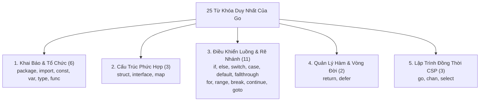
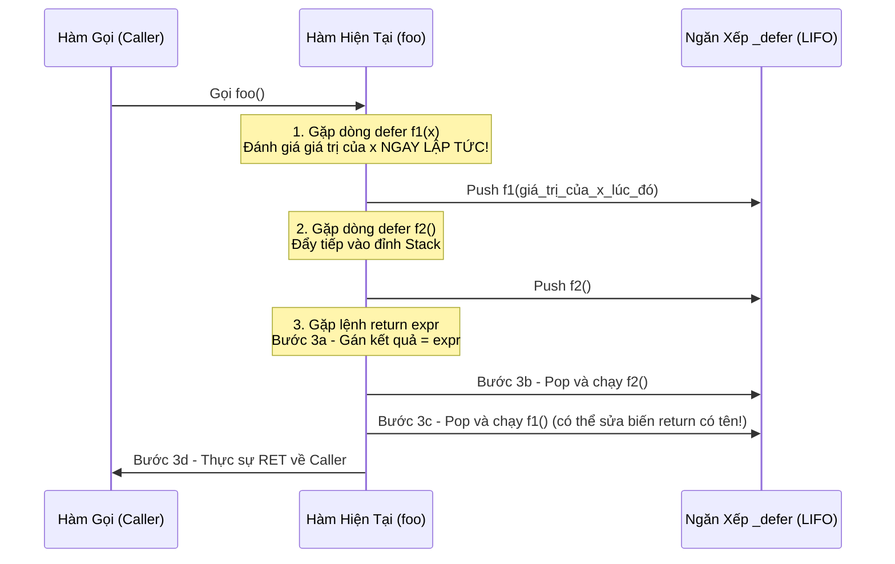
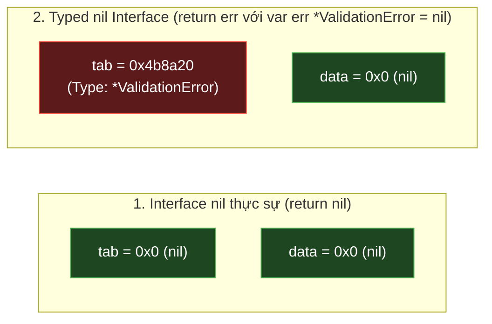

# CHUYÊN ĐỀ 01: TOÀN BỘ 25 TỪ KHÓA DUY NHẤT & ĐỊNH DANH TIỀN KHAI BÁO (PREDECLARED IDENTIFIERS)

> Thuộc bộ cẩm nang: [[00_Go_Mastery_Index|Go Mastery Handbook]]  
> Tham khảo: *The Go Programming Language Specification*, *100 Go Mistakes* (Teiva Harsanyi), Go Compiler & Runtime Source (`src/runtime`).

---

## 1. Triết Lý Tối Giản: 25 Từ Khóa Bất Biến Của Go

Nếu như C89 có 32 từ khóa, C23 có hơn 44 từ khóa và C++20 vượt quá 90 từ khóa, thì các nhà sáng lập Go (Rob Pike, Ken Thompson, Robert Griesemer) đã thiết kế ngôn ngữ với một quy tắc khắc nghiệt: **Sự trực giao (Orthogonality) và tối giản tuyệt đối**. Từ phiên bản Go 1.0 (năm 2012) đến Go 1.24+ hiện tại (kể cả khi bổ sung Generics ở Go 1.18), Go vẫn giữ nguyên đúng **25 từ khóa (Keywords)**.

> [!IMPORTANT]
> Trong Go, các kiểu dữ liệu như `int`, `string`, `bool`, `any`, hằng số `true`, `false`, `nil`, `iota`, hay các hàm `make`, `new`, `len`, `append`, `panic`, `recover` **KHÔNG PHẢI LÀ TỪ KHÓA**! Chúng là các **Định danh tiền khai báo (Predeclared Identifiers)** nằm trong Universe Block.



---

## 2. Bảng Phân Tích Chuyên Sâu 25 Từ Khóa Go

Dưới đây là bảng giải phẫu toàn bộ 25 từ khóa, cách trình biên dịch (`cmd/compile`) xử lý chúng và những cạm bẫy sâu sắc dưới tầng hệ thống:

| Nhóm chức năng | Từ khóa | Mục đích chính | Bản chất Compiler/Runtime & Cạm bẫy ít người biết |
| :--- | :--- | :--- | :--- |
| **Tổ chức gói** | `package` | Khai báo tên gói của file mã nguồn | Mọi file trong cùng một thư mục phải cùng tên `package` (trừ hậu tố `_test` cho black-box testing). `package main` là điểm nhập thực thi duy nhất sinh ra binary. |
| | `import` | Nạp gói phụ thuộc | Quá trình khởi tạo diễn ra theo thứ tự đồ thị phụ thuộc (DAG): nạp hằng/biến toàn cục $\rightarrow$ chạy tất cả hàm `init()` từ gói lá lên gói gốc trước khi vào `main()`. Không cho phép vòng lặp phụ thuộc (Circular Dependency). |
| **Khai báo** | `const` | Khai báo hằng số tại thời điểm biên dịch | Hằng số trong Go chỉ tồn tại lúc compile-time, không chiếm địa chỉ bộ nhớ (không thể lấy `&c`). Hỗ trợ hằng số không kiểu (**Untyped Constants**) có độ chính xác tùy ý (lên tới 256-bit hoặc 512-bit trong compiler). |
| | `var` | Khai báo biến có cấp phát vùng nhớ | Luôn được khởi tạo tự động về **Zero Value** của kiểu dữ liệu (`0`, `""`, `false`, `nil`). Khác với C (biến cục bộ chưa khởi tạo mang giá trị rác), Go đảm bảo không bao giờ có vùng nhớ chứa rác chưa định nghĩa. |
| | `type` | Định nghĩa kiểu mới hoặc đặt bí danh (Type Alias) | Cần phân biệt rõ: `type MyInt int` tạo ra **kiểu dữ liệu hoàn toàn mới** (cần ép kiểu tường minh và có thể gắn methods riêng), trong khi `type MyInt = int` (có dấu `=`) chỉ tạo **Type Alias** giống `typedef` trong C. |
| | `func` | Định nghĩa hàm, phương thức (method) hoặc hàm ẩn danh (closure) | Hàm là công dân hạng nhất (First-class citizen). Khi một closure bắt giữ (capture) biến ngoài, trình biên dịch tạo ra một cấu trúc ngầm định (`funcval`) chứa con trỏ hàm và con trỏ tới các biến bị bắt giữ (thường bị đẩy lên Heap). |
| **Cấu trúc phức hợp** | `struct` | Gom nhóm các trường dữ liệu liên tiếp trong bộ nhớ | Không có kế thừa (`extends`), chỉ có thành phần nhúng (**Struct Embedding / Composition**). Hỗ trợ `struct{}` (Empty Struct) có kích thước **0 byte** (`unsafe.Sizeof(struct{}{}) == 0`), dùng chung một địa chỉ toàn cục `runtime.zerobase`. |
| | `interface` | Định nghĩa tập hợp hành vi (Methods) hoặc ràng buộc kiểu (Type Constraints) | Thực thi ngầm định (**Implicit Implementation / Duck Typing tĩnh**): một kiểu không cần từ khóa `implements`. Dưới runtime, nó là một cặp 2 con trỏ 16 bytes: `runtime.iface` (có method) hoặc `runtime.eface` (interface rỗng `any`). |
| | `map` | Bảng băm ánh xạ Key-Value | Biến kiểu `map` thực chất là một con trỏ ẩn `*runtime.hmap`. Đọc từ một `nil` map trả về Zero Value an toàn, nhưng **ghi vào một `nil` map sẽ gây `panic: assignment to entry in nil map` ngay lập tức!** |
| **Rẽ nhánh** | `if`, `else` | Rẽ nhánh có điều kiện | Cho phép câu lệnh khởi tạo cục bộ (`if err := doWork(); err != nil`). Biến `err` chỉ sống trong phạm vi khối `if-else` đó. |
| | `switch`, `case`, `default` | Rẽ nhánh đa trường hợp (Value Switch hoặc Type Switch) | **Khác biệt lớn với C:** Trong Go, mỗi nhánh `case` **mặc định tự động `break`** ở cuối! Nhánh `case` chấp nhận biểu thức tính toán động lúc runtime chứ không bắt buộc phải là hằng số nguyên như trong C. |
| | `fallthrough` | Ép chạy xuyên xuống nhánh `case` kế tiếp | Phải đặt ở dòng cuối cùng của một nhánh `case`. **Cạm bẫy chết người:** `fallthrough` trong Go là **vô điều kiện** — nó nhảy thẳng vào thân của `case` tiếp theo mà **KHÔNG kiểm tra điều kiện** của `case` đó! Không được dùng trong Type Switch. |
| **Vòng lặp** | `for` | Cấu trúc lặp duy nhất trong Go (thay thế cả `while` và `do-while`) | `for {}` tương đương `while(1)` trong C. `for cond {}` tương đương `while(cond)`. |
| | `range` | Duyệt qua phần tử của mảng, slice, chuỗi, map, channel hoặc số nguyên (Go 1.22+) | Khi duyệt `for i, v := range slice`, biến `v` là **bản sao giá trị (copy)**. Khi duyệt `string`, `range` giải mã từng ký tự **UTF-8 (`rune`)** chứ không duyệt từng `byte`! Từ Go 1.22, mỗi vòng lặp tạo một biến cục bộ mới, chấm dứt lỗi closure capture kinh điển. |
| | `break`, `continue` | Thoát hoặc bỏ qua vòng lặp hiện tại | Hỗ trợ **Labeled Break / Continue** (`break OuterLoop`) để thoát một phát ra khỏi nhiều vòng lặp lồng nhau hoặc thoát khỏi `for` khi đang đứng trong `select`/`switch`. |
| | `goto` | Nhảy vô điều kiện tới nhãn trong cùng hàm | Go kiểm soát `goto` chặt hơn C: **Nghiêm cấm nhảy qua câu lệnh khai báo biến mới** (không cho phép nhảy vào vùng mà một biến mới được tạo sau lệnh `goto`). |
| **Hàm & Vòng đời** | `return` | Trả về kết quả từ hàm (hỗ trợ trả về nhiều giá trị) | Hỗ trợ **Named Return Values** (`func foo() (res int, err error)`). Các khối `defer` chạy **sau** khi lệnh `return` gán giá trị vào biến trả về nhưng **trước** khi hàm thực sự trả quyền điều khiển về cho caller! |
| | `defer` | Trì hoãn thực thi hàm cho tới khi hàm bao ngoài kết thúc | Hoạt động theo cơ chế ngăn xếp **LIFO (Vào sau ra trước)**. **Bẫy lớn:** Toàn bộ các tham số truyền vào hàm `defer` được **đánh giá (evaluate) NGAY TẠI DÒNG ĐĂNG KÝ `defer`**, không phải lúc hàm kết thúc! |
| **Đồng thời (CSP)** | `go` | Khởi chạy một hàm trên một Goroutine mới | Trình biên dịch biên dịch lệnh `go fn(args)` thành lời gọi `runtime.newproc(fn)` đẩy một cấu trúc `runtime.g` (stack khởi điểm chỉ 2KB) vào hàng đợi cục bộ của Processor `P`. |
| | `chan` | Kênh truyền thông điệp đồng bộ giữa các Goroutine | Hỗ trợ định hướng kênh tại mức kiểu dữ liệu: `chan T` (hai chiều), `chan<- T` (chỉ gửi - send-only), `<-chan T` (chỉ nhận - receive-only) để đảm bảo an toàn tại compile-time. |
| | `select` | Đa hợp (Multiplexing) chờ trên nhiều thao tác kênh | Nếu nhiều nhánh `case` cùng sẵn sàng tại một thời điểm, Go Runtime sẽ dùng thuật toán giả ngẫu nhiên (`fastrand`) để **chọn ngẫu nhiên một nhánh**, ngăn chặn tình trạng đói tài nguyên (Starvation). `select {}` rỗng sẽ khóa (block) Goroutine vĩnh viễn. |

---

## 3. Mổ Xẻ Chuyên Sâu Các Từ Khóa Có Cơ Chế Đặc Biệt

### 3.1. Cơ Chế Nội Tạng Của `defer`: Từ Heap Allocation Đến Open-Coded Defer

Nhiều lập trình viên hiểu đơn giản `defer` dùng để đóng file hoặc mở khóa Mutex, nhưng để viết code Go hiệu năng cao, bạn phải nắm rõ **3 quy tắc cốt lõi** và **cách trình biên dịch tối ưu hóa `defer`**:



#### Quy tắc 1: Đối số của `defer` được tính toán ngay lập tức (Immediate Argument Evaluation)
```go
func demoDeferEval() {
    status := "INIT"
    defer fmt.Println("1. Truyền trực tiếp:", status) // status được chụp ngay = "INIT"
    defer func() {
        fmt.Println("2. Qua Closure:", status)        // Closure giữ tham chiếu (&status)
    }()
    status = "SUCCESS"
}
// Kết quả in ra (theo thứ tự LIFO):
// 2. Qua Closure: SUCCESS
// 1. Truyền trực tiếp: INIT
```
> [!TIP]
> **Lưu ý với Method Receiver:** Nếu một phương thức có Value Receiver `func (s MyStruct) Print()` được gọi qua `defer s.Print()`, thì biến `s` cũng là một tham số ẩn thứ nhất nên **bị copy ngay tại dòng `defer`**! Nếu muốn `defer` thấy giá trị mới nhất của `s`, phương thức phải dùng Pointer Receiver `func (s *MyStruct) Print()` hoặc bọc trong closure `defer func() { s.Print() }()`.

#### Quy tắc 2: Sự thật về lệnh `return` và Named Return Values
Trong Go, câu lệnh `return x` **không phải là một thao tác nguyên tử duy nhất**. Dưới mã máy, nó gồm 3 bước tuần tự:
1. Gán giá trị `x` vào vùng nhớ chứa kết quả trả về (`ret_val = x`).
2. Thực thi lần lượt toàn bộ các hàm `defer` theo thứ tự LIFO.
3. Thực hiện lệnh nhảy Assembly `RET` thoát khỏi hàm.

Do đó, nếu hàm khai báo biến trả về có tên (**Named Return Value**), khối `defer` có thể đọc và **ghi đè kết quả trả về hoặc bọc thêm ngữ cảnh lỗi** ngay trước khi hàm thoát:
```go
func queryDatabase(id int) (user string, err error) {
    defer func() {
        if err != nil {
            // Bọc thêm thông tin ngữ cảnh cho mọi nhánh return lỗi trong hàm!
            err = fmt.Errorf("queryDatabase(id=%d) failed: %w", id, err)
        }
    }()
    // ... nếu có lỗi ở bất kỳ đâu, chỉ cần return "", ErrNotFound
    return "", sql.ErrNoRows
}
```

#### Quy tắc 3: Trình biên dịch tối ưu hóa `defer` như thế nào? (Go 1.13 & Go 1.14+)
- **Go 1.12 trở về trước:** Mỗi lệnh `defer` cấp phát một struct `runtime._defer` trên Heap (qua `deferproc`) và giải phóng lúc thoát hàm (`deferreturn`), tốn khoảng `~35ns`.
- **Go 1.13 (Stack-allocated `_defer`):** Nếu `defer` nằm ngoài vòng lặp, trình biên dịch cấp phát struct `_defer` trực tiếp trên Stack của hàm, giảm chi phí xuống còn `~25ns`.
- **Go 1.14+ (Open-coded Defer):** Nếu một hàm có không quá 8 lệnh `defer` và **không có lệnh `defer` nào nằm trong vòng lặp `for`**, trình biên dịch sẽ **nhúng thẳng (inline) lời gọi hàm `defer` vào cuối hàm** trước lệnh `RET`, quản lý trạng thái kích hoạt bằng một thanh ghi bitmask 8-bit (`deferBits`). Chi phí của `defer` lúc này chỉ còn **`~1ns` (tương đương gọi hàm bình thường)**!
> [!WARNING]
> Nếu bạn đặt `defer` bên trong một vòng lặp `for`, trình biên dịch **buộc phải tắt cơ chế Open-coded Defer** và quay về cấp phát danh sách liên kết `_defer` trên Heap! Không chỉ làm chậm hàm, các `_defer` này sẽ tích tụ trong suốt vòng lặp và không được giải phóng cho đến khi thoát khỏi toàn bộ hàm, gây rò rỉ bộ nhớ và cạn kiệt File Descriptors. (Xem chi tiết tại [[06_Traps_Gotchas_and_Production_Best_Practices]]).

---

### 3.2. `switch` và Cạm Bẫy `fallthrough` Khác Biệt Với C

Trong ngôn ngữ C, các nhãn `case` thực chất chỉ là nhãn nhảy (`goto` labels) trong một bảng nhảy (Jump Table). Nếu bạn quên viết `break;`, luồng thực thi tự động trôi xuống câu lệnh của `case` bên dưới.

Go đảo ngược hoàn toàn thiết kế này để chống lỗi quên `break`:
1. **Tự động `break`:** Mặc định cuối mỗi `case` trong Go đã có sẵn lệnh thoát khỏi `switch`.
2. **Muốn gộp nhiều giá trị:** Dùng dấu phẩy `case 'a', 'e', 'i', 'o', 'u':` thay vì xếp chồng các `case` rỗng như C.
3. **Bẫy `fallthrough` mù quáng (Blind Fallthrough):** Khi bạn chủ động viết từ khóa `fallthrough`, Go sẽ nhảy thẳng vào thực thi thân của `case` ngay bên dưới **mà bỏ qua việc kiểm tra điều kiện của `case` đó**!

```go
func checkNumber(n int) {
    switch {
    case n > 0:
        fmt.Println("Số dương")
        fallthrough // NGUY HIỂM: Nhảy thẳng xuống nhánh dưới bất chấp điều kiện n < 0 là SAI!
    case n < 0:
        fmt.Println("Số âm? (Bị in ra cả khi n = 10 do fallthrough!)")
    }
}
```
> [!CAUTION]
> Đừng bao giờ dùng `fallthrough` khi các nhánh `case` có biểu thức điều kiện độc lập. `fallthrough` cũng bị cấm hoàn toàn bên trong `switch v := x.(type)` (Type Switch) vì kiểu dữ liệu của biến `v` ở mỗi nhánh `case` là khác nhau.

---

### 3.3. Cuộc Cách Mạng `for ... range` Ở Go 1.22+ và Cạm Bẫy Bản Sao Giá Trị

#### 1. Thay đổi lịch sử ở Go 1.22+: Phạm vi biến vòng lặp (Loop Variable Capture)
- **Từ Go 1.0 đến Go 1.21:** Biến điều khiển `i, v` trong `for i, v := range slice` chỉ được khởi tạo **một lần duy nhất** cho toàn bộ vòng lặp, và địa chỉ bộ nhớ `&v` được tái sử dụng qua từng bước lặp. Nếu bạn khởi chạy Goroutine `go func() { fmt.Println(v) }()` hoặc lấy con trỏ `&v` bỏ vào mảng, tất cả sẽ cùng trỏ tới giá trị của phần tử **cuối cùng** sau khi vòng lặp kết thúc!
- **Từ Go 1.22 trở đi:** Đặc tả ngôn ngữ được nâng cấp: biến khai báo bằng `:=` trong vòng lặp `for` sẽ được tạo **một bản thể (instance) mới cho mỗi bước lặp**. Lỗi kinh điển tồn tại suốt 12 năm của Go đã chính thức được xóa sổ ở cấp độ trình biên dịch.

#### 2. Hai cạm bẫy của `range` vẫn luôn tồn tại ở mọi phiên bản Go:
1. **Biểu thức đích của `range` chỉ được đánh giá 1 lần trước khi lặp:**
   Khi viết `for i, v := range a`, Go tạo một bản sao của `a` trước khi bắt đầu lặp:
   - Nếu `a` là một Slice: Nó chỉ copy `runtime.slice` header (24 bytes), rất nhẹ. Vòng lặp sẽ chạy cố định theo `len(a)` ban đầu dù trong thân vòng lặp bạn có `append` thêm phần tử vào `a`.
   - **Nếu `a` là một Array tĩnh lớn** (ví dụ `var a [1_000_000]int`): `for i, v := range a` sẽ **sao chép toàn bộ mảng 8MB** lên Stack! Để tránh copy mảng lớn, hãy duyệt qua con trỏ mảng `for i, v := range &a` hoặc slice `a[:]`.
2. **Biến phần tử `v` luôn là bản sao (Value Copy):**
   ```go
   type Account struct{ Balance int }
   accounts := []Account{{100}, {200}}

   // SAI: v chỉ là bản sao cục bộ, sửa v.Balance không làm thay đổi slice accounts!
   for _, v := range accounts {
       v.Balance += 50
   }

   // ĐÚNG: Truy cập trực tiếp qua chỉ số index để sửa phần tử gốc trong mảng nền
   for i := range accounts {
       accounts[i].Balance += 50
   }
   ```

---

## 4. Nhóm Định Danh Tiền Khai Báo (Predeclared Identifiers)

Trong kiến trúc trình biên dịch Go, tồn tại một phạm vi bao trùm bên ngoài cả cấp độ `package`, được gọi là **Universe Block**. Toàn bộ các kiểu dữ liệu cơ bản, hằng số hệ thống và hàm tích hợp sẵn nằm trong Universe Block này.

> [!WARNING]
> Vì không phải là từ khóa, lập trình viên **hoàn toàn có thể đặt tên biến trùng với các định danh này** (ví dụ: `true := false`, `len := 10`, `nil := 123`, `copy := "abc"`). Hành động này gọi là **Shadowing Predeclared Identifiers** — mã nguồn vẫn biên dịch bình thường nhưng sẽ làm tê liệt các hàm/hằng số gốc trong phạm vi đó! Các bộ linter như `go vet` và `staticcheck` là chốt chặn bắt buộc để phát hiện hành vi này.

### 4.1. Hằng Số Tiền Khai Báo & Nghệ Thuật Dùng `iota`

Nhóm hằng số tiền khai báo gồm 4 định danh: `true`, `false`, `iota`, và `nil`.

#### 1. Bản chất của `iota`: Bộ đếm dòng trong khối `const`
`iota` là bộ sinh hằng số tự động của Go. Giá trị của `iota` được đặt về `0` mỗi khi gặp từ khóa `const` và **tăng thêm `1` sau mỗi dòng khai báo hằng số (ConstSpec)** bên trong khối `const (...)` đó (không tăng theo từng biểu thức trên cùng một dòng!). kết hợp với cơ chế **lặp lại biểu thức ngầm định (Implicit Repetition)**, `iota` tạo ra các bộ Enum và Bitmask cực kỳ thanh thoát:

```go
// 1. Tạo Bitmask cờ quyền hạn (Flags) kết hợp bỏ qua giá trị 0 bằng '_'
type Permission uint8

const (
    _ Permission = 1 << iota // iota = 0 -> 1 << 0 = 1 (nhưng bị bỏ qua bởi '_')
    PermRead                 // iota = 1 -> 1 << 1 = 2  (0b00000010)
    PermWrite                // iota = 2 -> 1 << 2 = 4  (0b00000100)
    PermExecute              // iota = 3 -> 1 << 3 = 8  (0b00001000)
    PermAdmin                // iota = 4 -> 1 << 4 = 16 (0b00010000)
)

// 2. Tạo đơn vị dung lượng bộ nhớ lũy thừa cơ số 1024 (KiB, MiB, GiB, TiB)
const (
    _  = iota             // iota = 0 (bỏ qua)
    KB = 1 << (10 * iota) // iota = 1 -> 1 << 10 = 1024
    MB                    // iota = 2 -> 1 << 20 = 1,048,576
    GB                    // iota = 3 -> 1 << 30 = 1,073,741,824
    TB                    // iota = 4 -> 1 << 40 = 1,099,511,627,776
)
```

#### 2. Hằng số không kiểu (Untyped Constants) & Độ chính xác cao
Trong C, hằng số `1 << 100` sẽ lập tức bị tràn số (Overflow) vì các literal trong C đều bị gắn chặt vào một kiểu phần cứng cố định (`int`, `long`).
Trong Go, một hằng số khai báo không kèm kiểu (ví dụ `const Huge = 1 << 100`) là **Untyped Constant**:
- Nó không bị giới hạn bởi kích thước thanh ghi 32-bit hay 64-bit của CPU. Trình biên dịch Go lưu giữ số nguyên không kiểu với độ chính xác ít nhất **256 bits** và số thực dấu phẩy động ít nhất **256 bits mantissa**.
- Bạn có thể thực hiện phép chia `const PiApprox = (1 << 200) / (1 << 199)` hoàn toàn hợp lệ lúc compile-time, miễn là kết quả cuối cùng khi gán vào một biến cụ thể (`int`, `float64`) nằm gọn trong miền giá trị của biến đó!

---

### 4.2. Các Kiểu Dữ Liệu Đặc Trưng Tiền Khai Báo

Ngoài các kiểu số học (`int`, `int8`..`int64`, `uint`, `uint8`..`uint64`, `float32`, `float64`, `complex64`, `complex128`, `bool`, `string`), có 6 kiểu định danh đặc biệt cần nắm rõ bản chất:

| Định danh kiểu | Định nghĩa trong `builtin.go` | Bản chất kỹ thuật & Quy tắc sử dụng |
| :--- | :--- | :--- |
| **`byte`** | `type byte = uint8` | Type Alias chính thức của `uint8`. Dùng để phân biệt ngữ nghĩa giữa dữ liệu nhị phân thô (`[]byte`) và số học 8-bit không dấu. |
| **`rune`** | `type rune = int32` | Type Alias chính thức của `int32`. Biểu diễn một **Unicode Code Point** (từ `U+0000` đến `U+10FFFF`). Một ký tự tiếng Việt như `'Đ'` hay emoji `'🚀'` chiếm từ 2 đến 4 `byte` trong chuỗi UTF-8 nhưng luôn là 1 `rune`. |
| **`uintptr`** | Kiểu số nguyên không dấu đủ lớn để chứa bit của mọi con trỏ | Có kích thước 4 bytes (32-bit OS) hoặc 8 bytes (64-bit OS). **Cảnh báo:** `uintptr` chỉ là một con số nguyên thuần túy, **Garbage Collector KHÔNG coi `uintptr` là một tham chiếu sống**! Nếu chỉ giữ địa chỉ trong `uintptr`, đối tượng đích có thể bị GC thu hồi bất cứ lúc nào. |
| **`any`** | `type any = interface{}` | Ra đời từ Go 1.18, là Type Alias chính thức của `interface{}` rỗng. Có thể chứa mọi kiểu dữ liệu (được biểu diễn dưới dạng `runtime.eface`). |
| **`comparable`** | Interface ràng buộc đặc biệt cho Generics | Được thực thi bởi mọi kiểu hỗ trợ toán tử `==` và `!=` (số, chuỗi, con trỏ, channel, struct/array chỉ chứa các trường comparable). Dùng làm ràng buộc cho khóa của Map trong hàm Generic: `func Keys[K comparable, V any](m map[K]V) []K`. |
| **`error`** | `type error interface { Error() string }` | Giao diện xử lý lỗi chuẩn của Go. Vì `error` là một `interface`, việc so sánh `err != nil` thực chất là kiểm tra cấu trúc `runtime.iface` bên dưới (nơi ẩn chứa cạm bẫy Typed `nil` khét tiếng). |

---

### 4.3. Giải Phẫu 15 Hàm Tích Hợp Sẵn (Built-in Functions)

Các hàm built-in không nằm trong bất kỳ gói import nào và có khả năng nhận kiểu dữ liệu làm tham số (Type-parametric) ngay từ trước khi Go có Generics:

#### 1. So sánh cốt tử: `new(T)` vs `make(T, args...)`
Đây là câu hỏi phỏng vấn hệ thống kinh điển nhưng nhiều người chỉ trả lời bề nổi:

| Tiêu chí | `new(T)` | `make(T, args...)` |
| :--- | :--- | :--- |
| **Kiểu áp dụng** | **Mọi kiểu dữ liệu `T`** (`int`, `struct`, mảng...). | **Chỉ áp dụng cho 3 kiểu duy nhất:** `slice`, `map`, `chan`. |
| **Giá trị trả về** | Trả về **con trỏ `*T`** trỏ tới vùng nhớ đã được xóa về Zero Value (`memset` 0). | Trả về **chính kiểu `T`** (không phải `*T`!) đã được khởi tạo cấu trúc nội tạng bên dưới. |
| **Bản chất dưới Runtime** | Gọi `runtime.newobject(typ)` (hoặc được tối ưu đặt thẳng trên Stack nếu con trỏ không thoát ra ngoài hàm). | Gọi các hàm khởi tạo đặc thù của Runtime: `runtime.makeslice`, `runtime.makemap`, `runtime.makechan` để cấp phát mảng nền, bảng băm `hmap` hoặc bộ đệm kênh `hchan`. |

```go
// Nếu dùng new cho slice vs make cho slice:
pSlice := new([]int)       // *pSlice == nil (len=0, cap=0, con trỏ mảng nền = nil)
mSlice := make([]int, 0)   // mSlice != nil (len=0, cap=0, con trỏ mảng nền = &runtime.zerobase)
// Khi Marshal ra JSON:
// json.Marshal(*pSlice) -> "null"
// json.Marshal(mSlice)  -> "[]"
```

#### 2. Nhóm thao tác Slice, Map và Bộ sưu tập
- **`len(v)` & `cap(v)`**: Trả về kiểu `int`. Nếu `v` là mảng tĩnh `[N]T`, hằng chuỗi, hoặc con trỏ tới mảng tĩnh `*[N]T` (miễn là biểu thức không chứa lời gọi hàm hay nhận kênh), kết quả của `len(v)` và `cap(v)` là **hằng số tại thời điểm biên dịch (Compile-time constant)**!
- **`append(slice, elems...)`**: Nếu `len + số_phần_tử_mới <= cap`, nó ghi đè trực tiếp vào mảng nền hiện tại. Nếu vượt quá `cap`, nó gọi `runtime.growslice` để cấp phát một mảng nền mới lớn hơn (xấp xỉ $2\times$ với slice nhỏ, và tiệm cận $1.25\times + 192$ với slice lớn từ Go 1.18+), copy dữ liệu cũ sang và trả về `runtime.slice` header mới.
- **`copy(dst, src)`**: Sao chép tối đa `min(len(dst), len(src))` phần tử từ `src` sang `dst` (sử dụng hàm `runtime.memmove` cực nhanh, xử lý an toàn cả khi hai vùng nhớ `dst` và `src` gối đè lên nhau - overlapping memory).
  > [!WARNING]
  > **Cạm bẫy `copy` vào slice rỗng:** Nếu bạn viết `var dst []int; copy(dst, src)` hoặc `dst := make([]int, 0, 10); copy(dst, src)`, hàm `copy` sẽ sao chép **0 phần tử** vì `len(dst) == 0`! Hàm `copy` phụ thuộc vào `len`, không phụ thuộc vào `cap`!
- **`delete(m, key)`**: Xóa cặp `key-value` khỏi map `m`. Nếu `m == nil` hoặc `key` không tồn tại, `delete` là thao tác rỗng an toàn (no-op), không bao giờ gây panic. **Lưu ý:** `delete` chỉ đánh dấu ô nhớ trong bucket là trống (`emptyOne`), **không thu nhỏ kích thước vật lý của bảng băm `hmap`**!
- **`clear(t)` (Go 1.21+)**:
  - Nếu `t` là một **Slice**: Giữ nguyên `len` và `cap`, nhưng xóa toàn bộ các phần tử trong phạm vi `len` về **Zero Value** (trình biên dịch chuyển thành lệnh `memclrNoHeapPointers` siêu tốc).
  - Nếu `t` là một **Map**: Xóa sạch toàn bộ các cặp key-value khiến `len(m) == 0` (vẫn giữ lại vùng nhớ bucket đã cấp phát để tái sử dụng).
- **`min(x, y, ...)` & `max(x, y, ...)` (Go 1.21+)**: Hỗ trợ mọi kiểu dữ liệu có thứ tự (`cmp.Ordered`: số nguyên, số thực, chuỗi). Xử lý chuẩn xác cả giá trị `NaN` của IEEE-754.

#### 3. Nhóm điều khiển luồng khẩn cấp: `panic`, `recover`, `close`
- **`close(ch)`**: Đóng kênh truyền. Chỉ **Sender (bên gửi)** mới nên gọi `close`. Đóng một channel `nil` hoặc đóng một channel đã đóng sẽ lập tức ném `panic`.
- **`panic(v)`**: Ngừng ngay luồng thực thi bình thường của Goroutine hiện tại, bắt đầu quá trình tháo gỡ ngăn xếp (Stack Unwinding) và thực thi toàn bộ các hàm `defer` đã đăng ký của Goroutine đó từ đỉnh xuống đáy. Nếu chạm đáy stack của Goroutine mà không được `recover()`, toàn bộ tiến trình OS (cả chương trình) sẽ sập!
  > [!CAUTION]
  > Một Goroutine con bị `panic` mà không tự `recover()` bên trong chính Goroutine đó sẽ **giết chết toàn bộ chương trình**, hàm `recover()` ở Goroutine `main` không thể bắt được `panic` của Goroutine khác!
- **`recover()`**: Chặn đứng quá trình `panic` và trả về giá trị đã truyền vào `panic(v)`.
  - **Quy tắc bất di bất dịch:** `recover()` **CHỈ HOẠT ĐỘNG** khi được gọi **trực tiếp** bên trong một hàm được đăng ký bởi `defer` (`defer func() { if r := recover(); r != nil { ... } }()`). Nếu gọi `recover()` trực tiếp ngoài `defer`, hoặc gọi gián tiếp cách 2 tầng hàm (`defer helper()` trong đó `helper` gọi một hàm khác chứa `recover()`), nó sẽ luôn trả về `nil` và không chặn được `panic`!

---

## 5. Cạm Bẫy Kinh Điển Số 1 Của Go: Typed `nil` Interface $\neq$ `nil`

Trong cuốn *100 Go Mistakes and How to Avoid Them* và trong thực tế vận hành hệ thống Production, đây là lỗi gây bối rối nhất cho cả những lập trình viên Go nhiều năm kinh nghiệm.

### 5.1. Hiện Tượng Kỳ Lạ: Tại Sao `return nil` Lại Thành `err != nil`?

Hãy quan sát đoạn code kiểm tra hợp lệ dữ liệu dưới đây:

```go
type ValidationError struct {
    Field string
}

func (e *ValidationError) Error() string {
    return "invalid field: " + e.Field
}

func ValidateAge(age int) error {
    var err *ValidationError = nil // Con trỏ cụ thể đang mang giá trị nil
    if age < 0 {
        err = &ValidationError{Field: "age"}
    }
    return err // BẪY CHẾT NGƯỜI: Ép kiểu từ (*ValidationError)(nil) sang interface 'error'!
}

func main() {
    err := ValidateAge(25) // age = 25 hợp lệ, err bên trong hàm là nil
    if err != nil {
        // NHÁNH NÀY VẪN CHẠY! Dù fmt.Println(err) in ra "<nil>"!
        fmt.Printf("LỖI XẢY RA?! err = %v, type = %T\n", err, err)
    }
}
```
Khi chạy chương trình với `age = 25` (hoàn toàn hợp lệ), biểu thức `err != nil` lại trả về **`true`**!

### 5.2. Giải Phẫu Bộ Nhớ Dưới Tầng Runtime (`runtime.iface`)

Để hiểu tận gốc nguyên nhân, chúng ta phải nhìn vào cấu trúc dữ liệu của một Interface trong mã nguồn Go Runtime (`src/runtime/runtime2.go`). Một biến kiểu `interface` (như `error` hoặc `io.Reader`) **không phải là một con trỏ đơn 8 bytes**, mà là một cấu trúc **16 bytes (trên hệ 64-bit) gồm 2 trường**:

```go
// Trong src/runtime/runtime2.go:
type iface struct {
    tab  *itab          // 8 bytes: Con trỏ tới bảng thông tin kiểu cụ thể (*ValidationError) & danh sách methods
    data unsafe.Pointer // 8 bytes: Con trỏ tới dữ liệu thực tế (hoặc nil)
}
```



> [!IMPORTANT]
> **Quy tắc bất biến của Go Runtime:**
> Một biến Interface chỉ được coi là bằng `nil` (`err == nil`) **KHI VÀ CHỈ KHI CẢ HAI TRƯỜNG `tab == nil` VÀ `data == nil`**!
> - Khi hàm `ValidateAge` khai báo `var err *ValidationError = nil` rồi thực hiện `return err` qua kiểu trả về `error`, trình biên dịch Go đã đóng gói (box) con trỏ đó vào cấu trúc `runtime.iface`:
>   - `iface.tab` = Địa chỉ bảng mô tả kiểu `*ValidationError` (**KHÁC `nil`!**)
>   - `iface.data` = `0x0` (`nil`)
> - Vì `iface.tab != nil`, nên phép so sánh `err != nil` tại hàm `main` luôn trả về **`true`**!

### 5.3. Cách Phòng Tránh & Kiểm Tra Đúng Chuẩn Sản Xuất

1. **Quy tắc số 1 (Tại nơi trả về):** Không bao giờ khai báo biến tạm kiểu con trỏ lỗi cụ thể (`var err *MyError`) rồi trả về trực tiếp qua kiểu `error`. Hãy luôn khai báo biến tạm có kiểu là chính interface `var err error`, hoặc trả về hằng số `nil` tường minh (`return nil`) khi không có lỗi!
2. **Quy tắc số 2 (Tại nơi nhận interface từ bên ngoài):** Nếu bạn viết thư viện (như ORM, Logger, Serializer) nhận vào một `any` hoặc `interface` từ người dùng và cần biết con trỏ bên trong có phải là `typed nil` hay không, hãy kiểm tra cấu trúc nội tạng hoặc dùng `reflect`:
   ```go
   func isNilInterfaceOrPointer(v any) bool {
       if v == nil {
           return true
       }
       rv := reflect.ValueOf(v)
       switch rv.Kind() {
       case reflect.Ptr, reflect.Map, reflect.Slice, reflect.Chan, reflect.Func, reflect.UnsafePointer:
           return rv.IsNil()
       }
       return false
   }
   ```
*(Bạn có thể chạy trực tiếp file thực nghiệm [`code_lab/01_nil_interface_trap.go`](file:///home/thinh/Obsidian/Go_Mastery_Handbook/code_lab/01_nil_interface_trap.go) và [`code_lab/05_defer_and_iota_tricks.go`](file:///home/thinh/Obsidian/Go_Mastery_Handbook/code_lab/05_defer_and_iota_tricks.go) để quan sát trực quan địa chỉ bộ nhớ `iface.tab` và `iface.data`).*
