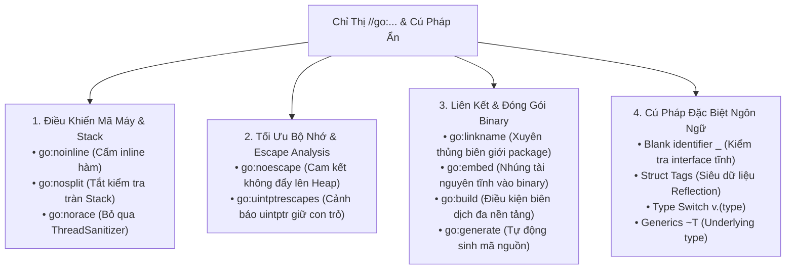

# CHUYÊN ĐỀ 02: CHỈ THỊ TRÌNH BIÊN DỊCH (`//go:...`), BUILD TAGS & CÁC CÚ PHÁP ĐẶC BIỆT

> Thuộc bộ cẩm nang: [[00_Go_Mastery_Index|Go Mastery Handbook]]  
> Tham khảo: Go Compiler Source (`src/cmd/compile`), Go Runtime (`src/runtime`), Kubernetes & Prometheus Codebase.

---

## 1. Thế Giới Ngầm Của `//go:...` — Tương Đương `__attribute__` Trong C

Trong ngôn ngữ C/C++, để điều khiển trực tiếp trình biên dịch (tắt inline, ép vùng nhớ, tắt prologue ngăn xếp, liên kết symbol), kỹ sư hệ thống sử dụng từ khóa mở rộng `__attribute__((...))` hoặc `#pragma`.

Do triết lý của Go là **không làm ô nhiễm bộ 25 từ khóa**, các nhà thiết kế Go đã ẩn toàn bộ các chỉ thị điều khiển trình biên dịch (Compiler Pragmas / Directives) vào trong các chú thích đặc biệt bắt đầu bằng tiền tố **`//go:`**!

> [!CAUTION]
> **Quy tắc cú pháp nghiêm ngặt của `//go:...`:**
> Phải được viết **sát lề hoặc không có khoảng trắng giữa `//` và `go:`**!
> - ĐÚNG: `//go:noinline` (Trình biên dịch nhận diện là chỉ thị Pragma).
> - SAI: `// go:noinline` (Có dấu cách sau `//` $\rightarrow$ Trình biên dịch coi đây chỉ là một dòng comment văn bản vô hại và lờ đi hoàn toàn!).



---

## 2. Giải Phẫu Chi Tiết Bộ Chỉ Thị Trình Biên Dịch (`//go:...`)

### 2.1. `//go:noinline` — Ngăn Chặn Trình Biên Dịch Inline Hàm

Mặc định, trình biên dịch Go (`gc`) có bộ tối ưu hóa **Function Inlining**: Nếu một hàm đủ ngắn và đơn giản (chi phí nút AST < ngân sách *inline budget = 80*), trình biên dịch sẽ copy thẳng thân hàm đó vào nơi gọi để xóa bỏ chi phí tạo Stack Frame (`CALL`/`RET`) và giúp Escape Analysis hoạt động hiệu quả hơn.

Tuy nhiên, trong nhiều trường hợp hệ thống, chúng ta **bắt buộc phải cấm inline** bằng `//go:noinline`:
1. **Trong Viết Benchmark (`testing.B`):** Ngăn trình biên dịch phát hiện hàm tính toán không có hiệu ứng phụ rồi tối ưu hóa xóa sạch vòng lặp benchmark (Dead-code Elimination).
2. **Giữ đường dẫn nóng (Hot Path) nhỏ gọn:** Khi một hàm có nhánh xử lý lỗi hiếm gặp (Slow Path) rất dài, ta tách phần xử lý lỗi ra một hàm riêng gắn `//go:noinline` để hàm chính (Fast Path) đủ nhỏ và được inline vào nơi gọi! (Kỹ thuật này được dùng dày đặc trong `sync.Mutex.Lock()` dẫn sang `lockSlow()`).
3. **Trong Gỡ lỗi & Profiling (`pprof`):** Đảm bảo tên hàm luôn xuất hiện rõ ràng trên Stack Trace và CPU Flame Graph.

```go
//go:noinline
func computeHeavyHash(data []byte) uint64 {
    // Đảm bảo compiler không bao giờ inline hoặc xóa bỏ lời gọi hàm này trong Benchmark
    var h uint64 = 14695981039346656037
    for _, b := range data {
        h ^= uint64(b)
        h *= 1099511628211
    }
    return h
}
```

---

### 2.2. `//go:nosplit` — Tắt Prologue Kiểm Tra Tràn Ngăn Xếp (Tương Đương `naked` Cấp Runtime)

Như sẽ phân tích ở [[03_Memory_Model_Pointers_and_Escape_Analysis]], mỗi Goroutine khởi đầu với một ngăn xếp (Stack) siêu nhỏ chỉ **2KB**. Làm sao Go biết khi nào ngăn xếp 2KB này sắp đầy để cấp phát ngăn xếp mới lớn gấp đôi?

Mặc định, trình biên dịch Go tự động chèn một đoạn mã máy kiểm tra tràn ngăn xếp (**Stack-split Prologue**) vào đầu mọi hàm:
```nasm
; Prologue mặc định ở đầu hàm Go (kiến trúc x86_64):
CMPQ SP, 16(R14)      ; So sánh thanh ghi SP hiện tại với ngưỡng g.stackguard0 (lưu ở thanh ghi R14)
JLS  morestack_label  ; Nếu SP <= stackguard0 (sắp hết stack), nhảy tới runtime.morestack!
```

Khi đặt chỉ thị `//go:nosplit` ngay trên khai báo hàm, trình biên dịch sẽ **tước bỏ hoàn toàn đoạn Prologue kiểm tra tràn stack này**!

#### Tại sao Go Runtime sống còn cần `//go:nosplit`?
1. **Tránh đệ quy vô tận:** Chính hàm cấp phát thêm stack (`runtime.morestack` và `runtime.newstack`) **bắt buộc phải gắn `//go:nosplit`**! Nếu bản thân hàm mở rộng stack lại kiểm tra tràn stack và gọi lại `morestack`, CPU sẽ rơi vào vòng lặp đệ quy vô tận ngay lập tức.
2. **Khi đang giữ khóa nội bộ của Scheduler hoặc GC:** Trong các hàm xử lý tín hiệu OS (`sigtramp`), rào chắn ghi của Garbage Collector (Write Barrier), hoặc khi đang chuyển đổi ngữ cảnh giữa Goroutine `g0` và Goroutine người dùng, ngăn xếp không được phép di chuyển.
> [!WARNING]
> Các hàm gắn `//go:nosplit` có một quỹ bộ nhớ cố định cực nhỏ (gọi là `StackNosplit` = khoảng 792 bytes). Nếu chuỗi các hàm `nosplit` gọi nhau vượt quá ngưỡng này, trình liên kết (Linker) của Go sẽ từ chối biên dịch và báo lỗi ngay tại compile-time: `nosplit stack overflow`!

---

### 2.3. `//go:noescape` — Vũ Khí Tối Thượng Chống Đẩy Biến Lên Heap

Khi bạn truyền một con trỏ `*T` hoặc một `[]byte` vào một hàm được viết bằng Assembly hoặc hàm ngoại lai (nơi trình biên dịch Go không nhìn thấy thân hàm bằng mã Go), bộ **Escape Analysis** của trình biên dịch buộc phải giả định tình huống xấu nhất: *"Hàm này có thể sẽ lưu giữ con trỏ vào biến toàn cục"*, do đó nó **đẩy biến của bạn lên Heap (Heap Allocation)**!

Chỉ thị `//go:noescape` (chỉ được đặt trên **khai báo hàm không có thân hàm bằng Go**, tức hàm thực thi bằng Assembly) là lời cam kết tuyệt đối với trình biên dịch (tương tự từ khóa `restrict` trong C99):
> *"Tôi cam kết hàm Assembly này chỉ đọc/ghi vùng nhớ qua con trỏ trong lúc hàm đang chạy, tuyệt đối không lưu giữ bản sao con trỏ nào trên Heap hay biến toàn cục sau khi hàm trả về!"*

Nhờ `//go:noescape`, các hàm băm mật mã (`crypto/sha256`), hàm hệ thống (`syscall.Read`) hay hàm so sánh chuỗi có thể nhận `[]byte` nằm ngay trên **Stack của Goroutine** với **0 byte cấp phát Heap (Zero Allocation)**!

---

### 2.4. `//go:linkname` — Xuyên Thủng Biên Giới Package & Khóa Bảo Mật Go 1.23+

Trong Go, các hàm/biến viết thường chữ cái đầu (unexported/private) chỉ có thể truy cập bên trong cùng một package. Tuy nhiên, chỉ thị `//go:linkname localname importpath.name` cho phép trình biên dịch và trình liên kết (Linker) **ánh xạ trực tiếp một định danh cục bộ tới bất kỳ symbol nào ở một package khác** (tương đương `__attribute__((alias))` kết hợp `extern` trong C).

Để sử dụng `//go:linkname`, file mã nguồn **bắt buộc phải `import _ "unsafe"`**.

```go
package main

import (
    "fmt"
    _ "unsafe" // Bắt buộc phải import unsafe để kích hoạt //go:linkname
)

// Liên kết hàm nanotime() cục bộ thẳng vào hàm runtime.nanotime() nội bộ của Go Runtime
// để đọc đồng hồ đơn điệu (monotonic clock) siêu tốc không tốn chi phí tạo time.Time!
//go:linkname runtimeNanotime runtime.nanotime
func runtimeNanotime() int64

func main() {
    t1 := runtimeNanotime()
    t2 := runtimeNanotime()
    fmt.Printf("Thời gian trôi qua: %d ns\n", t2-t1)
}
```

> [!WARNING]
> **Cập nhật quan trọng từ Go 1.23+ (Lockdown of `//go:linkname`):**
> Do nhiều thư viện bên thứ ba lạm dụng `//go:linkname` để chọc vào các cấu trúc nội bộ nhạy cảm của thư viện chuẩn (khiến đội ngũ phát triển Go không thể nâng cấp nội tạng stdlib mà không làm gãy code bên ngoài), **từ Go 1.23 trở đi**, trình liên kết menerapkan cơ chế **"Handshake" (Bắt tay hai chiều)**:
> - Bạn chỉ được phép `//go:linkname` tới một symbol của thư viện chuẩn nếu ở phía định nghĩa trong thư viện chuẩn cũng chủ động khai báo `//go:linkname` cho phép xuất symbol đó!
> - Nếu cố tình liên kết trái phép vào symbol nội bộ đã bị khóa ở Go 1.23+, trình biên dịch sẽ báo lỗi: `linkname must refer to declaredsymbol` (trừ khi truyền cờ `-ldflags="-checklinkname=0"`).

---

### 2.5. `//go:embed`, `//go:generate`, `//go:uintptrescapes` và `//go:norace`

1. **`//go:embed pattern` (Từ Go 1.16+):**
   Nhúng trực tiếp file cấu hình, câu lệnh SQL, HTML templates, hoặc cả một cây thư mục tĩnh vào thẳng trong file thực thi nhị phân (phân vùng `.rodata`) ngay lúc biên dịch, giúp triển khai ứng dụng Go dưới dạng **Single Static Binary duy nhất** không cần kèm theo thư mục tài nguyên bên ngoài:
   ```go
   import _ "embed"

   //go:embed schema.sql
   var databaseSchema string

   //go:embed static/* templates/*.html
   var webAssets embed.FS
   ```

2. **`//go:generate command args...`:**
   Khi lập trình viên chạy lệnh `go generate ./...` trên terminal, công cụ `go` sẽ quét toàn bộ các dòng `//go:generate` để chạy các trình sinh mã nguồn tự động trước khi build (như `stringer` tạo hàm `.String()` cho enum `iota`, `mockgen` tạo mock interface, hoặc `protoc` biên dịch gRPC Protobuf).

3. **`//go:uintptrescapes`:**
   Dùng cho các hàm cấp thấp (như `syscall.Syscall`) nhận tham số kiểu `uintptr` nhưng thực chất giá trị truyền vào là một con trỏ vừa được ép kiểu `uintptr(unsafe.Pointer(p))`. Chỉ thị này báo cho trình biên dịch: *"Biến con trỏ truyền vào vị trí `uintptr` này phải được đẩy lên Heap và phải được giữ sống (Keep Alive) cho tới khi lệnh gọi hàm kết thúc, cấm Garbage Collector thu hồi hay di chuyển stack giữa chừng!"*.

4. **`//go:norace`:**
   Báo cho trình phát hiện xung đột dữ liệu (**Race Detector** khi biên dịch với cờ `-race`) bỏ qua không chèn mã kiểm tra ThreadSanitizer vào hàm này. Thường dùng trong các hàm thao tác bộ nhớ nguyên tử cấp thấp của runtime hoặc bộ thu gom rác.

---

### 2.6. Chỉ Thị Điều Kiện Biên Dịch: Build Tags (`//go:build`)

Thay vì dùng tiền xử lý `#ifdef __linux__` rải rác khắp thân hàm như trong C (gây khó đọc và phân mảnh mã nguồn), Go quản lý mã nguồn đa nền tảng ở **cấp độ từng file** bằng chỉ thị `//go:build` đặt ở đầu file (trước dòng `package`, cách dòng `package` ít nhất 1 dòng trống):

```go
//go:build (linux && amd64) || (darwin && arm64)

package network
// File này chỉ được biên dịch trên Linux x86_64 hoặc macOS Apple Silicon!
```
> [!TIP]
> **Quy ước đặt tên file ngầm định (Implicit Build Constraints):**
> Bạn thậm chí không cần viết `//go:build` nếu đặt tên file theo hậu tố chuẩn `*_GOOS.go`, `*_GOARCH.go` hoặc `*_GOOS_GOARCH.go`. Ví dụ:
> - `epoll_linux.go`: Tự động chỉ biên dịch trên Linux.
> - `kqueue_darwin.go`: Tự động chỉ biên dịch trên macOS.
> - `simd_amd64.s`: Tự động chỉ biên dịch trên chip x86_64.

---

## 3. Các Cú Pháp Đặc Biệt & Idioms Đỉnh Cao Trong Go

### 3.1. Định Danh Trống `_` (Blank Identifier) — Hơn Cả Một Thùng Rác

Nhiều người chỉ biết dùng `_` để bỏ qua giá trị trả về không dùng tới (`val, _ := strconv.Atoi(s)`). Trong kỹ thuật hệ thống Go, `_` có **4 công dụng kiến trúc cực kỳ lợi hại**:

#### 1. Kiểm tra thực thi Interface tại thời điểm biên dịch (Compile-time Interface Satisfaction Check)
Làm sao đảm bảo struct `MyStorage` luôn tuân thủ đầy đủ các phương thức của interface `io.ReadWriteCloser` ngay lúc gõ code (dù chưa có nơi nào trong package ép kiểu nó)?
```go
// Không tốn dù chỉ 1 byte RAM lúc runtime, không cấp phát đối tượng nào!
// Nếu *MyStorage thiếu bất kỳ hàm nào của io.ReadWriteCloser, trình biên dịch báo lỗi ngay dòng này!
var _ io.ReadWriteCloser = (*MyStorage)(nil)
```
**Giải thích bản chất:** `(*MyStorage)(nil)` tạo một con trỏ `nil` mang kiểu tĩnh `*MyStorage`, sau đó gán vào biến vô danh `_` có kiểu `io.ReadWriteCloser`. Trình biên dịch kiểm tra bảng phương thức tĩnh tại compile-time rồi hủy bỏ luôn biến `_` vì không có tên định danh!

#### 2. Kiểm tra điều kiện hằng số lúc biên dịch (Compile-time Static Assert thuần Go)
Go không có từ khóa `_Static_assert` như C11, nhưng ta có thể kết hợp `_` với chỉ số mảng không âm để ép trình biên dịch kiểm tra điều kiện hằng số:
```go
// Đảm bảo kích thước của PacketHeader bắt buộc phải đúng bằng 64 bytes (vừa khít 1 CPU Cache Line).
// Nếu Sizeof != 64, một trong hai biểu thức sẽ âm -> Lỗi biên dịch: invalid array length!
var _ [64 - unsafe.Sizeof(PacketHeader{})]byte
var _ [unsafe.Sizeof(PacketHeader{}) - 64]byte
```

#### 3. Import lấy hiệu ứng phụ (`import _ "pkg"`)
Khi viết `import _ "net/http/pprof"` hoặc `import _ "github.com/lib/pq"`, trình biên dịch không đưa tên gói vào namespace hiện tại, nhưng **vẫn biên dịch gói đó và chạy toàn bộ các hàm `func init()`** bên trong gói đó (để tự động đăng ký HTTP route `/debug/pprof` hoặc đăng ký driver PostgreSQL vào `database/sql`).

#### 4. Đệm bộ nhớ tường minh (Explicit Struct Padding & Cache-line Isolation)
```go
type RingBuffer struct {
    writeIdx uint64
    _        [56]byte // Đệm 56 bytes trống để đẩy readIdx sang Cache Line 64-byte tiếp theo (Chống False Sharing!)
    readIdx  uint64
}
```

---

### 3.2. Struct Tags, Type Switch & Toán Tử Kiểu Nền `~T` (Generics)

#### 1. Struct Tags (Chuỗi siêu dữ liệu Raw String `` `...` ``)
Struct Tag là chuỗi hằng nguyên bản gắn sau các trường của struct, được trình biên dịch lưu vào bảng mô tả kiểu tĩnh (`runtime._type`) để các thư viện đọc qua cơ chế `reflect` lúc runtime:
```go
type UserPayload struct {
    ID       int64  `json:"id" db:"user_id" validate:"required"`
    Password string `json:"-"`                          // Dấu "-" báo encoding/json bỏ qua hoàn toàn trường này
    Bio      string `json:"bio,omitempty"`              // omitempty: Không xuất ra JSON nếu mang Zero Value ("")
    Balance  int64  `json:"balance,string"`             // Ép xuất số 64-bit dưới dạng chuỗi JSON để tránh tràn số float53 của JavaScript!
}
```
> [!WARNING]
> **Bẫy cú pháp Struct Tag:** Giữa khóa và giá trị trong tag **không được có khoảng trắng sau dấu hai chấm** (`json:"id"`, không phải `json: "id"`). Hơn nữa, các trường trong struct **bắt buộc phải viết hoa chữ cái đầu (Exported)** thì các gói như `encoding/json` mới có quyền đọc/ghi thông qua Reflection!

#### 2. Type Assertion (`x.(T)`) và Type Switch (`switch v := x.(type)`)
- **Bẫy Panic khi thiếu biến `ok`:** Nếu bạn viết `s := val.(string)` mà bên trong `val` không phải là `string`, chương trình sẽ **ném `panic: interface conversion` ngay lập tức**! Luôn sử dụng cú pháp **Comma-ok idiom**: `s, ok := val.(string)`.
- **Type Switch (`v.(type)`):** Cú pháp `. (type)` chỉ hợp lệ duy nhất bên trong câu lệnh `switch`. Điểm tinh tế là biến `v` trong `switch v := x.(type)` sẽ **tự động biến hình (Type Morphing)** thành đúng kiểu dữ liệu của từng nhánh `case` (trừ nhánh `case int, int64:` gộp nhiều kiểu thì `v` giữ nguyên kiểu interface ban đầu).

#### 3. Toán tử xấp xỉ kiểu nền `~T` (Underlying Type Operator trong Generics Go 1.18+)
Giả sử bạn định nghĩa một ràng buộc số nguyên:
```go
// Nếu KHÔNG có dấu '~': Chỉ chấp nhận đúng kiểu int64 và uint64 nguyên bản!
type StrictInt interface { int64 | uint64 }

// Nếu CÓ dấu '~' (Tilde): Chấp nhận MỌI kiểu định nghĩa mới có kiểu nền (underlying type) là int64 hoặc uint64!
type AnyInt interface { ~int64 | ~uint64 }
```
Nếu không có dấu `~`, bạn sẽ không thể truyền kiểu `time.Duration` (vốn được định nghĩa là `type Duration int64`) vào hàm Generic của mình!

---

## 4. Mổ Xẻ Mã Nguồn Thực Tế: Cách Các Dự Án Lớn Sử Dụng Directives & Cú Pháp Ẩn

### 4.1. Go Standard Library (`strings.Builder`): Bẻ Gãy Escape Analysis Bằng Trick `noescape`

Nếu bạn mở file [`src/strings/builder.go`](https://github.com/golang/go/blob/master/src/strings/builder.go) trong mã nguồn Go chuẩn, bạn sẽ bắt gặp một hàm nhìn cực kỳ "kỳ dị" có tên là `noescape`:

```go
// Trích dẫn từ src/strings/builder.go của Go Standard Library:
type Builder struct {
    addr *Builder // of receiver, to detect copies by value
    buf  []byte
}

// noescape hides a pointer from escape analysis. It is the identity function
// but escape analysis doesn't think the output depends on the input.
// noescape is inlined and currently compiles down to zero instructions.
// USE CAREFULLY!
// This was copied from the runtime; see issues 23382 and 7921.
//
//go:nosplit
//go:nocheckptr
func noescape(p unsafe.Pointer) unsafe.Pointer {
    x := uintptr(p)
    return unsafe.Pointer(x ^ 0)
}

func (b *Builder) copyCheck() {
    if b.addr == nil {
        // Mẹo đỉnh cao: Gán b.addr = b thông qua noescape!
        b.addr = (*Builder)(noescape(unsafe.Pointer(b)))
    } else if b.addr != b {
        panic("strings: illegal use of non-zero Builder copied by value")
    }
}
```

#### Tại sao đội ngũ Go lại phải viết `x ^ 0` trong `noescape`?
1. `strings.Builder` muốn chống việc lập trình viên vô tình copy struct `Builder` theo giá trị sau khi đã ghi dữ liệu. Để phát hiện điều đó, nó tự lưu địa chỉ của chính nó vào trường `b.addr = b`.
2. **Vấn đề:** Nếu viết thẳng `b.addr = b`, bộ **Escape Analysis** của trình biên dịch thấy một con trỏ được gán vào một trường của struct, nó sẽ lập tức kết luận biến `b` bị thoát (escape) và **ép mọi biến `var b strings.Builder` của người dùng phải cấp phát trên Heap**!
3. **Giải pháp thần sầu:** Hàm `noescape` ép con trỏ sang số nguyên `uintptr`, thực hiện phép XOR với `0` (`x ^ 0` không làm thay đổi giá trị bit và biên dịch ra **0 lệnh máy CPU**), rồi ép ngược về `unsafe.Pointer`. Phép toán số học `^ 0` trên `uintptr` đã **cắt đứt hoàn toàn đồ thị theo dõi luồng dữ liệu (Data-flow graph)** của bộ Escape Analysis, giúp `var b strings.Builder` nằm yên lành trên Stack!

---

### 4.2. Go Runtime (`src/runtime/stubs.go`): Hệ Thống `//go:noescape` Toàn Cục

Trong [`src/runtime/stubs.go`](https://github.com/golang/go/blob/master/src/runtime/stubs.go), toàn bộ các nguyên hàm thao tác bộ nhớ và băm dữ liệu bằng Assembly của Go đều được bảo vệ bởi cặp đôi `//go:noescape` và `//go:nosplit`:

```go
// Trích dẫn từ src/runtime/stubs.go:

// memclrNoHeapPointers xóa vùng nhớ n bytes tại ptr về 0.
//go:noescape
func memclrNoHeapPointers(ptr unsafe.Pointer, n uintptr)

// memmove sao chép n bytes từ "from" sang "to" bằng tập lệnh SIMD AVX2/ERMS.
//go:noescape
func memmove(to, from unsafe.Pointer, n uintptr)

// memequal kiểm tra hai vùng nhớ kích thước size có giống hệt nhau từng byte không.
//go:noescape
func memequal(a, b unsafe.Pointer, size uintptr) bool
```

---

### 4.3. Dự Án Kubernetes & Prometheus: Chốt Chặn Kiến Trúc Với `var _ Interface = (*Impl)(nil)`

Trong mã nguồn của **Kubernetes** ([`staging/src/k8s.io/client-go`](https://github.com/kubernetes/kubernetes)) và **Prometheus** ([`tsdb/head.go`](https://github.com/prometheus/prometheus)), khi một codebase có hàng trăm struct thực thi các interface phức tạp như `storage.Appender`, `cache.Store`, hay `runtime.Object`, các kỹ sư luôn đặt một cụm chốt chặn tĩnh ở đầu hoặc cuối file:

```go
// Trích dẫn phong cách chuẩn trong Kubernetes (k8s.io/apiserver & client-go):
var (
    _ rest.Storage              = (*REST)(nil)
    _ rest.Scoper               = (*REST)(nil)
    _ rest.Creater              = (*REST)(nil)
    _ rest.Updater              = (*REST)(nil)
    _ rest.GracefulDeleter      = (*REST)(nil)
    _ rest.CollectionDeleter    = (*REST)(nil)
    _ rest.Watcher              = (*REST)(nil)
    _ rest.StandardStorage      = (*REST)(nil)
)
```
> **Giá trị kiến trúc:** Trong một dự án hàng triệu dòng code, nếu một kỹ sư thay đổi chữ ký của một phương thức trong `rest.Updater`, trình biên dịch sẽ báo lỗi **ngay tại file định nghĩa struct `REST`**, thay vì báo lỗi ở một file khởi tạo Dependency Injection cách đó 20 tầng thư mục!
