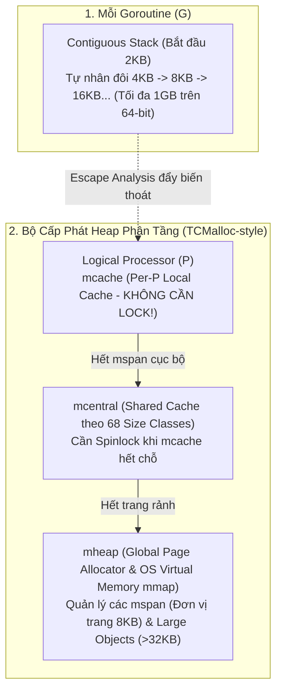
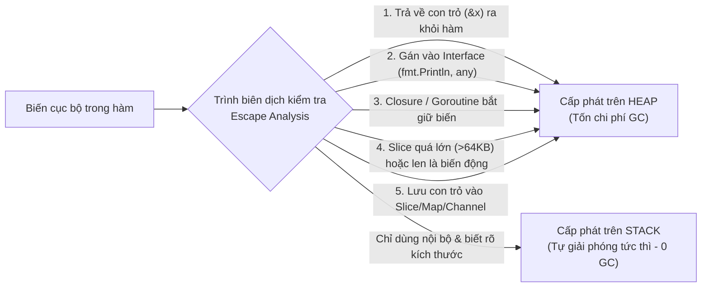
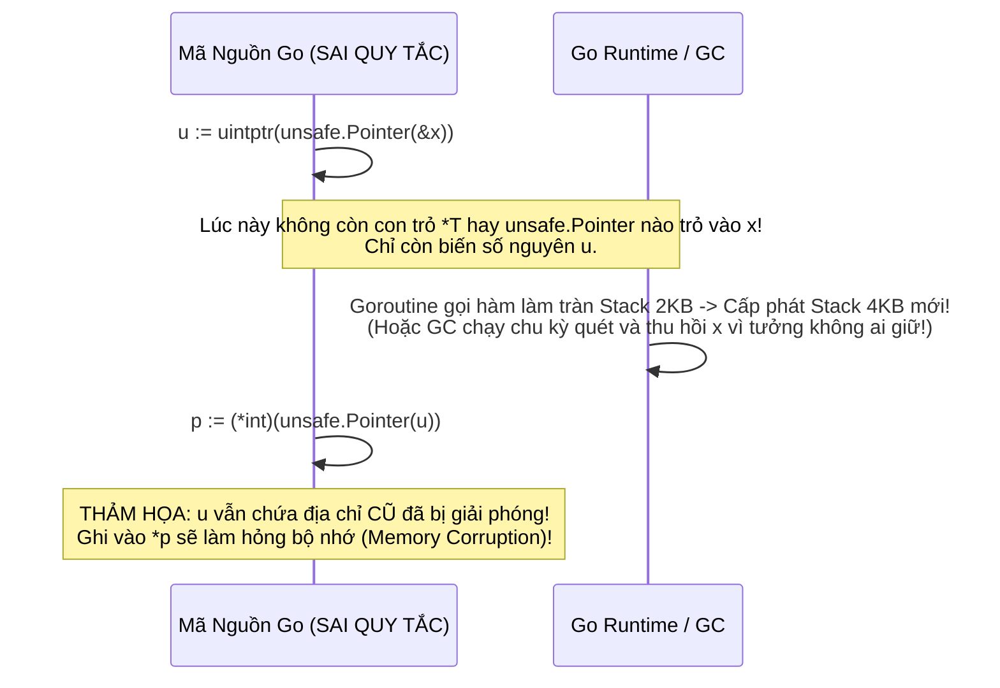

# CHUYÊN ĐỀ 03: KIẾN TRÚC BỘ NHỚ, ESCAPE ANALYSIS, `unsafe.Pointer` & CĂN CHỈNH STRUCT

> Thuộc bộ cẩm nang: [[00_Go_Mastery_Index|Go Mastery Handbook]]  
> Tham khảo: Go Memory Allocator (`src/runtime/malloc.go`), Escape Analysis (`src/cmd/compile/internal/escape`), *Efficient Go* (Bartłomiej Płóciennik), Prometheus TSDB.

---

## 1. Kiến Trúc Bộ Nhớ Của Go: Contiguous Stack & TCMalloc-Style Heap

Khác với ngôn ngữ C/C++ (nơi lập trình viên tự quyết định biến nằm trên Stack của OS Thread hay trên Heap qua `malloc`/`free`), Go sở hữu một **Runtime tự trị hoàn toàn**: trình biên dịch tự quyết định vị trí đặt biến (qua *Escape Analysis*), tự co giãn ngăn xếp của từng Goroutine, và tự quản lý Heap thông qua bộ cấp phát phân tầng kết hợp bộ thu gom rác đồng thời (**Concurrent Tri-color Mark-and-Sweep GC**).



### 1.1. Ngăn Xếp Co Giãn Liên Tục (Contiguous Goroutine Stack)

Trong C trên Linux, mỗi OS Thread (`pthread`) mặc định được cấp phát một ngăn xếp ảo cố định từ **2MB đến 8MB** kèm một trang bảo vệ (Guard Page). Nếu tạo 100.000 threads, hệ thống sẽ ngốn hàng trăm GB địa chỉ bộ nhớ!

Ngược lại, mỗi Goroutine trong Go khởi đầu với một ngăn xếp vỏn vẹn **2KB (2048 bytes)** nằm trên vùng nhớ do Go Runtime quản lý:
- **Trước Go 1.4 (Segmented Stacks):** Khi tràn 2KB, Go từng cấp phát một mảnh stack mới nối bằng con trỏ (Linked list of stacks). Cách này gặp lỗi hiệu năng nghiêm trọng gọi là **"Hot Split"**: nếu một lời gọi hàm nằm ngay ranh giới đầy stack bên trong một vòng lặp `for`, chương trình sẽ liên tục cấp phát rồi giải phóng mảnh stack mới ở mỗi bước lặp!
- **Từ Go 1.4 đến nay (Contiguous Stacks):** Khi prologue hàm phát hiện `SP <= g.stackguard0`, hàm `runtime.morestack` sẽ:
  1. Cấp phát một vùng nhớ Stack liên tục mới **gấp đôi kích thước cũ** ($2\text{KB} \rightarrow 4\text{KB} \rightarrow 8\text{KB}...$).
  2. Sao chép (`memmove`) toàn bộ dữ liệu từ Stack cũ sang Stack mới.
  3. **Điều chỉnh lại toàn bộ các con trỏ hợp lệ đang trỏ vào biến trên Stack đó** sang địa chỉ mới!
  4. Giải phóng Stack cũ (và thu nhỏ một nửa trong chu kỳ GC nếu stack dùng dưới $25\%$).

> [!IMPORTANT]
> **Hệ quả sống còn:** Địa chỉ của một biến nằm trên Stack của Goroutine **KHÔNG CỐ ĐỊNH** trong suốt vòng đời của nó! Khi Stack phình to hoặc co lại, biến trên Stack sẽ bị di dời sang địa chỉ vật lý/ảo mới. Đây là lý do tại sao lưu giữ địa chỉ dưới dạng số nguyên `uintptr` trong Go lại cực kỳ nguy hiểm (xem Mục 3).

---

### 1.2. Bộ Cấp Phát Heap Phân Tầng (`mspan`, `mcache`, `mcentral`, `mheap`)

Để tránh việc hàng nghìn Goroutine phải tranh chấp một khóa Mutex toàn cục mỗi khi cấp phát bộ nhớ trên Heap, Go thiết kế bộ cấp phát dựa trên kiến trúc **TCMalloc (Thread-Caching Malloc)** của Google:

1. **`mspan` (Đơn vị quản lý cơ bản):** Là một dãy các trang bộ nhớ liên tiếp (mỗi trang của Go có kích thước **8KB**). Mỗi `mspan` được chia nhỏ thành các ô nhớ có kích thước bằng nhau thuộc một trong **68 lớp kích thước (Size Classes: từ 8B, 16B, 24B, 32B... đến 32KB)**.
   - Điểm đặc biệt của Go: Mỗi Size Class lại được tách thành 2 loại `mspan`: **`scan`** (chứa đối tượng có con trỏ bên trong $\rightarrow$ GC phải quét) và **`noscan`** (chứa dữ liệu nguyên thủy không có con trỏ $\rightarrow$ **GC bỏ qua không cần quét!**).
2. **`mcache` (Bộ nhớ đệm cục bộ gắn với từng Processor `P`):** Mỗi luồng logic `P` sở hữu một `mcache` riêng biệt chứa sẵn các `mspan` cho mọi Size Class. Vì tại một thời điểm chỉ có duy nhất 1 Goroutine chạy trên 1 `P`, việc cấp phát bộ nhớ từ `mcache` **hoàn toàn KHÔNG CẦN LOCK (Zero-lock fast path)**!
3. **`mcentral` (Bộ điều phối trung tâm):** Khi một `mspan` trong `mcache` đầy, `P` mới phải lấy khóa của `mcentral` tương ứng với Size Class đó để xin một `mspan` mới.
4. **`mheap` (Bộ quản lý trang toàn cục):** Cung cấp trang mới cho `mcentral` hoặc xin thêm bộ nhớ ảo từ hệ điều hành qua `mmap`.

#### 3 Phân loại kích thước đối tượng khi cấp phát trên Heap:
| Phân loại | Kích thước | Đường đi cấp phát |
| :--- | :--- | :--- |
| **Tiny Objects** | `< 16 bytes` và **không chứa con trỏ** (`noscan`) | Gộp nhiều biến nhỏ (`bool`, `int8`, `int32`, chuỗi ngắn) vào chung một khối 16-byte duy nhất trong `mcache.tiny` để chống phân mảnh bộ nhớ! |
| **Small Objects** | `16 bytes` đến `32 KB` (hoặc `< 16B` có chứa con trỏ) | Cấp phát trực tiếp từ `mcache` của Processor `P` theo 67 Size Classes (Fast path không khóa). |
| **Large Objects** | `> 32 KB` | Bỏ qua `mcache` và `mcentral`, cấp phát thẳng một số lượng trang 8KB liên tiếp từ **`mheap`** (Có chi phí khóa toàn cục và áp lực GC cao). |

---

## 2. Phân Tích Thoát Vùng Nhớ (Escape Analysis)

Trong Go, việc bạn dùng hay không dùng từ khóa `new()` hoặc toán tử `&` **không quyết định** biến đó nằm trên Stack hay Heap:
- Bạn viết `p := new(User)` nhưng nếu `p` chỉ dùng nội bộ trong hàm, trình biên dịch vẫn đặt `User` trên **Stack**!
- Bạn viết `x := 42` (biến giá trị bình thường) nhưng nếu một closure bắt giữ `x` hoặc trả về `&x`, trình biên dịch sẽ tự động bốc `x` lên **Heap**!

### 2.1. Cách Kiểm Tra Escape Analysis Bằng Cờ `-gcflags="-m"`

Bạn có thể yêu cầu trình biên dịch Go in ra báo cáo chi tiết biến nào thoát lên Heap, biến nào ở lại Stack và hàm nào được inline bằng lệnh:
```bash
go build -gcflags="-m" main.go
# Hoặc xem giải thích chi tiết lý do tại sao biến bị đẩy lên Heap với -m=2:
go build -gcflags="-m -m" main.go
```

### 2.2. 5 Kịch Bản Kinh Điển Khiến Biến Bị Đẩy Lên Heap (`escapes to heap`)



1. **Chia sẻ lên trên (Sharing Up — Trả về con trỏ):**
   - Trong C: `int* bad() { int x = 10; return &x; }` gây lỗi Dangling Pointer (Undefined Behavior).
   - Trong Go: `func good() *int { x := 10; return &x }` hoàn toàn hợp lệ! Trình biên dịch báo `moved to heap: x` và cấp phát `x` trên Heap để con trỏ trả về luôn an toàn.
   - **Ngược lại, Chia sẻ xuống dưới (Sharing Down — Truyền `&x` vào hàm con):** Thường giữ được biến `x` trên Stack (trừ khi hàm con lưu con trỏ đó vào biến toàn cục hoặc gọi qua một Interface!).
2. **Truyền vào tham số kiểu Interface (`any`, `io.Reader`):**
   Khi bạn gọi `fmt.Println(x)`, vì `fmt.Println` nhận tham số `...any`, trình biên dịch rất khó chứng minh các phương thức động bên trong `fmt` không giữ lại con trỏ, nên giá trị `x` (nếu không phải hằng số nhỏ) thường bị cấp phát bản sao trên Heap!
3. **Kích thước động hoặc vượt ngưỡng Stack:**
   - `s := make([]byte, 1024)` (kích thước hằng số nhỏ, không trả về ra ngoài) $\rightarrow$ Nằm trên **Stack** (`does not escape`).
   - `s := make([]byte, n)` (với `n` là biến truyền vào lúc runtime) hoặc `make([]byte, 100_000)` (quá 64KB) $\rightarrow$ Bị đẩy lên **Heap**!
4. **Con trỏ nằm trong Con trỏ / Slice / Map (`[]*T`, `map[K]*T`, `chan *T`):**
   Hiện tại bộ Escape Analysis của Go chưa theo dõi sâu qua nhiều tầng gián tiếp của mảng/bảng băm. Nếu bạn đẩy một con trỏ `&item` vào `slice = append(slice, &item)`, biến `item` gần như chắc chắn sẽ thoát lên Heap dù `slice` đó chỉ dùng nội bộ trong hàm!

---

## 3. Tam Giác Quyền Lực: `*T` vs `unsafe.Pointer` vs `uintptr`

Để lập trình hệ thống cấp thấp, giao tiếp với nhân OS hoặc tối ưu hóa Zero-Copy trong Go, bạn phải phân biệt rạch ròi 3 kiểu biểu diễn địa chỉ bộ nhớ này:

| Đặc tính | Con trỏ chuẩn `*T` | `unsafe.Pointer` | Số nguyên `uintptr` |
| :--- | :--- | :--- | :--- |
| **Tương đương trong C** | Con trỏ có kiểu `T*` (nhưng bị khóa chặt) | Con trỏ tổng quát `void*` | Số nguyên `uintptr_t` / `size_t` |
| **An toàn kiểu (Type Safety)** | Tuyệt đối. Không thể ép `*int64` sang `*float64`. | Cầu nối đặc quyền: Có thể ép qua lại với **mọi `*T`** và **`uintptr`**. | Không có kiểu con trỏ. Chỉ là một con số nguyên không dấu. |
| **Phép toán cộng trừ địa chỉ (`p + offset`)** | **CẤM HOÀN TOÀN** | Trực tiếp qua hàm **`unsafe.Add(p, offset)`** (Từ Go 1.17+) | Cho phép cộng trừ số học tự do (`addr + 8`). |
| **Garbage Collector có theo dõi không?** | **CÓ!** GC giữ đối tượng sống và tự cập nhật `*T` khi dời Stack. | **CÓ!** GC giữ đối tượng sống và tự cập nhật `unsafe.Pointer` khi dời Stack. | **KHÔNG!** GC coi `uintptr` chỉ là một con số vô tri! |

---

### 3.1. 6 Quy Tắc Hợp Lệ Duy Nhất Của `unsafe.Pointer`

Gói `unsafe` của Go định nghĩa đúng **6 mẫu sử dụng hợp lệ**. Mọi cách dùng nằm ngoài 6 mẫu này đều là bất hợp pháp và sẽ bị cờ kiểm tra `-gcflags=all=-d=checkptr` (bật mặc định khi chạy `go test -race`) bắt lỗi ngay lúc runtime:

#### Quy tắc 1: Chuyển đổi `*T1` $\leftrightarrow$ `unsafe.Pointer` $\leftrightarrow$ `*T2` (Type Punning)
Cho phép đọc lại bit của kiểu `T1` dưới góc nhìn của kiểu `T2` (với điều kiện kích thước `T2` không lớn hơn `T1` và cả hai có cùng căn chỉnh bộ nhớ):
```go
func Float64bits(f float64) uint64 {
    return *(*uint64)(unsafe.Pointer(&f))
}
```

#### Quy tắc 2: Chuyển `unsafe.Pointer` sang `uintptr` (Chỉ để in ấn/so sánh, KHÔNG ép ngược lại!)
Nếu chỉ ép sang `uintptr` để in log địa chỉ (`%x`) hoặc tính băm thì hoàn toàn an toàn, nhưng **tuyệt đối không lưu biến `uintptr` đó rồi ép ngược lại thành `unsafe.Pointer`**!


#### Quy tắc 3: Dịch chuyển con trỏ (Pointer Arithmetic)
- **Cách chuẩn hiện đại (Go 1.17+):** Dùng trực tiếp hàm **`unsafe.Add(ptr, offset)`** mà không cần bước trung gian `uintptr`:
  ```go
  // Truy cập phần tử thứ 3 của mảng hoặc trường struct tại độ lệch Offsetof:
  elemPtr := (*int)(unsafe.Add(unsafe.Pointer(&arr[0]), 3*unsafe.Sizeof(arr[0])))
  fieldPtr := (*int32)(unsafe.Add(unsafe.Pointer(&myStruct), unsafe.Offsetof(myStruct.FieldB)))
  ```
- **Cách cổ điển:** Nếu dùng `uintptr`, toàn bộ phép ép sang `uintptr`, cộng trừ và ép ngược về `unsafe.Pointer` **BẮT BUỘC PHẢI NẰM TRONG CÙNG MỘT BIỂU THỨC DUY NHẤT** (không được tách ra gán vào biến tạm `uintptr`):
  ```go
  // ĐÚNG (Trong cùng 1 biểu thức):
  p := (*int)(unsafe.Pointer(uintptr(unsafe.Pointer(&arr[0])) + 3*unsafe.Sizeof(arr[0])))
  ```

#### Quy tắc 4, 5, 6: Khi gọi `syscall.Syscall`, `reflect.Value.Pointer()` và `reflect.SliceHeader`
- Khi truyền địa chỉ vào `syscall.Syscall(SYS_READ, fd, uintptr(unsafe.Pointer(&buf[0])), n)`, phép ép `uintptr(unsafe.Pointer(p))` **bắt buộc phải viết trực tiếp bên trong danh sách đối số của lời gọi hàm `Syscall`** để trình biên dịch nhận diện thông qua chỉ thị `//go:uintptrescapes` và ghim vùng nhớ đó không cho GC thu hồi!

### 3.2. Bộ Vũ Khí Hiện Đại Trong Go 1.17 & Go 1.20+: `unsafe.Slice` & `unsafe.String`

Trước Go 1.20, để thao tác nội tạng của `string` và `slice`, lập trình viên phải ép kiểu qua `reflect.StringHeader` và `reflect.SliceHeader` (vốn rất dễ vi phạm quy tắc GC và nay đã chính thức bị **Deprecated**). Từ Go 1.20, Go cung cấp 4 hàm chuẩn cấp trình biên dịch cực kỳ an toàn và rõ ràng:
- **`unsafe.Slice(ptr *T, len IntegerType) []T`**: Tạo một Slice từ con trỏ phần tử đầu tiên và độ dài `len`.
- **`unsafe.SliceData(slice []T) *T`**: Trích xuất con trỏ trỏ tới mảng nền của Slice.
- **`unsafe.String(ptr *byte, len IntegerType) string`**: Tạo một chuỗi `string` trực tiếp từ con trỏ `*byte` và độ dài `len` (Zero-copy).
- **`unsafe.StringData(str string) *byte`**: Trích xuất con trỏ `*byte` trỏ tới vùng nhớ nền của chuỗi `str`.

---

## 4. Struct Padding, Alignment & Tối Ưu Hóa Quét Rác (GC Scan Optimization)

### 4.1. Quy Tắc Căn Chỉnh Biên Tự Nhiên (Natural Alignment) Trong Go

Giống hệt như trong ngôn ngữ C (xem cẩm nang C/C++), trình biên dịch Go không đặt các trường của một `struct` nằm khít nhau một cách tùy tiện, mà tuân theo quy tắc **Natural Alignment** của kiến trúc CPU (trên hệ 64-bit `amd64`/`arm64`, một từ máy *Machine Word* là **8 bytes**):
- Kiểu có kích thước $K$ bytes (`bool`/`int8` = 1B, `int16` = 2B, `int32` = 4B, `int64`/con trỏ = 8B, `string` = 16B, `slice` = 24B) phải có địa chỉ bắt đầu (Offset) **chia hết cho $\min(K, 8)$**!
- Tổng kích thước của toàn bộ `struct` phải được làm tròn lên thành bội số của trường có `Alignof` lớn nhất trong `struct` đó.

Hãy so sánh hai cách sắp xếp cùng một tập hợp trường dữ liệu:

```go
// CÁCH 1: Sắp xếp ngẫu nhiên (Tốn 24 bytes do bị chèn 9 bytes Padding!)
type BadLayout struct {
    IsActive bool  // Offset 0, Size 1B + [7 bytes padding!]
    ID       int64 // Offset 8, Size 8B
    Priority int8  // Offset 16, Size 1B + [3 bytes padding!]
    Code     int32 // Offset 20, Size 4B
} // unsafe.Sizeof(BadLayout{}) == 24 bytes!

// CÁCH 2: Sắp xếp giảm dần theo kích thước (Chỉ tốn 16 bytes -> Tiết kiệm 33.3% RAM!)
type GoodLayout struct {
    ID       int64 // Offset 0, Size 8B
    Code     int32 // Offset 8, Size 4B
    IsActive bool  // Offset 12, Size 1B
    Priority int8  // Offset 13, Size 1B + [2 bytes tail padding]
} // unsafe.Sizeof(GoodLayout{}) == 16 bytes!
```

> [!WARNING]
> **Bẫy `struct{}` kích thước 0 byte đặt ở CUỐI Struct:**
> `struct{}{}` có kích thước `0 byte`. Nếu bạn đặt trường `struct{}` ở đầu hoặc giữa một struct, nó không tốn thêm byte nào. Nhưng nếu bạn **đặt trường `struct{}` ở vị trí CUỐI CÙNG của một struct**, trình biên dịch Go **bắt buộc phải cộng thêm ít nhất 1 byte (và làm tròn theo alignment thành 4 hoặc 8 bytes padding)**!
> - **Lý do sâu xa:** Nếu một trường 0-byte nằm ở cuối cùng của struct, việc lấy địa chỉ `&s.ZeroField` sẽ trỏ ra **bên ngoài phạm vi kết thúc của struct `s`**, tức là trỏ trùng vào đầu của đối tượng kế tiếp trong Heap! Điều này sẽ khiến Garbage Collector hiểu nhầm đối tượng kế tiếp đang được giữ sống, gây rò rỉ bộ nhớ (Memory Leak)! Do đó, luôn đặt trường `struct{}` ở **đầu** struct.

---

### 4.2. Tương Tác Giữa Struct Layout Và Garbage Collector (`noscan` & Pointer Bitmap)

Trong C, sắp xếp lại struct chỉ giúp tiết kiệm vài byte RAM. Nhưng trong Go, cách bạn thiết kế các trường trong struct quyết định trực tiếp đến **thời gian chạy CPU của Garbage Collector**:

1. **Nguyên tắc `noscan` (Pointer-free Structs):**
   Khi cấp phát một mảng lớn `make([]Entry, 10_000_000)`:
   - Nếu `Entry` chứa dù chỉ 1 con trỏ (bao gồm `*T`, `string`, `[]byte`, `map`, `interface`, `chan`, `time.Time` vì `time.Time` chứa con trỏ `*Location`!), toàn bộ mảng 10 triệu phần tử này sẽ được đặt vào `scan mspan`. Trong mỗi chu kỳ GC, các luồng đánh dấu (GC Mark Workers) phải duyệt qua toàn bộ 10 triệu phần tử!
   - Nếu bạn thiết kế `Entry` chỉ chứa các số nguyên và mảng tĩnh (`int64`, `uint32`, `[16]byte`, biến đổi `time.Time` thành Unix Nano `int64`), toàn bộ mảng 10 triệu phần tử được đặt vào **`noscan mspan`**. **Garbage Collector sẽ bỏ qua nó trong 0.00ms (O(1))!**
2. **Đặt toàn bộ các trường có con trỏ lên ĐẦU Struct:**
   Mỗi `mspan` có một bảng bit đánh dấu vị trí con trỏ (`gcdata` bitmap). Go Runtime ghi nhận vị trí của **trường chứa con trỏ cuối cùng** trong một struct (`type.ptrdata`). Khi GC quét một struct, ngay khi đi qua trường con trỏ cuối cùng, **GC ngừng quét phần còn lại của struct ngay lập tức**! Vì vậy, nếu gom các trường con trỏ (`*T`, `string`, `slice`) lên đầu struct và để các trường số học/mảng byte ở cuối, GC sẽ kết thúc việc quét đối tượng sớm hơn rất nhiều.

---

## 5. Mổ Xẻ Mã Nguồn Thực Tế: Kỹ Thuật Zero-Copy `string` $\leftrightarrow$ `[]byte`

Trong Go, kiểu `string` là **bất biến (Immutable)** còn `[]byte` là **khả biến (Mutable)**. Do đó, mỗi khi bạn ép kiểu thông thường `s := string(byteSlice)` hoặc `b := []byte(str)`, Go Runtime buộc phải:
1. Cấp phát một vùng nhớ mới trên Heap.
2. Sao chép (`memmove`) toàn bộ nội dung từ nguồn sang đích.

Với các hệ thống xử lý hàng triệu chuỗi/giây như cơ sở dữ liệu chuỗi thời gian **Prometheus TSDB** hay `strings.Builder`, chi phí cấp phát và copy này là không thể chấp nhận.

### 5.1. Giải Phẫu `strings.Builder.String()` Trong Go Standard Library

Hãy xem cách [`src/strings/builder.go`](https://github.com/golang/go/blob/master/src/strings/builder.go) biến bộ đệm `b.buf []byte` thành kiểu `string` mà không tốn 1 byte cấp phát hay 1 chu kỳ CPU copy nào:

```go
// Trích dẫn nguyên bản từ src/strings/builder.go (Go 1.20+):

// String returns the accumulated string.
func (b *Builder) String() string {
    return unsafe.String(unsafe.SliceData(b.buf), len(b.buf))
}
```
Chỉ đúng 1 dòng code! `unsafe.SliceData(b.buf)` lấy con trỏ `*byte` trỏ thẳng vào mảng nền của `b.buf`, và `unsafe.String` đóng gói con trỏ đó cùng `len(b.buf)` thành cấu trúc 16-byte của `string` (`runtime.stringStruct{str, len}`).

### 5.2. Giải Phẫu `prometheus/tsdb/chunks`: Zero-Copy Hai Chiều & Cảnh Báo `SIGSEGV`

Trong [`prometheus/model/labels`](https://github.com/prometheus/prometheus) và các thư viện phân tích JSON tốc độ cao (`fastjson`, `sonic`), kỹ thuật chuyển đổi hai chiều Zero-Copy được viết chuẩn theo Go 1.20+ như sau:

```go
package zerocopy

import "unsafe"

// BytesToString chuyển []byte sang string với 0 cấp phát bộ nhớ (Zero-Copy).
// CẢNH BÁO: Nếu mảng byte 'b' bị thay đổi sau khi gọi hàm này, chuỗi string trả về cũng bị đổi theo!
func BytesToString(b []byte) string {
    if len(b) == 0 {
        return ""
    }
    return unsafe.String(unsafe.SliceData(b), len(b))
}

// StringToBytes chuyển string sang []byte với 0 cấp phát bộ nhớ (Zero-Copy).
// CẢNH BÁO TỐI THƯỢNG: Slice trả về CHỈ ĐƯỢC ĐỌC (Read-Only)!
func StringToBytes(s string) []byte {
    if s == "" {
        return nil
    }
    return unsafe.Slice(unsafe.StringData(s), len(s))
}
```

> [!CAUTION]
> **Hiểm họa sập tiến trình (`SIGSEGV: segmentation violation`) khi ghi vào `StringToBytes(s)`:**
> Nếu chuỗi `s` ban đầu là một **String Literal** (ví dụ `s := "hello"`), trình biên dịch Go đặt dữ liệu `"hello"` vào phân vùng bộ nhớ **Chỉ đọc (`.rodata` - Read-Only Data Segment)** của file thực thi ELF/Mach-O được bảo vệ bởi phần cứng MMU của CPU.
> Nếu bạn gọi `b := StringToBytes("hello")` rồi cố tình ghi `b[0] = 'H'`, phần cứng CPU sẽ lập tức bắn ngắt lỗi bảo vệ trang bộ nhớ (**SIGSEGV / Segmentation Fault**). Đặc biệt, đây là lỗi phần cứng cấp hệ điều hành nên **hàm `recover()` của Go KHÔNG THỂ BẮT ĐƯỢC**, toàn bộ server sẽ chết ngay lập tức!
> Chỉ dùng `StringToBytes` khi bạn truyền `[]byte` đó vào một hàm chỉ đọc (như `hash.Write(b)`, `io.Writer.Write(b)`, hoặc `bytes.Index`).

*(Xem và chạy kiểm chứng trực tiếp tại [`code_lab/03_unsafe_zerocopy_and_layout.go`](file:///home/thinh/Obsidian/Go_Mastery_Handbook/code_lab/03_unsafe_zerocopy_and_layout.go)).*
