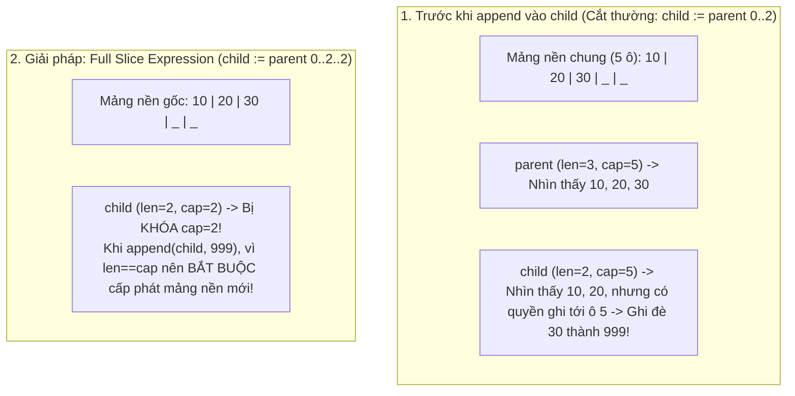
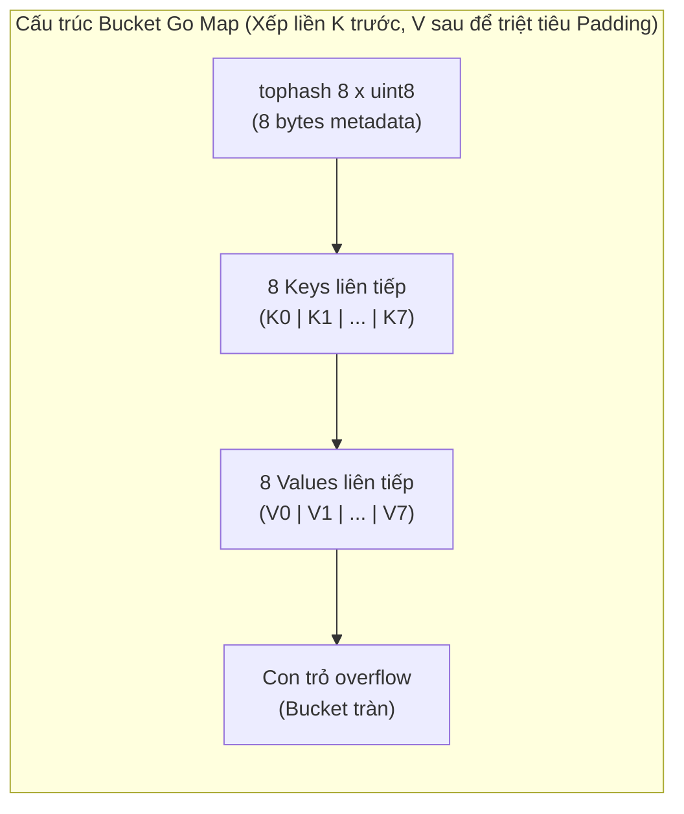
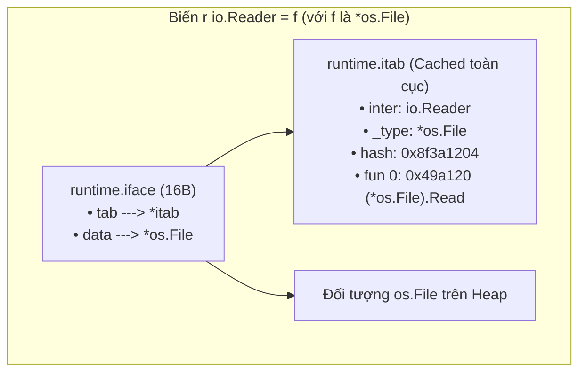

# CHUYÊN ĐỀ 04: GIẢI PHẪU NỘI TẠNG SLICE, MAP & INTERFACE DƯỚI TẦNG RUNTIME

> Thuộc bộ cẩm nang: [[00_Go_Mastery_Index|Go Mastery Handbook]]  
> Tham khảo: Go Runtime Source (`src/runtime/slice.go`, `src/internal/runtime/maps`, `src/runtime/iface.go`), Docker/Moby & CockroachDB Codebase.

---

## 1. Giải Phẫu Nội Tạng Slice (`runtime.slice`)

### 1.1. Cấu Trúc 24-Byte Header & Mảng Nền (Backing Array)

Trong Go, mảng tĩnh (`[N]T`) là kiểu giá trị nguyên khối: khi gán hoặc truyền `[1000]int` vào hàm, Go sao chép toàn bộ 1000 số nguyên. Vì vậy, 99% mã nguồn Go làm việc với **Slice (`[]T`)** — một khung nhìn động (Dynamic View) trỏ vào một mảng nền bên dưới.

Trong [`src/runtime/slice.go`](https://github.com/golang/go/blob/master/src/runtime/slice.go), một biến Slice thực chất là một struct nhỏ gọn kích thước cố định **24 bytes (trên kiến trúc 64-bit)**:

```go
// Trong src/runtime/slice.go:
type slice struct {
    array unsafe.Pointer // 8 bytes: Con trỏ trỏ tới phần tử đầu tiên của Slice trên Mảng nền
    len   int            // 8 bytes: Số phần tử hiện có thể truy cập hợp lệ (s[0] .. s[len-1])
    cap   int            // 8 bytes: Sức chứa tối đa tính từ vị trí 'array' đến hết Mảng nền
}
```

> [!IMPORTANT]
> **Mọi phép truyền tham số trong Go đều là Truyền Theo Giá Trị (Pass-by-Value)!**
> Khi bạn truyền một `s []int` vào hàm `func modify(s []int)`, Go sao chép cấu trúc `runtime.slice` 24 bytes đó.
> - Vì bản sao vẫn giữ cùng con trỏ `array` trỏ tới chung mảng nền, nếu hàm con sửa `s[0] = 99`, hàm gọi bên ngoài **sẽ thấy `s[0]` bị đổi thành 99**!
> - Nhưng nếu hàm con gọi `s = append(s, 100)`, biến `len` (và có thể cả con trỏ `array` nếu tràn `cap`) chỉ thay đổi trên **bản sao 24-byte cục bộ** của hàm con! Hàm gọi bên ngoài không hề thấy phần tử `100` mới đó (hoặc nguy hiểm hơn: phần tử `100` đã âm thầm ghi đè vào vùng nhớ dư của mảng nền!).

---

### 1.2. Cạm Bẫy Chia Sẻ Mảng Nền & Biểu Thức Full Slice `a[low:high:max]`

Hãy xét tình huống cực kỳ phổ biến khi cắt một Slice con (`sub-slicing`) rồi thực hiện `append`:

```go
parent := make([]int, 3, 5) // [0, 0, 0], len=3, cap=5 (Còn dư 2 ô trống trong mảng nền!)
parent[0], parent[1], parent[2] = 10, 20, 30

// Cắt lấy 2 phần tử đầu:
child := parent[0:2] // child = [10, 20], len=2, NHƯNG cap(child) VẪN BẰNG 5!

// Lập trình viên append vào child và nghĩ rằng parent không bị ảnh hưởng:
child = append(child, 999)
// THẢM HỌA: Vì len(child)=2 < cap(child)=5, append KHÔNG cấp phát mảng mới
// mà ghi đè số 999 thẳng vào ô thứ 3 (parent[2]) của mảng nền!
// Lúc này parent biến thành: [10, 20, 999]!
```



#### Giải pháp tuyệt đối: Biểu thức cắt 3 chỉ số (Full Slice Expression `a[low:high:max]`)
Ra đời từ Go 1.2, cú pháp `a[low : high : max]` cho phép kiểm soát trực tiếp dung lượng `cap` của Slice con:
- Độ dài mới: $\text{len} = \text{high} - \text{low}$
- Sức chứa mới: $\text{cap} = \text{max} - \text{low}$

Khi bạn viết **`child := parent[0:2:2]`**, biến `child` sẽ có `len = 2` và **`cap = 2` (khóa chặt `cap` bằng `len`)**. Bất kỳ lệnh `append(child, ...)` nào sau đó đều thấy `len == cap`, nên buộc phải cấp phát một mảng nền hoàn toàn mới trên Heap, **bảo vệ tuyệt đối mảng `parent` không bao giờ bị ghi đè ngoài ý muốn!**

---

### 1.3. Rò Rỉ Bộ Nhớ Do Sub-slicing Mảng Lớn (Slice Memory Leak)

Giả sử bạn đọc một gói tin mạng hoặc một file log kích thước **10 MB** vào `buf []byte`, nhưng chỉ cần giữ lại **16 bytes** mã định danh ở đầu gói tin:

```go
func parseHeaderBad( packet10MB []byte ) []byte {
    // RÒ RỈ BỘ NHỚ NGHIÊM TRỌNG:
    // Dù chỉ trả về slice 16 bytes, nhưng con trỏ 'array' của nó vẫn trỏ vào mảng nền 10 MB!
    // Garbage Collector KHÔNG THỂ thu hồi 10 MB đó chừng nào slice 16 bytes này còn sống!
    return packet10MB[:16]
}

func parseHeaderGood( packet10MB []byte ) []byte {
    // CHUẨN SẢN XUẤT: Sao chép 16 bytes ra một vùng nhớ độc lập (hoặc dùng bytes.Clone từ Go 1.20+)
    // để giải phóng ngay lập tức mảng 10 MB cho Garbage Collector thu hồi!
    header := make([]byte, 16)
    copy(header, packet10MB[:16])
    return header
}
```
*(Chạy trực tiếp bài thực nghiệm [`code_lab/02_slice_backing_and_fullslice.go`](file:///home/thinh/Obsidian/Go_Mastery_Handbook/code_lab/02_slice_backing_and_fullslice.go) để kiểm chứng).*

---

## 2. Giải Phẫu Nội Tạng Map (`runtime.hmap` & SwissTable)

### 2.1. Kiến Trúc Bảng Băm Của Go: Từ `hmap` (8-item Buckets) Đến SwissTable (Go 1.24+)

Trong Go, biến `m map[K]V` thực chất là một con trỏ `*hmap` (8 bytes). Đó là lý do khi truyền `map` vào hàm, mọi thao tác thêm/sửa/xóa khóa bên trong hàm con đều tác động trực tiếp lên `map` gốc bên ngoài!

1. **Kiến trúc cổ điển (`src/runtime/map.go` — Go 1.0 đến Go 1.23):**
   - Mỗi `hmap` quản lý một mảng gồm $2^B$ **Buckets (`bmap`)**.
   - Mỗi Bucket chứa tối đa **8 cặp Key-Value**, đi kèm một mảng 8 byte **`tophash [8]uint8`** lưu 8 bit cao nhất của mã băm (giúp so sánh nhanh bằng lệnh CPU mà không cần so sánh toàn bộ chuỗi khóa dài).
   - Bên trong một Bucket, 8 khóa được xếp liền nhau trước (`K0..K7`), sau đó mới đến 8 giá trị (`V0..V7`) để **loại bỏ hoàn toàn byte đệm Struct Padding** giữa `K` và `V` (ví dụ `map[int64]int8`)!
   - Khi hệ số tải (Load Factor) vượt quá **6.5 phần tử / bucket**, `hmap` thực hiện **Incremental Evacuation (Di tản lũy tiến)**: cấp phát mảng bucket mới gấp đôi, nhưng không copy toàn bộ ngay lập tức (tránh gây giật cục độ trễ giống Redis), mà mỗi lần có thao tác ghi/xóa sẽ di tản dần từng nhóm 1-2 buckets cũ sang mới!
2. **Kiến trúc hiện đại (**SwissTable** trong `src/internal/runtime/maps` — Từ Go 1.24+):**
   - Bắt đầu từ Go 1.24, Go chính thức nâng cấp nội tạng của `map` sang thuật toán **SwissTable** (tương tự `absl::flat_hash_map` của Google C++ và `hashbrown` của Rust).
   - Mỗi nhóm (Group) gồm 8 khe được điều khiển bởi một từ điều khiển 64-bit (**Control Word**). Bằng phép toán bitwise SIMD / SWAR, CPU có thể kiểm tra đồng thời cả 8 khe trong **1 lệnh máy duy nhất**, giúp tăng tốc độ tra cứu và duyệt map lên tới **30% - 50%** và giảm đáng kể phân mảnh bộ nhớ!



---

### 2.2. Ba Câu Hỏi Bản Chất Sống Còn Về Go Map

#### 1. Tại sao Go nghiêm cấm lấy địa chỉ phần tử của Map (`p := &m["key"]` báo lỗi biên dịch)?
- **Lý do:** Khi bạn thêm phần tử mới vào `map`, bảng băm có thể vượt ngưỡng Load Factor và kích hoạt quá trình mở rộng (**Rehashing / Bucket Evacuation**). Lúc này, toàn bộ các phần tử Key và Value sẽ được **di chuyển sang vùng nhớ Bucket mới**, và vùng nhớ Bucket cũ sẽ bị giải phóng!
- Nếu Go cho phép bạn giữ một con trỏ `p := &m["key"]`, ngay sau lệnh `m["new_key"] = val`, con trỏ `p` sẽ trỏ vào vùng nhớ cũ đã lỗi thời (hoặc gây lủng đoạn bộ thu gom rác). Vì vậy, trình biên dịch Go cấm tuyệt đối `&m[k]` (và cũng cấm gán trực tiếp trường của struct lưu theo giá trị trong map như `m["k"].Field = 10` — bạn phải lấy struct ra sửa rồi gán lại, hoặc dùng `map[string]*MyStruct`).

#### 2. Tại sao thứ tự duyệt `for k, v := range m` luôn khác nhau ở mỗi lần chạy?
- Nhiều lập trình viên mới viết unit test dựa vào thứ tự in ra của `map` trên một dữ liệu nhỏ. Để **ngăn chặn lập trình viên viết code phụ thuộc vào thứ tự cài đặt của hàm băm (Hyrum's Law)** và chống tấn công từ chối dịch vụ băm (**Hash-flooding DoS**):
  - Mỗi khi tạo một `map` mới, Go khởi tạo một hạt giống băm ngẫu nhiên (`hash0 = fastrand()`).
  - Mỗi khi bắt đầu vòng lặp `for range m`, hàm `mapiterinit` dùng `fastrand()` để **chọn ngẫu nhiên một Bucket bất kỳ và một vị trí Offset bất kỳ (từ 0 đến 7)** làm điểm bắt đầu duyệt!

#### 3. Lỗi `fatal error: concurrent map read and map write` — Không thể cứu bằng `recover()`!
- Cấu trúc `hmap` không dùng khóa Mutex để đạt tốc độ tối đa cho trường hợp đơn luồng. Tuy nhiên, bên trong `hmap.flags` có một cờ bit tên là **`hashWriting`**.
- Mỗi khi một Goroutine thực hiện ghi hoặc xóa trên map, nó bật bit `hashWriting ^= hashWriting`. Nếu ngay lúc đó một Goroutine khác nhảy vào đọc hoặc ghi và thấy bit `hashWriting` đang bật, Go Runtime lập tức gọi hàm **`runtime.fatal("concurrent map read and map write")`** (thay vì `panic` thông thường)!
> [!CAUTION]
> Hàm `runtime.fatal` (dẫn tới `throw`) sẽ in Stack Trace và **hủy diệt tiến trình OS ngay lập tức (`exit(2)`)**. Mọi khối `defer recover()` của bạn đều bị bỏ qua hoàn toàn! Không bao giờ chia sẻ một `map` thường cho nhiều Goroutine nếu có ít nhất 1 Goroutine thực hiện ghi mà không bọc trong `sync.RWMutex`.

---

### 2.3. Khi Nào Nên Dùng `sync.Map` Thay Cho `map` + `sync.RWMutex`?

Thư viện chuẩn cung cấp `sync.Map` (trong gói `sync`), nhưng tài liệu chính thức của Go cảnh báo rõ: **`sync.Map` KHÔNG PHẢI là sự thay thế đa năng cho `map` + `sync.RWMutex`!**

Bên dưới `sync.Map`, Go duy trì **hai bản đồ song song**:
1. **`read` map (Read-only atomic pointer):** Truy cập đọc/cập nhật khóa đã có sẵn thông qua biến nguyên tử `atomic.Pointer` — **hoàn toàn không cần khóa Mutex (Lock-free reads)**, không gây xung đột Cache Line giữa hàng chục nhân CPU!
2. **`dirty` map (Bảo vệ bởi Mutex):** Chứa các khóa mới vừa được chèn thêm. Khi số lần đọc trượt (`misses`) trên `read` map đạt ngưỡng bằng `len(dirty)`, toàn bộ `dirty` map được thăng cấp (promote) lên thành `read` map mới.

**Quy tắc chọn lựa:**
- **Chỉ dùng `sync.Map` trong 2 trường hợp:**
  1. Dữ liệu kiểu **Cache ghi 1 lần nhưng đọc hàng triệu lần** (Append-only / Read-heavy cache).
  2. Nhiều Goroutine trên hệ thống nhiều nhân CPU đọc/ghi/ghi đè trên **các tập khóa hoàn toàn tách biệt nhau (Disjoint sets of keys)**.
- **Dùng `map[K]V` + `sync.RWMutex` (hoặc Sharded Map):** Khi có tần suất thêm mới và xóa khóa liên tục (Write-heavy) và cần an toàn kiểu tĩnh (Compile-time Type Safety).

---

## 3. Giải Phẫu Nội Tạng Interface (`runtime.iface` vs `runtime.eface`)

### 3.1. Hai Khuôn Mặt Của Interface: `eface` (Rỗng) và `iface` (Có Phương Thức)

Trong mã nguồn [`src/runtime/runtime2.go`](https://github.com/golang/go/blob/master/src/runtime/runtime2.go), Go biểu diễn Interface bằng hai cấu trúc 16 bytes khác nhau tùy thuộc vào việc Interface đó có khai báo phương thức hay không:

```go
// 1. Empty Interface (any / interface{}) -> Dùng cấu trúc eface (16 bytes):
type eface struct {
    _type *_type         // 8 bytes: Con trỏ trỏ trực tiếp tới thông tin kiểu động (Dynamic Type Metadata)
    data  unsafe.Pointer // 8 bytes: Con trỏ trỏ tới giá trị dữ liệu thực tế
}

// 2. Non-empty Interface (ví dụ io.Reader, error) -> Dùng cấu trúc iface (16 bytes):
type iface struct {
    tab  *itab          // 8 bytes: Con trỏ tới bảng ánh xạ phương thức (Interface Table)
    data unsafe.Pointer // 8 bytes: Con trỏ trỏ tới giá trị dữ liệu thực tế
}
```

#### Cấu trúc bảng `itab` — Trái tim của Đa hình động (Dynamic Dispatch) trong Go:
Tại sao Go hỗ trợ Duck Typing (không cần khai báo `implements`) nhưng tốc độ gọi hàm qua Interface lại nhanh gần bằng `vtable` của C++? Bí mật nằm ở cấu trúc `itab` (kích thước 32 bytes + mảng con trỏ hàm):

```go
type itab struct {
    inter *interfacetype // Mô tả về kiểu Interface (ví dụ: io.ReadCloser)
    _type *_type         // Mô tả về kiểu cụ thể thực thi (ví dụ: *os.File)
    hash  uint32         // Bản sao mã băm của _type.hash (Dùng để kiểm tra Type Switch cực nhanh!)
    _     [4]byte
    fun   [1]uintptr     // Mảng kích thước biến đổi chứa địa chỉ hàm mã máy đã sắp xếp theo thứ tự bảng chữ cái!
}
```



- Khi bạn ép kiểu `*os.File` sang `io.Reader` lần đầu tiên, Go Runtime tra cứu trong một bảng băm toàn cục (`itabTable`) theo cặp khóa `(io.Reader, *os.File)`. Nếu chưa có, nó kiểm tra các phương thức của `*os.File` khớp với `io.Reader`, điền địa chỉ hàm vào `itab.fun` và **lưu đệm (cache) cấu trúc `itab` đó vĩnh viễn**. Các lần gán sau chỉ mất vài nano-giây!

---

### 3.2. Chi Phí Đóng Hộp (Interface Boxing Allocation) & Tối Ưu Hóa `staticuint64s`

Khi bạn gán một biến giá trị nguyên thủy hoặc một `struct` (không phải con trỏ) vào một biến Interface (`var a any = myStruct`), chuyện gì xảy ra dưới bộ nhớ?
- Vì trường `data` của `iface`/`eface` luôn là một con trỏ 8 bytes (`unsafe.Pointer`), Go Runtime **bắt buộc phải cấp phát một vùng nhớ mới trên Heap**, copy giá trị `myStruct` vào vùng nhớ đó rồi cho `iface.data` trỏ tới nó! Quá trình này gọi là **Interface Boxing**.
- **Tối ưu hóa đặc biệt của Go Runtime (Zero-allocation Boxing):**
  - Nếu giá trị gán vào Interface bằng **Zero Value** (`0`, `""`, `false`, struct toàn 0), `iface.data` trỏ thẳng vào biến tĩnh `runtime.zerobase` (**0 cấp phát Heap**).
  - Nếu giá trị là số nguyên nhỏ từ **`0` đến `255`** (1 byte `uint8`/`int` nhỏ) hoặc kiểu `bool`, Go Runtime trỏ thẳng `iface.data` vào một mảng hằng số tĩnh toàn cục `runtime.staticuint64s [256]uint64` đã được khởi tạo sẵn trong phân vùng `.rodata` (**0 cấp phát Heap**)!

---

## 4. Mổ Xẻ Mã Nguồn Thực Tế: Tối Ưu Hóa Slice & `sync.Pool` Trong Docker và CockroachDB

### 4.1. Quy Chuẩn Cấp Phát Trước (Slice Pre-allocation) Trong CockroachDB

Trong các cơ sở dữ liệu phân tán như **CockroachDB** ([`pkg/sql/rowenc`](https://github.com/cockroachdb/cockroach)), việc gọi `append` lặp đi lặp lại trên một slice khởi tạo rỗng `var res []Datum` sẽ kích hoạt chuỗi cấp phát lại ($0 \rightarrow 1 \rightarrow 2 \rightarrow 4 \rightarrow 8 \rightarrow 16 \rightarrow 32...$), tạo ra hàng loạt mảng nền rác trung gian cho GC.

Quy tắc bắt buộc khi đã biết trước (hoặc ước lượng được) kích thước đầu ra `N`:
```go
// CÁCH TỆ: Cấp phát lại ~10 lần khi N = 500, copy dữ liệu lặp đi lặp lại!
var out []Record
for _, item := range input {
    out = append(out, transform(item))
}

// CÁCH CHUẨN 1 (Dùng make với cap=len(input)): Chỉ cấp phát ĐÚNG 1 LẦN DUY NHẤT!
out := make([]Record, 0, len(input))
for _, item := range input {
    out = append(out, transform(item))
}

// CÁCH CHUẨN 2 (Dùng make với len=len(input) và gán theo index): Nhanh hơn nữa vì bỏ qua kiểm tra cap của append!
out := make([]Record, len(input))
for i, item := range input {
    out[i] = transform(item)
}
```

---

### 4.2. Dự Án Docker / Moby & Standard Library `fmt`: Tái Sử Dụng Bộ Đệm Bằng `sync.Pool`

Khi một máy chủ xử lý 50.000 HTTP requests/giây và mỗi request cần một bộ đệm `bytes.Buffer` hoặc `[]byte` 32KB để nén/mã hóa JSON, nếu dùng `make([]byte, 32768)` mới cho mỗi request, ứng dụng sẽ cấp phát **1.6 GB RAM mỗi giây**, khiến Garbage Collector chạy điên cuồng và đẩy độ trễ đuôi (p99 Latency) vọt lên cao.

Trong mã nguồn của **Docker/Moby** ([`pkg/pools/pools.go`](https://github.com/moby/moby)) và ngay trong gói `fmt` của Go Standard Library ([`src/fmt/print.go`](https://github.com/golang/go/blob/master/src/fmt/print.go)), các kỹ sư sử dụng **`sync.Pool`** với **3 quy tắc an toàn sống còn**:

```go
// Trích dẫn mô hình chuẩn từ Go stdlib (src/fmt/print.go) & Docker pools:
var bufferPool = sync.Pool{
    New: func() any {
        // QUY TẮC 1: Luôn trả về CON TRỎ (*bytes.Buffer hoặc *[]byte), KHÔNG trả về slice/struct theo giá trị
        // để tránh bị cấp phát 24 bytes Interface Boxing mỗi khi gọi pool.Put()!
        b := make([]byte, 0, 4096)
        return &b
    },
}

func ProcessPayload(data []byte) string {
    // 1. Mượn bộ đệm từ Pool (Local P-cache -> Không tốn khóa Mutex!)
    bufPtr := bufferPool.Get().(*[]byte)
    buf := (*bufPtr)[:0] // QUY TẮC 2: Bắt buộc phải Reset độ dài về 0 trước khi dùng (tránh rò rỉ dữ liệu cũ)!

    // 2. Xử lý nghiệp vụ trên buf
    buf = append(buf, "[HEADER] "...)
    buf = append(buf, data...)
    result := string(buf) // Copy kết quả ra string trước khi trả buf về Pool!

    // QUY TẮC 3 (Chống Pool Memory Bloat trong fmt/print.go dòng 147):
    // Nếu một request bất thường làm buf phình quá lớn (> 64KB), KHÔNG trả nó về Pool
    // để tránh việc một mảng khổng lồ nằm bất tử trong Pool mãi mãi!
    if cap(buf) <= 64*1024 {
        *bufPtr = buf[:0]
        bufferPool.Put(bufPtr)
    }
    return result
}
```

> [!TIP]
> **Bí mật nội tạng của `sync.Pool`:**
> - Bên dưới `sync.Pool`, mỗi Processor logic `P` có một biến riêng `private` và một hàng đợi không khóa `shared` (`poolChain` ring buffer). Khi một Goroutine gọi `Pool.Get()` và `Pool.Put()` trên cùng một `P`, thao tác này diễn ra **trong ~10ns mà không cần bất kỳ khóa Mutex nào**!
> - Các đối tượng nằm trong `sync.Pool` sẽ được tự động dọn dẹp sau **2 chu kỳ Garbage Collection** (thông qua cơ chế `victim` cache từ Go 1.13+) nếu không còn được mượn ra sử dụng.

*(Xem mã nguồn thực nghiệm [`code_lab/06_sync_pool_and_atomic.go`](file:///home/thinh/Obsidian/Go_Mastery_Handbook/code_lab/06_sync_pool_and_atomic.go)).*
