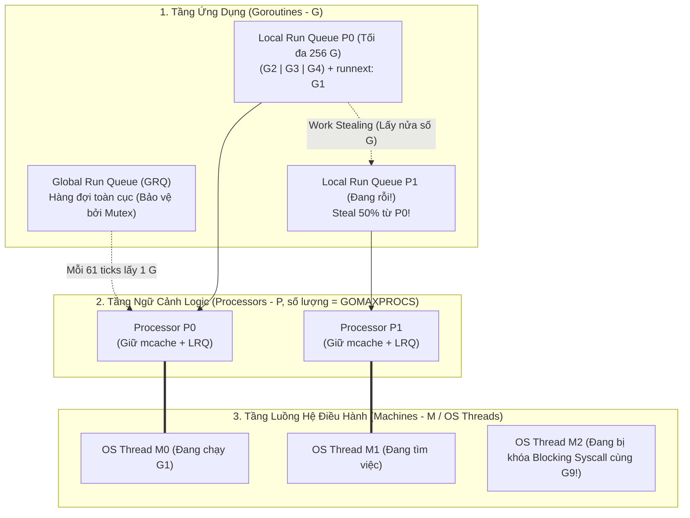
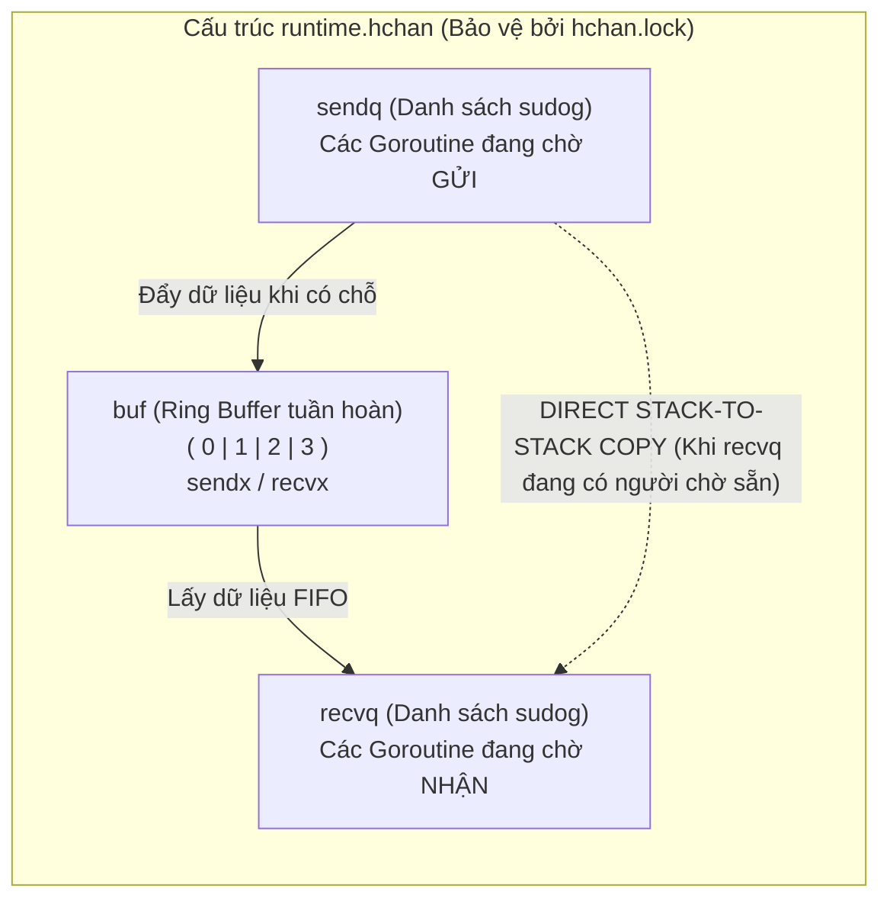
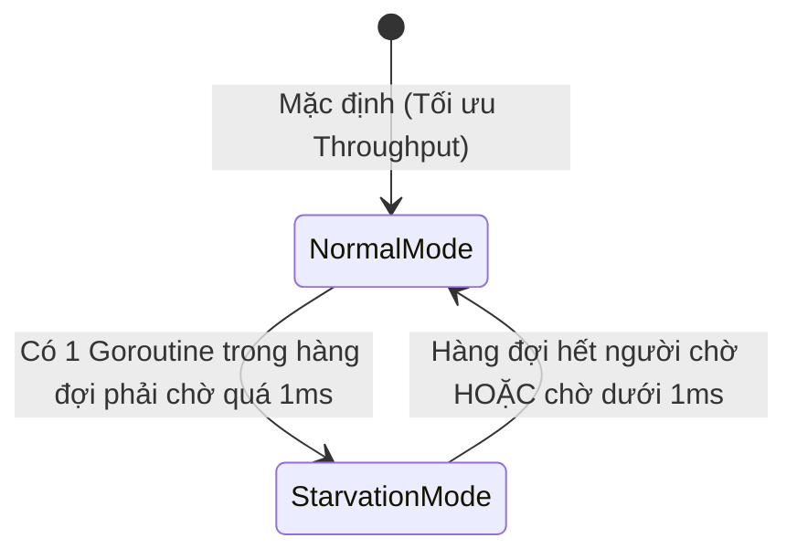

# CHUYÊN ĐỀ 05: LẬP TRÌNH ĐỒNG THỜI: GOROUTINES, CHANNELS & BỘ LẬP LỊCH GMP SCHEDULER

> Thuộc bộ cẩm nang: [[00_Go_Mastery_Index|Go Mastery Handbook]]  
> Tham khảo: Go Scheduler (`src/runtime/proc.go`), Channel (`src/runtime/chan.go`), *Concurrency in Go* (Katherine Cox-Buday), Kubernetes & etcd Codebase.

---

## 1. Giải Phẫu Bộ Lập Lịch GMP Scheduler (`src/runtime/proc.go`)

Tại sao một máy chủ viết bằng Go có thể chạy đồng thời **1.000.000 Goroutines** chỉ trên vài GB RAM, trong khi nếu tạo 1.000.000 OS Threads (`pthread`) bằng C/Java truyền thống thì nhân Linux sẽ sập ngay lập tức?

Câu trả lời nằm ở mô hình lập lịch đa hợp **$M:N$ (User-space Cooperative & Preemptive Scheduler)** do Dmitry Vyukov thiết kế cho Go Runtime, được gọi là kiến trúc **GMP**:



### 1.1. Ba Thực Thể Cốt Lõi: `G`, `M`, `P`

| Thực thể | Struct trong `runtime2.go` | Bản chất kỹ thuật & Chi phí |
| :--- | :--- | :--- |
| **`G` (Goroutine)** | `runtime.g` | Đại diện cho một tác vụ đồng thời nhẹ. Chứa ngăn xếp riêng (khởi điểm **2KB**), bộ đếm chương trình (`PC`), con trỏ ngăn xếp (`SP` trong `gobuf`), và trạng thái (`_Grunnable`, `_Grunning`, `_Gwaiting`, `_Gsyscall`). Tạo một `G` chỉ tốn vài trăm nano-giây trên không gian người dùng (User-space). |
| **`M` (Machine)** | `runtime.m` | Đại diện cho một **Luồng Hệ Điều Hành thực sự (OS Kernel Thread)** do Linux/Windows quản lý. Mỗi `M` có một Goroutine đặc biệt tên là **`g0`** (với stack lớn 8KB) chuyên dùng để chạy code lập lịch và cấp phát bộ nhớ của chính Go Runtime. |
| **`P` (Processor)** | `runtime.p` | Đại diện cho **Ngữ cảnh tài nguyên thực thi logic** (Số lượng `P` mặc định bằng số nhân CPU logic, điều chỉnh qua `runtime.GOMAXPROCS`). Một luồng `M` **bắt buộc phải gắn với một `P`** thì mới được phép chạy mã Go của `G`! Mỗi `P` sở hữu một hàng đợi cục bộ không khóa (**Local Run Queue - LRQ** chứa tối đa 256 `G` + 1 khe ưu tiên `runnext`) và bộ đệm bộ nhớ `mcache`. |

---

### 1.2. Bốn Cơ Chế Điều Phối Đỉnh Cao Của GMP Scheduler

#### 1. Thứ tự tìm kiếm công việc & Chống đói toàn cục (Tick `61` Magic Number)
Khi một `M` (đang giữ `P`) cần tìm Goroutine tiếp theo để chạy (`runtime.schedule()`), nó kiểm tra theo thứ tự:
- **Bước 1 (Chống đói - Fairness):** Cứ mỗi **`61` lần lập lịch (`schedtick % 61 == 0`)**, `P` sẽ kiểm tra **Global Run Queue (GRQ)** trước tiên! Tại sao lại là số nguyên tố `61`? Vì nếu chọn số chẵn như `64`, nó có thể trùng chu kỳ với các vòng lặp gửi nhận của chương trình người dùng, làm GRQ bị đói hoặc bị kiểm tra quá nhiều.
- **Bước 2:** Kiểm tra khe ưu tiên **`p.runnext`** (Goroutine vừa mới được đánh thức bởi channel/lock sẽ được đặt vào `runnext` để chạy ngay lập tức khi cache CPU còn nóng!).
- **Bước 3:** Lấy Goroutine từ **Local Run Queue (LRQ)** của `P`.
- **Bước 4:** Kiểm tra lại GRQ và **Network Poller (`netpoll` - epoll/kqueue)** xem có kết nối mạng nào vừa sẵn sàng I/O hay không.
- **Bước 5:** Nếu tất cả đều trống, kích hoạt thuật toán **Đánh cắp tác vụ (Work Stealing)**!

#### 2. Thuật toán Đánh Cắp Tác Vụ (Work-Stealing Algorithm)
Khi `P1` hết sạch việc trong hàng đợi cục bộ của mình, thay vì đi ngủ ngay, `P1` sẽ chọn ngẫu nhiên một Processor khác (ví dụ `P0`) và **đánh cắp một nửa (50%) số Goroutine** đang nằm trong LRQ của `P0` đem về LRQ của mình! Nhờ vậy, tải CPU luôn được cân bằng tự động trên toàn bộ các nhân mà không cần một bộ điều phối trung tâm.

#### 3. Cơ chế Chuyển Giao `P` Khi Gặp Lời Gọi Hệ Thống Chặn (Syscall Handoff)
- **Với Network I/O (HTTP, TCP, Timer):** Go tích hợp sẵn **Netpoller** không chặn (dựa trên `epoll` của Linux, `kqueue` của macOS, `IOCP` của Windows). Khi `G1` chờ đọc socket mạng, `G1` được đưa vào `netpoll` ngủ, còn `M0` và `P0` lập tức chuyển sang chạy `G2` ngay mà không hề bị block OS Thread!
- **Với Blocking OS Syscall (ví dụ đọc file đĩa cứng cục bộ hoặc gọi Cgo):** Khi `G1` (đang chạy trên `M0` + `P0`) gọi một syscall chặn, luồng hệ điều hành `M0` sẽ bị nhân Linux đóng băng. Ngay lập tức, Go Runtime (hoặc luồng giám sát ngầm `sysmon`) sẽ **tách `P0` ra khỏi `M0` (Handoff)** và giao `P0` cho một luồng OS Thread khác (`M1` đang rỗi hoặc tạo mới) để các Goroutine còn lại trong hàng đợi của `P0` tiếp tục được chạy! Khi `M0` hoàn tất syscall, `G1` được đẩy lại vào hàng đợi của một `P` bất kỳ để chạy tiếp.

#### 4. Ngắt Ưu Tiên Bất Đồng Bộ Bằng Tín Hiệu `SIGURG` (Asynchronous Preemption — Go 1.14+)
- **Trước Go 1.14:** Go chỉ có thể ngắt (preempt) một Goroutine tại **Prologue của lời gọi hàm** (khi kiểm tra tràn stack). Nếu một Goroutine chạy vòng lặp tính toán thuần túy không gọi hàm `for i := 0; i < 1e12; i++ { sum += i }`, nó sẽ **chiếm độc quyền nhân CPU mãi mãi** và làm treo cả Garbage Collector (जब GC cần Stop-The-World)!
- **Từ Go 1.14 trở đi:** Luồng giám sát nền `sysmon` (chạy định kỳ mỗi `20µs - 10ms` mà không cần `P`) phát hiện bất kỳ Goroutine nào chiếm giữ CPU quá **10ms**. Ngay lập tức, `sysmon` bắn một tín hiệu hệ điều hành **`SIGURG`** tới luồng OS Thread `M` đang chạy Goroutine đó! Khi nhận tín hiệu `SIGURG`, nhân OS tạm dừng luồng `M`, nhảy vào hàm xử lý tín hiệu của Go (`runtime.doSigPreempt`), lưu lại toàn bộ thanh ghi CPU của Goroutine đang chạy và **cưỡng chế nhường CPU cho Goroutine khác**!

---

## 2. Giải Phẫu Nội Tạng Channel (`runtime.hchan`)

Triết lý nổi tiếng nhất của Go (dựa trên mô hình *Communicating Sequential Processes - CSP* của Tony Hoare) là:
> *"Đừng giao tiếp bằng cách chia sẻ bộ nhớ; hãy chia sẻ bộ nhớ bằng cách giao tiếp."*
> *(Don't communicate by sharing memory; share memory by communicating.)*

### 2.1. Cấu Trúc Bộ Nhớ Của `runtime.hchan` (`src/runtime/chan.go`)

Khi bạn gọi `ch := make(chan int, 4)`, hàm `runtime.makechan` cấp phát trên Heap một cấu trúc `hchan` và trả về một con trỏ `*hchan`:

```go
// Trích dẫn từ src/runtime/chan.go:
type hchan struct {
    qcount   uint           // Số phần tử hiện đang nằm trong hàng đợi vòng (Ring Buffer)
    dataqsiz uint           // Dung lượng tối đa của Ring Buffer (tương ứng cap(ch))
    buf      unsafe.Pointer // Con trỏ trỏ tới mảng Ring Buffer (có độ dài = dataqsiz)
    elemsize uint16         // Kích thước 1 phần tử (bytes)
    closed   uint32         // Cờ trạng thái: 0 = đang mở, 1 = đã đóng (close)
    elemtype *_type         // Kiểu dữ liệu của phần tử
    sendx    uint           // Chỉ số (index) ô tiếp theo sẽ GHI vào Ring Buffer
    recvx    uint           // Chỉ số (index) ô tiếp theo sẽ ĐỌC từ Ring Buffer
    recvq    waitq          // Hàng đợi liên kết đôi các Goroutine (sudog) đang ngủ chờ NHẬN (<-ch)
    sendq    waitq          // Hàng đợi liên kết đôi các Goroutine (sudog) đang ngủ chờ GỬI (ch <-)
    lock     mutex          // Khóa Mutex nội bộ bảo vệ toàn bộ cấu trúc hchan này!
}
```



#### Tối ưu hóa đỉnh cao: Copy Trực Tiếp Giữa Hai Stack Goroutine (`runtime.sendDirect`)
Thông thường, một Goroutine không bao giờ được phép truy cập vào ngăn xếp (Stack) của một Goroutine khác. Nhưng Channel là **ngoại lệ duy nhất trong toàn bộ Go Runtime**!
- Giả sử `G1` đang ngủ chờ nhận dữ liệu trong `recvq` (`x := <-ch`).
- Lúc này `G2` thực hiện gửi `ch <- 42`. Thay vì copy số `42` vào bộ đệm `hchan.buf` rồi đánh thức `G1` dậy để `G1` tự copy từ `hchan.buf` về biến `x` của mình (mất 2 lần copy và phải giữ khóa `hchan.lock`), hàm `runtime.send` của **`G2` sẽ dùng rào chắn ghi để copy thẳng giá trị `42` từ Stack của `G2` sang biến `x` nằm trên Stack của `G1`**, sau đó đánh thức `G1` (`goready(G1)`) đẩy vào khe `runnext` của Processor!

---

### 2.2. Bảng Trạng Thái Toàn Diện Của Channel (`nil` vs Mở vs Đã Đóng)

Đây là bảng quy tắc sống còn mà mọi kỹ sư Go bắt buộc phải thuộc lòng để không bao giờ viết code gây `panic` hoặc treo hệ thống (Deadlock):

| Thao tác | Channel `nil` (`var ch chan T`) | Channel Đang Mở (Normal Open) | Channel Đã Đóng (`close(ch)`) |
| :--- | :--- | :--- | :--- |
| **Gửi (`ch <- v`)** | **Khóa vĩnh viễn (Block forever)** | Gửi thành công (hoặc đợi cho tới khi có người nhận / còn chỗ trống trong buffer). | **PANIC!** (`panic: send on closed channel`) |
| **Nhận (`v, ok := <-ch`)** | **Khóa vĩnh viễn (Block forever)** | Nhận giá trị và `ok = true` (hoặc đợi cho tới khi có dữ liệu). | • Nếu trong buffer còn dữ liệu tồn: Nhận hết dữ liệu tồn với `ok = true`.<br/>• Khi buffer đã cạn: **Trả về ngay lập tức Zero Value của `T` và `ok = false` (KHÔNG BLOCK!)** |
| **Đóng (`close(ch)`)** | **PANIC!** (`panic: close of nil channel`) | Đóng kênh thành công. Đánh thức toàn bộ Goroutine đang chờ nhận trong `recvq` ngay lập tức! | **PANIC!** (`panic: close of closed channel`) |

> [!TIP]
> **Kỹ thuật Vô Hiệu Hóa Nhánh `select` Động Bằng `nil` Channel:**
> Lợi dụng tính chất *"Đọc/Ghi trên `nil` channel sẽ bị khóa vĩnh viễn (tức là nhánh `case` đó không bao giờ được chọn trong `select`)"*, khi gộp dữ liệu từ 2 kênh `ch1` và `ch2`, ngay khi phát hiện `ch1` đã đóng (`!ok`), ta chỉ cần gán **`ch1 = nil`**! Câu lệnh `select` ở các vòng lặp tiếp theo sẽ tự động tắt nhánh `case <-ch1` mà không bị vòng lặp quay cuồng (CPU 100% spin loop) đọc Zero Value từ channel đã đóng!

---

## 3. Các Cơ Chế Đồng Bộ Hóa Nâng Cao (`select`, `context`, `sync`, `errgroup`)

### 3.1. Cơ Chế Thực Thi Của Câu Lệnh `select` (`src/runtime/select.go`)

Khi một Goroutine bước vào khối `select` có nhiều nhánh `case`:
1. **Xáo trộn thứ tự kiểm tra (`pollorder`):** Go Runtime dùng `fastrand` xáo trộn ngẫu nhiên thứ tự các nhánh `case` để đảm bảo tính công bằng (nếu 2 kênh luôn có sẵn dữ liệu cùng lúc, xác suất mỗi nhánh được chọn là 50/50).
2. **Sắp xếp thứ tự khóa (`lockorder`):** Để tránh **Deadlock** khi nhiều Goroutine cùng `select` trên cùng tập hợp các kênh theo thứ tự khác nhau, Go Runtime sắp xếp các kênh theo địa chỉ bộ nhớ tăng dần của `hchan` (Heap Sort) rồi mới lần lượt gọi `lock` từng kênh!
3. Nếu không có kênh nào sẵn sàng và có nhánh `default:`, nó mở khóa toàn bộ kênh và chạy nhánh `default` ngay lập tức (Non-blocking I/O). Nếu không có `default:`, Goroutine tự đăng ký vào `sendq`/`recvq` của tất cả các kênh rồi đi ngủ (`gopark`).

---

### 3.2. Cây Hủy Bỏ Tác Vụ: `context.Context`

Trong kiến trúc Microservices, một HTTP/gRPC request đến có thể kích hoạt 10 Goroutine con gọi xuống Database, Redis và các dịch vụ khác. Nếu người dùng ngắt kết nối hoặc hết thời gian chờ (Timeout 2 giây), làm sao báo hiệu cho toàn bộ 10 Goroutine con dừng làm việc ngay lập tức để giải phóng tài nguyên?

Gói `context` xây dựng một **Cây Truyền Tín Hiệu Một Chiều Từ Cha Xuống Con (Cancellation Propagation Tree)** hoàn toàn an toàn đa luồng:
- **`context.Background()` / `context.TODO()`**: Nút gốc bất tử ở đỉnh cây.
- **`context.WithCancel(parent)` / `WithCancelCause(parent)`**: Tạo một nút con (`cancelCtx`). Khi gọi hàm `cancel()` trên nút cha, nó đóng kênh `done chan struct{}` của cha và đệ quy hủy toàn bộ các nút con bên dưới, nhưng **hủy nút con không ảnh hưởng đến nút cha**.
- **`context.WithTimeout(parent, duration)` / `WithDeadline(parent, time)`**: Tự động kích hoạt hủy khi đồng hồ điểm.
  > [!IMPORTANT]
  > **Luôn gọi `defer cancel()` ngay sau khi tạo `WithTimeout` / `WithCancel`!** Ngay cả khi hàm của bạn chạy xong sớm trong `5ms` trước khi hết hạn `5s`, nếu bạn quên gọi `cancel()`, cấu trúc `timerCtx` và bộ đếm thời gian sẽ vẫn bị treo trong bộ nhớ và gắn vào nút cha cho đến hết 5 giây!

---

### 3.3. Giải Phẫu `sync.Mutex`: Normal Mode vs Starvation Mode (Chống Đói 1ms)

Khác với khóa Mutex hệ điều hành truyền thống (`pthread_mutex`), `sync.Mutex` của Go chỉ chiếm **8 bytes** (`state int32` và `sema uint32`) và hoạt động cực kỳ thông minh qua **2 chế độ tự chuyển đổi** (từ Go 1.9+):



1. **Normal Mode (Chế độ bình thường — Ưu tiên Thông lượng tối đa / High Throughput):**
   Khi một Goroutine mở khóa `Unlock()`, nó đánh thức Goroutine đứng đầu hàng đợi (`Waiter`). Tuy nhiên, Goroutine vừa được đánh thức này **phải cạnh tranh CAS (`Compare-And-Swap`) với các Goroutine mới vừa chạy tới gọi `Lock()` trên CPU**!
   - Vì các Goroutine mới đang chạy trực tiếp trên nhân CPU và có quyền quay vòng thử (`Spinning` 4 lần nếu hệ thống đa nhân), chúng gần như luôn thắng Goroutine vừa mới ngủ dậy! Điều này giúp thông lượng tổng thể cực cao vì không mất chi phí chuyển ngữ cảnh Goroutine.
2. **Starvation Mode (Chế độ chống đói — Ưu tiên Độ trễ đuôi p99 / Tail Latency):**
   Nếu Goroutine đứng đầu hàng đợi liên tục thua cuộc và phải chờ **quá `1ms` (1 mili-giây)**, nó lập tức bật cờ chuyển Mutex sang **Starvation Mode**!
   - Trong chế độ này, khi gọi `Unlock()`, quyền sở hữu khóa được **trao tay trực tiếp (Direct Handoff)** cho Goroutine đứng đầu hàng đợi! Các Goroutine mới vừa tới gọi `Lock()` **không được phép spin hay tranh giành**, mà bắt buộc phải xếp hàng vào cuối hàng đợi.
   - Khi Goroutine nhận khóa thấy mình là người cuối cùng trong hàng đợi hoặc thời gian chờ của mình `< 1ms`, nó chuyển Mutex quay về Normal Mode.

---

### 3.4. `sync.WaitGroup`, `sync.Once`, `sync/atomic` và `errgroup.Group`

1. **`sync.WaitGroup`:**
   - **Quy tắc sống còn:** Lệnh `wg.Add(1)` **BẮT BUỘC phải được gọi ở Goroutine cha TRƯỚC KHI chạy lệnh `go func()`**, tuyệt đối không đặt `wg.Add(1)` vào bên trong thân Goroutine con! Nếu đặt bên trong Goroutine con, Goroutine cha có thể chạy tới `wg.Wait()` trước cả khi Goroutine con kịp được bộ lập lịch khởi chạy và gọi `wg.Add(1)`.
   - Từ **Go 1.25+**, `WaitGroup` được bổ sung phương thức tiện lợi `wg.Go(func() { ... })` tự động bọc `Add(1)` và `defer Done()` để loại bỏ hoàn toàn lỗi quên `Done()` hoặc đặt sai vị trí `Add(1)`.
2. **`sync.Once` (`OnceFunc` / `OnceValue` từ Go 1.21+):**
   Đảm bảo hàm khởi tạo (Singleton) chỉ chạy **đúng 1 lần duy nhất** trên toàn hệ thống dù có 1000 Goroutine gọi cùng lúc.
   - *Lưu ý:* Nó không chỉ dùng một lệnh `atomic.CompareAndSwap`, mà kết hợp `atomic.Load` ở đường dẫn nhanh (Fast Path ~1ns) với một `sync.Mutex` ở đường dẫn chậm (Slow Path) để đảm bảo: các Goroutine đến sau **phải đợi cho tới khi Goroutine đầu tiên chạy XONG hàm khởi tạo** mới được đi tiếp!
3. **`sync/atomic` (Các kiểu dữ liệu `atomic.Int64`, `atomic.Bool`, `atomic.Pointer[T]` từ Go 1.19+):**
   Thay vì truyền địa chỉ `&val` dễ quên căn chỉnh biên 64-bit trên hệ 32-bit như các hàm `atomic.AddInt64(&x, 1)` cũ, hãy luôn dùng các kiểu struct bọc sẵn như `var counter atomic.Int64` (tự động căn chỉnh biên 8-byte và cấm copy bằng `noCopy`).
4. **`golang.org/x/sync/errgroup` (`errgroup.WithContext`):**
   Sự nâng cấp hoàn hảo của `sync.WaitGroup` trong môi trường sản xuất: Tự động quản lý giới hạn số lượng Goroutine chạy song song (`g.SetLimit(10)`), tự động thu thập lỗi đầu tiên xảy ra từ bất kỳ Goroutine con nào, và **tự động hủy `context.Context` để dừng toàn bộ các Goroutine anh em còn lại**!

---

## 4. Mổ Xẻ Mã Nguồn Thực Tế: Các Pattern Điều Phối Trong Kubernetes & etcd

### 4.1. Pattern 1: Bounded Worker Pool + Context Cancellation (Chuẩn Kubernetes Controller)

Trong **Kubernetes** (`k8s.io/apimachinery/pkg/util/wait` và `controller-runtime`), bạn không bao giờ thấy lệnh `go process(item)` không kiểm soát số lượng mỗi khi có sự kiện mới (vì một cơn bão request có thể tạo ra 5 triệu Goroutines gây OOM). Thay vào đó, một **Worker Pool giới hạn số lượng cố định** kết hợp kiểm tra `ctx.Done()` hai lớp luôn được sử dụng:

```go
// Mẫu thiết kế Bounded Worker Pool chống Goroutine Leak chuẩn Production:
func ProcessBatch(ctx context.Context, numWorkers int, jobs []int) ([]int, error) {
    jobCh := make(chan int, len(jobs))
    for _, j := range jobs {
        jobCh <- j
    }
    close(jobCh) // Đóng kênh jobCh để báo cho các Worker biết khi nào hết việc!

    results := make([]int, len(jobs))
    var wg sync.WaitGroup

    for w := 0; w < numWorkers; w++ {
        wg.Add(1)
        go func(workerID int) {
            defer wg.Done()
            for {
                // Kiểm tra ưu tiên xem Context đã bị hủy chưa trước khi nhận job mới
                select {
                case <-ctx.Done():
                    return
                case job, ok := <-jobCh:
                    if !ok {
                        return // jobCh đã đóng và hết sạch việc -> Thoát Goroutine sạch sẽ!
                    }
                    // Thực thi tác vụ có hỗ trợ dừng sớm theo ctx
                    results[job] = heavyCompute(ctx, job)
                }
            }
        }(w)
    }

    wg.Wait() // Chờ toàn bộ Worker thoát sạch trước khi hàm trả về!
    return results, ctx.Err()
}
```

---

### 4.2. Pattern 2: Graceful Shutdown Với `signal.NotifyContext` (Chuẩn `etcd` & Cloud-Native Server)

Trong mã nguồn của **etcd** ([`server/etcdmain/etcd.go`](https://github.com/etcd-io/etcd)) và các dịch vụ Kubernetes, khi Pod nhận tín hiệu `SIGTERM` từ Kubelet để tắt hoặc nâng cấp phiên bản, tiến trình không được chết đột ngột làm đứt gãy các giao dịch đang xử lý dở, mà phải thực hiện **Graceful Shutdown có thời hạn (Deadline)**:

```go
func RunProductionServer() error {
    // 1. Tạo Context tự động hủy khi nhận tín hiệu SIGINT (Ctrl+C) hoặc SIGTERM (Kubernetes Pod stop)
    ctx, stopSignals := signal.NotifyContext(context.Background(), os.Interrupt, syscall.SIGTERM)
    defer stopSignals()

    srv := &http.Server{Addr: ":8080"}

    // 2. Chạy Server trên một Goroutine riêng và bắt lỗi khởi động
    errCh := make(chan error, 1) // CỰC KỲ QUAN TRỌNG: Phải là Buffered Channel (size=1) để không leak Goroutine!
    go func() {
        if err := srv.ListenAndServe(); err != nil && !errors.Is(err, http.ErrServerClosed) {
            errCh <- err
        }
        close(errCh)
    }()

    // 3. Đứng chờ: Hoặc Server lỗi khởi động, hoặc nhận tín hiệu tắt từ OS
    select {
    case err := <-errCh:
        return fmt.Errorf("server failed to start: %w", err)
    case <-ctx.Done():
        // Ngừng lắng nghe tín hiệu để nếu user bấm Ctrl+C lần 2 thì ép thoát ngay
        stopSignals()
    }

    // 4. Cấp quỹ thời gian tối đa 10 giây để các request đang chạy dở hoàn tất (Drain in-flight requests)
    shutdownCtx, cancel := context.WithTimeout(context.Background(), 10*time.Second)
    defer cancel()

    return srv.Shutdown(shutdownCtx)
}
```
> **Điểm tinh tế cần học tập:** Hãy chú ý dòng `errCh := make(chan error, 1)`. Tại sao kích thước bộ đệm phải là `1`? Vì nếu nhánh `case <-ctx.Done():` được kích hoạt trước, Goroutine chính sẽ không đọc từ `errCh` nữa. Nếu `errCh` là Unbuffered (`make(chan error)`), khi Goroutine con gặp lỗi và gửi `errCh <- err`, nó sẽ bị **khóa vĩnh viễn (Goroutine Leak)** vì không còn ai đọc `errCh`! Đặt buffer bằng `1` đảm bảo Goroutine con luôn gửi xong và thoát ngay lập tức.

*(Xem và chạy trực tiếp bài thực nghiệm [`code_lab/04_concurrency_patterns_context.go`](file:///home/thinh/Obsidian/Go_Mastery_Handbook/code_lab/04_concurrency_patterns_context.go)).*
