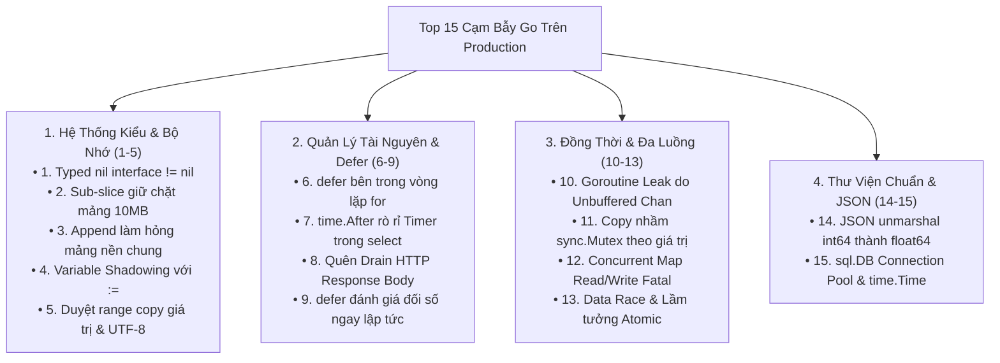

# CHUYÊN ĐỀ 06: TOP 15 CẠM BẪY KINH ĐIỂN (100 GO MISTAKES) & QUY CHUẨN SẢN XUẤT

> Thuộc bộ cẩm nang: [[00_Go_Mastery_Index|Go Mastery Handbook]]  
> Tham khảo: *100 Go Mistakes and How to Avoid Them* (Teiva Harsanyi), *Uber Go Style Guide*, *Google Go Style Decisions*.

---

## 1. Bản Đồ 15 Cạm Bẫy Chết Người Trên Môi Trường Production

Go có cú pháp cực kỳ đơn giản, dễ học trong một tuần, nhưng chính sự tối giản đó lại ẩn giấu nhiều hành vi ngầm dưới tầng Runtime có thể gây sập hệ thống (Out-Of-Memory, Goroutine Leak, Deadlock, Socket Exhaustion) sau vài ngày chạy thực tế.



---

## 2. Phân Tích Chi Tiết & Giải Pháp Cho Từng Cạm Bẫy

### Cạm bẫy 01: Bẫy `nil` Interface vs `nil` Pointer (`err != nil` dù không có lỗi!)
- **Triệu chứng:** Hàm trả về biến con trỏ lỗi cụ thể `var err *MyError = nil` qua kiểu trả về `error`. Nơi gọi kiểm tra `if err != nil` luôn thấy bằng `true`!
- **Bản chất:** Interface là cặp `(tab, data)`. Khi ép `(*MyError)(nil)` sang `error`, trường `tab` trỏ tới thông tin kiểu `*MyError` ($\neq$ `nil`), nên cả cấu trúc Interface **không bằng `nil`**. (Xem giải phẫu chi tiết tại [[01_Keywords_and_Predeclared_Identifiers#5. Cạm Bẫy Kinh Điển Số 1 Của Go: Typed `nil` Interface != `nil`|Chuyên đề 01]]).
- **Cách phòng tránh:** Luôn trả về trực tiếp từ khóa `return nil` khi không có lỗi, hoặc khai báo biến lỗi tạm có kiểu là chính interface `var err error`.

---

### Cạm bẫy 02: Rò Rỉ Goroutine (Goroutine Leak) Do Kênh Không Có Người Đọc
- **Triệu chứng:** RAM của dịch vụ tăng đều đặn từ vài chục MB lên hàng chục GB sau vài ngày chạy, kiểm tra `runtime.NumGoroutine()` thấy hàng trăm nghìn Goroutine đang bị treo ở trạng thái `chan send`.
- **Nguyên nhân kinh điển:** Khởi tạo một Unbuffered Channel (`ch := make(chan Result)`), bắn một Goroutine con đi gọi mạng rồi đẩy kết quả vào `ch <- res`. Nhưng ở Goroutine cha lại hết thời gian chờ (`case <-ctx.Done():`) và `return` thoát sớm! Lúc này không còn ai đọc `ch` nữa, khiến Goroutine con bị khóa vĩnh viễn tại dòng `ch <- res` cùng toàn bộ biến trên Stack của nó!

```go
// SAI (Gây Goroutine Leak nếu ctx hết hạn trước khi doRPC xong):
func callServiceBad(ctx context.Context) (Result, error) {
    ch := make(chan Result) // Unbuffered channel (size = 0)!
    go func() {
        ch <- doRPC() // TREO VĨNH VIỄN nếu hàm cha đã thoát ở nhánh ctx.Done()!
    }()
    select {
    case res := <-ch:
        return res, nil
    case <-ctx.Done():
        return Result{}, ctx.Err()
    }
}

// ĐÚNG: Luôn dùng Buffered Channel có kích thước >= số Goroutine gửi (make(chan Result, 1))
// HOẶC bọc lệnh gửi trong select có kiểm tra <-ctx.Done()!
func callServiceGood(ctx context.Context) (Result, error) {
    ch := make(chan Result, 1) // Buffer = 1: Goroutine con luôn gửi xong và thoát ngay dù không ai đọc!
    go func() {
        ch <- doRPC()
    }()
    select {
    case res := <-ch:
        return res, nil
    case <-ctx.Done():
        return Result{}, ctx.Err()
    }
}
```

---

### Cạm bẫy 03: Đặt `defer` Bên Trong Vòng Lặp `for`
- **Triệu chứng:** Hàm duyệt qua danh sách 50.000 đường dẫn file để đọc dữ liệu bị văng lỗi hệ điều hành `too many open files` (vượt giới hạn `ulimit -n`), hoặc ngốn cạn RAM.
- **Bản chất:** `defer` chỉ được thực thi khi **hàm bao ngoài kết thúc**, KHÔNG PHẢI khi kết thúc một bước lặp `for`! Hơn nữa, đặt `defer` trong vòng lặp sẽ phá vỡ tối ưu hóa *Open-coded Defer* của trình biên dịch, ép cấp phát hàng chục nghìn nút `_defer` nối đuôi nhau trên Heap.
- **Giải pháp:** Tách phần thân bên trong vòng lặp ra một **hàm phụ riêng biệt** (hoặc bọc trong một closure ẩn danh `func() { ... }()`) để `defer` chạy ngay ở cuối mỗi bước lặp:
```go
for _, path := range filePaths {
    if err := func(p string) error {
        f, err := os.Open(p)
        if err != nil {
            return err
        }
        defer f.Close() // Đóng file NGAY LẬP TỨC khi thoát hàm ẩn danh ở mỗi vòng lặp!
        return processFile(f)
    }(path); err != nil {
        return err
    }
}
```

---

### Cạm bẫy 04: Copy Nhầm `sync.Mutex` / `sync.WaitGroup` Theo Giá Trị (`copylocks`)
- **Triệu chứng:** Đã dùng `mu.Lock()` và `mu.Unlock()` đầy đủ nhưng vẫn xảy ra Data Race hoặc Deadlock bí ẩn!
- **Bản chất:** `sync.Mutex`, `sync.RWMutex`, `sync.WaitGroup`, `sync.Cond`, `sync.Once`, `sync.Pool` là các cấu trúc chứa trạng thái khóa nội bộ (`state`, `sema`) và chứa trường đánh dấu `noCopy`. Nếu bạn định nghĩa phương thức với **Value Receiver** `func (c Counter) Increment()` hoặc truyền struct chứa Mutex theo giá trị `func doWork(wg sync.WaitGroup)`, Go sẽ **tạo một bản sao hoàn toàn mới của cái khóa đó**! Bạn đang khóa trên bản sao tạm thời chứ không hề khóa trên đối tượng gốc!

```go
type SafeCache struct {
    mu   sync.Mutex
    data map[string]string
}

// SAI NGHIÊM TRỌNG: Value Receiver (c SafeCache) sẽ COPY toàn bộ sync.Mutex ở mỗi lần gọi!
func (c SafeCache) SetBad(k, v string) {
    c.mu.Lock()
    defer c.mu.Unlock()
    c.data[k] = v // DATA RACE! Vì mỗi người gọi đang Lock trên một bản sao mu khác nhau!
}

// ĐÚNG: Bắt buộc dùng Pointer Receiver (c *SafeCache) cho mọi struct có chứa đối tượng đồng bộ!
func (c *SafeCache) SetGood(k, v string) {
    c.mu.Lock()
    defer c.mu.Unlock()
    c.data[k] = v
}
```
> [!TIP]
> Luôn chạy lệnh **`go vet ./...`** trong CI/CD pipeline! Trình phân tích `copylocks` tích hợp trong `go vet` sẽ phát hiện mọi trường hợp copy `sync.Mutex` / `WaitGroup` và báo lỗi ngay lập tức.

---

### Cạm bẫy 05: Dùng `time.After(d)` Bên Trong Vòng Lặp `for { select { ... } }`
- **Triệu chứng:** Một Goroutine chạy vòng lặp nhận tin nhắn từ Kafka/Channel kết hợp `case <-time.After(5 * time.Minute):` để kiểm tra trạng thái nhàn rỗi (Idle Timeout). Nếu có 100.000 tin nhắn đến mỗi giây, bộ nhớ RAM của ứng dụng sẽ tăng vọt hàng GB trong vài phút!
- **Bản chất (Trước Go 1.23):** Mỗi lần vòng lặp `for` quay lại đầu câu lệnh `select`, hàm `time.After(5 * time.Minute)` được gọi lại và **tạo mới một đối tượng `time.Timer` trên Heap của Go Runtime**. Dù nhánh nhận tin nhắn `case msg := <-ch:` được chọn ngay sau đó, bộ `Timer` 5 phút vừa tạo **KHÔNG bị hủy**, mà vẫn nằm sống trong cấu trúc Heap quản lý thời gian của Runtime suốt 5 phút tiếp theo!
  *(Lưu ý: Từ Go 1.23+, Go Runtime đã cải tiến để GC có thể thu hồi sớm các `time.After` không còn tham chiếu, nhưng việc cấp phát một đối tượng `Timer` + channel mới trên Heap ở mỗi bước lặp vẫn gây áp lực GC cực lớn!).*
- **Giải pháp chuẩn mực:** Khởi tạo `time.NewTimer(d)` **1 lần duy nhất bên ngoài vòng lặp**, và dùng `timer.Reset(d)` ở mỗi bước lặp:
```go
func consumeStream(ctx context.Context, ch <-chan Message) {
    const idleTimeout = 5 * time.Minute
    timer := time.NewTimer(idleTimeout)
    defer timer.Stop() // Giải phóng ngay khi thoát hàm

    for {
        timer.Reset(idleTimeout) // Tái sử dụng đúng 1 Timer duy nhất, 0 byte cấp phát mới!
        select {
        case <-ctx.Done():
            return
        case msg, ok := <-ch:
            if !ok {
                return
            }
            handle(msg)
        case <-timer.C:
            log.Println("Không có tin nhắn mới trong 5 phút!")
        }
    }
}
```

---

### Cạm bẫy 06: Giải Mã JSON (`json.Unmarshal`) Vào `map[string]any` Biến Số Nguyên Thành `float64`
- **Triệu chứng:** Chuỗi JSON gửi lên là `{"user_id": 9007199254740993}` (số nguyên `int64` 64-bit). Khi giải mã vào `var data map[string]any`, hai thảm họa xảy ra:
  1. Ép kiểu `data["user_id"].(int64)` gây **`panic: interface conversion: interface {} is float64, not int64`**!
  2. Vì chuẩn IEEE-754 `float64` chỉ có **53 bits phần định trị (mantissa)**, số nguyên `9007199254740993` ($2^{53} + 1$) bị **làm tròn sai lệch thành `9007199254740992` (Mất độ chính xác âm thầm - Silent Data Corruption)**!
- **Giải pháp:** Nếu bắt buộc phải giải mã vào `map[string]any` (thay vì struct có kiểu rõ ràng), hãy dùng `json.NewDecoder` kết hợp **`dec.UseNumber()`** để giữ số dưới dạng chuỗi nguyên bản `json.Number`:
```go
dec := json.NewDecoder(bytes.NewReader(rawJSON))
dec.UseNumber() // Giữ nguyên độ chính xác 64-bit dưới dạng kiểu json.Number!

var data map[string]any
_ = dec.Decode(&data)

id, err := data["user_id"].(json.Number).Int64() // Chính xác tuyệt đối: 9007199254740993!
```

---

### Cạm bẫy 07: Không Đóng Hoặc Không Đọc Cạn `http.Response.Body` Làm Chết Kết Nối Keep-Alive
- **Triệu chứng:** Dịch vụ gọi API bên ngoài bằng `http.Client`. Dù đã viết `defer resp.Body.Close()`, nhưng khi tải cao, hệ thống lại mở hàng chục nghìn kết nối TCP mới liên tục, gây cạn kiệt cổng mạng (`TIME_WAIT` port exhaustion) và chậm tốc độ do phải bắt tay TCP/TLS lại từ đầu!
- **Bản chất (Trong `src/net/http/transport.go`):**
  1. Nếu `err == nil`, bạn **bắt buộc phải gọi `defer resp.Body.Close()`** (kể cả khi bạn không cần đọc nội dung phản hồi). Nếu quên đóng, kết nối bị rò rỉ vĩnh viễn.
  2. **Bí mật ít người biết:** Để `http.Transport` có thể **tái sử dụng kết nối TCP đó trong hồ Keep-Alive (Connection Pooling)** cho request tiếp theo, luồng dữ liệu của request hiện tại trên socket phải được **đọc sạch đến tận dấu hiệu `EOF`**! Nếu bạn chỉ đọc một nửa body (hoặc kiểm tra `resp.StatusCode != 200` rồi thoát luôn không đọc body), hàm `resp.Body.Close()` thấy vẫn còn byte tồn đọng trên đường ống mạng nên sẽ **đóng sập kết nối TCP vật lý luôn** thay vì trả về Pool!
- **Giải pháp chuẩn công nghiệp:**
```go
resp, err := httpClient.Get(url)
if err != nil {
    return err // Lưu ý: Chỉ defer Close() SAU KHI đã kiểm tra err == nil! (Nếu err != nil thì resp có thể là nil!)
}
defer func() {
    // Đọc xả bỏ tối đa 64KB dữ liệu thừa còn sót lại để cứu kết nối TCP Keep-Alive về Pool!
    _, _ = io.Copy(io.Discard, io.LimitReader(resp.Body, 64*1024))
    _ = resp.Body.Close()
}()
```

---

### Cạm bẫy 08: Che Khuất Biến Ngầm Định Với Toán Tử `:=` (Accidental Variable Shadowing)
- **Triệu chứng:** Biến `client` hoặc `err` khai báo ở đầu hàm vẫn bằng `nil` ở cuối hàm dù bên trong khối `if` đã khởi tạo thành công!
- **Bản chất:** Toán tử khai báo ngắn `:=` bên trong một khối con `{ ... }` (như `if`, `for`, `switch`) sẽ **tạo ra một biến cục bộ hoàn toàn mới che khuất (shadow) biến cùng tên ở khối ngoài**, miễn là ở vế trái của `:=` có ít nhất 1 biến mới!
```go
var client *http.Client
if useProxy {
    // BẪY: Vì 'err' là biến mới trong khối if, nên toán tử ':=' cũng TẠO MỚI luôn biến 'client' cục bộ!
    // Biến 'client' ở ngoài hàm hoàn toàn KHÔNG ĐƯỢC GÁN và vẫn bằng nil!
    client, err := createProxyClient()
    if err != nil {
        return err
    }
    _ = client
}
// Tại đây: client VẪN BẰNG nil!
```
- **Giải pháp:** Khai báo `var err error` trước ở ngoài rồi dùng dấu gán thuần túy `=` (`client, err = createProxyClient()`), và bật trình kiểm tra `shadow` trong `golangci-lint`.

---

### Cạm bẫy 09 đến 15: Tóm Tắt Nhanh Các Bẫy Quan Trọng Khác

| # | Tên cạm bẫy | Hiện tượng sai lầm | Giải pháp chuẩn Production |
| :--- | :--- | :--- | :--- |
| **09** | **`http.DefaultClient` không có Timeout** | Dùng `http.Get(url)` hoặc `&http.Client{}` mặc định có **`Timeout: 0` (Vô cực)**! Nếu server đích bị treo, Goroutine của bạn bị khóa vĩnh viễn! | Luôn khởi tạo `http.Client{Timeout: 10 * time.Second}` tường minh. |
| **10** | **`sql.Open` không kiểm tra kết nối và không giới hạn Pool** | `sql.Open()` chỉ kiểm tra cú pháp chuỗi kết nối chứ chưa hề mở kết nối tới DB, và mặc định `MaxOpenConns = 0` (không giới hạn), dễ làm sập DB khi tải tăng đột biến. | Luôn gọi `db.PingContext(ctx)` sau `sql.Open`, và cấu hình `SetMaxOpenConns`, `SetMaxIdleConns`, `SetConnMaxLifetime`. |
| **11** | **So sánh `time.Time` bằng toán tử `==`** | Struct `time.Time` chứa cả **Đồng hồ tường (Wall clock)**, **Đồng hồ đơn điệu (Monotonic clock)** và con trỏ múi giờ `*Location`. Hai thời điểm giống hệt nhau nhưng 1 cái vừa đọc từ `time.Now()` (có monotonic) và 1 cái giải mã từ JSON (không có monotonic) khi so sánh `t1 == t2` sẽ ra **`false`**! | Luôn dùng phương thức **`t1.Equal(t2)`** để so sánh hai mốc thời gian! |
| **12** | **Dùng `len(str)` để đếm số ký tự tiếng Việt / Unicode** | `len("Việt Nam")` trả về **`10`** (vì chữ `'ệ'` chiếm 3 bytes UTF-8), không phải `8` ký tự! Cắt chuỗi `s[:5]` giữa chừng một ký tự nhiều byte sẽ làm hỏng chuỗi UTF-8! | Dùng **`utf8.RuneCountInString(s)`** để đếm ký tự, và chuyển sang `[]rune(s)` nếu cần cắt theo vị trí ký tự. |
| **13** | **`strings.TrimRight` vs `strings.TrimSuffix`** | `strings.TrimRight("123oxo", "xo")` trả về **`"123"`** (không phải `"123o"`)! Vì `TrimRight` xóa **mọi ký tự có mặt trong tập hợp `"xo"`** ở cuối chuỗi! | Muốn cắt chính xác một chuỗi hậu tố/tiền tố cố định, bắt buộc dùng **`strings.TrimSuffix`** và **`strings.TrimPrefix`**! |
| **14** | **`filepath.Join` vs `path.Join`** | Dùng `path.Join` để nối đường dẫn file trên Windows sẽ bị lỗi dấu phân cách `/` thay vì `\`. | Dùng `filepath` (`path/filepath`) cho đường dẫn file hệ điều hành; chỉ dùng `path` cho URL Web. |
| **15** | **`os.Exit` hoặc `log.Fatal` bỏ qua toàn bộ `defer`** | Gọi `log.Fatalf(...)` (bên trong gọi `os.Exit(1)`) sẽ chấm dứt tiến trình ngay lập tức ở cấp OS. Toàn bộ các lệnh `defer db.Close()`, `defer flushLogs()` đã đăng ký đều **KHÔNG ĐƯỢC CHẠY**! | Chỉ gọi `os.Exit` ở hàm `main()` ngoài cùng: viết hàm `func run() error` chứa toàn bộ logic và `defer`, rồi trong `main()` kiểm tra `if err := run(); err != nil { os.Exit(1) }`. |

---

## 3. Quy Chuẩn Viết Code Công Nghiệp: Uber & Google Go Style Guide

Để mã nguồn đạt chuẩn kiến trúc của các tập đoàn công nghệ lớn (Uber, Google, Cloudflare), dưới đây là bảng đối chiếu các quy tắc thiết kế cốt lõi:

| Hạng mục | Quy tắc chuẩn (Uber & Google Go Style) | Lý do kỹ thuật |
| :--- | :--- | :--- |
| **1. Xử lý lỗi (Error Handling)** | • Chỉ xử lý lỗi **1 lần duy nhất**: Hoặc trả về lỗi (có bọc ngữ cảnh bằng `fmt.Errorf("...: %w", err)`), hoặc ghi log và xử lý tiếp. **Không bao giờ vừa `log.Error(err)` vừa `return err`** (gây rác log trùng lặp ở mọi tầng).<br/>• Dùng `errors.Is(err, target)` và `errors.As(err, &target)` thay vì so sánh `err == target`. | Từ Go 1.13+, lỗi thường được bọc nhiều tầng (Error Wrapping). Toán tử `==` sẽ thất bại nếu lỗi gốc đã được bọc thêm ngữ cảnh. |
| **2. Thiết kế Interface** | • *"Accept interfaces, return structs"* (Nhận tham số là Interface nhỏ gọn, trả về kiểu Struct cụ thể).<br/>• Định nghĩa Interface ở **package phía người sử dụng (Consumer)** chứ không định nghĩa trước ở package phía cung cấp (Producer). | Giúp tách rời phụ thuộc (Decoupling), dễ viết Mock cho Unit Test và tránh việc phải sửa đổi Interface mỗi khi thêm phương thức mới vào Struct. |
| **3. Quản lý Goroutine** | • Không bao giờ khởi chạy một Goroutine nếu không trả lời được 2 câu hỏi: **"Khi nào nó sẽ dừng?"** và **"Làm sao để đợi nó dừng hẳn?"**.<br/>• Không bao giờ khởi chạy Goroutine ngầm bên trong hàm `func init()`. | Giúp hàm `main()` hoặc `Stop()` kiểm soát trọn vẹn vòng đời ứng dụng và tránh lỗi Data Race khi chạy Unit Test. |
| **4. Kích thước Channel** | • Kích thước bộ đệm của Channel chỉ nên là **`0` (Unbuffered — đồng bộ hóa)** hoặc **`1` (Buffered 1 phần tử)**. Mọi con số tùy tiện như `make(chan T, 64)` hay `1000` đều phải được tính toán dựa trên tải thực tế và luồng kiểm soát áp lực ngược (Backpressure). | Bộ đệm lớn tùy tiện chỉ làm trì hoãn thời điểm xảy ra tắc nghẽn (Deadlock/OOM) và làm mất khả năng phát hiện lỗi sớm khi viết test. |
| **5. Sử dụng `init()` và Biến Toàn Cục** | • Tránh tối đa việc thực hiện I/O, đọc file cấu hình, kết nối mạng hoặc gọi biến môi trường trong hàm `func init()`.<br/>• Tránh biến trạng thái toàn cục khả biến (Mutable Global State); hãy truyền qua Dependency Injection (Struct fields). | Hàm `init()` làm code không thể kiểm thử độc lập (Untestable) và gây hiệu ứng phụ ẩn mỗi khi import package. |
| **6. Đặt tên & Format** | • Tên biến càng gần nơi sử dụng càng ngắn (`i`, `ctx`, `r`, `w`), biến phạm vi càng rộng tên càng phải mô tả rõ.<br/>• Tên hàm trả về giá trị không dùng tiền tố `Get` (`user.Name()`, không phải `user.GetName()`).<br/>• Giữ nguyên chữ viết hoa của từ viết tắt: `userID`, `httpServer`, `xmlParser` (không viết `userId`, `HttpServer`). | Đảm bảo tính nhất quán tuyệt đối trên toàn hệ sinh thái Go toàn cầu. |
