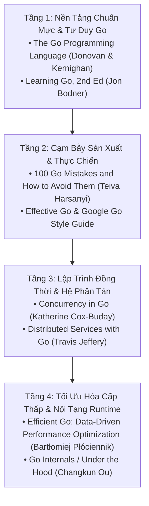

# CHUYÊN ĐỀ 07: THƯ VIỆN TÀI NGUYÊN, CÔNG CỤ PHÂN TÍCH (`pprof`, `trace`) & GITHUB REPOS MẪU MỰC

> Thuộc bộ cẩm nang: [[00_Go_Mastery_Index|Go Mastery Handbook]]

---

## 1. Lộ Trình Sách Kinh Điển Gối Đầu Giường Cho Kỹ Sư Go Chuyên Sâu

Để đi từ mức "biết viết cú pháp Go" lên mức "kiến trúc sư hệ thống phân tán và làm chủ Go Runtime", dưới đây là lộ trình 4 tầng sách kinh điển được cộng đồng kỹ sư hệ thống đánh giá cao nhất:

### 1.1. *The Go Programming Language* — Alan A. A. Donovan & Brian W. Kernighan
- **Tại sao phải đọc?** Đồng tác giả Brian Kernighan chính là tác giả cuốn *K&R C* huyền thoại, còn Alan Donovan là kỹ sư trưởng nhóm công cụ phân tích tĩnh Go tại Google. Dù viết từ thời trước Generics, cuốn sách này vẫn là chuẩn mực vàng về cách tư duy thiết kế kiểu dữ liệu, giao diện (`io.Reader`/`Writer`), phương thức, Goroutines và gói `reflect`/`unsafe`.

### 1.2. *100 Go Mistakes and How to Avoid Them* — Teiva Harsanyi (Manning)
- **Tại sao phải đọc?** Cuốn sách thực chiến nhất cho mọi kỹ sư Backend/Cloud. Phân tích 100 lỗi thực tế từ cấp độ cấu trúc dữ liệu (Slice backing array, Map memory leak), tổ chức dự án, xử lý lỗi, Concurrency, đến tối ưu hóa CPU Cache (False Sharing, Data Alignment) và công cụ profiling.

### 1.3. *Efficient Go: Data-Driven Performance Optimization* — Bartłomiej Płóciennik (O'Reilly)
- **Tại sao phải đọc?** Tác giả là kỹ sư cốt lõi của dự án **Prometheus** và **Thanos**. Sách hướng dẫn phương pháp tối ưu hóa dựa trên số liệu đo đạc thực nghiệm (`benchstat`, `pprof`), cách đọc hiểu bộ thu gom rác (Garbage Collector), bộ cấp phát bộ nhớ Go và cách giảm thiểu cấp phát Heap về 0 (Zero-allocation patterns).

### 1.4. *Concurrency in Go: Tools and Techniques for Developers* — Katherine Cox-Buday (O'Reilly)
- Giải thích triết lý CSP, mô hình bộ nhớ Go (Happens-Before relationship), cách kết hợp các mẫu thiết kế kênh truyền nâng cao (`or-channel`, `tee-channel`, `bridge-channel`, `pipeline`, `fan-out/fan-in`, `healing goroutines`) và cơ chế vận hành của bộ lập lịch GMP.

---

## 2. Bộ Công Cụ Chẩn Đoán, Phân Tích Tĩnh & Profiling Bất Ly Thân

Một thế mạnh vượt trội của Go so với C/C++ là toàn bộ chuỗi công cụ chẩn đoán hiệu năng, kiểm tra xung đột đa luồng và phân tích bộ nhớ đều được **tích hợp sẵn nguyên bản vào trình biên dịch và runtime (`go` toolchain)**:

| Công cụ / Lệnh | Mục đích cốt lõi | Lệnh thực thi mẫu mực |
| :--- | :--- | :--- |
| **`go vet`** | Kiểm tra lỗi ngữ nghĩa tĩnh chính thức (copy `sync.Mutex`, sai định dạng `printf`, lỗi truyền con trỏ `unsafe`). | `go vet ./...` |
| **`staticcheck`** | Bộ phân tích tĩnh chuyên sâu (>150 quy tắc phát hiện code thừa, lỗi logic, hiệu năng kém, API lỗi thời). | `staticcheck ./...` |
| **`golangci-lint`** | Trình chạy tổng hợp hơn 100 linters song song (`errcheck`, `govet`, `staticcheck`, `gosec`, ` gocritic`, `prealloc`). | `golangci-lint run ./...` |
| **`govulncheck`** | Quét lỗ hổng bảo mật CVE dựa trên đồ thị lời gọi hàm thực tế (chỉ cảnh báo nếu code của bạn thực sự gọi vào hàm bị lỗi của thư viện!). | `govulncheck ./...` |
| **Race Detector (`-race`)** | Phát hiện xung đột đọc/ghi bộ nhớ đa luồng (Data Race) dựa trên công nghệ ThreadSanitizer (TSan). | `go test -race ./...` |
| **Escape Analysis & Assembly** | Xem biến nào thoát lên Heap, hàm nào được inline và xem mã máy Assembly sinh ra bởi trình biên dịch Go. | `go build -gcflags="-m -m"` `go tool compile -S file.go` |
| **CPU & Heap Profiler (`pprof`)** | Chụp biểu đồ nhiệt Flame Graph của CPU, truy vết chính xác dòng code nào đang cấp phát nhiều RAM nhất (`alloc_space` vs `inuse_space`) hoặc đang giữ Goroutine. | `go test -bench=. -cpuprofile=cpu.out -memprofile=mem.out` `go tool pprof -http=:8080 cpu.out` |
| **Execution Tracer (`trace`)** | Quan sát trực quan từng micro-giây hoạt động của từng Processor `P`, thời điểm GC chạy, Goroutine bị khóa bởi Syscall/Mutex hay Network I/O. | `go test -trace=trace.out` `go tool trace trace.out` |
| **GC & Scheduler Trace** | In trực tiếp thống kê của Garbage Collector và trạng thái hàng đợi GMP Scheduler ra `stderr` theo thời gian thực lúc chạy ứng dụng. | `GODEBUG=gctrace=1 ./app` `GODEBUG=schedtrace=1000 ./app` |

---

## 3. Các GitHub Repositories Mẫu Mực Nên Clone & Nghiên Cứu

Muốn học cách tổ chức kiến trúc Go quy mô lớn, tối ưu hóa Zero-Copy và điều phối hàng chục nghìn Goroutine chuẩn công nghiệp, hãy đọc trực tiếp mã nguồn của 6 dự án kinh điển sau:

| Dự án / Repository | Đường dẫn GitHub | Tinh hoa kỹ thuật cần học tập |
| :--- | :--- | :--- |
| **Go Compiler & Runtime** | [`golang/go`](https://github.com/golang/go) | Nơi chứa toàn bộ sự thật: Bộ lập lịch GMP (`src/runtime/proc.go`), Channel (`src/runtime/chan.go`), SwissTable Map (`src/internal/runtime/maps`), `sync.Mutex` & `sync.Pool` (`src/sync`). |
| **Kubernetes** | [`kubernetes/kubernetes`](https://github.com/kubernetes/kubernetes) | Đỉnh cao của kiến trúc điều khiển bất đồng bộ: Hàng đợi thử lại có giới hạn tốc độ (`client-go/util/workqueue`), Informer/Reflector cache, kiến trúc प्लग-in Interface và kiểm tra tĩnh `var _ Interface = (*Impl)(nil)`. |
| **Prometheus** | [`prometheus/prometheus`](https://github.com/prometheus/prometheus) | Nghệ thuật tối ưu hóa bộ nhớ & đĩa cứng: Cơ sở dữ liệu chuỗi thời gian (`tsdb`), nén bit (`chunkenc`), quản lý `mmap`, Zero-Copy string/bytes và tái sử dụng bộ đệm giảm áp lực GC tới mức tối đa. |
| **etcd** | [`etcd-io/etcd`](https://github.com/etcd-io/etcd) | Mẫu mực về lập trình hệ phân tán tin cậy cao: Thuật toán đồng thuận **Raft** (`raft/`), quản lý giao dịch MVCC trên B+Tree (`server/storage/mvcc`), xử lý `context.Context` và Graceful Shutdown hoàn hảo. |
| **CockroachDB** | [`cockroachdb/cockroach`](https://github.com/cockroachdb/cockroach) | Một trong những codebase Go phức tạp và kỷ luật nhất thế giới: Hệ thống thực thi SQL vector hóa, quản lý bộ nhớ thủ công kết hợp `sync.Pool`, và bộ quy tắc kiểm soát lỗi/ngữ cảnh nghiêm ngặt. |
| **Uber Go Style Guide** | [`uber-go/guide`](https://github.com/uber-go/guide) | Tài liệu quy chuẩn viết code Go thực tế nhất trong ngành công nghiệp phần mềm, kèm giải thích chi tiết từng mẫu Good vs Bad. |

---

## 4. Các Tài Liệu Chính Thức & Trang Tra Cứu Trực Tuyến

1. **[The Go Programming Language Specification (`go.dev/ref/spec`)](https://go.dev/ref/spec):**
   - Tài liệu đặc tả ngôn ngữ ngắn gọn, súc tích và dễ đọc bậc nhất trong các ngôn ngữ lập trình hiện đại. Mọi quy tắc về hằng số không kiểu, thứ tự đánh giá biểu thức, `defer`, `select` đều được định nghĩa chính xác tại đây.
2. **[The Go Memory Model (`go.dev/ref/mem`)](https://go.dev/ref/mem):**
   - Giải thích chính thức khi nào một thao tác ghi biến ở Goroutine $A$ được đảm bảo nhìn thấy bởi thao tác đọc ở Goroutine $B$ (Quan hệ *Happens-Before* của Channel, Mutex, `sync.Once`, `sync/atomic`).
3. **[A Guide to the Go Garbage Collector (`go.dev/doc/gc-guide`)](https://go.dev/doc/gc-guide):**
   - Tài liệu chính chủ từ đội ngũ Go Runtime giải thích trực quan về chu kỳ Mark-and-Sweep, cách tinh chỉnh tham số **`GOGC`** (tỷ lệ tăng trưởng Heap) và **`GOMEMLIMIT`** (giới hạn bộ nhớ mềm chống OOM trên Container/Kubernetes từ Go 1.19+).
4. **[Compiler Explorer (`godbolt.org` — Chọn ngôn ngữ Go)](https://godbolt.org):**
   - Cho phép gõ code Go và quan sát trực tiếp mã máy Assembly (`gc` hoặc `gccgo`) theo từng dòng lệnh, giúp kiểm chứng ngay lập tức hiệu quả của `//go:noinline`, `//go:nosplit`, Bounds Check Elimination (BCE) và Escape Analysis.
