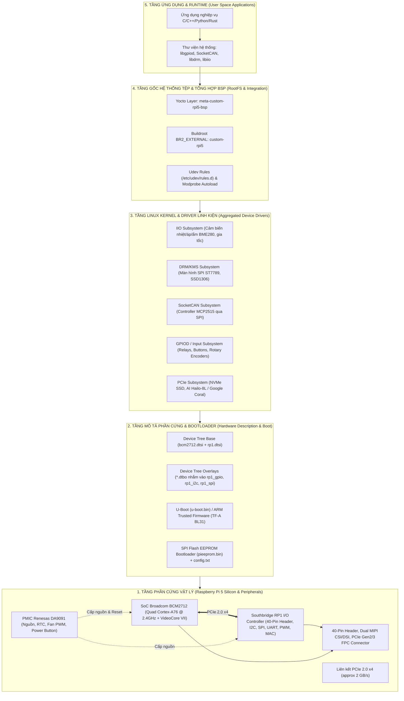

# 🍓🐧 Giáo Trình Nghiên Cứu Toàn Diện: Thiết Kế & Xây Dựng Board Support Package (BSP) Cho Raspberry Pi 5

Chào mừng bạn đến với bộ tài liệu chuyên sâu về **Kiến trúc, Thiết kế và Hiện thực hóa Board Support Package (BSP)** dành riêng cho nền tảng phần cứng thế hệ mới: **Raspberry Pi 5 (Broadcom BCM2712 + Southbridge RP1)**.

Tài liệu này được biên soạn nhằm giải quyết bài toán cốt lõi trong kỹ thuật hệ thống nhúng Linux: **Làm thế nào để tổng hợp, viết và tích hợp toàn bộ driver từ các linh kiện phần cứng (cảm biến I2C/SPI, màn hình TFT, bus công nghiệp CAN, cơ cấu chấp hành GPIO, module AI PCIe) vào một gói BSP hoàn chỉnh, sẵn sàng sản xuất thương mại.**

---

## 🗺️ TỔNG QUAN HỆ THỐNG PHÂN TẦNG CỦA MỘT BSP (BSP ARCHITECTURE)

Một Board Support Package (BSP) tiêu chuẩn công nghiệp không chỉ đơn thuần là việc nạp hệ điều hành, mà là **cầu nối toàn diện giữa phần cứng silicon và tầng ứng dụng người dùng**:

---

## 📚 MỤC LỤC CHI TIẾT CÁC CHƯƠNG NGHIÊN CỨU (DOCS)

Bộ tài liệu gồm 9 chương được tổ chức tuần tự theo chuẩn kỹ thuật từ mức phần cứng thấp nhất đến tầng tích hợp hệ điều hành:

| Chương | Tên Chuyên Đề | Nội Dung Chi Tiết & Kỹ Năng Đạt Được |
| :---: | :--- | :--- |
| **01** | [Chương 1: Kiến Trúc Phần Cứng RPi 5 - BCM2712 & Southbridge RP1](./docs/01_Kien_Truc_Phan_Cung_RPi5_BCM2712_Va_Southbridge_RP1.md) | Phân tích cuộc cách mạng phần cứng trên Pi 5: Tại sao tách I/O sang chip **RP1** qua liên kết **PCIe 2.0 x4**; Bản đồ thanh ghi PCIe BAR; Chi tiết PMIC Renesas DA9091, RTC, khe PCIe Gen 2/3 FPC ngoài. |
| **02** | [Chương 2: Boot Flow, Firmware EEPROM & U-Boot Cho RPi 5](./docs/02_Boot_Flow_Firmware_EEPROM_Va_UBoot_Cho_RPi5.md) | Khám phá chuỗi khởi động từ SPI Flash EEPROM on-board (`pieeprom.bin`); Tệp cấu hình `config.txt` & `cmdline.txt`; Nạp ARM Trusted Firmware (TF-A BL31); Cấu hình và biên dịch **U-Boot Mainline** (`rpi_arm64_defconfig`). |
| **03** | [Chương 3: Device Tree, Overlays (.dtbo) & Pinmux Trên RP1](./docs/03_Device_Tree_Overlays_Va_Pinmux_Tren_RP1.md) | Phân tích cơ chế Dynamic Overlay của driver `rp1-pci.c`; Quy tắc viết `.dtbo` nhắm vào các node RP1 (`&rp1_gpio`, `&rp1_i2c1`, `&rp1_spi0`); Bảng tra cứu chân và Alternate Functions (ALT0..ALT8) trên RP1. |
| **04** | [Chương 4: Chiến Lược Tổng Hợp & Viết Driver Linh Kiện](./docs/04_Chien_Luoc_Tong_Hop_Va_Viet_Driver_Linh_Kien.md) | **Trọng tâm kỹ thuật**: Phương pháp tích hợp 5 nhóm linh kiện phổ biến: (1) Cảm biến I2C qua IIO Subsystem; (2) Màn hình SPI qua DRM/KMS; (3) CAN Bus qua SPI MCP2515; (4) Cơ cấu chấp hành GPIO/Relay; (5) Module AI PCIe Hailo-8L / Coral. So sánh In-tree vs Out-of-tree. |
| **05** | [Chương 5: Xây Dựng Custom BSP Layer Yocto Cho RPi 5](./docs/05_Xay_Dung_Custom_BSP_Layer_Yocto_Cho_RPi5.md) | Thiết kế Layer chuẩn `meta-custom-rpi5-bsp` trên nền Yocto Scarthgap 5.0 LTS: Cấu hình `machine/custom-rpi5.conf`, Kernel bbappend kèm fragment `.cfg`, tự động biên dịch và nạp Driver Modules `.ko`, đóng gói Image WIC hoàn chỉnh. |
| **06** | [Chương 6: Xây Dựng BSP Với Buildroot Alternative](./docs/06_Xay_Dung_BSP_Voi_Buildroot_Alternative.md) | Giải pháp BSP nhẹ, tối giản thời gian build với Buildroot: Kiến trúc cây `BR2_EXTERNAL`, tùy biến `raspberrypi5_defconfig`, script đóng gói thẻ nhớ `genimage.cfg` và nạp driver linh kiện ngoài cây nguồn. |
| **07** | [Chương 7: Hướng Dẫn Thực Hành Step-by-Step Bring-up & Debug](./docs/07_Huong_Dan_Thuc_Hanh_Step_By_Step_Bring_Up_Va_Debug.md) | Quy trình Bring-up kiểm thử phần cứng thực tế: Lệnh chẩn đoán PCIe RP1 (`lspci`), kiểm tra Device Tree runtime, bộ công cụ `libgpiod v2`, test I2C/SPI, test SocketCAN, đọc log Kernel Oops và ma trận xử lý sự cố kinh điển. |
| **08** | [Chương 8: Báo Cáo Thực Thi & Kiểm Tra Image Yocto Tùy Biến Cho RPi 5](./docs/08_Kiem_Tra_Va_Xac_Thuc_Image_Custom_RPi5_Industrial.md) | Báo cáo chi tiết quá trình build thành công 100% 4729 tasks Yocto; Xác thực ELF 64-bit ARM aarch64, vermagic `v8-16k`; Hướng dẫn nạp image WIC (48 MB nén / 963 MB bung) vào thẻ nhớ/NVMe bằng `bmaptool` và test driver trên thực tế. |
| **09** | [Chương 9: Sổ Tay Debug Lỗi BSP Theo Phân Tầng & Căn Cứ Tài Liệu](./docs/09_So_Tay_Debug_Loi_BSP_Theo_Phan_Tang_Va_Can_Cu_Tai_Lieu.md) | **Phương pháp luận cho người mới học**: Đúc kết các lỗi kinh điển trong quá trình phát triển BSP; Định vị lỗi chính xác ở 5 tầng kiến trúc kèm căn cứ tiêu chuẩn kỹ thuật chính thức (Linux Kernel, Yocto, Raspberry Pi Architecture). |

---

## 💻 KHO MÃ NGUỒN BSP MẪU THỰC TẾ (`/home/thinh/rpi5_bsp_workspace/`)

Đi kèm với bộ tài liệu lý thuyết là thư mục workspace chứa đầy đủ mã nguồn thực thi độc lập:

1. **[`meta-custom-rpi5/`](file:///home/thinh/rpi5_bsp_workspace/meta-custom-rpi5)**: Layer Yocto BSP hoàn chỉnh, sẵn sàng tích hợp vào Poky.
   - `conf/layer.conf` & `conf/machine/custom-rpi5.conf`.
   - `recipes-kernel/linux/linux-raspberrypi_%.bbappend` + tệp cấu hình `custom-hardware.cfg`.
   - `recipes-drivers/custom-sensor-i2c/`: Recipe biên dịch driver cảm biến I2C out-of-tree.
   - `recipes-drivers/custom-gpio-actuator/`: Recipe biên dịch driver relay GPIO out-of-tree.
   - `recipes-core/images/custom-rpi5-industrial-image.bb`: Recipe Image sản phẩm công nghiệp.
2. **[`drivers/`](file:///home/thinh/rpi5_bsp_workspace/drivers)**: Mã nguồn C thuần túy kèm `Makefile` độc lập cho từng module driver:
   - [`sensor_bme280_iio/`](file:///home/thinh/rpi5_bsp_workspace/drivers/sensor_bme280_iio): Driver cảm biến nhiệt độ áp suất I2C chuẩn Linux Industrial I/O (IIO).
   - [`actuator_relay_gpio/`](file:///home/thinh/rpi5_bsp_workspace/drivers/actuator_relay_gpio): Driver điều khiển Relay/Cơ cấu chấp hành với giao diện Sysfs/Char dev an toàn.
3. **[`overlays/`](file:///home/thinh/rpi5_bsp_workspace/overlays)**: Các tệp nguồn Device Tree Overlays (`.dts`) được thiết kế riêng cho chip RP1 trên Pi 5 kèm `Makefile` tự động biên dịch sang `.dtbo`.
4. **[`scripts/`](file:///home/thinh/rpi5_bsp_workspace/scripts)**: Các kịch bản bash tự động hóa:
   - `setup_yocto_rpi5.sh`: Tự động tải Poky Scarthgap, meta-raspberrypi, liên kết layer và khởi tạo môi trường build.
   - `test_drivers_on_target.sh`: Kịch bản chạy trực tiếp trên Raspberry Pi 5 để kiểm tra toàn bộ linh kiện phần cứng đã tích hợp.
