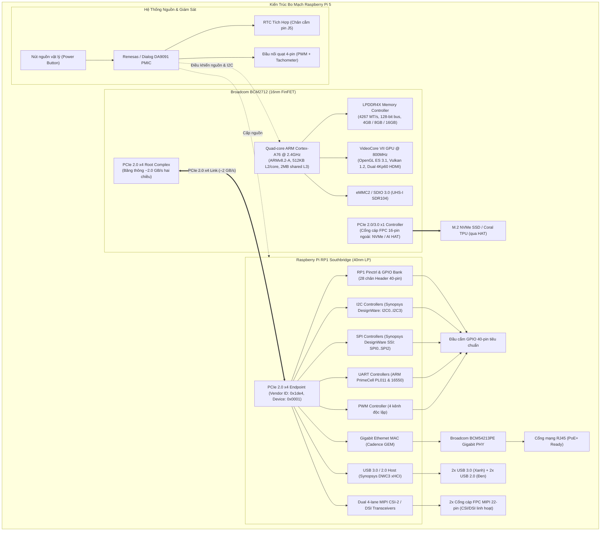
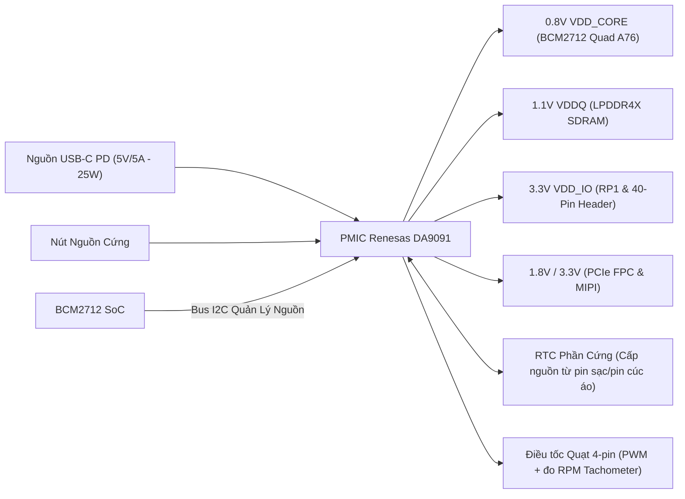

# 🏛️ Chương 1: Kiến Trúc Phần Cứng Raspberry Pi 5 — BCM2712 & Southbridge RP1

---

## 📌 1. BƯỚC ĐỘT PHÁ KIẾN TRÚC: TÁCH RỜI SoC VÀ SOUTHBRIDGE

Trong suốt các thế hệ Raspberry Pi từ 1 đến 4, toàn bộ hệ thống ngoại vi (GPIO, I2C, SPI, UART, USB, Ethernet, Camera) đều được tích hợp trực tiếp bên trong một đế silicon nguyên khối (**Monolithic SoC**) của Broadcom (BCM2835, BCM2836, BCM2837, BCM2711).

Tuy nhiên, trên **Raspberry Pi 5**, Raspberry Pi Foundation đã tạo nên một **cuộc cách mạng kiến trúc phần cứng** mang phong cách máy tính cá nhân (PC Architecture): **Tách rời bộ vi xử lý trung tâm (Application Processor SoC) và chip quản lý ngoại vi (I/O Controller Southbridge)** thông qua đường truyền tốc độ cao **PCI Express**.

---

## 💡 2. TẠI SAO RASPBERRY PI LỰA CHỌN THIẾT KẾ NÀY? (BÀI TOÁN KINH TẾ SILICON)

Việc phân tách SoC và Southbridge giải quyết 3 bài toán kỹ thuật & chi phí sống còn trong công nghiệp bán dẫn:

1. **Tối ưu hóa tiến trình bán dẫn (Silicon Process Node Mismatch)**:
   - Nhân CPU hiệu năng cao ARM Cortex-A76 cần tiến trình nhỏ (**TSMC 16nm FinFET**) để đạt xung nhịp 2.4GHz mà không tiêu thụ quá nhiều điện năng.
   - Ngược lại, các khối ngoại vi tương tự (Analog PHYs) và cổng logic I/O 3.3V (như 28 chân GPIO, bộ chuyển đổi I2C/SPI, tầng đệm USB/Ethernet) **không thể thu nhỏ hiệu quả** trên tiến trình 16nm mà đòi hỏi diện tích die silicon rất lớn, dẫn tới giá thành tấm wafer silicon cực kỳ đắt đỏ.
   - **Giải pháp**: Raspberry Pi tự thiết kế riêng chip **RP1** trên tiến trình **TSMC 40nm Low Power (40LP)** với chi phí sản xuất cực rẻ, gom toàn bộ mạch analog và I/O 3.3V về RP1. BCM2712 chỉ tập trung tính toán thuần túy.

2. **Giải phóng diện tích và giảm nhiệt cho SoC BCM2712**:
   - BCM2712 không còn phải gánh hàng chục bộ điều khiển I/O tốc độ thấp, giúp giảm số lượng chân ball-grid array (BGA) và giảm nhiệt lượng tích tụ trên tâm vi xử lý.

3. **Tính linh hoạt cho tương lai (Modularity & Reuse)**:
   - Chip RP1 hoàn toàn có thể được tái sử dụng trên các thế hệ vi xử lý tiếp theo (BCM2713, Compute Module 5) mà không cần phải thiết kế lại toàn bộ hệ thống ngoại vi và driver Linux từ đầu.

---

## 🔌 3. CHI TIẾT CHIP SOUTHBRIDGE RP1 & BẢN ĐỒ PCIe BAR

### 3.1 Nhận dạng phần cứng trên bus PCIe
Khi Linux khởi động, nhân Kernel sẽ quét qua bus PCI Express nội và phát hiện RP1:
- **PCI Vendor ID**: `0x1de4` (Định danh đăng ký chính thức của Raspberry Pi Ltd).
- **PCI Device ID**: `0x0001` (Thiết bị RP1 I/O Controller).
- **Class Code**: `0xff0000` (Miscellaneous Device / Multi-Function Peripheral).

### 3.2 Cơ chế phân bổ vùng nhớ BAR (Base Address Registers)
RP1 hoạt động như một thiết bị PCIe Endpoint đa chức năng. Không gian thanh ghi của toàn bộ các ngoại vi bên trong RP1 được ánh xạ vào bộ nhớ hệ thống (System Memory Map) thông qua 2 vùng BAR chính:

| Vùng BAR | Kích thước | Mục đích & Khối chức năng ánh xạ |
| :--- | :--- | :--- |
| **BAR 0** | 4 MB | **Ngoại vi I/O chính**: Toàn bộ thanh ghi của GPIO (`pinctrl-rp1`), I2C0..I2C3, SPI0..SPI2, UART0..UART4, PWM, Timer, DMA Controller của RP1. |
| **BAR 1** | 256 KB | **Bộ điều khiển Mạng & USB**: Thanh ghi Cadence Gigabit Ethernet MAC và Synopsys DWC3 USB Host Controller. |

### 3.3 Danh mục các khối IP ngoại vi tích hợp trong RP1
Khác với SoC BCM2835 cũ sử dụng các khối IP tùy biến độc quyền của Broadcom, RP1 sử dụng các IP tiêu chuẩn công nghiệp (**Industry-Standard IPs**):

1. **Bộ điều khiển GPIO & Pin Control (`pinctrl-rp1`)**:
   - Quản lý 28 chân GPIO đưa ra đầu cắm 40-pin (GPIO0 đến GPIO27).
   - Hỗ trợ tới 9 chế độ dồn kênh (Multiplexing: ALT0 đến ALT8).
   - Cung cấp trở kéo nội (Pull-up / Pull-down) có thể lập trình, bộ lọc chống nhiễu (Schmitt Trigger) và khả năng điều chỉnh dòng cấp (`drive-strength`: 2mA, 4mA, 8mA, 12mA).
2. **Bộ điều khiển I2C (Synopsys DesignWare APB I2C)**:
   - 4 bộ điều khiển I2C phần cứng độc lập (`i2c0` đến `i2c3`).
   - Tương thích chuẩn Standard mode (100 kHz), Fast mode (400 kHz) và Fast mode plus (1 MHz).
3. **Bộ điều khiển SPI (Synopsys DesignWare SSI SPI)**:
   - 3 bộ điều khiển SPI master tốc độ cao (`spi0`, `spi1`, `spi2`) với bộ đệm FIFO phần cứng 32-bit.
4. **Bộ điều khiển UART (ARM PrimeCell PL011 & 16550 Compatible)**:
   - `uart0`: Kết nối mặc định ra cổng gỡ lỗi Debug UART (đầu cắm 3-pin JST-SH chuyên dụng giữa cổng micro-HDMI).
   - `uart1` đến `uart4`: Có thể cấu hình đưa ra header 40-pin.
5. **Bộ điều khiển Mạng (Cadence Gigabit Ethernet MAC - GEM)**:
   - Giao tiếp với chip Broadcom BCM54213PE Ethernet PHY bên ngoài qua giao diện RGMII.
6. **Bộ điều khiển USB 3.0 / 2.0 (Synopsys DWC3)**:
   - Cung cấp 2 cổng USB 3.0 (băng thông thực tế 5 Gbps độc lập trên mỗi cổng) và 2 cổng USB 2.0.
7. **Bộ giao tiếp Video & Camera (Dual MIPI CSI-2/DSI Transceivers)**:
   - 2 cổng kết nối 22-pin FPC 4-lane. Điểm đặc biệt: Mỗi cổng có thể tự do cấu hình làm **CSI-2 Camera Input** hoặc **DSI Display Output** độc lập!

---

## ⚡ 4. QUẢN LÝ NGUỒN VÀ HỆ THỐNG: PMIC RENESAS DA9091

Một thành phần then chốt khác trong BSP của Raspberry Pi 5 là vi mạch quản lý nguồn **DA9091** do Renesas (trước đây là Dialog Semiconductor) hợp tác thiết kế riêng cho Pi 5:

### Các tính năng cốt lõi của PMIC DA9091 mà BSP phải hỗ trợ:
1. **USB-PD (Power Delivery) Negotiation**:
   - Tự động giao tiếp với củ sạc USB-C để yêu cầu mức nguồn 5V/5A (25W).
   - Nếu phát hiện củ sạc chuẩn 5V/3A thông thường, BSP sẽ tự động giới hạn dòng cấp cho 4 cổng USB xuống 600mA (thay vì 1.6A) để ngăn hiện tượng sụt nguồn khởi động lại bo mạch.
2. **Đồng hồ thời gian thực tích hợp (Real-Time Clock - RTC)**:
   - Tích hợp sẵn bộ đếm thời gian thực chính xác cực cao, có chân cắm riêng (`BAT` / J5) để gắn pin sạc Panasonic ML-2020 hoặc pin cúc áo thông thường.
   - Hỗ trợ tính năng hẹn giờ đánh thức máy (**Wake-on-RTC**).
3. **Nút nguồn mềm/cứng (Hardware Power Button)**:
   - Nhấn 1 lần: Kernel nhận sự kiện ngắt `KEY_POWER` và thực hiện `poweroff` an toàn.
   - Giữ 5 giây: PMIC ngắt nguồn cưỡng bức (Hard Shutdown).
   - Khi máy đang tắt (Standby 0.01W): Nhấn nút để khởi động lại.
4. **Bộ điều tốc quạt chủ động (Active Cooler Fan PWM)**:
   - Đầu cắm quạt 4-pin (chân nguồn, GND, PWM điều tốc, TACH đo tốc độ vòng quay).
   - Kernel tích hợp bảng nhiệt độ Thermal Zone: Tự động điều chỉnh quạt theo các ngưỡng nhiệt độ (50°C, 60°C, 67.5°C, 75°C).

---

## 🚀 5. CỔNG MỞ RỘNG PCIe GEN 2/3 (FPC CONNECTOR)

Lần đầu tiên trên dòng Raspberry Pi tiêu chuẩn, Broadcom BCM2712 đưa thẳng một đường truyền **PCIe 2.0 / 3.0 x1** ra đầu nối cáp FPC 16-pin (bước chân 0.5mm):
- Băng thông lý thuyết:
  - **PCIe Gen 2 x1**: 500 MB/s (Chế độ mặc định được kiểm định an toàn).
  - **PCIe Gen 3 x1**: 1000 MB/s (~1 GB/s, có thể kích hoạt thông qua `config.txt` cho các ổ cứng NVMe Gen3/Gen4).
- Ứng dụng trong việc phát triển BSP:
  - Lắp đặt mạch mở rộng **M.2 NVMe HAT** để làm ổ đĩa khởi động tốc độ cao (Boot from NVMe) đạt tốc độ đọc/ghi >850 MB/s.
  - Tích hợp các module gia tốc trí tuệ nhân tạo (AI Accelerators) như **Raspberry Pi AI Kit (Hailo-8L NPU - 13 TOPS)** hoặc **Google Coral M.2 TPU (4 TOPS)**.

---

## 🎯 TỔNG KẾT BÀI HỌC CHO KỸ SƯ BSP

Khi phát triển một Board Support Package cho Raspberry Pi 5, bạn cần ghi nhớ **3 nguyên tắc vàng**:
1. **Không còn truy cập GPIO/I2C trực tiếp từ thanh ghi SoC BCM2712**: Mọi giao diện người dùng đều phải đi qua driver điều khiển chip **RP1** thông qua PCIe BAR!
2. **Device Tree Overlays phải trỏ đúng node của RP1**: Các nhãn thiết bị cũ như `&gpio`, `&i2c1`, `&spi0` không còn đại diện cho header 40-pin; chúng ta phải sử dụng `&rp1_gpio`, `&rp1_i2c1`, `&rp1_spi0` (sẽ phân tích chi tiết tại Chương 3).
3. **Quản lý nhiệt độ và điện năng là một phần bắt buộc của BSP**: Tích hợp driver PMIC DA9091, RTC, và Thermal Governor quạt PWM để đảm bảo Cortex-A76 không bị Thermal Throttling khi xử lý tải nặng.

---
*Tiếp theo: [Chương 2: Boot Flow, Firmware EEPROM & U-Boot Cho RPi 5](./02_Boot_Flow_Firmware_EEPROM_Va_UBoot_Cho_RPi5.md)*
