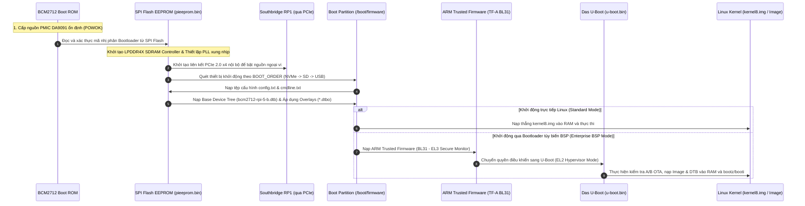

# 🚀 Chương 2: Boot Flow, Firmware EEPROM & U-Boot Cho Raspberry Pi 5

---

## 🔄 1. SỰ THAY ĐỔI CĂN BẢN TRONG CHUỖI KHỞI ĐỘNG CỦA RPI 5

Chuỗi khởi động (Boot Flow) của Raspberry Pi 5 đã được tái cấu trúc hoàn toàn so với các thế hệ tiền nhiệm, dịch chuyển dần về tiêu chuẩn của kiến trúc máy tính x86/ARM64 Server:



### So sánh chuỗi Bootloader qua các thế hệ:
1. **Raspberry Pi 1 / 2 / 3**:
   - Nhân CPU ARM bị giữ ở trạng thái "Reset" (đóng băng).
   - GPU VideoCore đảm nhận vai trò bộ não khởi động: Đọc file `bootcode.bin` từ phân vùng FAT thẻ nhớ vào L2 Cache, sau đó nạp `start.elf`. Cuối cùng `start.elf` mới đánh thức CPU ARM dậy để chạy Kernel.
2. **Raspberry Pi 4**:
   - Loại bỏ `bootcode.bin` trên thẻ nhớ, thay bằng chip SPI Flash EEPROM (512KB) trên bo mạch, nhưng GPU vẫn giữ vai trò chính trong việc tải `start4.elf`.
3. **Raspberry Pi 5 (Thế hệ mới nhất)**:
   - **VideoCore không còn là trung tâm khởi động**: BCM2712 Boot ROM và mã nhị phân trong SPI Flash EEPROM (`pieeprom.bin`) được tối ưu hóa để đưa CPU ARM Cortex-A76 vào hoạt động sớm nhất có thể.
   - Không còn file `start4.elf` độc quyền cồng kềnh; firmware quản lý phần cứng được phân chia mạch lạc giữa EEPROM và các khối điều khiển nguồn PMIC.

---

## 💾 2. GIẢI PHÃU CHIP SPI FLASH EEPROM & CẤU HÌNH `BOOT_ORDER`

Trên bo mạch Raspberry Pi 5, một chip nhớ SPI Flash 512KB (thường là Winbond W25Q40 hoặc Macronix) được gắn trực tiếp trên bus SPI của BCM2712, chứa tệp nhị phân **`pieeprom.bin`**.

### 2.1 Cấu hình EEPROM Bootloader (`bootloader.bin`)
Cấu hình của EEPROM có thể được trích xuất và chỉnh sửa bằng công cụ `rpi-eeprom-config`:

```bash
# Xem cấu hình bootloader hiện tại của bo mạch
vcgencmd bootloader_config
# Hoặc trên hệ thống Linux thông thường:
rpi-eeprom-config
```

Nội dung tệp cấu hình mẫu tiêu chuẩn cho một hệ thống công nghiệp:
```ini
[all]
BOOT_UART=1                   # Kích hoạt xuất log khởi động ra cổng Debug UART
WAKE_ON_GPIO=0                # Tắt đánh thức bằng GPIO nếu cần tiết kiệm điện
POWER_OFF_ON_HALT=1           # Yêu cầu PMIC ngắt hoàn toàn nguồn khi shutdown (Standby 0.01W)

# Thứ tự ưu tiên thiết bị boot:
# 6: NVMe PCIe SSD, 1: Thẻ MicroSD, 4: USB Mass Storage, f: Lặp lại vô tận
BOOT_ORDER=0xf461

# Thời gian chờ thiết bị USB/NVMe khởi động (ms)
BOOT_LOADER_TIMEOUT=5000

# Kích hoạt chế độ kiểm tra chữ ký số an toàn (Secure Boot) nếu bật
# SIGNED_BOOT=1
```

---

## 📄 3. CÁC TỆP TIN CỐT LÕI TRÊN PHÂN VÙNG BOOT (`/boot/firmware`)

Phân vùng khởi động của Raspberry Pi 5 luôn là phân vùng đầu tiên trên thẻ nhớ MicroSD hoặc ổ NVMe, được định dạng theo chuẩn **FAT32** (Type `0x0c` - W95 FAT32 LBA).

### 3.1 Tệp cấu hình `config.txt`
Đây là tệp tin quan trọng nhất để điều khiển hành vi của Bootloader và nạp các driver phần cứng cho Pi 5.

```ini
# ====================================================================
# TỆP CẤU HÌNH BSP CHUẨN DÀNH CHO RASPBERRY PI 5 (BCM2712)
# ====================================================================

[all]
# 1. Cấu hình kiến trúc và Kernel Image
arm_64bit=1
kernel=kernel8.img           # Nếu dùng U-Boot: đổi thành kernel=u-boot.bin

# 2. Cổng Serial Debug Console
# Chân Debug UART chuyên dụng 3-pin JST trên Pi 5 nối vào ttyAMA10
enable_uart=1
uart_2ndstage=1

# 3. Kích hoạt giao diện đồ họa DRM/KMS chuẩn VideoCore VII
dtoverlay=vc4-kms-v3d

# 4. Kích hoạt các bus ngoại vi trên Southbridge RP1
dtparam=i2c_arm=on           # Bật I2C1 (GPIO2 & GPIO3)
dtparam=spi=on               # Bật SPI0 (GPIO9, GPIO10, GPIO11, GPIO8)

# 5. Cấu hình cổng mở rộng PCIe 16-pin FPC ngoài (NVMe HAT / AI HAT)
dtparam=pciex1=on            # Bật khe cắm PCIe ngoài
dtparam=pciex1_gen=3         # Ép xung lên chuẩn PCIe Gen 3 (1 GB/s, mặc định Gen 2 500MB/s)

# 6. Tích hợp các Device Tree Overlays cho linh kiện phần cứng tùy biến
dtoverlay=custom-i2c-sensor-pi5
dtoverlay=custom-spi-can-pi5,oscillator=16000000,interrupt=25
dtoverlay=custom-gpio-keys-pi5

# 7. Quản lý quạt tản nhiệt chủ động (Active Cooler Fan)
dtparam=cooling_fan=on
```

### 3.2 Tệp tham số dòng lệnh Kernel `cmdline.txt`
Nội dung của `cmdline.txt` phải nằm trên **một dòng duy nhất**, không được xuống dòng:

```text
console=ttyAMA10,115200 console=tty1 root=/dev/mmcblk0p2 rootfstype=ext4 fsck.repair=yes rootwait quiet splash
```

> [!IMPORTANT]
> **Điểm khác biệt quan trọng của cổng Console trên Pi 5**:
> Cổng gỡ lỗi nối tiếp chuyên dụng (đầu cắm 3-pin nằm giữa hai cổng micro-HDMI) trên Raspberry Pi 5 được điều khiển bởi khối UART độc lập và được Linux Kernel đánh số là **`ttyAMA10`** (thay vì `ttyS0` hay `ttyAMA0` như các đời Pi cũ). Nếu cấu hình sai thành `console=ttyAMA0`, bạn sẽ không nhận được log của Kernel trên cổng UART debug 3-pin!

---

## 🛡️ 4. TÍCH HỢP ARM TRUSTED FIRMWARE (TF-A BL31)

Trong các hệ thống nhúng chuyên nghiệp yêu cầu phân chia vùng an toàn (TrustZone) và quản lý nguồn theo chuẩn **PSCI (Power State Coordination Interface)**, chuỗi khởi động cần thêm tầng **ARM Trusted Firmware (TF-A)**:

1. **Chế độ bảo mật EL3 (Exception Level 3)**:
   - Chạy thành phần BL31 của TF-A.
   - Cung cấp các hàm xử lý ngắt an toàn và quản lý tắt/mở các nhân CPU phụ (Secondary Cores Bring-up) thông qua lệnh gọi PSCI (`CPU_ON`, `CPU_OFF`, `SYSTEM_RESET`).
2. **Chuyển tiếp sang Non-secure EL2**:
   - TF-A hạ quyền hạn CPU từ EL3 xuống **EL2 (Hypervisor Mode)** và chuyển giao quyền thực thi cho bootloader phụ (U-Boot) hoặc trực tiếp cho Linux Kernel.

---

## ⚓ 5. TRIỂN KHAI DAS U-BOOT CHO RASPBERRY PI 5

Tại sao trong một giải pháp BSP công nghiệp, chúng ta nên sử dụng **Das U-Boot** thay vì để firmware EEPROM khởi động thẳng vào Linux?

| Tiêu Chí So Sánh | Khởi động trực tiếp bằng EEPROM Firmware | Khởi động thông qua Das U-Boot |
| :--- | :--- | :--- |
| **Cơ chế cập nhật OTA A/B** | Rất khó cấu hình fallback an toàn khi bản cập nhật lỗi. | **Xuất sắc**: Dễ dàng chuyển đổi phân vùng boot A/B, tự rollback nếu Kernel panic. |
| **Khởi động mạng (Network Boot)** | Bị giới hạn bởi giao thức TFTP cố định trong EEPROM. | Hỗ trợ DHCP, TFTP, NFS, HTTP, tải file qua mạng cực kỳ linh hoạt cho lập trình viên. |
| **Giao diện dòng lệnh (CLI)** | Không có giao diện tương tác trước khi vào OS. | Cung cấp shell `=>` mạnh mẽ để chẩn đoán RAM, Flash, thanh ghi phần cứng trước khi boot. |
| **Tiêu chuẩn công nghiệp** | Phụ thuộc hoàn toàn vào cấu trúc của Raspberry Pi. | Đồng nhất quy trình quản lý với các dòng chip SoC khác (i.MX8, STM32MP1, AM335x). |

### 5.1 Quy trình biên dịch chéo U-Boot Mainline cho Raspberry Pi 5

Mở Terminal trên máy tính phát triển (Host x86_64) và thực hiện các bước:

```bash
# 1. Cài đặt bộ công cụ biên dịch chéo ARM64
sudo apt update && sudo apt install -y gcc-aarch64-linux-gnu bison flex libssl-dev bc

# 2. Clone mã nguồn U-Boot chính thức (Nhánh mới nhất hỗ trợ RPi 5)
git clone https://source.denx.de/u-boot/u-boot.git
cd u-boot

# 3. Nạp cấu hình defconfig cho dòng Raspberry Pi 64-bit
make ARCH=arm64 CROSS_COMPILE=aarch64-linux-gnu- rpi_arm64_defconfig

# 4. Tùy biến cấu hình (Bật hỗ trợ lệnh ext4, fat, mmc, network)
make ARCH=arm64 CROSS_COMPILE=aarch64-linux-gnu- menuconfig

# 5. Biên dịch ra file nhị phân u-boot.bin (-j$(nproc) tối ưu số luồng)
make ARCH=arm64 CROSS_COMPILE=aarch64-linux-gnu- -j$(nproc)
```

### 5.2 Tích hợp U-Boot vào phân vùng Boot của Pi 5
1. Sao chép file **`u-boot.bin`** vừa biên dịch vào thư mục gốc của phân vùng FAT (`/boot/firmware/u-boot.bin`).
2. Sửa file `config.txt` trên phân vùng FAT:
   ```ini
   [all]
   arm_64bit=1
   enable_uart=1
   # Thay vì nạp kernel8.img, ta chỉ định nạp U-Boot:
   kernel=u-boot.bin
   device_tree_address=0x2eff0000
   ```
3. Tạo tệp kịch bản khởi động U-Boot **`boot.scr`** (hoặc `extlinux/extlinux.conf`):
   ```uboot
   # Nội dung script boot.cmd:
   setenv bootargs "console=ttyAMA10,115200 console=tty1 root=/dev/mmcblk0p2 rw rootwait"
   fatload mmc 0:1 ${kernel_addr_r} Image
   fatload mmc 0:1 ${fdt_addr_r} bcm2712-rpi-5-b.dtb
   booti ${kernel_addr_r} - ${fdt_addr_r}
   ```
   Biên dịch thành file nhị phân:
   ```bash
   mkimage -A arm64 -O linux -T script -C none -d boot.cmd boot.scr
   ```

Khi Raspberry Pi 5 bật nguồn, EEPROM sẽ tải `u-boot.bin`, xuất hiện dấu nhắc lệnh `U-Boot>` trên cổng UART debug, cho phép bạn toàn quyền điều khiển chuỗi khởi động trước khi vào Linux!

---
*Tiếp theo: [Chương 3: Device Tree, Overlays (.dtbo) & Pinmux Trên RP1](./03_Device_Tree_Overlays_Va_Pinmux_Tren_RP1.md)*
