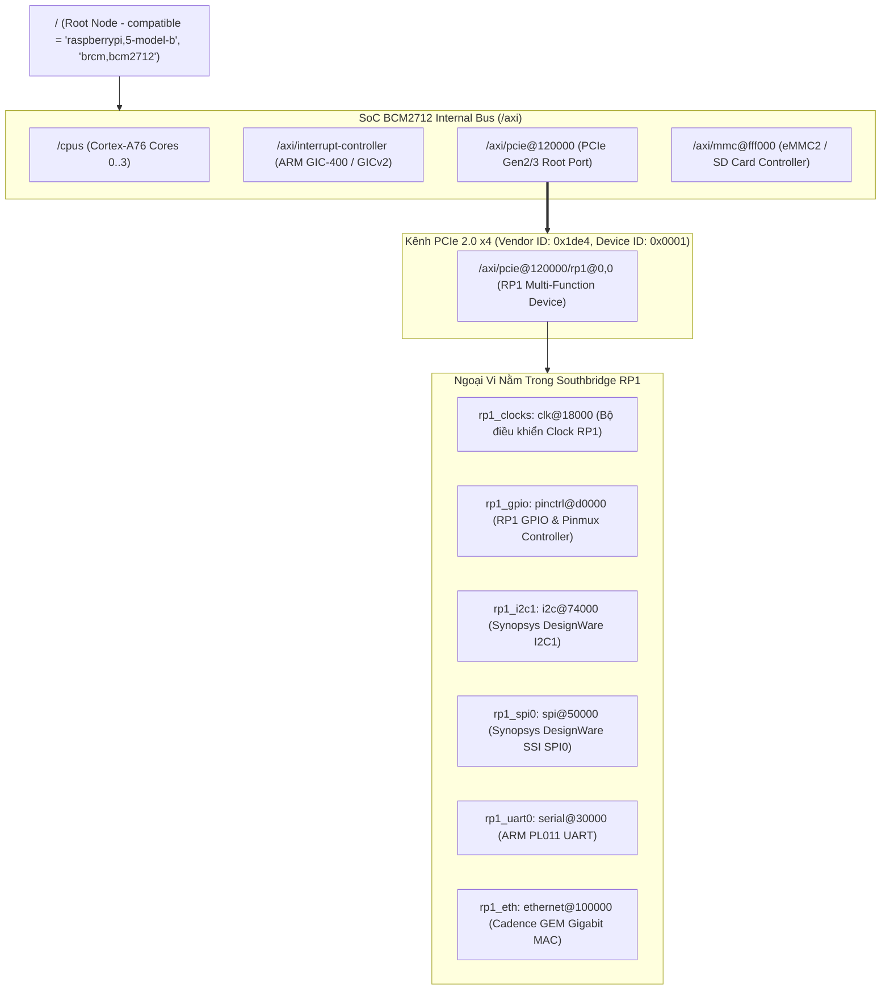

# 🌲 Chương 3: Device Tree, Overlays (.dtbo) & Pinmux Trên RP1

---

## 🔍 1. SỰ THAY ĐỔI TRONG KIẾN TRÚC DEVICE TREE CỦA RASPBERRY PI 5

Trên các thế hệ Raspberry Pi 4 trở về trước, toàn bộ cây Device Tree (`bcm2711.dtsi` $\rightarrow$ `bcm2711-rpi-4-b.dts`) được xây dựng theo mô hình tĩnh: Toàn bộ ngoại vi (GPIO, I2C, SPI) đều nằm trực tiếp dưới bus nội bộ của SoC Broadcom (`/soc/gpio@7e200000`, `/soc/i2c@7e804000`).

Nhưng trên **Raspberry Pi 5**, do ngoại vi đã được dời sang chip Southbridge **RP1** nối qua PCIe, cấu trúc cây Device Tree có sự phân cấp hoàn toàn mới:



---

## ⚡ 2. CƠ CHẾ DYNAMIC OVERLAY CỦA DRIVER `rp1-pci.c`

Làm thế nào mà Linux Kernel có thể tải đúng các thông số phần cứng của RP1 khi nó nằm sau một bus PCIe cắm nóng/tự phát hiện?

1. **Phát hiện thiết bị PCIe (PCIe Probe)**:
   - Khi Kernel khởi động, driver core `drivers/misc/rp1/rp1-pci.c` (hoặc `drivers/pci/`) quét bus PCIe và bắt được thiết bị có mã Vendor ID `0x1de4` và Device ID `0x0001`.
2. **Kích hoạt nạp Dynamic Overlay (`rp1.dtso`)**:
   - Khác với PC thông thường (nơi các sub-devices trong chip cầu nam có thể tự khai báo qua thanh ghi PCI Configuration Space), các khối bên trong RP1 (như chân GPIO, bộ I2C) **không thể tự phát hiện**.
   - Do đó, driver `rp1-pci.c` sử dụng cơ chế **Dynamic Device Tree Overlay Injection**: Nó tự động lấy tệp Device Tree Overlay mô tả chi tiết sơ đồ chân, ngắt và địa chỉ BAR của RP1 (`rp1.dtbo`) và gắn động vào cây Device Tree của hệ thống ngay khi probe thành công!

---

## 🏷️ 3. BẢNG ĐỐI CHIẾU PHANDLES & TARGET NODES (PI 4 VS PI 5)

Đây là **nguyên nhân số 1** khiến 90% các Device Tree Overlay của Raspberry Pi 4 bị lỗi không hoạt động khi mang sang Raspberry Pi 5. Bạn bắt buộc phải chuyển đổi các nhãn tham chiếu mục tiêu (`target` / `target-path`):

| Ngoại Vi Trên Header 40-Pin | Nhãn Trên RPi 4 / RPi 3 (Cũ) | **Nhãn Chính Thức Trên RPi 5 (RP1)** | Ghi Chú Kỹ Thuật |
| :--- | :--- | :--- | :--- |
| **GPIO & Pin Control** | `target = <&gpio>;` | **`target = <&rp1_gpio>;`** | Trỏ tới driver `pinctrl-rp1` tại offset `0xd0000`. |
| **I2C Bus 1 (Chân 3 & 5)** | `target = <&i2c1>;` | **`target = <&rp1_i2c1>;`** | Bộ Synopsys DW I2C thay vì Broadcom BSC. |
| **SPI Bus 0 (Chân 19..24)**| `target = <&spi0>;` | **`target = <&rp1_spi0>;`** | Bộ Synopsys DW SSI SPI thay vì Broadcom SPI. |
| **UART0 Serial (GPIO14/15)**| `target = <&uart0>;` | **`target = <&rp1_uart0>;`** | Cổng UART đưa ra chân 8 và 10 của header 40-pin. |
| **I2C Bus 2 / 3** | Không hỗ trợ tiện lợi | **`target = <&rp1_i2c2>;`** | Có thêm các kênh I2C phần cứng độc lập. |

> [!TIP]
> **Cơ chế Overlay Map (`overlay_map`) của Firmware**:
> Để duy trì tính tương thích ngược cho người dùng phổ thông, Raspberry Pi Firmware có cơ chế tự động chuyển hướng: Khi trong `config.txt` ghi `dtoverlay=i2c1`, firmware sẽ tự động tìm kiếm tệp `overlays/i2c1-pi5.dtbo` để nạp thay thế. Tuy nhiên, khi **tự viết BSP riêng**, bạn nên viết rõ ràng nhắm vào `&rp1_gpio`, `&rp1_i2c1`, `&rp1_spi0` để kiểm soát 100% mã nguồn.

---

## 🔀 4. CƠ CHẾ PINMUXING TRÊN CHIP SOUTHBRIDGE RP1

Hệ thống chân GPIO của RP1 hỗ trợ 9 chế độ dồn kênh (Multiplexing: Function 0 đến Function 8), hoàn toàn khác biệt với bảng ALT0..ALT5 của các đời Broadcom cũ.

### 4.1 Bảng ánh xạ chức năng chân tiêu chuẩn (Pin Function Mapping)

| Chân Header | Tên Tín Hiệu RP1 | Func 0 (Mặc định) | Func 1 | Func 2 | Func 3 | Func 4 |
| :---: | :---: | :---: | :---: | :---: | :---: | :---: |
| **Pin 3** | **GPIO2** | GPIO2 | **I2C1_SDA** | UART1_TX | - | PWM0_CHAN2 |
| **Pin 5** | **GPIO3** | GPIO3 | **I2C1_SCL** | UART1_RX | - | PWM0_CHAN3 |
| **Pin 8** | **GPIO14** | GPIO14 | **UART0_TX** | - | SPI1_MISO | PWM0_CHAN0 |
| **Pin 10** | **GPIO15** | GPIO15 | **UART0_RX** | - | SPI1_MOSI | PWM0_CHAN1 |
| **Pin 19** | **GPIO10** | GPIO10 | **SPI0_MOSI** | - | I2C2_SDA | - |
| **Pin 21** | **GPIO9** | GPIO9 | **SPI0_MISO** | - | I2C2_SCL | - |
| **Pin 23** | **GPIO11** | GPIO11 | **SPI0_SCLK** | - | - | - |
| **Pin 24** | **GPIO8** | GPIO8 | **SPI0_CE0** | - | - | - |

### 4.2 Cú pháp định nghĩa Pinctrl cho RP1 trong Device Tree
Trong driver `pinctrl-rp1`, cấu hình một nhóm chân được định nghĩa bằng các thuộc tính chuẩn:

```dts
my_i2c_pins: my_i2c_pins {
    pin_sda {
        pins = "gpio2";
        function = "i2c1";      // Hoặc dùng số hiệu hàm: function = <1>;
        bias-pull-up;           // Kích hoạt điện trở kéo lên nội 3.3V
    };
    pin_scl {
        pins = "gpio3";
        function = "i2c1";
        bias-pull-up;
    };
};
```

---

## 🛠️ 5. HƯỚNG DẪN VIẾT DEVICE TREE OVERLAYS MẪU CHO RPI 5

Dưới đây là 3 mẫu Device Tree Overlay chuẩn công nghiệp được thiết kế riêng cho chip RP1 trên Raspberry Pi 5.

### 5.1 Mẫu 1: Tích hợp Cảm biến Nhiệt độ / Áp suất I2C (BME280 tại địa chỉ 0x76)
Tệp `custom-i2c-sensor-pi5.dts`:

```dts
/dts-v1/;
/plugin/;

/ {
    compatible = "raspberrypi,5-model-b", "brcm,bcm2712";

    // Đoạn phân mảnh 1: Kích hoạt bus I2C1 trên chip RP1
    fragment@0 {
        target = <&rp1_i2c1>;
        __overlay__ {
            #address-cells = <1>;
            #size-cells = <0>;
            status = "okay";
            clock-frequency = <400000>; // Tốc độ 400 kHz Fast-Mode

            // Khai báo node cảm biến BME280 kết nối vào bus I2C1
            bme280_sensor: bme280@76 {
                compatible = "bosch,bme280";
                reg = <0x76>; // Địa chỉ I2C 7-bit
                status = "okay";
            };
        };
    };
};
```

### 5.2 Mẫu 2: Tích hợp Chip CAN Bus Công Nghiệp (MCP2515 qua SPI0)
Tệp `custom-spi-can-pi5.dts`:
- Chip điều khiển CAN MCP2515 kết nối vào `rp1_spi0` (CS0 trên GPIO8).
- Chân ngắt báo nhận gói tin (Interrupt Pin) nối vào chân GPIO25 của RP1.
- Thạch anh dao động ngoài 16 MHz.

```dts
/dts-v1/;
/plugin/;

/ {
    compatible = "raspberrypi,5-model-b", "brcm,bcm2712";

    // Phân mảnh 0: Khai báo bộ dao động thạch anh 16MHz cho MCP2515
    fragment@0 {
        target-path = "/";
        __overlay__ {
            can0_osc: can0_osc {
                compatible = "fixed-clock";
                #clock-cells = <0>;
                clock-frequency = <16000000>; // 16 MHz
            };
        };
    };

    // Phân mảnh 1: Cấu hình chân ngắt GPIO25 trên RP1
    fragment@1 {
        target = <&rp1_gpio>;
        __overlay__ {
            can0_pins: can0_pins {
                pins = "gpio25";
                function = "gpio";
                bias-pull-up;
            };
        };
    };

    // Phân mảnh 2: Khai báo thiết bị CAN trên bus SPI0 của RP1
    fragment@2 {
        target = <&rp1_spi0>;
        __overlay__ {
            #address-cells = <1>;
            #size-cells = <0>;
            status = "okay";

            can0: mcp2515@0 {
                compatible = "microchip,mcp2515";
                reg = <0>; // Chip Select 0 (GPIO8)
                pinctrl-names = "default";
                pinctrl-0 = <&can0_pins>;
                spi-max-frequency = <10000000>; // Tần số SPI 10 MHz
                interrupt-parent = <&rp1_gpio>;
                interrupts = <25 2>; // Chân GPIO25, ngắt sườn xuống (IRQ_TYPE_EDGE_FALLING = 2)
                clocks = <&can0_osc>;
                status = "okay";
            };
        };
    };
};
```

### 5.3 Mẫu 3: Cấu hình Nút nhấn (GPIO-Keys) & Đầu ra Relay trên RP1
Tệp `custom-gpio-keys-pi5.dts`:

```dts
/dts-v1/;
/plugin/;

#include <dt-bindings/input/input.h>
#include <dt-bindings/gpio/gpio.h>

/ {
    compatible = "raspberrypi,5-model-b", "brcm,bcm2712";

    // Phân mảnh 0: Cấu hình cấu trúc bàn phím GPIO-Keys cho nút bấm
    fragment@0 {
        target-path = "/";
        __overlay__ {
            industrial_buttons {
                compatible = "gpio-keys";
                autorepeat;

                button_emergency: emergency_stop {
                    label = "Emergency Stop Button";
                    linux,code = <KEY_RESTART>;
                    gpios = <&rp1_gpio 17 GPIO_ACTIVE_LOW>;
                    debounce-interval = <20>; // Bộ lọc khử rung 20ms
                };

                button_user: user_button {
                    label = "User Function Button";
                    linux,code = <BTN_0>;
                    gpios = <&rp1_gpio 27 GPIO_ACTIVE_LOW>;
                    debounce-interval = <20>;
                };
            };
        };
    };
};
```

---

## 💻 6. BIÊN DỊCH VÀ NẠP DYNAMIC OVERLAYS

### 6.1 Biên dịch thủ công bằng lệnh `dtc`
Bộ biên dịch Device Tree Compiler (`dtc`) hỗ trợ cờ `-@` (cho phép bảo lưu các biểu tượng tham chiếu symbols/phandles phục vụ dynamic resolution):

```bash
# Cài đặt dtc nếu chưa có
sudo apt install -y device-tree-compiler

# Biên dịch tệp nguồn .dts thành nhị phân .dtbo
dtc -@ -I dts -O dtb -o custom-i2c-sensor-pi5.dtbo custom-i2c-sensor-pi5.dts
dtc -@ -I dts -O dtb -o custom-spi-can-pi5.dtbo custom-spi-can-pi5.dts
dtc -@ -I dts -O dtb -o custom-gpio-keys-pi5.dtbo custom-gpio-keys-pi5.dts
```

### 6.2 Cài đặt vào hệ thống khởi động của Raspberry Pi 5
1. Chép toàn bộ các tệp `.dtbo` vừa biên dịch vào thư mục overlays của phân vùng boot:
   ```bash
   sudo cp *.dtbo /boot/firmware/overlays/
   ```
2. Mở tệp `/boot/firmware/config.txt` và thêm các dòng khai báo:
   ```ini
   dtoverlay=custom-i2c-sensor-pi5
   dtoverlay=custom-spi-can-pi5
   dtoverlay=custom-gpio-keys-pi5
   ```
3. Khởi động lại máy: `sudo reboot`.
4. Sau khi khởi động, kiểm tra nút phần cứng đã được nạp thành công vào hệ thống hay chưa:
   ```bash
   # Kiểm tra node thiết bị trên cây Device Tree sống:
   ls -la /proc/device-tree/axi/pcie@120000/rp1/i2c@74000/bme280@76
   ls -la /proc/device-tree/axi/pcie@120000/rp1/spi@50000/mcp2515@0
   ```

---
*Tiếp theo: [Chương 4: Chiến Lược Tổng Hợp & Viết Driver Linh Kiện](./04_Chien_Luoc_Tong_Hop_Va_Viet_Driver_Linh_Kien.md)*
