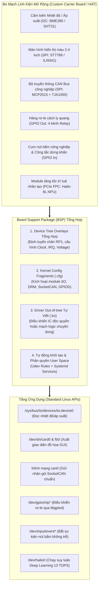

# 🧩 Chương 4: Chiến Lược Tổng Hợp & Viết Driver Linh Kiện Cho Raspberry Pi 5

---

## 🎯 1. BẢN CHẤT CỦA "TỔNG HỢP DRIVER LINH KIỆN" TRONG BSP

Khi phát triển một thiết bị nhúng thương mại dựa trên Raspberry Pi 5 (ví dụ: Cổng kết nối công nghiệp IoT Gateway, Bộ điều khiển máy tự động hóa, Thiết bị y tế, Trạm đo quan trắc môi trường), bo mạch mở rộng (Carrier Board / Custom HAT) của bạn sẽ chứa hàng loạt linh kiện phần cứng khác nhau:



> [!IMPORTANT]
> **Định nghĩa của một BSP hoàn chỉnh**:
> Khách hàng hoặc lập trình viên ứng dụng chỉ cần bật nguồn máy tính, **hệ điều hành phải tự động nhận dạng, tự động nạp driver cho toàn bộ linh kiện trên bo mạch**, và xuất ra các giao diện chuẩn POSIX của Linux. Lập trình viên ứng dụng tuyệt đối không phải tự chạy các lệnh thủ công như `insmod`, không phải tự viết code gõ thanh ghi chân GPIO, và không lo xung đột tài nguyên!

---

## ⚖️ 2. HAI PHƯƠNG PHÁP TÍCH HỢP DRIVER: IN-TREE VS OUT-OF-TREE

Trong kỹ thuật BSP, một kỹ sư cần phân loại chính xác linh kiện nào nên dùng **In-Tree Driver** và linh kiện nào bắt buộc phải viết **Out-of-Tree Driver**:

| Tiêu Chí So Sánh | Tích Hợp In-Tree Driver (Tận dụng Framework có sẵn) | Viết Out-of-Tree Driver (Tự viết Kernel Module `.ko`) |
| :--- | :--- | :--- |
| **Loại linh kiện áp dụng** | 85% linh kiện phổ biến trên thị trường: Cảm biến I2C (BME280, MPU6050), Chip CAN (MCP2515), Màn hình SPI (ST7789), RTC (DS1307, PCF8563), ADC (ADS1115). | IC độc quyền của công ty, mạch FPGA tùy biến, cảm biến mới ra mắt chưa có trên Linux mainline, hoặc driver có sở hữu trí tuệ đóng. |
| **Phương thức tích hợp trong BSP** | Viết tệp cấu hình kernel fragment (`.cfg`) để bật cờ `CONFIG_*=m` hoặc `=y`, kết hợp viết Device Tree Overlay để map chân RP1. | Viết mã nguồn C đầy đủ (`probe`, `remove`, `fops`), viết `Makefile` chuẩn Kbuild, đóng gói vào Recipe Yocto. |
| **Tính ổn định & Bảo trì** | Cực kỳ ổn định, tự động cập nhật và sửa lỗi qua các phiên bản Kernel LTS mới. | Phải tự bảo trì mã nguồn C khi Kernel thay đổi chữ ký hàm API nội bộ. |

---

## 🛠️ 3. CHI TIẾT TỔNG HỢP 5 NHÓM LINH KIỆN CÔNG NGHIỆP TRÊN RPI 5

### 3.1 Nhóm 1: Cảm biến I2C/SPI qua Linux Industrial I/O (IIO) Framework
Thay vì viết Character Driver thô sơ đọc byte qua `/dev`, Linux cung cấp chuẩn **IIO Subsystem** (`drivers/iio/`) chuyên biệt cho cảm biến đo lường (nhiệt độ, độ ẩm, áp suất, gia tốc, từ trường, con quay hồi chuyển, ADC/DAC).

#### Quy trình tích hợp vào BSP:
1. **Kích hoạt Kernel Config**:
   ```kconfig
   CONFIG_IIO=y
   CONFIG_IIO_BUFFER=y
   CONFIG_IIO_TRIGGERED_BUFFER=m
   CONFIG_BMP280=m
   CONFIG_BMP280_I2C=m
   ```
2. **Khai báo Device Tree Node trên bus `rp1_i2c1`**:
   ```dts
   &rp1_i2c1 {
       status = "okay";
       bme280@76 {
           compatible = "bosch,bme280";
           reg = <0x76>;
       };
   };
   ```
3. **Giao diện chuẩn trên User Space**:
   Khi cắm nguồn, Kernel tự nạp `bmp280_i2c.ko`, tạo thư mục tại `/sys/bus/iio/devices/iio:device0/`. Người dùng chỉ cần đọc giá trị:
   ```bash
   # Đọc nhiệt độ (đơn vị: milli-Celsius):
   cat /sys/bus/iio/devices/iio:device0/in_temp_input
   # Kết quả: 28540 -> tương ứng 28.54 °C
   ```

---

### 3.2 Nhóm 2: Màn hình hiển thị nhỏ (SPI TFT LCD) qua Linux DRM/KMS
Màn hình LCD nhỏ (như chuẩn ST7789 240x240 hoặc ILI9341 320x240) giao tiếp qua bus SPI không nên dùng framebuffer cũ (`fbtft`) mà nên sử dụng kiến trúc hiện đại **DRM/KMS TinyDRM** (`drivers/gpu/drm/tiny/`).

#### Quy trình tích hợp vào BSP:
1. **Kích hoạt Kernel Config**:
   ```kconfig
   CONFIG_DRM=y
   CONFIG_DRM_KMS_HELPER=y
   CONFIG_TINYDRM_ST7789V=m
   ```
2. **Khai báo Device Tree Node trên bus `rp1_spi0`**:
   Màn hình dùng chân SPI0 (MOSI, SCLK) kèm chân lệnh/dữ liệu **DC (Data/Command)** và chân **RESET** nối vào GPIO RP1:
   ```dts
   &rp1_spi0 {
       status = "okay";
       display@0 {
           compatible = "sitronix,st7789v";
           reg = <0>;                         // Chip Select 0 (GPIO8)
           spi-max-frequency = <40000000>;     // Tốc độ bus 40 MHz
           rotate = <90>;                     // Góc xoay màn hình
           dc-gpios = <&rp1_gpio 24 0>;       // Chân DC nối GPIO24
           reset-gpios = <&rp1_gpio 25 0>;    // Chân Reset nối GPIO25
           buswidth = <8>;
       };
   };
   ```
3. **Kết quả**: Kernel tạo giao diện đồ họa chuẩn `/dev/dri/card1` (hoặc `/dev/fb1`), cho phép ứng dụng GUI chạy thẳng giao diện Qt, Flutter, hoặc LVGL lên màn hình SPI!

---

### 3.3 Nhóm 3: Mạng CAN Bus Công Nghiệp qua Chip MCP2515 (SPI)
Mạng CAN (Controller Area Network) là chuẩn giao tiếp số 1 trong nhà máy và ô tô. Bo mạch Pi 5 tích hợp chip Microchip MCP2515 nối qua bus SPI0 của RP1.

#### Quy trình tích hợp vào BSP:
1. **Kích hoạt Kernel Config**:
   ```kconfig
   CONFIG_CAN=y
   CONFIG_CAN_RAW=y
   CONFIG_CAN_DEV=y
   CONFIG_CAN_MCP251X=m
   ```
2. **Khai báo Device Tree Node** (đã viết chi tiết ở Chương 3 với thạch anh 16MHz và ngắt GPIO25).
3. **Cấu hình tự động khởi tạo giao diện mạng mạng `can0`**:
   Trong BSP, tạo tệp dịch vụ Systemd `/etc/systemd/network/80-can0.network`:
   ```ini
   [Match]
   Name=can0

   [CAN]
   BitRate=500K
   RestartSec=100ms
   ```
   Khi hệ điều hành boot, mạng `can0` tự động bật với tốc độ 500 kbps, người dùng chỉ cần dùng các lệnh chuẩn `candump can0` hoặc thư viện lập trình C SocketCAN (`socket(PF_CAN, SOCK_RAW, CAN_RAW)`).

---

### 3.4 Nhóm 4: Thiết bị đóng ngắt Rơ-le (Relays) & Nút nhấn công nghiệp
Thay vì xuất khẩu chân GPIO kiểu thủ công (`/sys/class/gpio` - đã bị Linux Kernel Deprecated từ bản 6.x), BSP hiện đại tích hợp:
1. **Đầu ra (Relays / Actuators)**: Dùng framework **`gpio-leds`** (rất tiện lợi, hỗ trợ cấu hình trạng thái ban đầu `default-state = "off"` hoặc `"on"`):
   ```dts
   relays {
       compatible = "gpio-leds";
       relay1 {
           label = "industrial:relay1";
           gpios = <&rp1_gpio 26 0>;
           default-state = "off";
       };
   };
   ```
2. **Đầu vào (Nút nhấn / Cảm biến tiệm cận)**: Dùng framework **`gpio-keys`** (hỗ trợ tự động chống rung phần cứng `debounce-interval`, chuyển đổi sườn điện áp thành sự kiện phím chuẩn của Linux Input Subsystem `/dev/input/eventX`).

---

### 3.5 Nhóm 5: Module Gia Tốc Trí Tuệ Nhân Tạo (NPU) Qua Cổng PCIe FPC
Raspberry Pi 5 cung cấp cổng PCIe ngoài. Khi tích hợp module NPU như **Hailo-8L (13 TOPS)**:
1. **Bật PCIe Gen 3 trong `config.txt`**:
   ```ini
   dtparam=pciex1=on
   dtparam=pciex1_gen=3
   ```
2. **Tích hợp Driver Kernel Module PCIe (`hailo_pci.ko`)**:
   Biên dịch và nhúng driver PCI Endpoint của Hailo vào rootfs.
3. Khi khởi động, lệnh `lspci` sẽ xuất hiện thiết bị:
   `0000:01:00.0 Co-processor: Hailo Technologies Ltd. Hailo-8L AI Processor`.
   Ứng dụng Python/C++ chỉ cần gọi thư viện `hailo_platform` để phân tích hình ảnh camera 30 FPS thời gian thực.

---

## 💻 4. HƯỚNG DẪN VIẾT DRIVER OUT-OF-TREE CHO LINH KIỆN TÙY BIẾN

Dưới đây là mã nguồn C hoàn chỉnh của một Driver chuẩn Linux Kernel cho **Cảm biến I2C tùy biến** (`custom_sensor_driver.c`) được thiết kế để tương thích với kiến trúc RP1 trên Raspberry Pi 5:

```c
#include <linux/module.h>
#include <linux/init.h>
#include <linux/i2c.h>
#include <linux/of.h>
#include <linux/fs.h>
#include <linux/uaccess.h>
#include <linux/miscdevice.h>
#include <linux/delay.h>

#define DRIVER_NAME "custom_i2c_sensor"

// Cấu trúc dữ liệu quản lý cá thể thiết bị
struct custom_sensor_dev {
    struct i2c_client *client;
    struct miscdevice miscdev;
    struct mutex lock;
    int last_temperature;
};

// Hàm đọc dữ liệu thô từ thanh ghi I2C của cảm biến
static int read_sensor_raw(struct custom_sensor_dev *dev)
{
    int ret;
    u8 reg = 0x01; // Thanh ghi lưu nhiệt độ
    u8 val;

    mutex_lock(&dev->lock);
    
    // Đọc 1 byte dữ liệu từ chip I2C
    ret = i2c_smbus_read_byte_data(dev->client, reg);
    if (ret < 0) {
        dev_err(&dev->client->dev, "Lỗi đọc dữ liệu bus I2C: %d\n", ret);
        mutex_unlock(&dev->lock);
        return ret;
    }

    dev->last_temperature = ret;
    mutex_unlock(&dev->lock);
    return 0;
}

// Giao diện đọc file /dev/custom_sensor từ User Space
static ssize_t sensor_read(struct file *file, char __user *buf, size_t count, loff_t *ppos)
{
    struct custom_sensor_dev *dev = container_of(file->private_data, struct custom_sensor_dev, miscdev);
    char kbuf[32];
    int len;

    if (*ppos > 0)
        return 0;

    if (read_sensor_raw(dev) < 0)
        return -EIO;

    len = snprintf(kbuf, sizeof(kbuf), "Temp: %d C\n", dev->last_temperature);
    if (copy_to_user(buf, kbuf, len))
        return -EFAULT;

    *ppos += len;
    return len;
}

static const struct file_operations sensor_fops = {
    .owner = THIS_MODULE,
    .read = sensor_read,
};

// Hàm Probe: Được kích hoạt khi chuỗi compatible trong Device Tree khớp
static int custom_sensor_probe(struct i2c_client *client)
{
    struct custom_sensor_dev *dev;
    int ret;

    dev_info(&client->dev, "===============================================\n");
    dev_info(&client->dev, "[BSP] Phát hiện cảm biến Custom I2C tại địa chỉ 0x%02X!\n", client->addr);

    // 1. Cấp phát bộ nhớ quản lý an toàn bằng Managed API devm_
    dev = devm_kzalloc(&client->dev, sizeof(*dev), GFP_KERNEL);
    if (!dev)
        return -ENOMEM;

    dev->client = client;
    mutex_init(&dev->lock);

    // 2. Đăng ký giao diện file thiết bị /dev/custom_sensor
    dev->miscdev.minor = MISC_DYNAMIC_MINOR;
    dev->miscdev.name = "custom_sensor";
    dev->miscdev.fops = &sensor_fops;
    dev->miscdev.parent = &client->dev;

    ret = misc_register(&dev->miscdev);
    if (ret) {
        dev_err(&client->dev, "Không thể đăng ký miscdevice: %d\n", ret);
        return ret;
    }

    i2c_set_clientdata(client, dev);
    dev_info(&client->dev, "[BSP] Khởi tạo driver cảm biến thành công (/dev/custom_sensor ready)\n");
    dev_info(&client->dev, "===============================================\n");

    return 0;
}

// Hàm Remove: Dọn dẹp khi gỡ bỏ module
static void custom_sensor_remove(struct i2c_client *client)
{
    struct custom_sensor_dev *dev = i2c_get_clientdata(client);
    misc_deregister(&dev->miscdev);
    dev_info(&client->dev, "[BSP] Đã giải phóng driver cảm biến!\n");
}

// Bảng ánh xạ Device Tree Matching
static const struct of_device_id custom_sensor_of_match[] = {
    { .compatible = "myvendor,custom-sensor-v1", },
    { }
};
MODULE_DEVICE_TABLE(of, custom_sensor_of_match);

// Khai báo cấu trúc i2c_driver chuẩn Linux Kernel
static struct i2c_driver custom_sensor_driver = {
    .driver = {
        .name = DRIVER_NAME,
        .of_match_table = custom_sensor_of_match,
    },
    .probe = custom_sensor_probe,
    .remove = custom_sensor_remove,
};

module_i2c_driver(custom_sensor_driver);

MODULE_LICENSE("GPL");
MODULE_AUTHOR("Antigravity Embedded Team");
MODULE_DESCRIPTION("Custom I2C Sensor Driver for Raspberry Pi 5 BSP");
MODULE_VERSION("1.0");
```

---

## 🏗️ 5. QUY TRÌNH KẾT NỐI DRIVER VỚI THIẾT BỊ THẬT TRÊN PI 5

Sau khi viết xong Driver C ở trên, làm cách nào để Kernel tự động nạp nó và gắn vào đúng chân bus I2C của chip RP1?

1. **Viết Device Tree Overlay** (`custom-sensor-overlay.dts`):
   ```dts
   /dts-v1/;
   /plugin/;
   / {
       compatible = "raspberrypi,5-model-b", "brcm,bcm2712";
       fragment@0 {
           target = <&rp1_i2c1>; // Gắn vào I2C1 của RP1
           __overlay__ {
               #address-cells = <1>;
               #size-cells = <0>;
               status = "okay";
               my_sensor: sensor@48 {
                   compatible = "myvendor,custom-sensor-v1"; // KHỚP 100% VỚI CODE C!
                   reg = <0x48>; // Địa chỉ I2C của linh kiện
               };
           };
       };
   };
   ```
2. **Biên dịch Driver thành file `.ko` và Overlay thành `.dtbo`**.
3. **Cơ chế nạp tự động của BSP**:
   - Tệp `.dtbo` được sao chép vào `/boot/firmware/overlays/`.
   - Dòng `dtoverlay=custom-sensor-overlay` được ghi vào `config.txt`.
   - File driver `custom_sensor_driver.ko` được sao chép vào `/lib/modules/$(uname -r)/extra/`.
   - Tên module `custom_sensor_driver` được thêm vào `/etc/modules-load.d/custom-bsp.conf`.

Khi Raspberry Pi 5 khởi động:
- Bootloader EEPROM đọc `config.txt` $\rightarrow$ nạp `custom-sensor-overlay.dtbo` vào RAM.
- Kernel khởi động $\rightarrow$ phát hiện node `sensor@48` với chuỗi `myvendor,custom-sensor-v1`.
- Hệ thống `udev` tra cứu chuỗi `compatible` trong bảng `MODULE_DEVICE_TABLE` $\rightarrow$ Tự động gọi `modprobe custom_sensor_driver`!
- Hàm `custom_sensor_probe()` thực thi $\rightarrow$ Tạo file `/dev/custom_sensor` sẵn sàng cho ứng dụng sử dụng!

---
*Tiếp theo: [Chương 5: Xây Dựng Custom BSP Layer Yocto Cho RPi 5](./05_Xay_Dung_Custom_BSP_Layer_Yocto_Cho_RPi5.md)*
