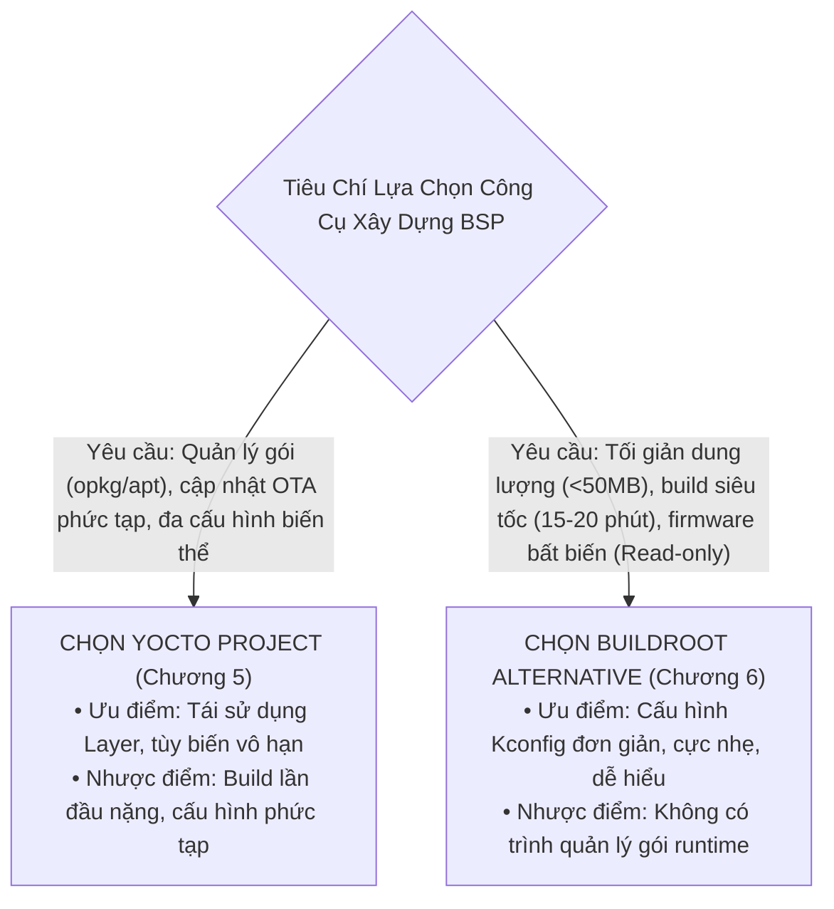

# 🍃 Chương 6: Xây Dựng BSP Với Buildroot Alternative Cho Raspberry Pi 5

---

## ⚖️ 1. SO SÁNH BUILDROOT VS YOCTO TRONG DỰ ÁN BSP CHO RPI 5

Khi triển khai giải pháp BSP cho Raspberry Pi 5, hai hệ sinh thái xây dựng Linux nhúng phổ biến nhất là **Yocto Project** và **Buildroot**. Việc lựa chọn công cụ nào phụ thuộc hoàn toàn vào yêu cầu sản phẩm của bạn:



---

## 🌳 2. CƠ CHẾ `BR2_EXTERNAL`: NGUYÊN TẮC VÀNG TRONG PHÁT TRIỂN BSP BUILDROOT

> [!CAUTION]
> **Tuyệt đối không bao giờ sửa đổi trực tiếp vào cây mã nguồn gốc của Buildroot!**
> Mọi tùy biến phần cứng, driver linh kiện, Device Tree Overlays và kịch bản phân vùng đĩa bắt buộc phải được đóng gói riêng biệt trong một cây thư mục ngoại vi độc lập gọi là **`BR2_EXTERNAL`**.

Cấu trúc thư mục của một cây `BR2_EXTERNAL` chuyên nghiệp dành cho Raspberry Pi 5:

```text
br2-external-rpi5/
├── external.desc                          # Định danh tên và mô tả của cây ngoại vi
├── external.mk                            # Makefile bao hàm các gói phần mềm tự viết
├── Config.in                              # Menu Kconfig hiển thị trên menuconfig
├── configs/
│   └── custom_rpi5_defconfig              # Tệp cấu hình Buildroot hoàn chỉnh
├── board/
│   └── custom-rpi5/
│       ├── config.txt                     # Cấu hình firmware bootloader RPi 5
│       ├── cmdline.txt                    # Tham số dòng lệnh Kernel
│       ├── post-image.sh                  # Kịch bản chạy genimage sau khi build xong
│       ├── genimage.cfg                   # Định nghĩa bản đồ phân vùng thẻ nhớ (MBR)
│       └── overlays/
│           └── custom-components-rpi5.dts # Device Tree Overlay nhắm vào RP1
└── package/
    └── custom-sensor-driver/              # Gói biên dịch kernel module tùy biến
        ├── Config.in
        ├── custom-sensor-driver.mk
        └── src/
            ├── custom_sensor.c
            └── Makefile
```

---

## ⚙️ 3. GIẢI PHÃU CÁC TỆP TIN CỐT LÕI CỦA CÂY BSP BUILDROOT

### 3.1 Tệp mô tả cây: `external.desc`
```text
name: CUSTOM_RPI5_BSP
desc: Custom Board Support Package for Raspberry Pi 5 Industrial Devices
```

### 3.2 Tệp phân vùng thẻ nhớ tự động: `board/custom-rpi5/genimage.cfg`
Công cụ `genimage` trong Buildroot sẽ tự động tạo ra một tệp ảnh đĩa hoàn chỉnh `sdcard.img` chứa 2 phân vùng tiêu chuẩn:

```ini
image boot.vfat {
    vfat {
        extraargs = "-F 32 -n boot"
        files = {
            "bcm2712-rpi-5-b.dtb",
            "overlays",
            "Image",
            "config.txt",
            "cmdline.txt"
        }
    }
    size = 128M
}

image sdcard.img {
    hdimage {
        partition-table-type = "mbr"
    }

    partition boot {
        partition-type = 0xC
        bootable = "true"
        image = "boot.vfat"
    }

    partition rootfs {
        partition-type = 0x83
        image = "rootfs.ext4"
        size = 512M
    }
}
```

### 3.3 Đóng gói Driver Out-of-tree trong Buildroot: `package/custom-sensor-driver/custom-sensor-driver.mk`
Buildroot cung cấp hạ tầng macro `kernel-module` tự động giải quyết việc biên dịch chéo C Kernel Module:

```makefile
################################################################################
# custom-sensor-driver
################################################################################

CUSTOM_SENSOR_DRIVER_VERSION = 1.0
CUSTOM_SENSOR_DRIVER_SITE = $(CUSTOM_RPI5_BSP_PATH)/package/custom-sensor-driver/src
CUSTOM_SENSOR_DRIVER_SITE_METHOD = local
CUSTOM_SENSOR_DRIVER_LICENSE = GPL-2.0
CUSTOM_SENSOR_DRIVER_LICENSE_FILES = COPYING

# Yêu cầu Buildroot tự động biên dịch module theo Kbuild của Linux Kernel
$(eval $(kernel-module))
$(eval $(generic-package))
```

---

## 🚀 4. QUY TRÌNH BIÊN DỊCH VÀ XUẤT XƯỞNG VỚI BUILDROOT

Thực hiện các lệnh sau trên máy trạm Ubuntu:

```bash
# 1. Tải mã nguồn Buildroot LTS chính thức
git clone -b 2024.02.x https://github.com/buildroot/buildroot.git
cd buildroot

# 2. Nạp cấu hình từ cây BR2_EXTERNAL ngoài
make BR2_EXTERNAL=/path/to/br2-external-rpi5 custom_rpi5_defconfig

# 3. Tinh chỉnh các gói phần mềm (nếu cần)
make menuconfig

# 4. Kích hoạt biên dịch (Toàn bộ Toolchain, Kernel, RootFS và Driver)
make -j$(nproc)
```

Khi lệnh `make` kết thúc, file ảnh đĩa hoàn chỉnh nằm tại:
`output/images/sdcard.img` (Dung lượng chỉ khoảng **150 MB**!).

Ghi trực tiếp vào thẻ nhớ:
```bash
sudo dd if=output/images/sdcard.img of=/dev/sdX bs=4M status=progress conv=fsync
```

---
*Tiếp theo: [Chương 7: Hướng Dẫn Thực Hành Step-by-Step Bring-up & Debug](./07_Huong_Dan_Thuc_Hanh_Step_By_Step_Bring_Up_Va_Debug.md)*
