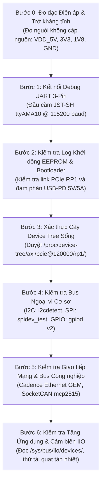

# 🛠️ Chương 7: Hướng Dẫn Thực Hành Bring-up & Debug Phần Cứng Trên RPi 5

---

## 📋 1. QUY TRÌNH BRING-UP PHẦN CỨNG CHUẨN CÔNG NGHIỆP (CHECKLIST)

Khi bo mạch mở rộng (Carrier Board / Custom HAT) vừa xuất xưởng từ nhà máy gia công PCBA, bạn không bao giờ cắm nguồn rồi chạy ngay phần mềm ứng dụng. Một kỹ sư hệ thống nhúng chuyên nghiệp bắt buộc phải tuân thủ **Quy trình Bring-up 7 bước có kiểm soát**:



---

## 💻 2. CÁC LỆNH CHẨN ĐOÁN PHẦN CỨNG THỰC TẾ TRÊN TERMINAL

### Bước 1: Kiểm tra kết nối PCIe giữa SoC BCM2712 và Southbridge RP1
Đây là điều kiện tiên quyết. Nếu BCM2712 không "nhìn thấy" RP1 qua PCIe thì 100% ngoại vi (GPIO, I2C, SPI, Ethernet, USB) đều sẽ tê liệt!

```bash
# Liệt kê toàn bộ thiết bị trên bus PCI Express:
lspci -nn -vvv

# Kết quả mong đợi phải xuất hiện thiết bị của Raspberry Pi Ltd:
# 0000:00:00.0 PCI bridge: Broadcom Inc. and subsidiaries BCM2712 PCIe Bridge
# 0001:01:00.0 Miscellaneous device [ff00]: Device 1de4:0001 (rev 01)
# Subsystem: Device 1de4:0001
# Region 0: Memory at 1f00000000 (32-bit, non-prefetchable) [size=4M]  <-- BAR 0 của RP1!
# Region 1: Memory at 1f00400000 (32-bit, non-prefetchable) [size=256K] <-- BAR 1 của RP1!
```

Kiểm tra nhật ký Kernel xem driver RP1 probe thành công hay không:
```bash
dmesg | grep -i rp1
```

---

### Bước 2: Kiểm tra trạng thái cây Device Tree đang nạp trong RAM
Xem các nút thiết bị của bạn có thực sự xuất hiện dưới nhánh của RP1 hay không:

```bash
# Duyệt các thiết bị trực thuộc RP1:
ls -l /proc/device-tree/axi/pcie@120000/rp1/

# Kiểm tra xem cảm biến I2C BME280 có nằm trong I2C1 không:
cat /proc/device-tree/axi/pcie@120000/rp1/i2c@74000/bme280@76/compatible
# Kết quả mong đợi: bosch,bme280

# Xem các Device Tree Overlays nào đã được nạp thành công lúc boot:
sudo vcdbg log msg
```

---

### Bước 3: Thao tác với Chân GPIO bằng bộ công cụ `libgpiod v2`
> [!WARNING]
> Trên các bản Linux hiện đại (Kernel 6.x trở lên trên Pi 5), giao diện cũ `/sys/class/gpio/export` đã bị loại bỏ hoàn toàn. Bắt buộc sử dụng bộ công cụ **`libgpiod`**!

```bash
# 1. Liệt kê các chip điều khiển GPIO trên hệ thống:
gpiodetect
# Kết quả:
# gpiochip0 [rp1-gpio] (28 lines)  <-- Đây chính là 28 chân Header 40-pin!
# gpiochip1 [pinctrl-bcm2712] (36 lines) <-- Chân nội bộ SoC

# 2. Xem sơ đồ chức năng và trạng thái của từng chân trên header 40-pin:
gpioinfo gpiochip0

# 3. Đọc trạng thái chân nút nhấn GPIO17:
gpioget gpiochip0 17

# 4. Kích hoạt đóng Relay nối vào chân GPIO26 (Mức logic 1):
gpioset gpiochip0 26=1

# 5. Ngắt Relay (Mức logic 0):
gpioset gpiochip0 26=0

# 6. Giám sát sự kiện nhấn nút theo thời gian thực (Interrupt Monitor):
gpiomon gpiochip0 17
```

---

### Bước 4: Quét Bus I2C & Kiểm tra Cảm biến
```bash
# Quét toàn bộ các địa chỉ từ 0x03 đến 0x77 trên bus I2C1 (chân GPIO2 & GPIO3):
i2cdetect -y 1
```
Bảng hiển thị kết quả chẩn đoán:
```text
     0  1  2  3  4  5  6  7  8  9  a  b  c  d  e  f
00:                         -- -- -- -- -- -- -- -- 
10: -- -- -- -- -- -- -- -- -- -- -- -- -- -- -- -- 
20: -- -- -- -- -- -- -- -- -- -- -- -- -- -- -- -- 
30: -- -- -- -- -- -- -- -- -- -- -- -- -- -- -- -- 
40: -- -- -- -- -- -- -- -- -- -- -- -- -- -- -- -- 
50: -- -- -- -- -- -- -- -- -- -- -- -- -- -- -- -- 
60: -- -- -- -- -- -- -- -- -- -- -- -- -- -- -- -- 
70: -- -- -- -- -- -- UU --                         
```
- Nếu hiển thị **`76`**: Thiết bị phần cứng đã phản hồi ACK nhưng chưa có Kernel Driver nào giành quyền điều khiển.
- Nếu hiển thị **`UU`**: Cực kỳ tuyệt vời! Thiết bị tại địa chỉ `0x76` đã được Kernel Driver (ví dụ: `bmp280_i2c`) gắn kết thành công và đang phục vụ hệ điều hành.

---

### Bước 5: Kiểm tra Truyền Nhận Mạng CAN Bus Công Nghiệp
```bash
# 1. Kiểm tra driver MCP2515 đã nạp hay chưa:
lsmod | grep mcp251x

# 2. Cấu hình tốc độ baud 500 kbps và bật giao diện mạng can0:
sudo ip link set can0 up type can bitrate 500000

# 3. Kiểm tra thông số thống kê gói tin và lỗi bus:
ip -details -statistics link show can0

# 4. Lắng nghe toàn bộ gói tin CAN trên mạng (Terminal 1):
candump can0

# 5. Bắn một gói tin thử nghiệm (Terminal 2):
# Mã ID: 0x123, Độ dài: 4 byte, Dữ liệu: 0xDEADBEEF
cansend can0 123#DEADBEEF
```

---

## 🚑 3. MA TRẬN CHẨN ĐOÁN & XỬ LÝ SỰ CỐ KINH ĐIỂN (TROUBLESHOOTING MATRIX)

| Triệu Chứng Lỗi | Nguyên Nhân Tiềm Ẩn | Biện Pháp Khắc Phục Chuẩn Xác |
| :--- | :--- | :--- |
| **Lệnh `lspci` không thấy RP1 (`1de4:0001`)** | Nguồn cấp cho chip RP1 bị sụt áp, hoặc mạch in PCIe 2.0 x4 bị đứt/chạm chập chân. | Đo điện áp chân 3.3V và 1.1V cấp cho RP1; kiểm tra đèn LED báo nguồn PMIC DA9091. |
| **Chạy `i2cdetect -y 1` toàn bộ đều hiện dấu `--`** | Thiếu điện trở kéo lên (**Pull-up Resistors 4.7k**) trên đường SDA/SCL, hoặc chân GPIO2/3 chưa được cấu hình dồn kênh (Muxing) sang I2C1 trên RP1. | Bổ sung trở kéo 4.7kΩ lên nguồn 3.3V; kiểm tra node `pinctrl` trong Device Tree Overlay đảm bảo có cờ `bias-pull-up`. |
| **Màn hình SPI chỉ hiện màu trắng xóa hoặc sọc đen** | Sai tần số SPI (`spi-max-frequency` quá cao vượt khả năng chip hiển thị), hoặc nối nhầm chân điều khiển Data/Command (**DC**) và **RESET**. | Hạ xung nhịp SPI xuống 10 MHz (`10000000`); kiểm tra định tuyến chân DC và Reset trong Device Tree xem có khớp với chân cắm thực tế không. |
| **Mạng CAN Bus báo lỗi `can0: bus-off` hoặc không gửi được** | 1. Sai tần số thạch anh dao động trong DTS (Ví dụ: mạch dùng thạch anh 8MHz nhưng DTS khai báo 16MHz). <br>2. Thiếu trở kháng đầu cuối **120Ω** giữa 2 dây CAN_H và CAN_L. | Mở vỏ bọc module CAN kiểm tra số ghi trên vỏ thạch anh (8.000 hay 16.000) và sửa lại `clock-frequency` trong DTS; đo đồng hồ vạn năng giữa dây CAN_H và CAN_L phải đạt xấp xỉ **60Ω** (hai trở 120Ω song song). |
| **Kernel bị Oops / Crash khi insmod custom driver** | Truy cập con trỏ NULL trong hàm `probe()`, hoặc giải tham chiếu trực tiếp địa chỉ vật lý I/O mà quên gọi hàm ánh xạ `ioremap()` / `devm_platform_ioremap_resource()`. | Đọc dòng `pc : my_func+0x18/0x40` trong log `dmesg`, chạy công cụ `addr2line -e my_driver.ko 0x18` để tìm chính xác dòng lệnh C bị lỗi con trỏ! |

---

## 🏆 TỔNG KẾT TOÀN BỘ GIÁO TRÌNH BSP RASPBERRY PI 5

Chúc mừng bạn đã hoàn thành trọn bộ 7 chương tài liệu chuyên sâu về **Kiến trúc và Xây dựng Board Support Package (BSP) cho Raspberry Pi 5**:

1. **Hiểu bản chất phần cứng**: Bạn đã nắm vững lý do tại sao Pi 5 chuyển sang kiến trúc phân tách BCM2712 (SoC) và RP1 (Southbridge) qua PCIe 2.0 x4.
2. **Làm chủ chuỗi Boot**: Thành thạo cấu hình SPI EEPROM, tệp `config.txt` tối ưu, và triển khai Das U-Boot độc lập.
3. **Thành thạo Device Tree**: Nắm vững sự khác biệt giữa phandles Pi 4 và Pi 5, tự tin viết các bản Overlays `.dtbo` nhắm thẳng vào các ngoại vi RP1.
4. **Chiến lược Driver**: Phân biệt rành mạch In-Tree vs Out-of-Tree, tích hợp chuẩn hóa IIO cho cảm biến, DRM/KMS cho màn hình, SocketCAN cho bus công nghiệp.
5. **Thực thi sản xuất**: Biết cách tổ chức Layer Yocto `meta-custom-rpi5` và cây Buildroot `BR2_EXTERNAL` để đóng gói bản Linux nhúng độc quyền sẵn sàng flash hàng loạt.

👉 **Bây giờ, hãy chuyển sang thư mục thực hành ngoài [`/home/thinh/rpi5_bsp_workspace/`](file:///home/thinh/rpi5_bsp_workspace/) để khám phá toàn bộ mã nguồn C, Device Tree Overlays, và công thức Yocto hoàn chỉnh!**
