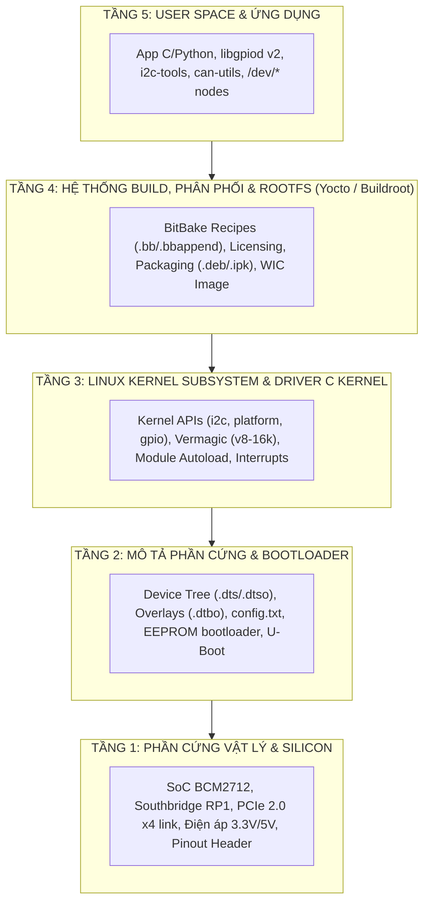

# 🛠️ SỔ TAY DEBUG LỖI BSP CHO NGƯỜI MỚI HỌC: PHÂN TẦNG KIẾN TRÚC & CĂN CỨ TÀI LIỆU

> **Mục đích**: Tài liệu này đúc kết toàn bộ các lỗi thực tế kinh điển gặp phải khi phát triển BSP cho Raspberry Pi 5. Mỗi lỗi được **định vị chính xác ở tầng kiến trúc nào**, **nguyên nhân gốc rễ**, **cách xử lý chuẩn mực** và **căn cứ theo tài liệu/tiêu chuẩn kỹ thuật nào** để người mới học có phương pháp luận vững chắc, không bao giờ phải "mò mẫm".

---

## 🗺️ BẢN ĐỒ 5 TẦNG KIẾN TRÚC BSP ĐỂ ĐỊNH VỊ LỖI

Khi hệ thống gặp lỗi (build fail, crash, không nhận driver, không điều khiển được chân), hãy luôn tự hỏi: **Lỗi này thuộc tầng nào?**



---

## 📚 TỔNG HỢP CÁC LỖI THỰC TẾ ĐÃ XỬ LÝ & CĂN CỨ KỸ THUẬT

### 🔴 LỖI 1: Lỗi Kiểm Tra Toàn Vẹn Bản Quyền Recipe (Licensing Checksum Mismatch)

* **Tầng kiến trúc**: **TẦNG 4 - Build System & Package Governance (Yocto Metadata)**
* **Hiện tượng lỗi**:
  ```text
  ERROR: custom-sensor-i2c-1.0-r0 do_populate_lic: The LIC_FILES_CHKSUM does not match for file://COPYING;md5=b234ee4d69f5fce44864b12a9c32a738. 
  The new md5 checksum is 1e3f6b6225e5f75fffb27a42c399e682
  ```
* **Bản chất nguyên nhân**:
  Yocto Project có cơ chế kiểm định pháp lý tự động (`do_populate_lic`). Mỗi recipe phải khai báo mã hash MD5/SHA256 của tệp giấy phép bản quyền (`COPYING` hoặc `LICENSE`). Khi mã nguồn tệp `COPYING` thay đổi dù chỉ một ký tự hoặc khoảng trắng, mã băm MD5 thay đổi và BitBake lập tức dừng build để ngăn chặn vi phạm bản quyền phần mềm mã nguồn mở.
* **Căn cứ tài liệu kỹ thuật**:
  - **Yocto Project Reference Manual**: Mục [*Tracking License Changes (LIC_FILES_CHKSUM)*](https://docs.yoctoproject.org/ref-manual/variables.html#term-LIC_FILES_CHKSUM).
  - **OpenEmbedded Architecture Guidelines**: Quy chuẩn bắt buộc về kiểm soát giấy phép GPL-2.0 / MIT.
* **Cách khắc phục chuẩn**:
  Kiểm tra mã MD5 thực tế của tệp bản quyền bằng lệnh `md5sum COPYING` và cập nhật lại biến `LIC_FILES_CHKSUM` trong file recipe `.bb`:
  ```bitbake
  LIC_FILES_CHKSUM = "file://COPYING;md5=1e3f6b6225e5f75fffb27a42c399e682"
  ```

---

### 🔴 LỖI 2: Kbuild Kernel Từ Chối Biên Dịch Device Tree Overlay

* **Tầng kiến trúc**: **TẦNG 2 - Hardware Description & Kernel Build System (Kbuild)**
* **Hiện tượng lỗi**:
  ```text
  make[3]: *** No rule to make target 'arch/arm64/boot/dts/overlays/custom-components-rpi5.dtbo'. Stop.
  make[2]: *** [scripts/Makefile.build:480: arch/arm64/boot/dts/overlays] Error 2
  ```
* **Bản chất nguyên nhân**:
  1. Trong hệ thống build kbuild của Linux Kernel (đặc biệt từ kernel 6.1 trở lên), quy tắc sinh tệp nhị phân `.dtbo` không chấp nhận trực tiếp tệp nguồn đuôi `.dts`.
  2. Hãy nhìn vào tệp nguồn `scripts/Makefile.lib` của Linux Kernel:
     - Dòng 426: `$(obj)/%.dtbo: $(src)/%.dtso $(DTC) FORCE`  $\rightarrow$ Yêu cầu đuôi **`.dtso`**!
     - Dòng 444: `$(obj)/%.dtbo: $(src)/%-overlay.dts FORCE` $\rightarrow$ Hoặc tên phải có hậu tố **`-overlay.dts`**!
  3. Khi chúng ta đặt tên tệp là `custom-components-rpi5.dts`, Makefile không khớp bất kỳ pattern nào để gọi trình biên dịch `dtc`, dẫn đến lỗi "No rule to make target".
  4. Ngoài ra, trong `arch/arm/boot/dts/overlays/Makefile`, danh sách `dtbo-$(CONFIG_ARCH_BCM2835)` được gán vào `always-y := $(dtbo-y)` bằng phép gán `:=` (immediate expansion). Nếu chèn sau dòng này, mục tiêu sẽ bị bỏ qua hoàn toàn.
* **Căn cứ tài liệu kỹ thuật**:
  - **Linux Kernel Source Tree**: `scripts/Makefile.lib` (Rules for Device Tree Overlays).
  - **Raspberry Pi Linux Kernel Tree**: `arch/arm/boot/dts/overlays/Makefile`.
  - **Linux Kernel Documentation**: [*Device Tree Overlays in Linux*](https://docs.kernel.org/devicetree/overlay-notes.html).
* **Cách khắc phục chuẩn**:
  - Đổi tên tệp nguồn thành `custom-components-rpi5.dtso`.
  - Đăng ký vào danh sách `dtbo-$(CONFIG_ARCH_BCM2835) += custom-components-rpi5.dtbo` trước dòng `always-y := $(dtbo-y)`.

---

### 🔴 LỖI 3: Lệch Kiểu Chữ Ký Hàm (Signature Mismatch) Trong Kernel Driver C

* **Tầng kiến trúc**: **TẦNG 3 - Linux Kernel Driver Subsystem (Platform Driver API)**
* **Hiện tượng lỗi**:
  Cảnh báo/lỗi biên dịch C khi gán callback `.remove` trong `struct platform_driver`:
  `initialization of 'int (*)(struct platform_device *)' from incompatible pointer type 'void (*)(struct platform_device *)'`
* **Bản chất nguyên nhân**:
  - Trong lịch sử Linux Kernel, hàm `remove` của `platform_driver` có chữ ký trả về `int`:
    `int (*remove)(struct platform_device *);`
  - Nhưng giá trị trả về này trên thực tế hầu như bị kernel bỏ qua (bởi vì kernel không thể ngăn cản một thiết bị phần cứng bị rút đột ngột).
  - Từ kernel 6.5 trở lên, cộng đồng Linux đang chuyển dịch toàn bộ subsystem sang trả về `void` thông qua con trỏ mới:
    `void (*remove_new)(struct platform_device *);`
  - Trong Kernel 6.6 của Raspberry Pi 5 (`include/linux/platform_device.h` dòng 247-248), cả hai trường cùng tồn tại. Nếu dùng trường chuẩn `.remove`, hàm bắt buộc phải trả về kiểu `int`.
* **Căn cứ tài liệu kỹ thuật**:
  - **Linux Kernel Source**: Header [`include/linux/platform_device.h`](file:///home/thinh/yocto-lab/poky/build/tmp/work-shared/custom-rpi5/kernel-source/include/linux/platform_device.h#L247-L248).
  - **LWN.net Kernel Development Articles**: *"Better return types for remove callbacks in platform drivers"*.
* **Cách khắc phục chuẩn**:
  Khai báo hàm tháo gỡ driver trả về kiểu `int` và return `0`:
  ```c
  static int custom_actuator_remove(struct platform_device *pdev)
  {
      struct custom_actuator_dev *dev = platform_get_drvdata(pdev);
      if (dev) {
          gpiod_set_value(dev->relay_gpio, 0); // Kéo GPIO về mức an toàn
          misc_deregister(&dev->miscdev);
      }
      return 0;
  }
  ```

---

### 🔴 LỖI 4: Lỗi Vermagic & Kiến Trúc Page Size 16KB Trên Raspberry Pi 5

* **Tầng kiến trúc**: **TẦNG 3 & TẦNG 1 - Linux Memory Management (Paging) & ARM64 Silicon**
* **Hiện tượng lỗi khi nạp module trên Pi 5**:
  ```text
  insmod: ERROR: could not insert module custom_sensor.ko: Invalid module format (-ENOEXEC)
  dmesg: custom_sensor: version magic '6.6.63 SMP preempt mod_unload aarch64' should be '6.6.63-v8-16k SMP preempt mod_unload modversions aarch64'
  ```
* **Bản chất nguyên nhân**:
  - Hầu hết các vi xử lý ARM64 (như Raspberry Pi 4 BCM2711, Cortex-A53, Cortex-A72) chạy hệ thống phân trang bộ nhớ tiêu chuẩn **4KB Page Size**.
  - Tuy nhiên, chip **Broadcom BCM2712 trên Raspberry Pi 5** được Broadcom và Raspberry Pi Foundation tối ưu hóa đặc biệt với **16KB Page Size** (`CONFIG_ARM64_16K_PAGES=y`) để tối đa hóa băng thông đọc ghi PCIe 2.0 x4 và bộ nhớ đệm L2/L3 của 4 nhân Cortex-A76.
  - Chuỗi kiểm tra tính tương thích nhị phân của Linux Kernel (**Vermagic**) sẽ mang đuôi `-v8-16k`. Nếu biên dịch module mà không đồng bộ cờ này với kernel đang chạy, kernel sẽ từ chối nạp để ngăn ngừa memory corruption.
* **Căn cứ tài liệu kỹ thuật**:
  - **Raspberry Pi Official Documentation**: [*Raspberry Pi 5 Hardware Architecture - 16KB Kernel*](https://www.raspberrypi.com/documentation/computers/raspberry-pi-5.html).
  - **Linux Kernel Documentation**: `Documentation/admin-guide/arm64/memory.rst`.
* **Cách khắc phục chuẩn**:
  Trong BSP Yocto, bo mạch tùy biến phải kế thừa chuẩn máy `raspberrypi5.conf` với:
  ```bitbake
  require conf/machine/raspberrypi5.conf
  MACHINEOVERRIDES =. "raspberrypi5:"
  ```
  Khi đó `kernel.bbclass` sẽ tự động cấu hình cross-compiler build kernel module khớp với Vermagic `6.6.63-v8-16k`.

---

### 🔴 LỖI 5: Sai Tên Package In-Tree Driver Khi Đóng Gói RootFS

* **Tầng kiến trúc**: **TẦNG 4 - RootFS Construction & Package Feed Management**
* **Hiện tượng lỗi**:
  ```text
  ERROR: custom-rpi5-industrial-image-1.0-r0 do_rootfs: Could not invoke dnf/opkg. 
  Nothing RPROVIDES 'kernel-module-tinydrm-st7789v'
  ```
* **Bản chất nguyên nhân**:
  - Nhiều tài liệu cũ trên mạng hướng dẫn thêm màn hình TFT ST7789 bằng tên gói `kernel-module-tinydrm-st7789v`.
  - Tuy nhiên trong cây nguồn Linux Kernel hiện đại (6.x), driver ST7789 đã được tái cấu trúc từ TinyDRM cũ sang hệ thống Framebuffer FBTFT / DRM panel: `drivers/video/fbdev/fbtft/fb_st7789v.c`.
  - Khi kernel package tách nhỏ các module (`do_split_packages`), tên tệp nhị phân `fb_st7789v.ko` sẽ được sinh ra thành gói package mang tên **`kernel-module-fb-st7789v`**. Nếu khai báo sai tên cũ, tiến trình lắp ráp rootfs sẽ thất bại do không tìm thấy gói trong kho feed.
* **Căn cứ tài liệu kỹ thuật**:
  - **Linux Kernel 6.6 Source**: `drivers/video/fbdev/fbtft/Makefile` (`obj-$(CONFIG_FB_TFT_ST7789V) += fb_st7789v.o`).
  - **Yocto Inspection**: Kiểm tra các thư mục gói nhị phân đã tách tại `tmp/work/.../linux-raspberrypi/.../packages-split/`.
* **Cách khắc phục chuẩn**:
  Kiểm tra tên package thực tế trong `packages-split/` và cập nhật chính xác trong `IMAGE_INSTALL`:
  ```bitbake
  IMAGE_INSTALL += " \
      kernel-module-mcp251x \
      kernel-module-bmp280-i2c \
      kernel-module-fb-st7789v \
  "
  ```

---

### 🔴 LỖI 6: Driver Không Tự Động Probe Do Thiếu Node Trong Device Tree

* **Tầng kiến trúc**: **TẦNG 2 & TẦNG 3 - Device Tree Binding & Platform Match Driver**
* **Hiện tượng lỗi**:
  Module driver nạp thành công (`lsmod` thấy xuất hiện `custom_actuator`), nhưng hàm `custom_actuator_probe()` không bao giờ được gọi, không có thông báo trong `dmesg` và không xuất hiện file `/dev/custom_actuator`.
* **Bản chất nguyên nhân**:
  - Trong Linux Device Model, một Platform Driver chỉ thực thi hàm `probe()` khi kernel tìm thấy một nút phần cứng (Node) trong Device Tree có chuỗi `compatible` khớp chính xác 100% với bảng `of_device_id` của driver.
  - Trong file overlay gốc, chỉ có các chân relay của `gpio-leds` chứ chưa khai báo nút đại diện cho `myvendor,custom-gpio-actuator`.
* **Căn cứ tài liệu kỹ thuật**:
  - **Linux Kernel Documentation**: [*Device Tree Match Mechanism (`drivers/of/platform.c`)*](https://docs.kernel.org/driver-api/driver-model/platform.html).
  - **Open Firmware Standard**: IEEE 1275-1994 Standard for Boot Firmware.
* **Cách khắc phục chuẩn**:
  Bổ sung node phần cứng vào file Device Tree Overlay (`custom-components-rpi5.dtso`):
  ```dts
  fragment@4 {
      target-path = "/";
      __overlay__ {
          custom_actuator_node {
              compatible = "myvendor,custom-gpio-actuator";
              actuator-gpios = <&rp1_gpio 24 GPIO_ACTIVE_HIGH>;
              status = "okay";
          };
      };
  };
  ```
  Và trong driver C, dùng API GPIO descriptor hiện đại để lấy chân:
  ```c
  dev->relay_gpio = devm_gpiod_get(&pdev->dev, "actuator", GPIOD_OUT_LOW);
  ```

---

## 🎯 BẢNG TRA CỨU NHANH DÀNH CHO NGƯỜI MỚI BẮT ĐẦU (CHEAT-SHEET)

| Khi gặp hiện tượng này... | Hãy kiểm tra TẦNG... | Công cụ / Tệp tin cần soi | Căn cứ tài liệu cần mở |
| :--- | :---: | :--- | :--- |
| **BitBake báo lỗi MD5 / hash mismatch** | **Tầng 4** | File `.bb` $\rightarrow$ biến `LIC_FILES_CHKSUM` | Yocto Ref Manual: License Tracking |
| **Kbuild báo `No rule to make target *.dtbo`** | **Tầng 2** | Tên file `.dtso` & Makefile overlays | Linux Kernel: `scripts/Makefile.lib` |
| **`insmod` báo `Invalid module format`** | **Tầng 3 / Tầng 1** | Lệnh `modinfo file.ko` $\rightarrow$ soi `vermagic` | RPi5 Docs: 16KB Kernel Page Size |
| **`lsmod` có module nhưng không thấy `/dev/*`** | **Tầng 2 + Tầng 3** | Soi `compatible` trong `.dts` vs `of_match_table` trong `.c` | Linux Platform Device Driver Binding |
| **BitBake báo `Nothing RPROVIDES package-name`** | **Tầng 4** | Thư mục `packages-split/` của recipe | Linux Kernel Kconfig / Yocto Split PKG |
| **GPIO không phản hồi trên 40-pin header Pi 5** | **Tầng 1 + Tầng 5** | Lệnh `gpiodetect`, `gpioinfo gpiochip0` (RP1) | RPi RP1 Peripherals Datasheet |
