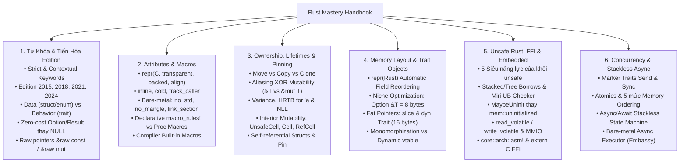

# RUST ADVANCED MASTERY HANDBOOK & SYSTEM REFERENCE
# Cẩm Nang Ôn Tập Chuyên Sâu Rust: Từ Khóa, Thuộc Tính `#[...]`, Borrow Checker, Memory Layout, Unsafe/FFI, Concurrency & Embedded Systems

> **Dành cho:** Kỹ sư Lập trình Hệ thống (Systems Programming), Lập trình Nhúng (Embedded / Bare-metal Rust), Linux Kernel Developer, và Kỹ sư Phần mềm chuyển dịch từ C/C++ sang làm chủ bản chất sâu của Rust.
> **Nguồn tham khảo tổng hợp:**
> - **Sách kinh điển:**
>   - *The Rust Programming Language ("The Book")* — Steve Klabnik & Carol Nichols.
>   - *Rust for Rustaceans: Idiomatic Programming for Experienced Developers* — Jon Gjengset.
>   - *Programming Rust: Fast, Safe Systems Development (2nd Edition)* — Jim Blandy, Jason Orendorff & Leonora F. S. Tindall.
>   - *Rust Atomics and Locks: Low-Level Concurrency in Practice* — Mara Bos.
>   - *The Rustonomicon: The Dark Arts of Unsafe Rust* — Đội ngũ phát triển Rust.
>   - *The Embedded Rust Book* — Rust Embedded Working Group.
> - **Mã nguồn dự án thực tế (Production Repositories):**
>   - *Rust Standard Library (`rust-lang/rust` - `core`, `alloc`, `std`)*
>   - *Rust for Linux (`Rust-for-Linux/linux` - `rust/kernel/`)*
>   - *Tokio Async Runtime (`tokio-rs/tokio`)*
>   - *Serde Serialization Framework (`serde-rs/serde`)*
>   - *Ripgrep (`BurntSushi/ripgrep`)*
>   - *Embassy Async Embedded Framework (`embassy-rs/embassy`) & TockOS (`tock/tock`)*

---

## 🗺️ Bản Đồ Tri Thức (Map of Content - MOC)



---

## 📚 Danh Mục Các Chuyên Đề Chi Tiết

Mỗi chuyên đề dưới đây được biên soạn toàn diện, kết nối chặt chẽ với kiến thức nền tảng từ [[00_C_Cpp_Mastery_Index|C/C++ Mastery Handbook]], đi sâu vào biểu diễn bộ nhớ cấp phần cứng, mã máy LLVM IR/Assembly, cạm bẫy Undefined Behavior và mổ xẻ trực tiếp mã nguồn của các dự án lớn:

1. **[[01_Keywords_and_Edition_Evolution|Chuyên đề 01: Toàn Bộ Từ Khóa Rust & Sự Tiến Hóa Qua Các Edition (2015 → 2024)]]**
   - Bảng phân loại toàn diện: Strict Keywords, Weak/Contextual Keywords và Reserved Keywords.
   - Giải phẫu chi tiết từng nhóm từ khóa: Ownership (`let`, `mut`, `ref`, `move`), Kiểu (`struct`, `enum`, `union`, `trait`, `impl`, `dyn`), Luồng điều khiển (`match`, `loop` trả về giá trị), Visibility (`pub(crate)`, `pub(in path)`), và Bất đồng bộ/An toàn (`async`, `await`, `unsafe`, `&raw const`).
   - Đối chiếu triết lý thiết kế C/C++ vs Rust: Tại sao Rust loại bỏ `null`, không dùng kế thừa `class`/`virtual` mà tách biệt hoàn toàn Data và Behavior.

2. **[[02_Attributes_Macros_and_Compiler_Intrinsics|Chuyên đề 02: Hệ Thống Thuộc Tính `#[...]`, Macros & Compiler Intrinsics]]**
   - Giải mã hệ thống Outer Attributes (`#[...]`) và Inner Attributes (`#![...]`): Vũ khí vượt xa `__attribute__((...))` của GCC/Clang.
   - Kiểm soát bố cục bộ nhớ cấp bit: `#[repr(C)]`, `#[repr(transparent)]`, `#[repr(packed)]` (cùng hiểm họa UB khi tạo tham chiếu lệch biên), `#[repr(align(N))]`, `#[repr(u8)]`.
   - Điều khiển Codegen, Linker & Bare-metal: `#[inline]`, `#[cold]`, `#[track_caller]`, `#![no_std]`, `#[no_mangle]`, `#[link_section]`, `#[used]`, `#[panic_handler]`, `#[must_use]`.
   - Hệ thống Macro vệ sinh (Hygienic Macros `macro_rules!`), Procedural Macros và mổ xẻ mã nguồn **Rust for Linux Kernel** & **Embassy/TockOS**.

3. **[[03_Ownership_Borrow_Checker_and_Lifetimes_Deep_Dive|Chuyên đề 03: Giải Phẫu Ownership, Borrow Checker, Lifetimes, Interior Mutability & Pinning]]**
   - Bản chất phần cứng của **Move Semantics vs Copy vs Clone** và quy tắc vàng **Aliasing XOR Mutability** (phiên bản cưỡng chế lúc biên dịch của từ khóa `restrict` trong C99).
   - Hệ thống **Lifetimes (`'a`, `'static`)**: Subtyping & Variance (Covariant, Invariant, Contravariant), Higher-Rank Trait Bounds (`for<'a>`) và Non-Lexical Lifetimes (NLL).
   - **Smart Pointers & Interior Mutability**: Từ `UnsafeCell<T>` (nguyên thủy duy nhất cho phép đột biến nội tại) đến `Cell<T>`, `RefCell<T>`, `Mutex<T>`, `RwLock<T>`, `OnceLock<T>`, `Cow<'a, B>`.
   - **Pinning (`Pin<P>` & `Unpin`)**: Giải quyết bài toán cấu trúc tự tham chiếu (Self-referential structs) và mổ xẻ mã nguồn **Tokio** & **Serde**.

4. **[[04_Memory_Layout_Trait_Objects_and_Zero_Cost_Abstractions|Chuyên đề 04: Bố Cục Bộ Nhớ, Niche Optimization, Fat Pointers & Đa Hình Zero-Cost]]**
   - Cơ chế **Struct Field Reordering** mặc định của `#[repr(Rust)]` tự động triệt tiêu Padding lãng phí so với C.
   - Tuyệt kỹ **Niche Optimization (Tối ưu hóa hốc trống)**: Tại sao `size_of::<Option<&T>>()` bằng đúng `size_of::<&T>()` (8 bytes) và cách thiết kế enum không tốn bộ nhớ phụ.
   - Giải phẫu **Fat Pointers (Con trỏ béo 16 bytes)**: Cấu trúc thanh ghi của `&[T]`, `&str` (`ptr + len`) và `&dyn Trait` (`ptr + vtable_ptr`).
   - So sánh **Static Dispatch (Monomorphization)** vs **Dynamic Dispatch (vtable)**, quy tắc Object Safety (Dyn Compatibility) và mổ xẻ mã nguồn **Ripgrep (`BurntSushi/ripgrep`)**.

5. **[[05_Unsafe_Rust_FFI_Inline_ASM_and_Embedded|Chuyên đề 05: Unsafe Rust, Undefined Behavior, FFI, Inline Assembly & Lập Trình Nhúng]]**
   - 5 siêu năng lực của khối `unsafe` và ranh giới đóng gói an toàn (Safe Abstraction over Unsafe Code).
   - Các luật **Undefined Behavior (UB)** khắt khe trong *The Rustonomicon*: Mô hình **Stacked Borrows / Tree Borrows**, kiểm chứng bằng **Miri**, và quản lý bộ nhớ chưa khởi tạo bằng **`MaybeUninit<T>`**.
   - Lập trình thanh ghi phần cứng MMIO với `read_volatile` / `write_volatile` (tại sao `volatile` trong Rust gắn với thao tác truy cập thay vì gắn vào kiểu biến như C).
   - **Inline Assembly (`core::arch::asm!`)**, Memory Barriers (`fence`, `compiler_fence`), giao tiếp song phương **FFI (`extern "C"`)** và mổ xẻ mã nguồn **Rust for Linux** & **SVD2Rust / Embedded HAL**.

6. **[[06_Concurrency_Async_and_Fearless_Systems_Programming|Chuyên đề 06: Đa Luồng Không Sợ Hãi (`Send`/`Sync`), Atomics & Stackless Async/Await]]**
   - Giải mã hai marker trait **`Send`** và **`Sync`**: Cách trình biên dịch chặn đứng Data Race ngay tại thời điểm compile.
   - **Atomics & 5 mức Memory Ordering** (*Rust Atomics and Locks* - Mara Bos): `Relaxed`, `Acquire`, `Release`, `AcqRel`, `SeqCst` và mối liên hệ với lệnh CPU x86/ARM.
   - Giải phẫu **Async/Await trong Rust**: Cơ chế biên dịch hàm `async fn` thành **Stackless State Machine (`enum`)** tốn 0 byte cấp phát Heap, chạy mượt trên vi điều khiển chỉ có vài KB RAM.
   - Mổ xẻ mã nguồn **Embassy (Embedded Async RTOS)** và **Tokio Work-Stealing Scheduler**.

7. **[[07_Recommended_Resources_Books_and_Repos|Chuyên đề 07: Thư Viện Tài Nguyên, Công Cụ Kiểm Chứng (Miri, Clippy, Expand) & GitHub Repos]]**
   - Lộ trình đọc sách chuyên sâu theo 4 tầng công lực.
   - Bộ công cụ phân tích & giải phẫu mã máy: `cargo miri`, `cargo clippy`, `cargo expand`, `cargo show-asm`.
   - Danh mục các GitHub Repositories mẫu mực cần nghiên cứu.

---

## 🧪 Phòng Thực Nghiệm (Code Lab)

Kèm theo cẩm nang là bộ 6 chương trình thực nghiệm tại thư mục [`code_lab/`](file:///home/thinh/Obsidian/Rust_Mastery_Handbook/code_lab/), được thiết kế độc lập (zero external dependencies) để biên dịch trực tiếp bằng `rustc` (Edition 2021/2024) thông qua `Makefile`:

- [`01_memory_layout_and_niche.rs`](file:///home/thinh/Obsidian/Rust_Mastery_Handbook/code_lab/01_memory_layout_and_niche.rs): Kiểm chứng `#[repr(Rust)]` tự động đảo trường tối ưu padding so với `#[repr(C)]`, và chứng minh Niche Optimization (`size_of::<Option<&u32>>() == 8`).
- [`02_ownership_and_interior_mutability.rs`](file:///home/thinh/Obsidian/Rust_Mastery_Handbook/code_lab/02_ownership_and_interior_mutability.rs): Thực nghiệm quy tắc Borrowing, đột biến nội tại với `Cell<T>`, `RefCell<T>` và chia sẻ quyền sở hữu qua `Rc<T>` / `Arc<T>`.
- [`03_repr_packed_and_volatile.rs`](file:///home/thinh/Obsidian/Rust_Mastery_Handbook/code_lab/03_repr_packed_and_volatile.rs): Giải phẫu `#[repr(packed)]` với toán tử `&raw const` (tránh UB unaligned reference) và mô phỏng truy cập thanh ghi ngoại vi MMIO bằng `read_volatile` / `write_volatile`.
- [`04_fat_pointers_and_dispatch.rs`](file:///home/thinh/Obsidian/Rust_Mastery_Handbook/code_lab/04_fat_pointers_and_dispatch.rs): Giải phẫu cấu trúc bộ nhớ 16-byte của Fat Pointers (`&[T]`, `&dyn Trait`) và so sánh Static Dispatch vs Dynamic Dispatch.
- [`05_maybe_uninit_and_unsafe_ffi.rs`](file:///home/thinh/Obsidian/Rust_Mastery_Handbook/code_lab/05_maybe_uninit_and_unsafe_ffi.rs): Kỹ thuật khởi tạo mảng từng phần an toàn không tốn chi phí bằng `MaybeUninit<T>` và giao tiếp hàm chuẩn ABI `extern "C"`.
- [`06_fearless_concurrency_atomics.rs`](file:///home/thinh/Obsidian/Rust_Mastery_Handbook/code_lab/06_fearless_concurrency_atomics.rs): Thực nghiệm đa luồng an toàn với `std::thread::scope` (mượn biến cục bộ sang nhiều thread không cần `Arc`!), bộ đếm Lock-free `AtomicUsize` và `Mutex<T>`.

### Hướng dẫn chạy thực nghiệm:
```bash
cd /home/thinh/Obsidian/Rust_Mastery_Handbook/code_lab
make run     # Biên dịch toàn bộ 6 bài lab với rustc -O và chạy kiểm chứng
make clean   # Dọn dẹp toàn bộ file thực thi nhị phân
```
