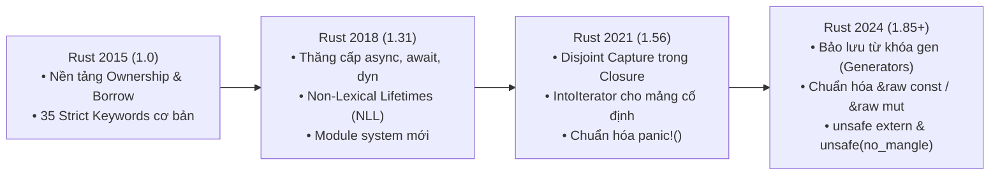
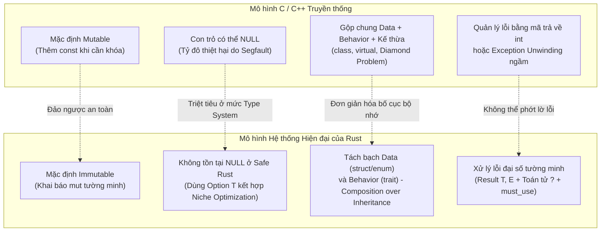

# CHUYÊN ĐỀ 01: TOÀN BỘ TỪ KHÓA RUST & SỰ TIẾN HÓA QUA CÁC EDITION (2015 → 2024)

> Thuộc bộ cẩm nang: [[00_Rust_Mastery_Index|Rust Mastery Handbook]]
> Tham chiếu đối sánh: [[01_Keywords_Evolution_C89_to_C23|Chuyên đề 01 (C/C++): Toàn Bộ Từ Khóa ANSI/ISO C & C++]]

---

## 1. Cơ Chế Edition Của Rust: Tiến Hóa Không Phá Vỡ Tương Thích Ngược

Trong C/C++, mỗi khi chuẩn mới (như C99 hay C11) muốn thêm một từ khóa mới, ủy ban ISO buộc phải dùng tên kỳ dị bắt đầu bằng dấu gạch dưới và chữ hoa (như `_Bool`, `_Atomic`, `_Generic`) để không làm hỏng các dự án cũ đã lỡ đặt tên biến là `bool` hay `atomic`.

Rust giải quyết triệt để bài toán này bằng cơ chế **Editions (Phiên bản thế hệ: 2015, 2018, 2021, 2024)** kết hợp với **Raw Identifiers (`r#ident`)**:
- Mỗi crate khai báo `edition = "2024"` trong `Cargo.toml`. Trình biên dịch `rustc` hỗ trợ liên kết (link) các crate ở mọi Edition khác nhau trong cùng một chương trình nhị phân!
- Nếu một crate ở Edition 2015 có hàm tên là `async`, crate ở Edition 2024 (nơi `async` đã là từ khóa bắt buộc) vẫn gọi được hàm đó bằng cú pháp **Raw Identifier**: `r#async()`.



---

## 2. Phân Loại Toàn Diện Hệ Thống Từ Khóa Trong Rust

Hệ thống từ vựng (Lexical grammar) của Rust chia từ khóa thành **3 cấp độ**:
1. **Strict Keywords (Từ khóa nghiêm ngặt):** Chỉ được dùng đúng ngữ nghĩa của ngôn ngữ, cấm đặt làm tên biến/hàm/kiểu (trừ khi dùng `r#`).
2. **Reserved Keywords (Từ khóa dự phòng):** Chưa có tính năng hoàn chỉnh hoặc đang được bảo lưu cho tương lai, nhưng **cấm** người dùng đặt làm tên định danh để đảm bảo nâng cấp mượt mà.
3. **Weak / Contextual Keywords (Từ khóa ngữ cảnh):** Chỉ mang ý nghĩa đặc biệt ở một số vị trí cú pháp nhất định (ví dụ `raw`, `union`, `macro_rules`, `'static`). Ở vị trí khác, bạn vẫn có thể đặt tên biến là `let union = 5;` hoặc `let raw = 10;`.

---

## 3. Giải Phẫu Chi Tiết Các Nhóm Từ Khóa Nghiêm Ngặt (Strict Keywords)

### 3.1. Nhóm Ownership, Khai Báo Biến & Tham Chiếu (`let`, `mut`, `ref`, `move`, `static`, `const`)

| Từ khóa | Ngữ nghĩa & Cơ chế hoạt động | Điểm đặc biệt & Cạm bẫy cần nhớ |
| :--- | :--- | :--- |
| **`let`** | Ràng buộc giá trị vào một Pattern (Pattern binding) và khởi tạo biến cục bộ trên Stack. | Mặc định mọi biến `let x = 5;` đều là **Immutable (bất biến)**! `let` còn hỗ trợ destructuring: `let (a, b) = (1, 2);` và `let-else`: `let Some(v) = opt else { return; };`. |
| **`mut`** | Cấp quyền thay đổi giá trị (Mutability) cho biến, tham chiếu (`&mut T`), hoặc con trỏ (`*mut T`). | Trong Rust, `mut` không chỉ là "cho phép ghi" mà trên tham chiếu `&mut T`, nó mang cam kết **Độc quyền truy cập (Exclusive Access / No Aliasing)**. |
| **`ref`** | Mượn tham chiếu ngay bên trong một nhánh Pattern Matching thay vì Move giá trị. | Ví dụ: `match maybe_name { Some(ref name) => println!("{name}"), None => {} }`. Từ Rust 2018, cơ chế *Match Ergonomics* cho phép match trực tiếp trên `&maybe_name` để tự suy diễn `ref`. |
| **`move`** | Cưỡng bức Closure hoặc khối `async move` **chiếm quyền sở hữu (Move ownership)** các biến bên ngoài vào trong bản thân nó. | Cần thiết khi trả về một Closure ra khỏi hàm hoặc gửi Closure sang một thread mới (`std::thread::spawn(move || { ... })`) để tránh tham chiếu treo (Dangling reference) tới Stack cũ. |
| **`const`** | Hằng số biên dịch (Compile-time constant) hoặc hàm thực thi lúc biên dịch (`const fn`). | **`const` KHÔNG có địa chỉ bộ nhớ cố định!** Nó được inline trực tiếp vào vị trí sử dụng (tương tự `#define` có kiểm kiểu hoặc `constexpr` trong C++). |
| **`static`** | Biến toàn cục có địa chỉ bộ nhớ cố định trong suốt thời gian chạy chương trình (nằm ở `.rodata`, `.data` hoặc `.bss`). | Cũng là tên của lifetime dài nhất `'static`. Biến `static mut` cực kỳ nguy hiểm (dễ gây Data Race) nên mọi truy cập vào `static mut` bắt buộc phải nằm trong khối `unsafe`. |

> [!TIP] Phân biệt nhanh `let x: &mut T` và `let mut x: &mut T`
> - `let x: &mut i32 = &mut val;`: Bản thân con trỏ tham chiếu `x` là cố định (không thể trỏ sang biến khác), nhưng giá trị vùng nhớ nó trỏ tới (`*x = 10;`) thì **thay đổi được**. (Tương đương `int * const x` trong C).
> - `let mut x: &i32 = &val;`: Bản thân `x` có thể đổi hướng trỏ sang biến khác (`x = &other;`), nhưng giá trị vùng nhớ nó trỏ tới thì **chỉ đọc**. (Tương đương `const int * x` trong C).

---

### 3.2. Nhóm Kiểu Dữ Liệu, Cấu Trúc & Đa Hình (`struct`, `enum`, `union`, `trait`, `impl`, `type`, `dyn`, `Self`, `self`, `where`)

| Từ khóa | Ngữ nghĩa & Cơ chế hoạt động | Đối chiếu với C/C++ |
| :--- | :--- | :--- |
| **`struct`** | Kiểu dữ liệu tích (Product Type) gom nhóm các trường dữ liệu. Có 3 dạng: Named-field struct, Tuple struct `struct Meters(f64);`, và Unit-like struct `struct Marker;`. | Khác C++, `struct` của Rust **không có kế thừa (`: public Base`)**. Unit struct có kích thước bằng **0 byte (Zero-Sized Type - ZST)**! |
| **`enum`** | Kiểu dữ liệu tổng (Sum Type / Tagged Union / Algebraic Data Type). Mỗi biến thể (variant) có thể mang theo dữ liệu có kiểu và kích thước hoàn toàn khác nhau! | Trong C, `enum` chỉ là tập hằng số nguyên. Trong Rust, `enum` là một `struct` kết hợp giữa nhãn phân biệt (`discriminant tag`) và `union` an toàn kiểu tuyệt đối. |
| **`union`** | (Contextual keyword) Các trường chia sẻ cùng một vùng nhớ vật lý, không có tag theo dõi biến thể nào đang hoạt động. | Chỉ dùng để giao tiếp FFI với C hoặc tiết kiệm bộ nhớ cực hạn. Đọc trường của `union` luôn bắt buộc phải đặt trong khối `unsafe`. |
| **`trait`** | Định nghĩa một giao diện hành vi chung (Shared Behavior / Typeclass), bao gồm chữ ký phương thức, Associated Types và Associated Constants. | Thay thế hoàn toàn cho Abstract Class (Pure virtual class) và C++20 `concept`. |
| **`impl`** | Khối triển khai phương thức nội tại (`impl MyStruct`) hoặc triển khai một Trait cho một kiểu (`impl MyTrait for MyStruct`). | Cho phép tách rời hoàn toàn phần khai báo dữ liệu (`struct`) và phần định nghĩa hành vi (`impl`). |
| **`type`** | Tạo bí danh cho kiểu (Type alias: `type Result<T> = std::result::Result<T, MyError>;`) hoặc khai báo Associated Type trong Trait. | Tương đương `typedef` trong C hoặc `using` trong C++11. Lưu ý: `type` không tạo kiểu mới phân biệt như Newtype `struct`. |
| **`dyn`** | (Từ Edition 2018) Tiền tố bắt buộc để chỉ định một **Trait Object (Đa hình động qua bảng hàm ảo vtable)**, ví dụ: `&dyn Write`, `Box<dyn Error>`. | Trước Edition 2018, người ta viết `&Write` gây nhầm lẫn giữa kiểu cụ thể và Trait. `dyn` giúp lập trình viên nhìn thấy ngay chi phí con trỏ béo (Fat pointer) và vtable dispatch. |
| **`self`** | Tham số đầu tiên của phương thức đại diện cho thực thể đang gọi (`self`, `&self`, `&mut self`, `self: Box<Self>`, `self: Pin<&mut Self>`), hoặc đại diện cho module hiện tại trong `use self::submodule;`. | Tương đương con trỏ ẩn `this` trong C++, nhưng trong Rust nó được khai báo **tường minh** ngay ở chữ ký hàm để thể hiện rõ quyền Ownership/Borrowing! |
| **`Self`** | Bí danh kiểu (Type alias) viết hoa chữ `S`, đại diện cho chính kiểu dữ liệu đang được `impl` hoặc định nghĩa trong `trait`. | Giúp viết code không lặp lại tên kiểu và là nền tảng để ngăn chặn các phương thức không an toàn cho vtable (Object Safety). |
| **`where`** | Mệnh đề tách riêng các ràng buộc Generic (Trait bounds & Lifetime bounds) ra cuối chữ ký hàm/struct để dễ đọc và biểu đạt các ràng buộc phức tạp. | Tương đương mệnh đề `requires` trong C++20 Concepts. |

---

### 3.3. Nhóm Luồng Điều Khiển & Pattern Matching (`match`, `if`, `else`, `loop`, `while`, `for`, `in`, `break`, `continue`, `return`)

Trong Rust, hầu hết các cấu trúc điều khiển (`if`, `match`, `loop`, khối `{ ... }`) đều là **Biểu thức (Expression)** trả về giá trị, chứ không chỉ là câu lệnh (Statement) như trong C!

```rust
// 1. if-else là một Expression (thay thế hoàn toàn toán tử 3 ngôi ? : của C)
let status_code = if is_ready { 200 } else { 503 };

// 2. loop hỗ trợ trả về giá trị trực tiếp qua `break` và thoát nhiều vòng lặp bằng Labeled Break ('label:)
let found_item = 'outer: loop {
    for row in matrix {
        for item in row {
            if item.is_target() {
                break 'outer Some(item); // Thoát thẳng khỏi vòng loop ngoài cùng VÀ trả về giá trị!
            }
        }
    }
    break None;
};
```

| Từ khóa | Điểm tinh hoa trong thiết kế của Rust |
| :--- | :--- |
| **`match`** | Đối sánh mẫu vét cạn (**Exhaustive Pattern Matching**). Trình biên dịch kiểm tra toán học đảm bảo bạn đã xử lý **100% mọi trường hợp có thể xảy ra** của `enum` hoặc giá trị. Không bao giờ có chuyện "quên `break`" gây lỗi Fallthrough như `switch-case` của C! |
| **`if` / `else`** | Ngoài điều kiện `bool` (Rust cấm ép kiểu ngầm định số nguyên `if (1)` sang `bool`), còn kết hợp với `let` tạo thành `if let Some(x) = opt { ... }` hoặc `let ... else { ... }` để giải nén pattern cực gọn. |
| **`loop`** | Vòng lặp vô tận nguyên bản. Tốt hơn `while true` vì trình biên dịch biết chắc chắn ở mức Control Flow Graph rằng vòng lặp chỉ có thể thoát qua `break` (giúp suy luận biến được khởi tạo chính xác). |
| **`while`** | Vòng lặp có điều kiện (`while cond`) hoặc lặp chừng nào pattern còn khớp (`while let Some(item) = iter.next()`). |
| **`for` ... `in`** | Không dùng cú pháp 3 thành phần `for(i=0; i<n; i++)` dễ lỗi tràn mảng (off-by-one) của C. Mọi vòng `for x in collection` trong Rust đều biến đổi thành lời gọi `IntoIterator::into_iter(collection)` và tối ưu hóa triệt tiêu kiểm tra biên (Bounds check elision). |
| **`break` / `continue`** | Hỗ trợ nhảy tới nhãn `'label` cụ thể (giải quyết hoàn toàn nhu cầu dùng `goto` thoát vòng lặp lồng nhau trong C). Từ Rust 1.65, `break 'block_label val;` còn dùng được cho cả khối lệnh thường `'block_label: { ... }`! |
| **`return`** | Trả về sớm từ hàm. Ở dòng cuối cùng của hàm, Rust khuyến khích viết biểu thức trả về không có dấu `;` thay vì viết `return`. |
| **`true` / `false`** | Hai hằng giá trị nguyên bản của kiểu logic `bool` (kích thước 1 byte, chỉ mang bit pattern `0x00` hoặc `0x01` — tạo ra 254 giá trị Niche cho trình biên dịch tối ưu!). |

---

### 3.4. Nhóm Module, Tầm Vực & Liên Kết (`mod`, `pub`, `use`, `as`, `crate`, `super`, `extern`)

Rust loại bỏ hoàn toàn mô hình `#include` copy-paste văn bản gây chậm tốc độ biên dịch và lỗi trùng lặp macro của C/C++. Đơn vị biên dịch (Translation Unit) của Rust không phải là từng file `.rs`, mà là toàn bộ một **Crate**!

| Từ khóa | Ngữ nghĩa & Cơ chế hoạt động |
| :--- | :--- |
| **`mod`** | Khai báo một module con (không gian tên - namespace). Có thể viết nội tuyến `mod net { ... }` hoặc trỏ tới file `net.rs` / `net/mod.rs`. Mặc định mọi thứ trong module đều là **Private (riêng tư)** đối với thế giới bên ngoài! |
| **`pub`** | Mở quyền truy cập công khai. Rust cung cấp khả năng kiểm soát tầm vực chi tiết đến từng tầng cây thư mục:<br/>• `pub`: Công khai toàn bộ.<br/>• `pub(crate)`: Chỉ công khai trong nội bộ Crate hiện tại (rất hữu ích khi viết thư viện).<br/>• `pub(super)`: Chỉ công khai cho module cha trực tiếp.<br/>• `pub(in crate::path::to::mod)`: Chỉ công khai cho một nhánh module được chỉ định. |
| **`use`** | Đưa đường dẫn định danh vào phạm vi hiện tại để gọi ngắn gọn (ví dụ `use std::collections::HashMap;`). |
| **`as`** | Đổi tên định danh khi `use` (`use std::io::Result as IoResult;`), ép kiểu nguyên thủy (`x as u64`), hoặc chỉ định Trait rõ ràng (`<MyType as MyTrait>::func()`). |
| **`crate`** | Đại diện cho gốc (root) của Crate hiện tại trong đường dẫn tuyệt đối: `use crate::config::Settings;`. |
| **`super`** | Đại diện cho module cha trực tiếp (tương đương `..` trong hệ thống file): `use super::helper_fn;`. |
| **`extern`** | Liên kết với thư viện ngoài hoặc chỉ định chuẩn gọi hàm ABI (Application Binary Interface), ví dụ `extern "C" fn callback()`. Trong Rust 2024, khối khai báo hàm C bên ngoài bắt buộc phải viết là `unsafe extern "C" { ... }` để nhấn mạnh rằng chữ ký hàm ngoại lai do lập trình viên tự cam kết tính đúng đắn. |

---

### 3.5. Nhóm Bất Đồng Bộ, An Toàn & Con Trỏ Thô (`async`, `await`, `unsafe`, `raw`)

| Từ khóa | Edition ra mắt | Bản chất kỹ thuật |
| :--- | :--- | :--- |
| **`async`** | 2018 | Biến một hàm (`async fn`) hoặc khối lệnh (`async { ... }`) thành một bộ sinh trả về đối tượng triển khai `core::future::Future`. Bản chất bên dưới được compiler dịch thành một **State Machine (`enum`)** không tốn cấp phát Heap. |
| **`await`** | 2018 | Điểm tạm dừng (Suspension point) bên trong khối `async`. Cú pháp hậu tố `future.await` (thay vì tiền tố `await future` như JS/C#) giúp nối chuỗi phương thức cực đẹp: `client.send_request().await?.parse_json().await?`. |
| **`unsafe`** | 2015 | Mở khóa 5 thao tác cấp thấp mà trình biên dịch không thể tự chứng minh tính an toàn bộ nhớ (Dereference raw pointer, gọi `unsafe fn`, truy cập `static mut`, implement `unsafe trait`, đọc trường `union`). Lưu ý: **`unsafe` KHÔNG tắt Borrow Checker!** |
| **`raw`** | Contextual (Chuẩn hóa 2024) | Đi kèm với `&raw const expr` và `&raw mut expr` (thay thế macro `core::ptr::addr_of!` / `addr_of_mut!`). Cho phép lấy địa chỉ con trỏ thô (`*const T` / `*mut T`) trực tiếp tới vùng nhớ chưa căn chỉnh (`#[repr(packed)]`) hoặc chưa khởi tạo mà **không tạo tham chiếu trung gian `&T`** (tránh dính lỗi Undefined Behavior!). |

---

## 4. Bảng Từ Khóa Dự Phòng (Reserved Keywords) Qua Các Edition

Tại sao Rust lại giữ một danh sách các từ khóa chưa dùng đến? Để bảo vệ không gian tên cho các tính năng tương lai của ngôn ngữ:

| Từ khóa dự phòng | Edition bắt đầu bảo lưu | Mục đích thiết kế / Trạng thái hiện tại |
| :--- | :--- | :--- |
| **`gen`** | **Edition 2024** | Dùng cho **Generator blocks (`gen { yield 1; }`)** và hàm sinh trả về `Iterator` một cách tự nhiên mà không cần tự viết struct lưu trạng thái. |
| **`try`** | **Edition 2018** | Bảo lưu cho khối `try { ... }` — giúp gom nhóm các phép toán dùng toán tử `?` trong một phạm vi cục bộ mà không cần tách thành hàm riêng. |
| **`yield`** | Edition 2015 | Dùng bên trong khối `gen` / Coroutines để tạm dừng và nhả giá trị tiếp theo. |
| **`box`** | Edition 2015 | Cú pháp nội bộ của compiler để khởi tạo trực tiếp trên Heap (Placement new) và giải cấu trúc `Box<T>` trong pattern. |
| **`macro`** | Edition 2015 | Bảo lưu cho hệ thống Declarative Macros 2.0 (`pub macro my_macro(...)`) có quy tắc phân quyền module chuẩn như hàm. |
| **`become`** | Edition 2015 | Bảo lưu cho tính năng **Guaranteed Tail Call Elimination (TCO)** — nhảy trực tiếp sang hàm tiếp theo mà không làm tăng kích thước Stack frame. |
| **`do`**, **`abstract`**, **`final`**, **`override`**, **`priv`**, **`typeof`**, **`unsized`**, **`virtual`** | Edition 2015 | Bảo lưu từ thời kỳ đầu của Rust để phòng ngừa lập trình viên C++/Java mang thói quen đặt tên sang hoặc dành cho mở rộng hệ thống kiểu tương lai. |

---

## 5. Đối Chiếu Triết Lý Thiết Kế Sâu Sắc: C/C++ vs Rust

Để thực sự làm chủ Rust, kỹ sư hệ thống cần hiểu rõ **tại sao** Rust lại từ bỏ những mô hình quen thuộc của C và C++:



### 5.1. Tại sao Rust không có `null` (Và tại sao `Option<T>` không hề chậm hơn)?
Nhà khoa học máy tính Tony Hoare (cha đẻ của tham chiếu `NULL` năm 1965) từng gọi `NULL` là **"Sai lầm tỷ đô" (The Billion-Dollar Mistake)**. Trong C/C++, mọi con trỏ `T*` đều ngầm định mang 2 trạng thái: hoặc trỏ tới một địa chỉ hợp lệ, hoặc bằng `0x0` (`NULL`). Trình biên dịch C không bắt buộc bạn phải `if (ptr != NULL)` trước khi viết `*ptr`.

Trong Safe Rust:
- Một tham chiếu `&T` hoặc `&mut T` **được trình biên dịch đảm bảo 100% không bao giờ là Null**.
- Khi một giá trị *có thể vắng mặt*, bạn bắt buộc phải thể hiện điều đó trên hệ thống kiểu bằng `Option<T>`:
  ```rust
  pub enum Option<T> {
      None,
      Some(T),
  }
  ```
- **Không thể quên kiểm tra:** Bạn không thể gọi phương thức của `T` trên một `Option<T>` nếu chưa giải nén nó qua `match`, `if let`, hoặc `.unwrap_or(...)`.
- **Chi phí bộ nhớ bằng 0 (Zero-Cost Niche Optimization):** Nhờ việc `&T` không bao giờ bằng `0`, trình biên dịch Rust tự động dùng chính địa chỉ `0x0` để biểu diễn nhánh `Option::None`! Do đó, `size_of::<Option<&T>>()` bằng đúng `size_of::<&T>()` (8 bytes trên hệ 64-bit), sinh ra mã máy kiểm tra `test rdi, rdi` y hệt như kiểm tra `ptr != NULL` trong C! (Xem chi tiết tại [[04_Memory_Layout_Trait_Objects_and_Zero_Cost_Abstractions]]).

### 5.2. Tại sao Rust không có `class`, `extends` hay `virtual` (Kế thừa dữ liệu)?
Trong C++, khi lớp `Derived` kế thừa từ nhiều lớp `Base1`, `Base2` có phương thức `virtual`, trình biên dịch phải nhúng nhiều con trỏ ẩn `vptr` vào ngay bên trong bố cục bộ nhớ của đối tượng `Derived`, gây ra:
1. Bố cục bộ nhớ của đối tượng bị phình to ngầm và phụ thuộc vào ABI phức tạp của trình biên dịch.
2. Bài toán **Object Slicing** khi truyền đối tượng lớp con theo giá trị vào hàm nhận lớp cha.
3. Ràng buộc cứng nhắc giữa cấu trúc dữ liệu và phân cấp kế thừa.

**Giải pháp của Rust — Tách bạch hoàn toàn Dữ liệu (`struct`/`enum`) và Hành vi (`trait`):**
- Một `struct` trong Rust chỉ chứa thuần túy các trường dữ liệu của chính nó (không bao giờ có con trỏ `vptr` ẩn bên trong `struct`!).
- Khi bạn cần đa hình tĩnh (Static Polymorphism), bạn dùng Generics với Trait bounds (`fn process<T: Sensor>(s: &T)`), compiler sẽ sinh mã chuyên biệt hóa (Monomorphization) nhanh tối đa.
- Khi bạn thực sự cần đa hình động (Dynamic Polymorphism qua bảng hàm ảo `vtable`), con trỏ tới `vtable` không nằm trong `struct`, mà nằm cạnh con trỏ dữ liệu tạo thành một **Fat Pointer (`&dyn Sensor` = 16 bytes: `[data_ptr, vtable_ptr]`)**! Cùng một `struct` có thể được truyền trực tiếp qua FFI sang C với kích thước gọn nhẹ, vừa có thể khoác lên mình hàng chục `trait` khác nhau mà không tốn thêm 1 byte bộ nhớ nào trong `struct`!

---

## 6. Mổ Xẻ Mã Nguồn Thực Tế: Cách Thư Viện Chuẩn Rust & Linux Kernel Tổ Chức Module và Từ Khóa

### 6.1. Tổ chức Quyền Truy Cập Tinh Vi với `pub(crate)` trong `tokio`
Trong mã nguồn của [`tokio-rs/tokio`](https://github.com/tokio-rs/tokio), các kỹ sư hệ thống phải chia sẻ hàng trăm cấu trúc nội bộ giữa bộ lập lịch (`runtime::scheduler`), bộ quản lý I/O (`net::driver`) và bộ đếm thời gian (`time::wheel`), nhưng tuyệt đối không được để lộ các API nội bộ này ra ngoài cho người dùng cuối (vì sẽ làm cứng nhắc SemVer).

Họ sử dụng triệt để `pub(crate)` và `pub(super)`:
```rust
// Trích dẫn mô phỏng kiến trúc từ tokio/src/runtime/scheduler/multi_thread/worker.rs
pub(crate) struct Worker {
    /// Chỉ các module bên trong crate `tokio` mới nhìn thấy trường `run_queue`
    pub(super) run_queue: Queue<Arc<Handle>>,
    pub(crate) core: AtomicCell<Core>,
}

impl Worker {
    // Hàm này khả dụng khắp nội bộ crate tokio, nhưng vô hình với người dùng thư viện
    pub(crate) fn launch(self) { ... }
}
```

### 6.2. Sử dụng `&raw const` / `&raw mut` trong **Rust for Linux Kernel**
Khi làm việc với các cấu trúc dữ liệu của nhân Linux (như `struct list_head` tự trỏ vòng quanh hoặc các cấu trúc chưa được khởi tạo hoàn toàn), việc dùng toán tử tham chiếu thông thường `& (*ptr).field` trong Rust có thể ngay lập tức vi phạm luật Aliasing hoặc luật tham chiếu tới vùng nhớ chưa khởi tạo.

Trong mã nguồn `rust/kernel/list.rs` của Linux Kernel hiện đại (Edition 2024), toán tử lấy địa chỉ thô `&raw mut` được dùng để thao tác trực tiếp trên con trỏ mà không bao giờ tạo ra tham chiếu `&mut` trung gian:

```rust
// Mẫu thiết kế từ Rust for Linux: Khởi tạo intrusive list node bằng &raw mut
#[repr(C)]
pub struct ListLinks {
    pub next: *mut ListLinks,
    pub prev: *mut ListLinks,
}

pub unsafe fn init_list_head(head: *mut ListLinks) {
    // Dùng &raw mut để lấy địa chỉ trường mà KHÔNG tạo tham chiếu &mut ListLinks
    // (Vì tại thời điểm này, các trường bên trong `*head` có thể đang chứa rác chưa khởi tạo!)
    unsafe {
        (&raw mut (*head).next).write(head);
        (&raw mut (*head).prev).write(head);
    }
}
```

> [!IMPORTANT] Tổng kết Chuyên đề 01
> Hệ thống từ khóa của Rust được thiết kế với sự kỷ luật toán học: mỗi từ khóa (`mut`, `move`, `dyn`, `async`, `unsafe`, `raw`) đều phản ánh trực tiếp một cam kết về quyền sở hữu bộ nhớ, cơ chế gọi hàm hoặc mô hình thực thi của CPU. Tiếp theo, tại [[02_Attributes_Macros_and_Compiler_Intrinsics|Chuyên đề 02]], chúng ta sẽ khám phá thế giới của các thuộc tính `#[...]` và hệ thống Macro giúp điều khiển trình biên dịch ở mức sâu nhất.
