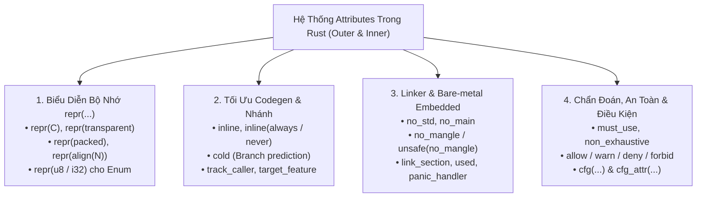

# CHUYÊN ĐỀ 02: HỆ THỐNG THUỘC TÍNH `#[...]`, MACROS & COMPILER INTRINSICS

> Thuộc bộ cẩm nang: [[00_Rust_Mastery_Index|Rust Mastery Handbook]]
> Tham chiếu đối sánh: [[03_Special_Syntax_and_GCC_Attributes|Chuyên đề 03 (C/C++): Các Cú Pháp Đặc Biệt & GCC Attributes]] & [[04_Compiler_Builtins_and_Intrinsics|Chuyên đề 04 (C/C++): Compiler Built-ins & Hardware Intrinsics]]

---

## 1. Kiến Trúc Thuộc Tính Trong Rust: Outer (`#[...]`) vs Inner (`#![...]`)

Trong C/C++ hệ thống, lập trình viên phải dùng cú pháp mở rộng không chuẩn của GCC/Clang như `__attribute__((packed, aligned(4)))` hoặc `#pragma pack`. Trong Rust, toàn bộ các chỉ thị điều khiển trình biên dịch, bố cục bộ nhớ, linker và chẩn đoán đều được chuẩn hóa thống nhất dưới dạng **Attributes**:

1. **Outer Attribute (`#[attr]`)**: Áp dụng cho phần tử đứng **ngay phía sau** nó (`struct`, `enum`, `fn`, trường dữ liệu, hoặc biểu thức).
2. **Inner Attribute (`#![attr]`)**: Có thêm dấu chấm than `!`, áp dụng cho **bản thân khối bao chứa nó** (thường đặt ở đầu file `lib.rs` / `main.rs` để áp dụng cho toàn bộ Crate như `#![no_std]`, `#![deny(unsafe_op_in_unsafe_fn)]`).



---

## 2. Điều Khiển Biểu Diễn Bộ Nhớ Cấp Độ Bit (`#[repr(...)]`)

Mặc định, mọi `struct` và `enum` trong Rust mang thuộc tính ngầm định `#[repr(Rust)]` — cho phép trình biên dịch tự do đảo vị trí các trường để tối ưu hóa bộ nhớ (sẽ phân tích sâu tại [[04_Memory_Layout_Trait_Objects_and_Zero_Cost_Abstractions]]). Khi giao tiếp với phần cứng (MMIO, DMA), giao thức mạng, hoặc gọi hàm C qua FFI, ta bắt buộc phải khóa chặt bố cục bộ nhớ bằng `#[repr(...)]`:

### 2.1. `#[repr(C)]` — Tương Thích Chuẩn ABI Của Ngôn Ngữ C
Giữ nguyên 100% thứ tự các trường như lúc khai báo và áp dụng đúng quy tắc căn chỉnh tự nhiên (Natural Alignment & Padding) của trình biên dịch C trên kiến trúc đích:
```rust
#[repr(C)]
pub struct DmaDescriptor {
    pub ctrl_flags: u8,     // Offset 0 (1 byte) + 3 bytes padding
    pub transfer_len: u32,  // Offset 4 (4 bytes)
    pub src_addr: u64,      // Offset 8 (8 bytes)
} // Tổng kích thước: 16 bytes, Alignment: 8 bytes (Giống hệt struct C!)
```

### 2.2. `#[repr(transparent)]` — Vũ Khí Tối Thượng Cho Newtype Pattern Zero-Cost
Chỉ áp dụng cho `struct` hoặc `enum` đơn biến thể có **duy nhất 1 trường dữ liệu có kích thước khác 0 (Non-zero-sized field)** (có thể kèm theo tùy ý các trường Zero-Sized Types như `PhantomData<T>`).
- **Cam kết phần cứng:** Không chỉ có cùng `size` và `alignment`, mà **ABI truyền tham số qua thanh ghi CPU (Calling Convention)** của struct bọc ngoài được đảm bảo giống hệt 100% kiểu dữ liệu lõi bên trong!
- Ví dụ: Nếu bọc `u32` trong một `struct FileDescriptor(u32)` có `#[repr(transparent)]`, khi truyền `FileDescriptor` qua hàm `extern "C"`, nó được truyền thẳng trong thanh ghi `edi`/`rdi` y hệt một số `u32` nguyên thủy, chứ không bị coi là struct tổng hợp!

```rust
use core::marker::PhantomData;

pub struct Millimeters;
pub struct Inches;

#[repr(transparent)]
pub struct Length<Unit>(f64, PhantomData<Unit>);
// Kích thước đúng 8 bytes, truyền qua thanh ghi dấu phẩy động xmm0 y hệt f64,
// nhưng trình biên dịch cấm cộng nhầm Length<Millimeters> với Length<Inches>!
```

### 2.3. `#[repr(packed)]` và `#[repr(packed(N))]` — Triệt Tiêu Padding & Cạm Bẫy Chết Người
Tương đương `__attribute__((packed))` hoặc `#pragma pack(N)` trong C: ép Alignment của struct xuống `1` (hoặc `N`), xóa bỏ toàn bộ các byte đệm (Padding) giữa các trường.

> [!CAUTION] CẠM BẪY UNDEFINED BEHAVIOR (UB) KHẮT KHE NHẤT CỦA `#[repr(packed)]` TRONG RUST!
> Trong Rust, mọi tham chiếu `&T` và `&mut T` **BẮT BUỘC PHẢI ĐƯỢC CĂN CHỈNH ĐÚNG BIÊN TỰ NHIÊN (Properly Aligned)** ở mọi thời điểm tồn tại, ngay cả khi bạn chưa đọc/ghi hay đang chạy trên CPU x86_64 hỗ trợ unaligned load!
> Do đó, việc lấy tham chiếu tới một trường nằm lệch biên bên trong packed struct (`let p = &packed_pkt.unaligned_u32;`) là **Undefined Behavior tức thì** (và đã bị `rustc` chặn thành lỗi biên dịch cứng `error[E0793]`)!

**Cách xử lý chuẩn xác:**
1. **Copy giá trị ra biến cục bộ:** `let val = packed_pkt.unaligned_u32;` (Hợp lệ 100%, compiler tự sinh lệnh đọc từng byte hoặc unaligned load).
2. **Dùng toán tử lấy địa chỉ thô `&raw const` / `&raw mut` (hoặc `core::ptr::addr_of!`):**
```rust
#[repr(C, packed)]
struct NetworkHeader {
    version: u8,       // Offset 0 (1 byte)
    payload_len: u32,  // Offset 1 (4 bytes - LỆCH BIÊN 4-BYTE!)
}

fn inspect_header(hdr: &NetworkHeader) -> u32 {
    // SAI LẦM CHẾT NGƯỜI (Bị cấm): let r: &u32 = &hdr.payload_len;
    
    // CÁCH 1 (Khuyên dùng): Copy trực tiếp ra biến trên stack (đã căn chỉnh)
    let len_copy = hdr.payload_len;

    // CÁCH 2 (Khi cần con trỏ): Dùng &raw const + read_unaligned()
    let raw_ptr: *const u32 = &raw const hdr.payload_len;
    let len_via_ptr = unsafe { raw_ptr.read_unaligned() };
    
    debug_assert_eq!(len_copy, len_via_ptr);
    len_copy
}
```
*(Đã kiểm chứng thực tế tại [`code_lab/03_repr_packed_and_volatile.rs`](file:///home/thinh/Obsidian/Rust_Mastery_Handbook/code_lab/03_repr_packed_and_volatile.rs)).*

### 2.4. `#[repr(align(N))]` — Căn Chỉnh Biên Bộ Nhớ Phần Cứng (Cache Line & DMA)
Tương đương `__attribute__((aligned(N)))` hoặc `alignas(N)` trong C11/C23 ($N$ phải là lũy thừa của 2).
- **Ứng dụng 1 (Vi điều khiển / DMA):** Bộ điều khiển DMA trên STM32/ESP32 hoặc bảng phân trang MMU thường yêu cầu bộ đệm phải nằm ở địa chỉ chia hết cho 32, 64 hoặc 4096 bytes.
- **Ứng dụng 2 (Đa luồng hiệu năng cao - Chống False Sharing):** Đặt `#[repr(align(64))]` (hoặc 128 trên Apple Silicon / x86 Spatial Prefetcher) lên các biến đếm Atomic của từng luồng để đảm bảo hai luồng không tranh chấp cùng một dòng Cache L1 (Cache Line Bouncing).

### 2.5. `#[repr(u8)]`, `#[repr(i32)]`, `#[repr(C)]` Cho `enum`
Cho phép chỉ định chính xác kiểu số nguyên bên dưới của thẻ phân biệt (Discriminant tag) trong `enum`, kể cả với `enum` mang dữ liệu (Tagged union), giúp truyền trực tiếp qua FFI hoặc ánh xạ vào thanh ghi phần cứng:
```rust
#[repr(u8)]
pub enum SpiMode {
    Mode0 = 0b00,
    Mode1 = 0b01,
    Mode2 = 0b10,
    Mode3 = 0b11,
} // Đảm bảo kích thước đúng 1 byte và giá trị bit chính xác
```

---

## 3. Điều Khiển Inlining, Dự Đoán Rẽ Nhánh & Codegen

| Thuộc tính | Tương đương trong GCC/Clang C | Bản chất hoạt động & Khi nào sử dụng |
| :--- | :--- | :--- |
| **`#[inline]`** | `inline` | Cho phép trình biên dịch inline hàm **xuyên qua ranh giới giữa các Crate (Cross-crate inlining)**. Lưu ý: Trong cùng 1 crate, `rustc` đã tự động inline các hàm nhỏ; nhưng khác crate thì hàm không generic phải có `#[inline]` mới xuất mã MIR sang crate gọi! |
| **`#[inline(always)]`** | `__attribute__((always_inline))` | Cưỡng bức LLVM luôn luôn nhúng thân hàm vào nơi gọi (dùng cho các hàm đọc thanh ghi, bit manipulation cực nhỏ trên đường nóng - hot path). |
| **`#[inline(never)]`** | `__attribute__((noinline))` | Cấm inline tuyệt đối. Dùng để giữ nguyên hàm trên Stack trace phục vụ Profiling/Debugging hoặc tránh làm phình bộ nhớ I-Cache bởi các hàm xử lý lỗi lớn. |
| **`#[cold]`** | `__attribute__((cold))` + `unlikely()` | Báo cho LLVM biết hàm này **rất hiếm khi được gọi** (ví dụ: hàm xử lý lỗi, `panic!`, slow-path). LLVM sẽ tự động:<br/>1. Đặt mọi nhánh `if` dẫn tới hàm `#[cold]` tương đương với `unlikely()` (ưu tiên đường thẳng cho nhánh bình thường).<br/>2. Đẩy mã máy của hàm `#[cold]` sang vùng bộ nhớ riêng (`.text.unlikely`) để không làm bẩn Instruction Cache của CPU! |
| **`#[track_caller]`** | Macro truyền `__FILE__`, `__LINE__` | Khi một hàm có `#[track_caller]` gọi `panic!()` hoặc `Location::caller()`, vị trí file/dòng báo lỗi sẽ chỉ thẳng vào **nơi người dùng gọi hàm bên ngoài**, thay vì chỉ vào dòng code bên trong thư viện! (Đây là bí quyết giúp `.unwrap()` báo đúng dòng code của bạn). |

---

## 4. Điều Khiển Linker & Lập Trình Nhúng Bare-Metal (`#![no_std]`)

Khi viết Firmware cho vi điều khiển (ARM Cortex-M, RISC-V, ESP32), Bootloader hoặc Kernel hệ điều hành, không có hệ điều hành bên dưới để cung cấp cấp phát Heap, File hay Thread. Rust cung cấp bộ thuộc tính Bare-metal hoàn chỉnh:

```rust
#![no_std]  // 1. Ngắt liên kết với thư viện `std` (OS-dependent), chỉ dùng thư viện lõi `core` (Zero-OS overhead)
#![no_main] // 2. Báo cho compiler không sinh điểm vào `main` chuẩn của C runtime (crt0)

use core::panic::PanicInfo;

// 3. Đặt bảng Vector Ngắt vào đúng phân vùng `.vector_table` trong Flash theo Linker Script
// #[used] bắt buộc Linker giữ lại biến static này dù không có hàm Rust nào trực tiếp tham chiếu tới nó!
#[used]
#[link_section = ".vector_table.reset_vector"]
pub static RESET_VECTOR: unsafe extern "C" fn() -> ! = ResetHandler;

// 4. Giữ nguyên tên hàm "ResetHandler" trong bảng Symbol của file ELF (không bị Name Mangling)
// Lưu ý: Trong Edition 2024, viết là #[unsafe(no_mangle)] và #[unsafe(link_section = "...")]
#[no_mangle]
pub unsafe extern "C" fn ResetHandler() -> ! {
    // Khởi tạo RAM (.data, .bss) và nhảy vào vòng lặp điều khiển chính
    loop {
        core::hint::spin_loop();
    }
}

// 5. Định nghĩa hàm xử lý khi xảy ra Panic trên hệ thống không có OS
#[panic_handler]
#[cold]
fn panic(_info: &PanicInfo) -> ! {
    // Ngắt toàn bộ ngoại vi an toàn, nháy đèn LED báo lỗi hoặc ghi log qua UART/RTT
    loop {
        core::sync::atomic::compiler_fence(core::sync::atomic::Ordering::SeqCst);
    }
}
```

---

## 5. Nhóm Chẩn Đoán Biên Dịch & Biên Dịch Có Điều Kiện (`#[cfg]`)

### 5.1. `#[must_use]` — Bảo Vệ Tuyệt Đối Trước Lỗi Quên Kiểm Tra Kết Quả
Tương đương `[[nodiscard]]` trong C23/C++17 hoặc `__attribute__((warn_unused_result))`, nhưng trong Rust nó có thể gắn cho cả **Hàm**, **Trait**, lẫn bản thân **Kiểu dữ liệu (`struct`/`enum`)**!
- Trong thư viện chuẩn, `Result<T, E>`, `Future`, `MutexGuard` và các `Iterator` adapters (`map`, `filter`) đều được gắn `#[must_use]`.
- Nếu bạn gọi một hàm trả về `Result` mà không xử lý (`.unwrap()`, `?`, `match`, hoặc gán tường minh `let _ = ...`), compiler sẽ cảnh báo ngay lập tức!

### 5.2. `#[non_exhaustive]` — Tiến Hóa API Không Phá Vỡ SemVer
Khi gắn `#[non_exhaustive]` lên một `pub enum` hoặc `pub struct`, các crate bên ngoài:
- Không thể khởi tạo struct trực tiếp bằng cú pháp `Config { a: 1 }` (phải qua hàm khởi tạo hoặc builder).
- Khi `match` trên `enum`, bắt buộc phải có nhánh dự phòng `_ => ...`. Nhờ đó, thư viện có thể thêm mã lỗi mới vào `enum` ở phiên bản sau mà không làm gãy code của người dùng!

### 5.3. `#[cfg(...)]` và `#[cfg_attr(...)]` — Thay Thế Hoàn Hảo Cho `#ifdef`
Khác với `#ifdef` cắt dán văn bản mù quáng của C Preprocessor, `#[cfg(...)]` hoạt động trực tiếp trên Cây Cú Pháp Trừu Tượng (AST) với tổ hợp logic đầy đủ `all(...)`, `any(...)`, `not(...)`:
```rust
// Chỉ biên dịch hàm này trên kiến trúc ARM 32-bit hoặc RISC-V khi chạy bare-metal
#[cfg(all(any(target_arch = "arm", target_arch = "riscv32"), target_os = "none"))]
pub fn enable_interrupts() { ... }

// Tự động bật thuộc tính #[repr(align(64))] nếu tính năng "cache_padded" được bật
#[cfg_attr(feature = "cache_padded", repr(align(64)))]
pub struct Counter(u64);
```

---

## 6. Hệ Thống Macro Trong Rust & Các Built-in Compiler Macros

Trong C, `#define SQUARE(x) x * x` là sự thay thế văn bản thuần túy, dẫn đến các lỗi kinh điển như `SQUARE(1 + 2)` biến thành `1 + 2 * 1 + 2 = 5`, hoặc xung đột tên biến cục bộ bên trong macro.

Rust cung cấp 2 hệ thống Macro hoạt động ở mức Token Stream / AST và đảm bảo **Tính Vệ Sinh (Hygiene — biến nội bộ trong macro không bao giờ trùng hay làm ô nhiễm biến bên ngoài)**:

### 6.1. Declarative Macros (`macro_rules!`) — Đối Sánh Mẫu Trên Cú Pháp
Hoạt động giống như câu lệnh `match`, nhưng đối sánh các mảnh cú pháp (Fragment specifiers: `:expr` biểu thức, `:ty` kiểu, `:ident` định danh, `:stmt` câu lệnh, `:tt` token tree) ngay lúc biên dịch:
```rust
macro_rules! RetryOperation {
    // Khớp mẫu: RetryOperation!(số_lần, biểu_thức_trả_về_Result)
    ($retries:expr, $op:expr) => {{
        let mut attempts = 0usize; // Biến `attempts` hoàn toàn Hygienic, không bao giờ đụng độ biến `attempts` bên ngoài!
        loop {
            match $op {
                Ok(val) => break Ok(val),
                Err(e) => {
                    attempts += 1;
                    if attempts >= $retries {
                        break Err(e);
                    }
                }
            }
        }
    }};
}
```

### 6.2. Procedural Macros (Proc Macros) — Lập Trình Sinh Code Bằng Chính Rust
Là các hàm Rust chạy ngay bên trong trình biên dịch, nhận đầu vào là `TokenStream` và trả về `TokenStream` mới. Gồm 3 loại:
1. **Derive Macros (`#[derive(Serialize, Deserialize, Debug, Clone)]`)**: Tự động kiểm tra các trường của `struct`/`enum` và sinh toàn bộ mã triển khai Trait tương ứng.
2. **Attribute Macros (`#[tokio::main]`, `#[embassy_executor::task]`)**: Biến đổi toàn bộ hàm hoặc cấu trúc được gắn thẻ.
3. **Function-like Macros (`sqlx::query!("SELECT * FROM users WHERE id = ?", id)`)**: Có thể kết nối cơ sở dữ liệu hoặc kiểm tra cú pháp SQL/HTML ngay tại thời điểm biên dịch!

### 6.3. Bảng Các Built-in Macros Thiết Yếu Của Trình Biên Dịch

| Macro | Tác dụng ở thời điểm biên dịch (Compile-time) / Runtime |
| :--- | :--- |
| **`cfg!(...)`** | Trả về hằng số `bool` (`true`/`false`) ngay lúc compile dựa trên cấu hình. Khác với `#[cfg]`, nhánh `if cfg!(debug_assertions) { ... }` vẫn được kiểm tra cú pháp/kiểu đầy đủ rồi mới bị tối ưu hóa cắt bỏ (Dead-code elimination). |
| **`env!("VAR")` / `option_env!("VAR")`** | Đọc biến môi trường ngay lúc biên dịch và nhúng thành chuỗi `&'static str` vào file nhị phân (ví dụ `env!("CARGO_PKG_VERSION")`). Nếu biến không tồn tại, `env!` báo lỗi compile ngay lập tức. |
| **`include_bytes!("file.bin")` / `include_str!("...")`** | Nhúng trực tiếp toàn bộ nội dung file nhị phân (như Firmware blob của chip WiFi, FPGA bitstream, TLS cert) thành mảng tĩnh `&'static [u8; N]` ngay trong phân vùng `.rodata` mà không cần công cụ `xxd` bên ngoài! |
| **`concat!(...)` & `stringify!(...)`** | Nối các hằng chuỗi lúc compile hoặc biến một đoạn code bất kỳ thành chuỗi ký tự (dùng trong `assert!` và sinh log). |
| **`todo!()` & `unimplemented!()`** | Đánh dấu nhánh code đang viết dở. Có kiểu trả về là **Never type (`!`)** nên tương thích với mọi kiểu trả về của hàm, giúp bạn biên dịch và chạy thử phần code khác mà không bị lỗi thiếu `return`. |
| **`unreachable!()` & `unreachable_unchecked()`** | Báo hiệu nhánh không thể xảy ra. `unreachable!()` sẽ gọi `panic!` nếu chạy vào; còn ` unsafe { core::hint::unreachable_unchecked() }` tương đương `__builtin_unreachable()` trong GCC — ra lệnh cho optimizer cắt bỏ hoàn toàn nhánh kiểm tra! |
| **`compile_error!("msg")`** | Tương đương `#error` trong C: ép trình biên dịch dừng lại và in thông báo lỗi rõ ràng (khi cấu hình `cfg` không hợp lệ). |

---

## 7. Mổ Xẻ Mã Nguồn Thực Tế: Cách Linux Kernel & Embassy RTOS Sử Dụng Attributes

### 7.1. Dự Án **Rust for Linux Kernel**: Bọc Struct Nhân C Bằng `#[repr(transparent)]` và `Opaque<T>`
Trong nhân Linux (`rust/kernel/types.rs`), các cấu trúc dữ liệu của C như `struct mutex`, `struct spinlock` hoặc `struct file` chứa rất nhiều trạng thái nội bộ có thể bị thay đổi bởi mã C hoặc phần cứng bất cứ lúc nào.

Các kỹ sư Rust for Linux định nghĩa kiểu `Opaque<T>` kết hợp `#[repr(transparent)]` và `UnsafeCell` cùng `MaybeUninit`:
```rust
// Trích dẫn kiến trúc từ linux/rust/kernel/types.rs
#[repr(transparent)]
pub struct Opaque<T> {
    value: core::cell::UnsafeCell<core::mem::MaybeUninit<T>>,
    _pin: core::marker::PhantomPinned,
}
```
**Tại sao thiết kế này lại thiên tài?**
1. `#[repr(transparent)]` đảm bảo `Opaque<bindings::mutex>` có kích thước, độ căn chỉnh và ABI giống hệt 100% `struct mutex` của C!
2. `MaybeUninit<T>` báo cho trình biên dịch Rust biết rằng các byte bên trong có thể chưa được khởi tạo theo quy tắc của Rust (tránh UB khi C khởi tạo từng phần).
3. `UnsafeCell` tắt các giả định tối ưu hóa bất biến (Immutability aliasing) của LLVM, cho phép phía C sửa đổi vùng nhớ thông qua con trỏ `&Opaque<T>`.
4. `PhantomPinned` đảm bảo cấu trúc nhân không bao giờ bị di chuyển địa chỉ bộ nhớ (`!Unpin`), bảo toàn các danh sách liên kết vòng (`list_head`) bên trong.

### 7.2. Hệ Điều Hành Nhúng **Embassy / TockOS**: Định Tuyến Ngắt & Tiết Kiệm Flash Với `#[cold]` + `#[link_section]`
Trong các framework nhúng như **Embassy** (`embassy-stm32`, `embassy-executor`) và `cortex-m-rt`, bộ nhớ Flash và RAM của vi điều khiển cực kỳ hạn hẹp:
- Các hàm chạy siêu tốc cần đặt vào **ITCM / RAM** thay vì chạy từ Flash (vốn có Wait-states) được gắn:
  ```rust
  #[link_section = ".data.ramfunc"]
  #[inline(never)]
  pub fn flash_erase_sector(sector: u32) {
      // Khi xóa Flash, CPU không thể đọc lệnh từ chính Flash đó (Read-While-Write hazard),
      // nên hàm này bắt buộc phải nằm trong phân vùng RAM!
  }
  ```
- Đồng thời, mọi hàm định dạng lỗi (`defmt::panic`, `unwrap_failed`) đều được gắn kết hợp `#[cold]` và `#[inline(never)]` cùng `#[track_caller]`. Nhờ đó, hàng trăm lời gọi `.unwrap()` khắp chương trình chỉ biên dịch thành 1 lệnh nhảy có điều kiện duy nhất tới 1 hàm xử lý lỗi chung, tiết kiệm hàng chục Kilobyte bộ nhớ Flash!

> [!IMPORTANT] Tổng kết Chuyên đề 02
> Hệ thống `#[...]` và Macro của Rust trao cho lập trình viên quyền năng kiểm soát phần cứng và trình biên dịch tương đương (và an toàn hơn) mọi bản mở rộng của GCC/Clang. Ở [[03_Ownership_Borrow_Checker_and_Lifetimes_Deep_Dive|Chuyên đề 03]], chúng ta sẽ bước vào trái tim của Rust: Giải phẫu cơ chế Ownership, Borrow Checker, Lifetimes, Interior Mutability và Pinning.
