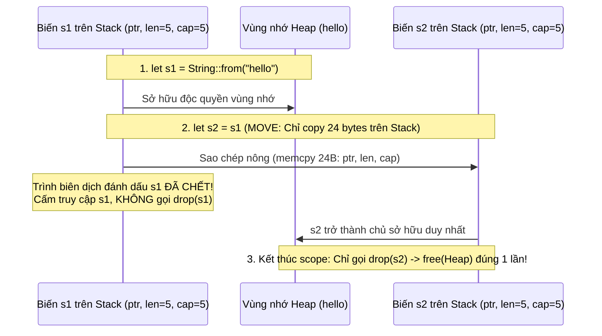
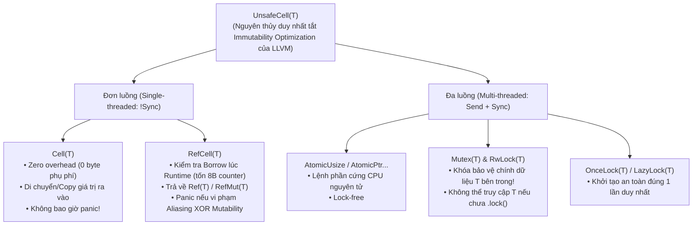
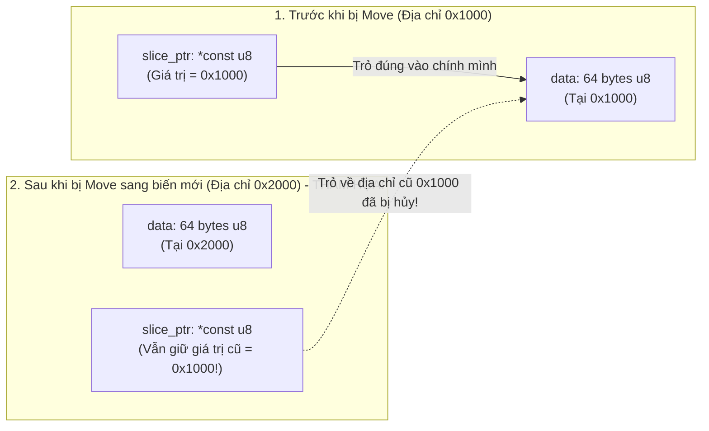

# CHUYÊN ĐỀ 03: GIẢI PHẪU OWNERSHIP, BORROW CHECKER, LIFETIMES, INTERIOR MUTABILITY & PINNING

> Thuộc bộ cẩm nang: [[00_Rust_Mastery_Index|Rust Mastery Handbook]]
> Tham chiếu đối sánh: [[02_Storage_Classes_and_Type_Qualifiers|Chuyên đề 02 (C/C++): Storage Classes & Từ khóa `restrict`]] & [[03_Special_Syntax_and_GCC_Attributes|Chuyên đề 03 (C/C++): `__attribute__((cleanup))` RAII]]

---

## 1. Bản Chất Cấp Phần Cứng Của Ownership: Move vs Copy vs Clone & Drop

Trong C, lập trình viên phải tự quản lý bộ nhớ bằng `malloc()` / `free()`. Trong C++11, Move Semantics (`std::move`, Rvalue references `T&&`) được đưa vào nhưng có một nhược điểm lịch sử: **Sau khi một đối tượng C++ bị `std::move`, đối tượng gốc vẫn tồn tại ở trạng thái "Valid but Unspecified"** và hàm Destructor `~T()` của đối tượng gốc **vẫn bị gọi** khi kết thúc hàm!

Rust thiết kế lại hoàn toàn cơ chế này thành **Destructive Move (Di chuyển hủy diệt nguyên bản)**:



### Bảng So Sánh `Move`, `Copy` và `Clone` Ở Mức Mã Máy (LLVM IR / Assembly)

| Cơ chế                    | Điều gì xảy ra ở mức CPU / Bộ nhớ?                                                                                                                               | Biến nguồn sau phép gán `let b = a;`                                                  | Điều kiện áp dụng                                                                                                                                                                                                               |
| :------------------------ | :--------------------------------------------------------------------------------------------------------------------------------------------------------------- | :------------------------------------------------------------------------------------ | :------------------------------------------------------------------------------------------------------------------------------------------------------------------------------------------------------------------------------ |
| **Move (Mặc định)**       | Chỉ thực hiện `memcpy` nông số byte của biến trên Stack (ví dụ 24 bytes của `Vec<T>` hoặc `String`), thường được tối ưu hóa biến mất hoàn toàn trên thanh ghi!   | **Bị vô hiệu hóa tĩnh** bởi trình biên dịch. Không bao giờ chạy `Drop::drop(&mut a)`. | Mọi kiểu dữ liệu trong Rust đều có thể Move (trừ khi bị khóa bởi `Pin`).                                                                                                                                                        |
| **`Copy` (Marker Trait)** | Giống hệt Move ở mức mã máy (vẫn chỉ là `memcpy` nông từng bit - Bitwise copy), không có hàm đặc biệt nào được gọi.                                              | **Vẫn sống và dùng tiếp được** bình thường.                                           | Kiểu chỉ chứa các thành phần thuần giá trị (như `i32`, `f64`, `bool`, con trỏ `*const T`, tham chiếu bất biến `&T`, hoặc struct chỉ chứa các kiểu `Copy`). **Luật sắt:** Một kiểu đã cài đặt `Drop` thì **cấm** cài đặt `Copy`! |
| **`Clone` (Trait)**       | Gọi hàm tường minh `a.clone()`. Có thể thực hiện bất kỳ logic tùy chỉnh nào (cấp phát vùng Heap mới và sao chép sâu dữ liệu, hoặc tăng bộ đếm tham chiếu `Arc`). | Vẫn sống (vì `clone(&self)` chỉ mượn tham chiếu `&self`).                             | Phải gọi tường minh `.clone()` để lập trình viên luôn nhìn thấy chi phí hiệu năng trên màn hình.                                                                                                                                |

---

## 2. Quy Tắc Vàng "Aliasing XOR Mutability": Sự Thăng Hoa Của Từ Khóa `restrict` Trong C99

Tại [[02_Storage_Classes_and_Type_Qualifiers|Chuyên đề 02 (C/C++)]], chúng ta đã biết từ khóa `restrict` của C99 là một lời hứa của lập trình viên với trình biên dịch rằng: *"Không có con trỏ nào khác trỏ trùng vào vùng nhớ này"*, giúp trình biên dịch tự do nạp dữ liệu vào thanh ghi và vector hóa SIMD mà không sợ **Pointer Aliasing**. Tuy nhiên trong C, nếu lập trình viên truyền hai con trỏ trùng nhau vào tham số `restrict`, trình biên dịch C **không hề biết** và âm thầm sinh mã máy chạy sai!

**Borrow Checker của Rust biến lời hứa `restrict` thành một Định Lý Toán Học được kiểm chứng 100% lúc biên dịch:**

> [!IMPORTANT] Định Luật Bảo Toàn Tham Chiếu Của Rust (Aliasing XOR Mutability)
> Tại bất kỳ thời điểm thực thi nào đối với một vùng nhớ `T`, bạn chỉ được phép có **MỘT TRONG HAI** trạng thái sau (không bao giờ có cả hai cùng lúc):
> 1. **Shared References (`&T` — Nhiều người đọc, cấm ghi):** Có thể có vô số tham chiếu `&T` cùng tồn tại (`&T` implement `Copy`), nhưng không ai được phép sửa đổi dữ liệu bên dưới.
> 2. **Mutable Reference (`&mut T` — Duy nhất một người đọc/ghi độc quyền):** Chỉ có **DUY NHẤT MỘT** tham chiếu `&mut T` đang hoạt động, và không được tồn tại bất kỳ `&T` nào khác trỏ tới cùng vùng nhớ đó!

### Sức mạnh tối ưu hóa cấp LLVM: `noalias` Mặc Định!
Nhờ quy tắc này, trình biên dịch `rustc` tự động gắn thuộc tính **`noalias`** (tương đương `restrict`) của LLVM lên **MỌI tham số `&T` và `&mut T` của mọi hàm Rust!**
- Trong C/C++: Khi viết `void process(const int *a, int *b)`, compiler phải giả định `a` và `b` có thể trỏ vào cùng một biến, nên sau khi ghi `*b = 10`, nó bắt buộc phải đọc lại `*a` từ RAM thay vì giữ trên thanh ghi.
- Trong Rust: Khi viết `fn process(a: &i32, b: &mut i32)`, LLVM biết chắc chắn 100% `a` và `b` không bao giờ trỏ trùng nhau! Giá trị `*a` được giữ cứng trong thanh ghi CPU xuyên suốt toàn bộ vòng lặp!

---

## 3. Giải Phẫu Hệ Thống Lifetimes (`'a`, `'static`), NLL, Variance & HRTB

Lifetime (`'a`) trong Rust **không thay đổi thời gian sống thực tế của giá trị ở Runtime** (nó bị xóa sạch sau khi qua pha kiểm tra Borrow Checker, tốn 0 byte bộ nhớ và 0 chu kỳ CPU). Lifetime là các biến đại số giúp trình biên dịch chứng minh rằng: **Không bao giờ có một tham chiếu sống lâu hơn (outlive) dữ liệu mà nó trỏ tới (Triệt tiêu 100% lỗi Dangling Pointer / Use-After-Free).**

### 3.1. Non-Lexical Lifetimes (NLL - Từ Rust 2018)
Trước năm 2018, một tham chiếu bị giữ cho đến tận dấu ngoặc nhọn `}` cuối khối lệnh. Với **NLL**, trình biên dịch phân tích Đồ thị Luồng Điều khiển (Control-Flow Graph): một tham chiếu kết thúc vòng đời **ngay sau dòng code cuối cùng mà nó được sử dụng**:
```rust
let mut data = vec![10, 20, 30];
let first = &data[0];           // Bắt đầu mượn bất biến (&)
println!("Phần tử đầu: {first}"); // Lần cuối cùng `first` được sử dụng -> Lifetime của `first` KẾT THÚC TẠI ĐÂY!

data.push(40);                  // Mượn khả biến (&mut) hoàn toàn HỢP LỆ nhờ NLL!
```

### 3.2. Ba Quy Tắc Ngầm Định Lifetime (Lifetime Elision Rules)
Để lập trình viên không phải gõ `'a` ở mọi hàm đơn giản, `rustc` áp dụng 3 quy tắc tự động điền lifetime:
1. Mỗi tham số đầu vào là tham chiếu nhận một lifetime riêng biệt: `fn foo(x: &i32, y: &i32)` $\rightarrow$ `fn foo<'a, 'b>(x: &'a i32, y: &'b i32)`.
2. Nếu chỉ có **đúng 1** lifetime đầu vào, lifetime đó được gán cho tất cả các tham chiếu đầu ra: `fn first_word(s: &str) -> &str` $\rightarrow$ `fn first_word<'a>(s: &'a str) -> &'a str`.
3. Nếu có nhiều lifetime đầu vào nhưng có `&self` hoặc `&mut self`, thì lifetime của `self` được gán cho tất cả tham chiếu đầu ra.

### 3.3. Subtyping & Variance (Tính Biến Thiên Của Lifetime & Kiểu)
Trong Rust, nếu lifetime `'long` sống lâu hơn (bao trùm) `'short`, ta viết `'long: 'short` (`'long` là một **subtype** của `'short`, vì nơi nào cần một tham chiếu sống ngắn `'short`, ta đều có thể truyền một tham chiếu sống dài `'long` như `'static` vào!).

Tuy nhiên, khi `'long` nằm bên trong một kiểu phức hợp `F<'a>` hoặc `F<T>`, mối quan hệ này thay đổi theo **3 tính chất Variance**:

| Loại Variance | Định nghĩa (Khi `'long: 'short` hoặc `Sub: Super`) | Các kiểu đại diện trong Rust | Tại sao bắt buộc phải như vậy? |
| :--- | :--- | :--- | :--- |
| **Covariant (Đồng biến)** | Giữ nguyên chiều: `&'long T` có thể truyền vào nơi cần `&'short T`. | `&'a T` (với cả `'a` và `T`), `Box<T>`, `Vec<T>`, `*const T`, `NonNull<T>`. | Chỉ đọc dữ liệu nên truyền tham chiếu sống lâu hơn vào nơi dùng ngắn hơn là hoàn toàn an toàn. |
| **Invariant (Bất biến)** | **Cấm thay thế theo cả 2 chiều!** Cần chính xác kiểu `T` (không được co giãn). | **`&'a mut T` là Invariant đối với `T`!** (nhưng Covariant đối với `'a`). `UnsafeCell<T>`, `Cell<T>`, `*mut T`. | Nếu `&mut &'static str` được phép ép thành `&mut &'short str`, người dùng có thể ghi một chuỗi cục bộ `'short` vào biến `&'static str`, gây lỗi Use-After-Free khi chuỗi cục bộ chết! |
| **Contravariant (Nghịch biến)** | Đảo ngược chiều: Hàm nhận tham số tổng quát hơn có thể thay cho hàm nhận tham số hẹp hơn. | `fn(T) -> U` là **Contravariant đối với tham số `T`** (và Covariant đối với kiểu trả về `U`). | Nếu bạn cần một callback chỉ truyền vào `&'static str` (`fn(&'static str)`), thì một hàm chấp nhận chuỗi có vòng đời bất kỳ `'short` (`fn(&'short str)`) hoàn toàn xử lý được! |

### 3.4. Higher-Rank Trait Bounds (HRTB — `for<'a>`)
Khi viết một hàm nhận vào một Closure mà Closure đó phải mượn một biến cục bộ được tạo ra **bên trong hàm** (do đó người gọi bên ngoài không thể biết trước lifetime `'a` đó là gì), ta dùng **HRTB `for<'a>`** (*"Với mọi lifetime `'a` bất kỳ"*):
```rust
// Cú pháp `Fn(&str) -> bool` thực chất là viết tắt (sugar) của HRTB:
pub fn filter_lines<F>(text: &str, predicate: F)
where
    F: for<'a> Fn(&'a str) -> bool, // Closure `predicate` phải hoạt động đúng với MỌI lifetime 'a ngắn dài bất kỳ!
{
    for line in text.lines() {
        let trimmed = line.trim(); // Lifetime của `trimmed` chỉ tồn tại trong 1 vòng lặp
        if predicate(trimmed) {
            println!("{trimmed}");
        }
    }
}
```

---

## 4. Smart Pointers & Interior Mutability: Đột Biến Nội Tại An Toàn

Trong C++, từ khóa `mutable` cho phép sửa đổi một trường của `class` ngay cả khi phương thức là `const`. Trong Rust, đôi khi một cấu trúc dữ liệu (như bộ đếm tham chiếu `Rc<T>`, bộ nhớ đệm Cache, hoặc thanh ghi phần cứng) cần thay đổi trạng thái bên trong thông qua một tham chiếu chia sẻ `&self`. Cơ chế đó gọi là **Interior Mutability (Đột biến nội tại)**.

> [!WARNING] Nguyên Tắc Tối Thượng Của Interior Mutability Trong Rust
> Mọi sự biến đổi dữ liệu thông qua tham chiếu bất biến `&T` trong toàn bộ ngôn ngữ Rust **BẮT BUỘC PHẢI ĐI QUA `core::cell::UnsafeCell<T>`**!
> Nếu bạn tự ý ép kiểu `*const T as *mut T` từ một tham chiếu `&T` không bọc trong `UnsafeCell<T>` rồi ghi giá trị mới vào, đó là **Undefined Behavior 100%** (vì LLVM đã gắn cờ `readonly`/`noalias` cho `&T`)! Chỉ có `UnsafeCell<T>` mới báo cho trình biên dịch tắt tối ưu hóa bất biến trên vùng nhớ đó.



### Bảng Phân Tích Chuyên Sâu Các Smart Pointers & Interior Mutability Wrappers

| Kiểu dữ liệu | Cấp phát bộ nhớ & Phụ phí (Overhead) | Đa luồng (`Send`/`Sync`) | Khi nào sử dụng trong thực tế? |
| :--- | :--- | :--- | :--- |
| **`Box<T>`** | 1 con trỏ duy nhất (8B) sở hữu vùng nhớ trên Heap. | `Send` + `Sync` (nếu `T: Send + Sync`) | Tương đương `std::unique_ptr<T>`. Dùng cho cấu trúc đệ quy (Tree/Linked List), chuyển dữ liệu lớn lên Heap, hoặc chứa Trait Object `Box<dyn Trait>`. |
| **`Rc<T>`** | Con trỏ tới khối Heap chứa `(strong_count: usize, weak_count: usize, T)`. | **`!Send` và `!Sync`** (Cấm gửi sang thread khác!) | Chia sẻ quyền sở hữu trong **cùng 1 thread** (ví dụ đồ thị DAG, UI Widget tree). Vì bộ đếm dùng `Cell<usize>` thường (không dùng lệnh `LOCK XADD` đắt đỏ của CPU) nên cực nhanh! |
| **`Arc<T>`** | Giống `Rc<T>` nhưng bộ đếm dùng `AtomicUsize`. | `Send` + `Sync` (khi `T: Send + Sync`) | Chia sẻ dữ liệu qua nhiều luồng phần cứng hoặc nhiều tác vụ `tokio::spawn`. |
| **`Cell<T>`** | **0 byte phụ phí** (`#[repr(transparent)]` bọc `UnsafeCell<T>`). | `Send` nhưng **`!Sync`** | Tuyệt vời cho các kiểu `Copy` (`u32`, `bool`) hoặc `take()`/`replace()`. Không bao giờ cấp tham chiếu `&T` vào bên trong nên **không bao giờ có thể gây lỗi hay panic**! |
| **`RefCell<T>`** | Thêm 1 trường `borrow: Cell<isize>` (8 bytes) bên cạnh `T`. | `Send` nhưng **`!Sync`** | Khi cần mượn tham chiếu `&T` (`.borrow()`) hoặc `&mut T` (`.borrow_mut()`) mà trình biên dịch không thể chứng minh tĩnh (ví dụ mô hình Observer hoặc đồ thị). Kết hợp kinh điển: `Rc<RefCell<T>>`. |
| **`Mutex<T>`** | Khóa hệ điều hành + bọc trực tiếp `UnsafeCell<T>` bên trong. | `Send` + `Sync` (khi `T: Send`) | Khác C/C++ (nơi `pthread_mutex_t` nằm rời rạc với biến dữ liệu, dễ quên lock), trong Rust **dữ liệu `T` nằm khóa chặt bên trong `Mutex<T>`** — bạn bắt buộc phải gọi `.lock()` nhận `MutexGuard<T>` mới chạm được vào `T`! |
| **`Cow<'a, B>`** | `enum` gồm `Borrowed(&'a B)` và `Owned(<B as ToOwned>::Owned)`. | `Send` + `Sync` | **Clone-On-Write:** Chỉ mượn dữ liệu gốc không tốn chi phí cấp phát (`Borrowed`) cho đến khi thực sự cần chỉnh sửa mới cấp phát bản sao (`to_mut()`). |

*(Đã kiểm chứng trực tiếp tại [`code_lab/02_ownership_and_interior_mutability.rs`](file:///home/thinh/Obsidian/Rust_Mastery_Handbook/code_lab/02_ownership_and_interior_mutability.rs)).*

---

## 5. Giải Mã `Pin<P>` & `Unpin`: Cấu Trúc Tự Tham Chiếu (Self-Referential Structs)

Tại sao Rust lại cần một khái niệm phức tạp như `Pin<P>`? Hãy xét bài toán **Cấu trúc tự tham chiếu (Self-referential struct)** — nền tảng của mọi hàm `async fn` và danh sách liên kết Intrusive trong Kernel:



Trong Rust, nếu bạn có một tham chiếu khả biến `&mut T`, bạn luôn có quyền gọi `core::mem::swap(&mut a, &mut b)` hoặc `core::mem::replace(&mut a, new_val)` để **di chuyển (Move) toàn bộ các byte của `T` sang một địa chỉ bộ nhớ mới**!
Nếu `T` là một State Machine sinh ra từ `async fn` đang lưu một con trỏ nội bộ trỏ vào biến cục bộ của chính nó, việc `mem::swap` sẽ làm con trỏ nội bộ trỏ vào địa chỉ cũ (Dangling pointer)!

### Cơ chế bảo vệ của `Pin<P>`:
1. **`Pin<P>`** (ví dụ `Pin<&mut T>` hoặc `Pin<Box<T>>`) là một kiểu bọc `#[repr(transparent)]` quanh một con trỏ `P`, cam kết rằng: **Giá trị `T` mà nó trỏ tới sẽ KHÔNG BAO GIỜ bị di chuyển sang địa chỉ bộ nhớ khác** cho đến khi vùng nhớ đó được giải phóng hoàn toàn (`Drop::drop` chạy xong)!
2. Làm sao `Pin<&mut T>` ngăn người dùng gọi `mem::swap`? Bằng cách **giấu kín tham chiếu `&mut T`**! Muốn lấy `&mut T` từ `Pin<&mut T>`, bạn phải gọi hàm `unsafe fn get_unchecked_mut()`.
3. **Marker trait `Unpin`:** Hầu hết các kiểu dữ liệu bình thường (`i32`, `String`, `Vec<T>`) không hề tự trỏ vào chính mình, nên chúng tự động cài đặt trait `Unpin` (di chuyển thoải mái không sao cả). Với kiểu `T: Unpin`, `Pin<&mut T>` hoạt động y hệt `&mut T`.
4. Với kiểu tự tham chiếu (như `Future` do compiler sinh ra hoặc kiểu có chứa trường `core::marker::PhantomPinned` là `!Unpin`), `Pin<&mut T>` khóa chặt địa chỉ bộ nhớ của đối tượng!

---

## 6. Mổ Xẻ Mã Nguồn Thực Tế: Cách Serde Và Tokio Làm Chủ Lifetimes & Pinning

### 6.1. **Serde (`serde-rs/serde`)**: Zero-Copy Deserialization Với Lifetime `'de`
Thông thường, khi giải mã một chuỗi JSON hoặc gói tin nhị phân sang Struct trong các ngôn ngữ khác, trình phân tích phải `malloc` cấp phát bộ nhớ Heap cho từng chuỗi `String` hoặc mảng `Vec<u8>`.

Trong [`serde`](https://github.com/serde-rs/serde), trait `Deserialize<'de>` giới thiệu một lifetime đặc biệt là **`'de` (Lifetime của bộ đệm dữ liệu đầu vào)**. Bằng cách gắn thuộc tính `#[serde(borrow)]` hoặc dùng `&'a str` / `Cow<'a, str>`, cấu trúc sau khi giải mã sẽ **trỏ trực tiếp (Slice) vào đúng các byte của bộ đệm mạng ban đầu** với **0 lần cấp phát bộ nhớ (Zero Heap Allocation)**:

```rust
// Mẫu thiết kế Zero-Copy Parser chuẩn từ Serde
use std::borrow::Cow;

#[derive(Debug)]
pub struct HttpRequest<'a> {
    pub method: &'a str,         // Chỉ là Fat Pointer 16B (ptr, len) trỏ thẳng vào raw_buffer!
    pub path: &'a str,           // 0 byte cấp phát Heap!
    pub body: Cow<'a, str>,      // Nếu không có ký tự escape: Borrowed(&'a str). Nếu cần giải mã: Owned(String)
}

// Trình biên dịch Rust đảm bảo: Chừng nào `HttpRequest<'a>` còn sống,
// bộ đệm mạng gốc `raw_buffer` KHÔNG THỂ bị giải phóng hay ghi đè!
```

### 6.2. **Tokio (`tokio-rs/tokio`)**: Pin Projection Trong `Future` State Machines
Trong mã nguồn của `tokio` (ví dụ `tokio::time::Timeout<F>` bọc một Future `F` bên trong), khi hàm `Future::poll(self: Pin<&mut Self>, cx: &mut Context<'_>)` được gọi, `self` đang bị khóa trong `Pin<&mut Timeout<F>>`. Làm sao để gọi `.poll()` trên trường `future: F` bên trong?

Các kỹ sư Tokio sử dụng kỹ thuật **Structural Pin Projection** (hoặc crate `pin-project-lite` do chính đội ngũ Tokio duy trì):
```rust
// Mô phỏng kỹ thuật Pin Projection trong tokio/src/time/timeout.rs
use core::pin::Pin;
use core::future::Future;
use core::task::{Context, Poll};

pub struct Timeout<F> {
    value: F,        // Trường này CẦN được Pin (Pinned projection)
    deadline: u64,   // Trường này chỉ là u64 bình thường, KHÔNG cần Pin (Unpinned projection)
}

impl<F: Future> Future for Timeout<F> {
    type Output = Result<F::Output, &'static str>;

    fn poll(self: Pin<&mut Self>, cx: &mut Context<'_>) -> Poll<Self::Output> {
        // AN TOÀN: Nếu `Timeout` đã được Pin, thì trường `value` bên trong nó cũng không bao giờ bị Move!
        let this = unsafe { self.get_unchecked_mut() };
        let pinned_value: Pin<&mut F> = unsafe { Pin::new_unchecked(&mut this.value) };
        let deadline: &mut u64 = &mut this.deadline;

        if *deadline == 0 {
            return Poll::Ready(Err("Timed out"));
        }
        pinned_value.poll(cx).map(Ok)
    }
}
```

> [!IMPORTANT] Tổng kết Chuyên đề 03
> Ownership, Borrow Checker, Lifetimes, `UnsafeCell` và `Pin` kết hợp thành một hệ thống chứng minh định lý tự động ngay lúc biên dịch: vừa cho phép trình biên dịch tối ưu hóa thanh ghi ở mức cao nhất (nhờ `noalias` mặc định), vừa loại bỏ hoàn toàn các lỗi Use-After-Free, Double-Free và Data Race. Tiếp theo, tại [[04_Memory_Layout_Trait_Objects_and_Zero_Cost_Abstractions|Chuyên đề 04]], chúng ta sẽ khảo sát cách Rust bố trí các byte trong RAM và tối ưu hóa không gian lưu trữ.
