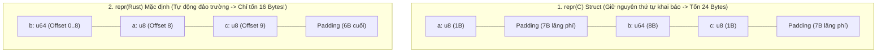
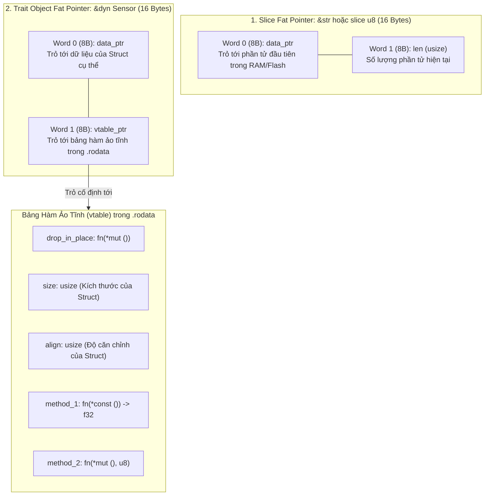

# CHUYÊN ĐỀ 04: BỐ CỤC BỘ NHỚ, NICHE OPTIMIZATION, FAT POINTERS & ĐA HÌNH ZERO-COST

> Thuộc bộ cẩm nang: [[00_Rust_Mastery_Index|Rust Mastery Handbook]]
> Tham chiếu đối sánh: [[07_Struct_Padding_Alignment_and_Punning|Chuyên đề 07 (C/C++): Cấu Trúc Bộ Nhớ Struct Padding, Alignment & Type Punning]]

---

## 1. Bí Mật Của `#[repr(Rust)]`: Tự Động Đảo Trường Triệt Tiêu Padding

Trong C/C++ (xem [[07_Struct_Padding_Alignment_and_Punning|Chuyên đề 07 (C/C++)]]), tiêu chuẩn ISO C bắt buộc trình biên dịch phải giữ nguyên thứ tự các trường trong `struct` đúng như thứ tự lập trình viên viết. Nếu bạn khai báo xen kẽ các biến `uint8_t` và `uint64_t`, struct trong C sẽ bị chèn hàng loạt byte đệm (Padding) lãng phí bộ nhớ.

Trong Rust, biểu diễn mặc định `#[repr(Rust)]` **không cam kết giữ nguyên thứ tự trường trong RAM**. Trình biên dịch `rustc` tự động chạy thuật toán sắp xếp các trường theo **Alignment giảm dần (hoặc gom nhóm tối ưu)** để triệt tiêu tối đa các byte Padding lãng phí!



```rust
use std::mem::{size_of, align_of, offset_of};

struct RustOptimized {
    a: u8,   // 1 byte
    b: u64,  // 8 bytes
    c: u8,   // 1 byte
    d: u16,  // 2 bytes
    e: u32,  // 4 bytes
}
// Trong C (#[repr(C)]): Tốn 24 bytes!
// Trong Rust (#[repr(Rust)]): rustc tự xếp [b(8B), e(4B), d(2B), a(1B), c(1B)] -> Đúng 16 bytes (0 byte padding)!
```
*(Đã kiểm chứng trực tiếp bằng `offset_of!` tại [`code_lab/01_memory_layout_and_niche.rs`](file:///home/thinh/Obsidian/Rust_Mastery_Handbook/code_lab/01_memory_layout_and_niche.rs)).*

### Zero-Sized Types (ZST — Kiểu dữ liệu kích thước 0 byte)
Khác với C++ (nơi mọi struct/class rỗng bắt buộc phải có `sizeof >= 1` byte để có địa chỉ phân biệt), trong Rust, các kiểu không mang dữ liệu runtime như `()`, `struct Unit;`, `[u8; 0]`, hoặc `PhantomData<T>` có kích thước **đúng bằng 0 byte (`size_of::<()>() == 0`)**!
- Một mảng `Vec<()>` có 1 triệu phần tử **không bao giờ gọi `malloc` cấp phát Heap** và tốn đúng 0 byte cho dữ liệu!
- Một `HashSet<Key>` trong thư viện chuẩn của Rust thực chất chỉ là `HashMap<Key, ()>` — nhờ `()` có kích thước 0 byte nên không tốn thêm bất kỳ byte nào cho phần Value!

---

## 2. Tuyệt Kỹ Niche Optimization (Tối Ưu Hóa Hốc Trống / Bit Pattern Rỗng)

Trong C, nếu bạn bọc một con trỏ `int*` (8 bytes) vào một struct kèm cờ `bool is_valid` (1 byte + 7 bytes padding), struct của bạn sẽ phình lên thành **16 bytes**.

Trong Rust, một kiểu dữ liệu thường có những cấu hình bit (Bit patterns) **bất hợp pháp (Invalid bit patterns)**. Khoảng giá trị bit không bao giờ xuất hiện ở một kiểu dữ liệu hợp lệ được trình biên dịch gọi là **Niche (Hốc trống)**. Trình biên dịch `rustc` tự động tận dụng các Niche này để lưu thẻ phân biệt (Discriminant tag) của `enum` (như `Option<T>` hoặc `Result<T, E>`) mà **không tốn thêm bất kỳ byte nào**!

| Kiểu dữ liệu `T` (Hệ 64-bit) | Các giá trị hợp lệ của `T` | Hốc trống (Niche) còn dư | Kích thước của `Option<T>` |
| :--- | :--- | :--- | :--- |
| **`&T`, `&mut T`, `Box<T>`, `Rc<T>`, `Arc<T>`, `fn()`** | Địa chỉ khác `0` ($\neq \text{0x0}$) | Giá trị `0x0000_0000_0000_0000` (con trỏ Null) | **8 bytes** (Bằng đúng `size_of::<&T>()`, nhánh `None` được mã hóa bằng số `0`!) |
| **`core::ptr::NonNull<T>`** | Con trỏ thô cam kết $\neq \text{0x0}$ | Giá trị `0x0` | **8 bytes** (Dùng khi tự viết cấu trúc dữ liệu Unsafe). |
| **`core::num::NonZeroU32` / `NonZeroUsize`** | Số nguyên từ $1 \dots 2^{32}-1$ | Giá trị `0` | **4 bytes** (Bằng đúng `size_of::<u32>()`!). |
| **`bool`** | Chỉ dùng `0x00` (`false`) và `0x01` (`true`) | 254 giá trị từ `0x02` đến `0xFF` | **1 byte** (`Option<bool>` vẫn chỉ tốn đúng 1 byte!). |
| **`char`** (Unicode Scalar Value) | `0x0000`..`0xD7FF` và `0xE000`..`0x10FFFF` | Hơn 4 tỷ giá trị ngoài vùng Unicode | **4 bytes** (`Option<char>` vẫn chỉ tốn đúng 4 bytes!). |
| **Struct chứa bất kỳ trường nào ở trên** | Tổ hợp có chứa trường có Niche | Kế thừa Niche từ trường bên trong | `size_of::<Option<MyStruct>>() == size_of::<MyStruct>()`! |

> [!TIP] Bí quyết thiết kế Struct tiết kiệm RAM cho Hệ thống Nhúng & High-Frequency Trading
> Nếu một trường ID hoặc độ dài trong struct của bạn theo logic nghiệp vụ không bao giờ bằng `0` (hoặc bạn muốn biểu diễn trạng thái "Chưa gán"), thay vì dùng `Option<u32>` (tốn **8 bytes** vì `u32` dùng kín hết $2^{32}$ bit pattern), hãy dùng **`Option<NonZeroU32>`** (chỉ tốn **4 bytes** — giảm 50% dung lượng bộ nhớ và tăng gấp đôi mật độ Cache L1!).

---

## 3. Giải Phẫu Fat Pointers (Con Trỏ Béo 16 Bytes Trên Hệ 64-bit)

Trong Rust, hầu hết các kiểu có kích thước biết trước tại thời điểm biên dịch (mặc định có ràng buộc ngầm định `T: Sized`). Tuy nhiên, có hai nhóm kiểu dữ liệu có kích thước chỉ biết lúc chạy (**Dynamically Sized Types — DST**, tức `?Sized`):
1. **Slices (`[T]`, `str`)**: Một dãy liên tiếp các phần tử không cố định độ dài trong kiểu.
2. **Trait Objects (`dyn Trait`)**: Một thực thể ẩn danh chỉ biết các hành vi thông qua Trait.

Vì trình biên dịch không biết kích thước của `[T]` hay `dyn Trait` lúc compile, bạn **không bao giờ có thể đặt trực tiếp `[T]` hay `dyn Trait` lên Stack**, mà bắt buộc phải đứng sau một con trỏ (`&[T]`, `&str`, `Box<[T]>`, `&dyn Trait`, `Box<dyn Trait>`, `Arc<dyn Trait>`).

Khi đó, con trỏ trỏ tới một DST không còn là con trỏ đơn 8 bytes (Thin pointer) nữa, mà trở thành một **Fat Pointer (Con trỏ béo — rộng gấp đôi = 16 bytes trên CPU 64-bit, hoặc 8 bytes trên MCU 32-bit)**:



### Sự ưu việt của Slice `&str` / `&[u8]` so với chuỗi `char*` kết thúc bằng `\0` của C:
1. **Đo độ dài $O(1)$ tức thì:** Trong C, `strlen(s)` phải quét từng byte cho tới khi gặp `\0` ($O(N)$). Trong Rust, `s.len()` chỉ là việc đọc ngay thanh ghi thứ 2 của Fat Pointer ($O(1)$, tốn 1 lệnh đọc thanh ghi!).
2. **Cắt chuỗi con (Subslice) Zero-Copy:** Trong C, muốn lấy một từ ở giữa chuỗi mà vẫn dùng được với các hàm chuẩn yêu cầu `\0`, bạn phải copy ra mảng mới hoặc ghi đè `\0` làm hỏng chuỗi gốc. Trong Rust, `&s[4..10]` chỉ đơn giản tạo một Fat Pointer mới `(data_ptr + 4, len = 6)` trong 1 chu kỳ CPU mà không đụng chạm tới bộ nhớ gốc!

---

## 4. Đa Hình Tĩnh (Monomorphization) vs Đa Hình Động (`dyn Trait` vtable)

Rust cho phép bạn chọn chính xác cơ chế đa hình phù hợp với bài toán kỹ thuật:

### 4.1. Static Dispatch — Generics & `impl Trait` (Monomorphization)
```rust
// Cách viết 1 (Cú pháp Generic truyền thống) và Cách viết 2 (impl Trait) sinh mã máy GIỐNG HỆT NHAU:
pub fn read_sensor_static<S: Sensor>(s: &S) -> f32 { s.read_value() }
pub fn read_sensor_impl(s: &impl Sensor) -> f32 { s.read_value() }
```
- **Cơ chế (Monomorphization):** Nếu bạn gọi hàm trên với `TempSensor` và `PressureSensor`, trình biên dịch sẽ nhân bản và biên dịch thành 2 hàm mã máy độc lập: `read_sensor_TempSensor` và `read_sensor_PressureSensor`.
- **Ưu điểm:** Con trỏ truyền vào là **Thin pointer (8B)**, lời gọi hàm được **Inline trực tiếp**, cho phép LLVM tối ưu hóa xuyên qua hàm (Zero-cost abstraction tuyệt đối!).
- **Nhược điểm:** Làm tăng kích thước file nhị phân (Code bloat / Flash footprint) nếu được gọi với quá nhiều kiểu khác nhau, và không thể gom chung các kiểu khác nhau vào cùng một mảng `[S]`.

### 4.2. Dynamic Dispatch — Trait Objects (`&dyn Trait`, `Box<dyn Trait>`)
```rust
pub fn read_sensor_dynamic(s: &dyn Sensor) -> f32 {
    s.read_value() // Tra bảng vtable_ptr để tìm địa chỉ hàm lúc Runtime
}
```
- **Ưu điểm:** Chỉ biên dịch **duy nhất 1 thân hàm** trong vùng nhớ `.text` (tiết kiệm Flash cho vi điều khiển), và cho phép tạo mảng hỗn hợp nhiều thiết bị khác nhau: `Vec<Box<dyn Sensor>>` hoặc `&[&dyn Sensor]`.
- **Nhược điểm:** Tốn 16 bytes cho Fat pointer, tốn 1 lần nhảy gián tiếp qua con trỏ hàm (Indirect call), và **ngăn cản trình biên dịch Inline hàm**.

### 4.3. Quy Tắc Object Safety (Dyn Compatibility)
Không phải mọi `trait` đều có thể biến thành `dyn Trait`. Để trình biên dịch có thể xây dựng bảng `vtable` tĩnh cho một Trait, mọi phương thức trong Trait đó phải thỏa mãn quy tắc **Dyn Compatibility (Object Safety)**:
1. **Không trả về kiểu `Self` theo giá trị** (vì ở Runtime người gọi không biết `Self` rộng bao nhiêu byte để cấp phát chỗ trên Stack!).
2. **Không có tham số kiểu Generic trên phương thức** (`fn process<T>(&self, x: T)`): Vì một hàm generic có vô hạn phiên bản monomorphized, không thể nhét vô hạn con trỏ hàm vào một bảng `vtable` hữu hạn!
3. Trait không có supertrait yêu cầu `Self: Sized`. *(Mẹo: Bạn có thể loại trừ riêng một hàm không tương thích khỏi vtable bằng cách gắn mệnh đề `where Self: Sized` vào hàm đó!).*

*(Đã kiểm chứng trực tiếp tại [`code_lab/04_fat_pointers_and_dispatch.rs`](file:///home/thinh/Obsidian/Rust_Mastery_Handbook/code_lab/04_fat_pointers_and_dispatch.rs)).*

---

## 5. Mổ Xẻ Mã Nguồn Thực Tế: Cách Ripgrep Và Rust Standard Library Tối Ưu Bộ Nhớ

### 5.1. Rust Standard Library (`alloc::vec::Vec<T>`): Tối Ưu Hóa Bằng `NonNull<T>`
Nếu bạn mở mã nguồn của thư viện chuẩn Rust (`library/alloc/src/raw_vec.rs`), bạn sẽ thấy `Vec<T>` không hề lưu con trỏ dữ liệu dưới dạng `*mut T`, mà lưu bằng `core::ptr::Unique<T>` (bọc bên ngoài **`core::ptr::NonNull<T>`**):

```rust
// Cấu trúc thực tế của Vec<T> trong Rust Standard Library (24 bytes trên hệ 64-bit)
pub struct Vec<T> {
    buf: RawVec<T>, // Bên trong chứa ptr: Unique<T> (bọc NonNull<T> != 0x0) và cap: usize
    len: usize,
}
```
**Hệ quả kỳ diệu:**
- Ngay cả khi bạn tạo một vector rỗng `let v: Vec<u8> = Vec::new();` (chưa hề cấp phát Heap!), `Vec` vẫn không gán `ptr = 0x0`, mà gán `ptr = NonNull::dangling()` (tức địa chỉ giả bằng đúng `align_of::<T>()`, ví dụ `0x1` hoặc `0x8`).
- Nhờ `ptr` bên trong `Vec<T>` và `String` cam kết **không bao giờ bằng `0x0`**, trình biên dịch tự động kích hoạt **Niche Optimization**:
  $$\text{size\_of}::<Option<Vec<T>>>() == \text{size\_of}::<Vec<T>>() == 24 \text{ bytes!}$$
  $$\text{size\_of}::<Option<String>>() == \text{size\_of}::<String>() == 24 \text{ bytes!}$$

### 5.2. Dự Án **Ripgrep (`BurntSushi/ripgrep`)**: Tốc Độ Ánh Sáng Nhờ Fat Pointers `&[u8]` & `Cow<str>`
Tại sao công cụ tìm kiếm văn bản [`ripgrep`](https://github.com/BurntSushi/ripgrep) của Andrew Gallant (BurntSushi) lại đánh bại cả GNU `grep`, The Silver Searcher (`ag`) và `git grep`?
Khi mổ xẻ crate `grep-searcher` và `bstr` bên trong `ripgrep`, ta thấy 3 kỹ thuật cốt lõi dựa trên bố cục bộ nhớ của Rust:
1. **Thao tác trực tiếp trên Slice `&[u8]` (Fat Pointer) kết hợp Memory-Mapped File (`mmap`) hoặc Ring Buffer cố định:** Thay vì đọc từng dòng và cấp phát `String` trên Heap, `ripgrep` ánh xạ tệp tin thành một slice `&[u8]` khổng lồ và dùng thuật toán SIMD (`memchr`) cắt ra các lát cắt con `&[u8]` với **0 lần cấp phát bộ nhớ**!
2. **Dùng `Cow<'a, str>` (`String::from_utf8_lossy`) khi giải mã đường dẫn và văn bản:**
   - Trong 99.9% trường hợp dữ liệu trên đĩa là UTF-8 hợp lệ, `from_utf8_lossy(slice)` kiểm tra nhanh bằng SIMD và trả về `Cow::Borrowed(&str)` — chỉ là một phép ép kiểu Fat pointer từ `&[u8]` sang `&str` tốn **0 byte cấp phát**!
   - Chỉ khi gặp đúng dòng có byte lỗi mã hóa (0.1% trường hợp), nó mới chuyển sang nhánh `Cow::Owned(String)` để thay thế byte lỗi bằng ký tự `` (`U+FFFD`).
3. **Static Dispatch cho đường nóng (Hot Loop) + Dynamic Dispatch ở biên cấu hình:** Bên trong vòng lặp quét từng dòng (`Sink` trait), `ripgrep` dùng Generics (`S: Sink`) để trình biên dịch inline toàn bộ logic xử lý khớp mẫu vào ngay bên trong vòng lặp đọc bộ đệm!

> [!IMPORTANT] Tổng kết Chuyên đề 04
> Bố cục bộ nhớ của Rust (`#[repr(Rust)]`, Niche Optimization, Zero-Sized Types và Fat Pointers) cho thấy một ngôn ngữ bậc cao hoàn toàn có thể tiết kiệm từng byte RAM tốt hơn cả cách viết C thủ công. Tiếp theo, tại [[05_Unsafe_Rust_FFI_Inline_ASM_and_Embedded|Chuyên đề 05]], chúng ta sẽ bước qua ranh giới của Safe Rust để làm chủ Unsafe Rust, FFI, Inline Assembly và lập trình thanh ghi phần cứng.
