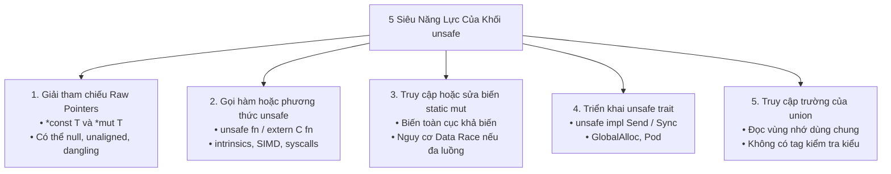

# CHUYÊN ĐỀ 05: UNSAFE RUST, UNDEFINED BEHAVIOR, FFI, INLINE ASSEMBLY & LẬP TRÌNH NHÚNG

> Thuộc bộ cẩm nang: [[00_Rust_Mastery_Index|Rust Mastery Handbook]]
> Tham chiếu đối sánh: [[05_Inline_Assembly_and_Barriers|Chuyên đề 05 (C/C++): Inline Assembly & Barriers]] & [[08_Undefined_Behavior_and_Safety_Standards|Chuyên đề 08 (C/C++): Cạm Bẫy Hành Vi Bất Định (UB) & MISRA-C]]

---

## 1. Năm Siêu Năng Lực Của Khối `unsafe` & Triết Lý Đóng Gói An Toàn

Trong lập trình hệ thống (Kernel, Driver phần cứng, Bộ cấp phát bộ nhớ, Giao tiếp C FFI), trình biên dịch không thể hiểu được đặc tả vật lý của thanh ghi ngoại vi hay các hàm C bên ngoài. Do đó, Rust cung cấp từ khóa `unsafe`.

> [!IMPORTANT] Hiểu Đúng Về `unsafe`: Mở Khóa 5 Quyền Năng, KHÔNG Tắt Borrow Checker!
> Việc đặt code vào trong khối `unsafe { ... }` **không hề tắt Borrow Checker hay kiểm tra kiểu của Rust** (các tham chiếu `&T`, `&mut T` bình thường bên trong `unsafe` vẫn bị kiểm tra vòng đời nghiêm ngặt).
> Khối `unsafe` chỉ mở khóa đúng **5 thao tác (5 Unsafe Superpowers)** mà lập trình viên phải tự chịu trách nhiệm đảm bảo tính đúng đắn:



### Quy tắc vàng `#[deny(unsafe_op_in_unsafe_fn)]` (Mặc định từ Edition 2024!)
Trước đây, khi viết một hàm `pub unsafe fn do_something(ptr: *mut u8)`, toàn bộ thân hàm bên trong mặc định được coi là một khối `unsafe` lớn, khiến lập trình viên vô tình gọi các thao tác nguy hiểm mà không nhận ra.
Từ Rust 2024 (hoặc khi bật `#![deny(unsafe_op_in_unsafe_fn)]`), **`unsafe fn` chỉ mang ý nghĩa "Người gọi hàm này phải đáp ứng các điều kiện an toàn"**, còn bên trong thân hàm, bạn vẫn **bắt buộc phải viết khối `unsafe { ... }` nhỏ gọn kèm chú thích `// SAFETY: ...`** ngay tại dòng thực hiện thao tác nguy hiểm!

---

## 2. Các Quy Tắc Undefined Behavior (UB) Khắt Khe Trong Rust (*The Rustonomicon*)

Nhiều kỹ sư C/C++ khi mới viết Unsafe Rust thường mang tư duy *"Cái gì chạy không segfault trên x86 nghĩa là hợp lệ"*. Đây là sai lầm nguy hiểm nhất! Vì trình biên dịch Rust cung cấp nhiều cam kết mạnh hơn C cho bộ tối ưu hóa LLVM, nên **một số đoạn code hợp lệ trong C lại là Undefined Behavior (UB) nghiêm trọng trong Rust**:

### 2.1. Bảng Các Lỗi Tạo Ra Undefined Behavior Tức Thì Trong Rust

| Hành vi vi phạm | Trong C/C++ | Trong Rust (Kể cả trong `unsafe`!) | Cách viết đúng trong Rust |
| :--- | :--- | :--- | :--- |
| **Tạo tham chiếu `&T` / `&mut T` bị Null, Dangling hoặc Lệch biên (Unaligned)** | Con trỏ `int *p = NULL;` hoàn toàn hợp lệ chừng nào chưa `*p`. | **UB NGAY TẠI THỜI ĐIỂM TẠO THAM CHIẾU `&T`**, dù chưa hề đọc hay ghi! | Giữ nguyên ở dạng con trỏ thô `*const T` / `*mut T`, dùng `&raw const` và `ptr.read_unaligned()`. |
| **Hai tham chiếu `&mut T` (hoặc `&T` và `&mut T`) cùng trỏ vào 1 vùng nhớ** | Hợp lệ nếu không dùng `restrict` và cùng kiểu. | **UB TỨC THÌ** (Vi phạm luật `noalias` tuyệt đối của `&mut T`). | Dùng con trỏ thô `*mut T` hoặc bọc trong `UnsafeCell<T>`. |
| **Tạo giá trị có Bit Pattern bất hợp pháp** | `bool b = 2;` có thể chỉ là giá trị khác 0 trong C89. | **UB TỨC THÌ:** `bool` khác `0/1`, `enum` mang tag không tồn tại, `char` ngoài chuẩn Unicode, `&T` bằng `0`, hoặc đọc số nguyên chưa khởi tạo! | Dùng `MaybeUninit<T>` hoặc kiểm tra giá trị nguyên trước khi chuyển thành `enum`. |
| **Ép kiểu `&T` thành `*mut T` rồi ghi đè giá trị** | Hợp lệ nếu biến gốc ban đầu không được khai báo `const`. | **UB 100%!** Mọi vùng nhớ đi qua `&T` mà không có `UnsafeCell<T>` đều là bất biến tuyệt đối! | Bắt buộc phải bọc dữ liệu trong `UnsafeCell<T>` ngay từ đầu. |

### 2.2. Mô Hình Stacked Borrows / Tree Borrows & Công Cụ Kiểm Chứng **Miri**
Làm sao trình biên dịch và công cụ kiểm chứng biết được khi nào bạn trộn lẫn con trỏ thô `*mut T` và tham chiếu `&mut T` một cách hợp pháp hay bất hợp pháp?
Nhà nghiên cứu Ralf Jung cùng đội ngũ Rust đã xây dựng mô hình toán học **Stacked Borrows** và **Tree Borrows**, được hiện thực hóa trong trình thông dịch **Miri (`cargo +nightly miri test`)**:
- Mỗi khi bạn mượn một tham chiếu hoặc ép ra con trỏ thô, vùng nhớ đó ghi nhận một thẻ (Tag) trên Ngăn xếp/Cây mượn (Borrow Stack/Tree).
- Nếu bạn tạo `let raw = &mut x as *mut i32;`, sau đó bạn lại dùng trực tiếp biến gốc `x = 10;` (hoặc tạo một `&mut x` mới), thì thẻ quyền hạn của con trỏ `raw` cũ trên đỉnh Stack **bị thu hồi (Popped / Disabled)**! Nếu sau đó bạn ghi `*raw = 20;`, Miri sẽ bắt quả tang lỗi vi phạm Stacked Borrows ngay lập tức!

---

## 3. Quản Lý Bộ Nhớ Chưa Khởi Tạo An Toàn Bằng `core::mem::MaybeUninit<T>`

Trong C, việc khai báo `uint8_t buf[1024];` trên Stack rồi truyền vào hàm đọc phần cứng là chuyện thường ngày. Trong Rust cổ điển, người ta từng dùng `mem::uninitialized()`, nhưng hàm này đã bị **khai tử hoàn toàn** vì ngay khoảnh khắc biến `T` chưa khởi tạo được gán tên trong Rust, LLVM đã giả định nó có bit pattern hợp lệ (nếu `T` là `bool` hay `&u32` hoặc trình biên dịch tự gọi `drop` thì chương trình nổ tung ngay lập tức!).

**Giải pháp chuẩn mực duy nhất: `MaybeUninit<T>` (`#[repr(transparent)]` bọc một `union { uninit: (), value: ManuallyDrop<T> }`)**:
1. Báo cho trình biên dịch biết vùng nhớ này **có thể đang chứa rác chưa khởi tạo** (tắt mọi giả định bit pattern và **không tự động gọi `Drop`**).
2. Cho phép lấy con trỏ thô `*mut T` bằng `.as_mut_ptr()` để truyền cho DMA, hàm C FFI hoặc khởi tạo từng phần tử mảng.
3. Sau khi đã ghi đầy đủ dữ liệu hợp lệ, gọi `unsafe { buf.assume_init() }` để chuyển hóa thành kiểu `T` với **0 chi phí runtime**!

```rust
use std::mem::MaybeUninit;

pub fn init_calibration_table() -> [u32; 4] {
    // 1. Cấp phát vùng nhớ trên Stack mà KHÔNG tốn chu kỳ CPU gán giá trị 0 ban đầu
    let mut table: [MaybeUninit<u32>; 4] = [const { MaybeUninit::uninit() }; 4];

    // 2. Khởi tạo từng phần tử một cách an toàn
    for (i, slot) in table.iter_mut().enumerate() {
        slot.write((i as u32 + 1) * 100);
    }

    // 3. Chuyển đổi sang mảng [u32; 4] hoàn chỉnh (Biến mất hoàn toàn ở mức mã máy!)
    // SAFETY: Toàn bộ 4 phần tử đã được khởi tạo qua vòng lặp trên.
    unsafe { MaybeUninit::array_assume_init(table) } // Hoặc transmute / assume_init từng phần tử
}
```
*(Đã kiểm chứng trực tiếp tại [`code_lab/05_maybe_uninit_and_unsafe_ffi.rs`](file:///home/thinh/Obsidian/Rust_Mastery_Handbook/code_lab/05_maybe_uninit_and_unsafe_ffi.rs)).*

---

## 4. Truy Cập Thanh Ghi Phần Cứng (MMIO): `read_volatile` & `write_volatile`

Trong C (xem [[02_Storage_Classes_and_Type_Qualifiers|Chuyên đề 02 (C/C++)]]), `volatile` là một **Type Qualifier** gắn vào kiểu của biến (`volatile uint32_t *reg`). Tuy nhiên, ngay cả trong Linux Kernel (tập tin `include/linux/compiler.h`), Linus Torvalds và các kỹ sư nhân Linux đã chỉ ra rằng việc gắn `volatile` vào biến thường gây hại (vì ở những chỗ không cần đọc phần cứng, nó cũng cấm trình biên dịch tối ưu hóa), nên Linux Kernel chuyển sang dùng macro **`READ_ONCE(x)`** và **`WRITE_ONCE(x, val)`** — tức là gắn tính chất `volatile` vào **BẢN THÂN THAO TÁC ĐỌC/GHI** chứ không gắn vào biến!

**Rust áp dụng chính xác triết lý hiện đại của Linux Kernel:**
Trong Rust không có từ khóa `volatile` gắn vào biến, mà sử dụng hai hàm nội tại trên con trỏ thô:
- **`core::ptr::read_volatile(src: *const T) -> T`**
- **`core::ptr::write_volatile(dst: *mut T, val: T)`**

```rust
const UART0_BASE: usize = 0x4000_C000;
const UART_SR_TXE: u32  = 1 << 7; // Transmit Data Register Empty bit

#[repr(C)]
pub struct UartRegisters {
    pub sr: u32, // Offset 0x00: Status Register
    pub dr: u32, // Offset 0x04: Data Register
}

pub fn uart_putc(byte: u8) {
    let uart = UART0_BASE as *mut UartRegisters;
    unsafe {
        // 1. Polling bit TXE bằng read_volatile trên con trỏ trường (&raw const)
        // Đảm bảo LLVM KHÔNG BAO GIỜ tối ưu hóa vòng lặp này thành vòng lặp treo vô tận!
        while (&raw const (*uart).sr).read_volatile() & UART_SR_TXE == 0 {
            core::hint::spin_loop();
        }
        // 2. Ghi byte ra thanh ghi phát bằng write_volatile
        (&raw mut (*uart).dr).write_volatile(byte as u32);
    }
}
```

> [!CAUTION] Tại sao không được tạo `&mut UartRegisters` trỏ tới địa chỉ phần cứng `0x4000_C000`?
> Vì phần cứng ngoại vi có thể tự động thay đổi giá trị thanh ghi `sr` bất kỳ lúc nào (ngay cả khi CPU không ghi), và nhiều hàm/ngắt có thể cùng truy cập `UART0_BASE`. Nếu bạn viết `let uart: &mut UartRegisters = unsafe { &mut *(UART0_BASE as *mut _) };`, bạn đã nói dối LLVM rằng không có ai khác sửa đổi vùng nhớ này! Do đó, luôn giữ địa chỉ ngoại vi ở dạng **con trỏ thô `*mut T`** (hoặc bọc từng thanh ghi trong struct `VolatileCell<T>` chứa `UnsafeCell<T>`).

---

## 5. Inline Assembly (`core::arch::asm!`) & Memory Barriers

Tại [[05_Inline_Assembly_and_Barriers|Chuyên đề 05 (C/C++)]], chúng ta đã thấy cú pháp GCC Extended ASM (`__asm__ __volatile__("..." : "=r"(out) : "r"(in) : "memory")`) rất dễ viết nhầm thứ tự toán hạng `%0`, `%1`.

Rust chuẩn hóa Inline Assembly thông qua macro **`core::arch::asm!`** (và `global_asm!`) với cú pháp đặt tên toán hạng trực quan như `format!` và kiểm tra thanh ghi nghiêm ngặt:

```rust
use core::arch::asm;

#[cfg(target_arch = "x86_64")]
pub fn read_cpu_timestamp_counter() -> u64 {
    let low: u32;
    let high: u32;
    unsafe {
        // Lệnh rdtsc của x86_64 đọc bộ đếm chu kỳ xung nhịp vào cặp thanh ghi EDX:EAX
        asm!(
            "lfence",               // Chặn thực thi乱序 (Out-of-order execution) trước khi đọc
            "rdtsc",
            out("eax") low,         // Ràng buộc chính xác thanh ghi đầu ra EAX
            out("edx") high,        // Ràng buộc chính xác thanh ghi đầu ra EDX
            options(nomem, nostack, preserves_flags) // Báo cho compiler biết lệnh này không chạm vào RAM/Stack
        );
    }
    ((high as u64) << 32) | (low as u64)
}
```

### Đối chiếu Rào chắn Bộ nhớ (Memory Barriers) giữa C/Linux Kernel và Rust:
1. **Compiler Barrier (Chặn trình biên dịch đảo lệnh, tốn 0 lệnh CPU):**
   - Trong GCC C: `asm volatile("" ::: "memory");`
   - Trong Rust: **`core::sync::atomic::compiler_fence(Ordering::SeqCst);`**
2. **Hardware CPU Memory Barrier (Chặn bộ đệm Store Buffer của phần cứng CPU đảo lệnh):**
   - Trong ARM / Linux C: `smp_mb()` / `dmb ish` / `mfence`
   - Trong Rust: **`core::sync::atomic::fence(Ordering::SeqCst);`**

---

## 6. Giao Tiếp Song Phương FFI (`extern "C"`) Không Chi Phí

Rust có khả năng gọi trực tiếp các hàm C và xuất các hàm Rust thành thư viện tĩnh (`.a`) / thư viện động (`.so`, `.dll`) theo đúng chuẩn ABI của C mà **không có bất kỳ lớp máy ảo hay chi phí chuyển đổi nào (Zero FFI Overhead)**:

```rust
// 1. Khai báo hàm từ thư viện C chuẩn (libc) để gọi từ Rust
// (Trong Rust 2024 viết là: unsafe extern "C" { ... })
extern "C" {
    fn abs(input: core::ffi::c_int) -> core::ffi::c_int;
}

// 2. Xuất hàm từ Rust để chương trình C/C++ hoặc Python/CGO gọi vào
#[no_mangle]
pub unsafe extern "C" fn rust_crc16_compute(data: *const u8, len: usize) -> u16 {
    if data.is_null() || len == 0 {
        return 0;
    }
    // Chuyển đổi con trỏ C (ptr + len) thành Slice Fat Pointer &[u8] của Rust trong 0 chu kỳ CPU:
    let slice: &[u8] = unsafe { core::slice::from_raw_parts(data, len) };
    
    let mut crc: u16 = 0xFFFF;
    for &byte in slice {
        crc ^= (byte as u16) << 8;
        for _ in 0..8 {
            if (crc & 0x8000) != 0 {
                crc = (crc << 1) ^ 0x1021;
            } else {
                crc <<= 1;
            }
        }
    }
    crc
}
```

> [!WARNING] Quy Tắc Sinh Tử Khi Viết Hàm `extern "C"` Trong Rust: Cấm Để `panic!` Vượt Qua Biên FFI!
> Nếu một hàm `extern "C"` của Rust bị `panic!` và thực hiện tháo gỡ ngăn xếp (Stack Unwinding) xuyên ngược vào khung Stack của mã C/C++ gọi nó, đó là **Undefined Behavior tức thì** (làm sập toàn bộ tiến trình).
> - Trong hàm `extern "C"`, hãy luôn trả về mã lỗi nguyên hoặc dùng `std::panic::catch_unwind(|| { ... })` để chặn mọi panic tại biên giới FFI!
> - Hoặc dùng chuẩn gọi hàm `extern "C-unwind"` nếu chủ đích muốn tương thích ngoại lệ ABI giữa C++ và Rust.

---

## 7. Mổ Xẻ Mã Nguồn Thực Tế: SVD2Rust / Embedded-HAL & Rust for Linux

### 7.1. **SVD2Rust & Embedded-HAL (`rust-embedded`)**: Biến Tập Tin Mô Tả Phần Cứng SVD Thành Hệ Thống Kiểu An Toàn Tuyệt Đối
Trong lập trình vi điều khiển C truyền thống (STM32 HAL / CMSIS), việc cấu hình nhầm bit vào thanh ghi (ví dụ ghi nhầm giá trị Baudrate vào thanh ghi GPIO, hoặc sử dụng ngoại vi khi chưa bật xung nhịp RCC) chỉ có thể phát hiện khi chạy thử thấy mạch không hoạt động.

Hệ sinh thái nhúng của Rust (`svd2rust`, `stm32-metapac`, `embassy-stm32`) đọc file mô tả phần cứng XML (`.svd`) của hãng bán dẫn và tự động sinh ra các thanh ghi dùng **Typestate Pattern (Mã hóa trạng thái phần cứng thành Kiểu dữ liệu Zero-Cost)**:

```rust
// Minh họa Typestate Pattern trong Embedded Rust (Tốn 0 byte RAM nhờ PhantomData!)
use core::marker::PhantomData;

pub struct InputFloating;
pub struct OutputPushPull;

pub struct GpioPin<const PIN: u8, Mode> {
    _mode: PhantomData<Mode>, // Kích thước = 0 byte!
}

impl<const PIN: u8, Mode> GpioPin<PIN, Mode> {
    /// Chuyển đổi chân GPIO sang chế độ Output: TIÊU THỤ (Move) chân ở chế độ cũ
    /// và trả về kiểu GpioPin<PIN, OutputPushPull> mới!
    #[inline(always)]
    pub fn into_push_pull_output(self) -> GpioPin<PIN, OutputPushPull> {
        // Ghi thanh ghi MODER phần cứng bằng write_volatile...
        GpioPin { _mode: PhantomData }
    }
}

// Phương thức `set_high()` CHỈ TỒN TẠI trên kiểu GpioPin<PIN, OutputPushPull>!
impl<const PIN: u8> GpioPin<PIN, OutputPushPull> {
    #[inline(always)]
    pub fn set_high(&mut self) {
        // Ghi bit(PIN) vào thanh ghi BSRR (Atomic Bit Set/Reset Register)
    }
}
```
**Kết quả:** Nếu lập trình viên cố tình gọi `pin.set_high()` trên một chân đang ở chế độ `InputFloating`, hoặc dùng lại biến `pin` cũ sau khi đã chuyển giao cho bộ điều khiển SPI, **trình biên dịch từ chối biên dịch ngay lập tức!** Toàn bộ lớp bảo vệ này nằm trong `PhantomData` có kích thước **0 byte**, nên mã máy Assembly sinh ra chỉ là **đúng 1 lệnh `STR` duy nhất vào thanh ghi `BSRR`** giống hệt code Assembly viết tay!

### 7.2. **Rust for Linux Kernel (`rust/kernel/sync/aref.rs`)**: Đóng Gói Con Trỏ Đếm Tham Chiếu Của Nhân Linux Bằng `ARef<T>`
Trong nhân Linux, các đối tượng như `struct task_struct` hay `struct device` có cơ chế đếm tham chiếu riêng bằng C (`refcount_t`). Để mã Rust trong Kernel dùng được các con trỏ C này mà không bao giờ quên gọi `put_device()` (gây rò rỉ bộ nhớ nhân) hoặc gọi thừa `put_device()` (gây Use-After-Free trong Kernel space), dự án Rust for Linux định nghĩa trait `unsafe trait AlwaysRefCounted` và con trỏ thông minh `ARef<T>` (`#[repr(transparent)]` bọc `NonNull<T>`):
- Khi `ARef<Task>::clone(&task)` được gọi, nó tự động gọi hàm C `get_task_struct()`.
- Khi `ARef<Task>` ra khỏi tầm vực (Scope), hàm `Drop::drop` của nó tự động gọi hàm C `put_task_struct()`.
- Nhờ `NonNull<T>`, `Option<ARef<Task>>` vẫn chỉ rộng đúng 8 bytes bằng một con trỏ C thuần túy!

> [!IMPORTANT] Tổng kết Chuyên đề 05
> Unsafe Rust không phải là "vùng vô pháp luật", mà là công cụ chính xác để xây dựng các cầu nối phần cứng và FFI với cam kết bất biến rõ ràng. Tại [[06_Concurrency_Async_and_Fearless_Systems_Programming|Chuyên đề 06]], chúng ta sẽ khám phá đỉnh cao của lập trình đa luồng (`Send`/`Sync`), bộ nhớ nguyên tử (`Atomics`) và cơ chế `Async/Await` không dùng Heap.
