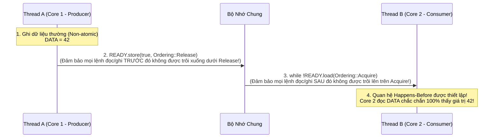
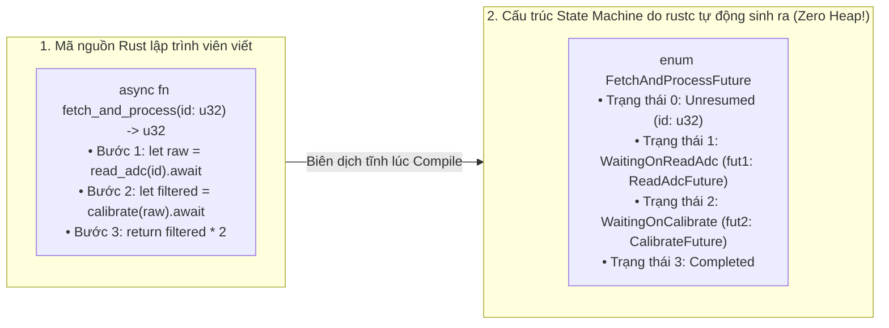

# CHUYÊN ĐỀ 06: ĐA LUỒNG KHÔNG SỢ HÃI (`SEND`/`SYNC`), ATOMICS & STACKLESS ASYNC/AWAIT

> Thuộc bộ cẩm nang: [[00_Rust_Mastery_Index|Rust Mastery Handbook]]
> Tham chiếu đối sánh: [[02_Storage_Classes_and_Type_Qualifiers|Chuyên đề 02 (C/C++): `_Atomic` & `thread_local`]] & [[05_Inline_Assembly_and_Barriers|Chuyên đề 05 (C/C++): Hardware Memory Barriers]]

---

## 1. Giải Mã Hai Marker Trait Thiên Tài: `Send` và `Sync`

Trong C/C++, nếu bạn vô tình truyền một con trỏ tới một cấu trúc dữ liệu không an toàn luồng (như `std::shared_ptr` được sửa đổi trực tiếp hoặc một bộ đếm không dùng khóa) sang một `pthread` khác, trình biên dịch C/C++ hoàn toàn im lặng. Lỗi **Data Race (Tranh chấp dữ liệu)** chỉ phát nổ ngẫu nhiên sau hàng tuần chạy trên hệ thống khách hàng.

Rust loại bỏ 100% lỗi Data Race ngay tại **thời điểm biên dịch** chỉ bằng hai **Auto Marker Traits** (không có phương thức nào, kích thước 0 byte, được trình biên dịch tự động suy diễn cho mọi struct/enum):

1. **`pub unsafe auto trait Send`**:
   - **Định nghĩa:** Một kiểu `T` là `Send` nếu việc **chuyển giao toàn bộ quyền sở hữu (Move `T`) sang một thread khác** là an toàn.
   - Hầu hết mọi kiểu đều là `Send`, ngoại trừ: `Rc<T>` (vì nếu 2 thread cùng giữ 2 bản clone của cùng một `Rc<T>`, chúng sẽ cùng tăng/giảm biến đếm không nguyên tử gây hỏng bộ nhớ), và `MutexGuard<'a, T>` (vì trên POSIX `pthread`, luồng nào khóa Mutex thì **chính luồng đó** phải mở khóa!).

2. **`pub unsafe auto trait Sync`**:
   - **Định nghĩa:** Một kiểu `T` là `Sync` nếu việc **chia sẻ tham chiếu bất biến `&T` cho nhiều thread cùng lúc** là an toàn.
   - **Định lý đại số cốt lõi của `Sync`:**
     $$T \text{ là } \mathbf{Sync} \iff \&T \text{ là } \mathbf{Send}$$
     *(Tức là: Có thể chia sẻ `T` giữa nhiều luồng nếu và chỉ nếu việc gửi một tham chiếu đọc `&T` sang luồng khác là an toàn!).*

### Bảng Phân Loại `Send` & `Sync` Của Các Kiểu Cốt Lõi

| Kiểu dữ liệu | `Send`? | `Sync`? | Giải thích bản chất kỹ thuật |
| :--- | :---: | :---: | :--- |
| **`i32`, `bool`, `[u8; N]`, `String`, `Vec<T>`, `Box<T>`** | ✅ Có | ✅ Có | Nếu `T` sở hữu độc quyền dữ liệu và không có Interior Mutability không đồng bộ, thì cả Move lẫn đọc đồng thời qua `&T` đều an toàn tuyệt đối. |
| **`Cell<T>` & `RefCell<T>`** | ✅ Có | ❌ **KHÔNG** | Bạn có thể **Move** một `RefCell<T>` từ thread A sang cho riêng thread B dùng (`Send`). Nhưng bạn **CẤM** chia sẻ `&RefCell<T>` cho cả thread A và B cùng gọi `.borrow_mut()` (`!Sync`, vì bộ đếm mượn của nó không phải là lệnh Atomic!). |
| **`Rc<T>`** | ❌ **KHÔNG** | ❌ **KHÔNG** | Cấm hoàn toàn việc bước qua biên giới Thread (`!Send` và `!Sync`). Nếu bạn thử đưa `Rc<T>` vào `std::thread::spawn`, compiler báo lỗi ngay lập tức! |
| **`Arc<T>`** | ✅ Có (nếu `T: Send + Sync`) | ✅ Có (nếu `T: Send + Sync`) | Bộ đếm tham chiếu dùng lệnh phần cứng nguyên tử (`AtomicUsize`). |
| **`Mutex<T>`** | ✅ Có (nếu `T: Send`) | ✅ **Có** (chỉ cần `T: Send`!) | Lưu ý tinh tế: `Mutex<RefCell<i32>>` **LÀ `Sync`** (mặc dù `RefCell` là `!Sync`)! Vì tại mỗi thời điểm chỉ có 1 thread giành được khóa `.lock()`, nên `Mutex` biến một kiểu chỉ cần `Send` thành `Sync`! |
| **Con trỏ thô `*const T` & `*mut T`** | ❌ **KHÔNG** | ❌ **KHÔNG** | Trình biên dịch cố tình đánh dấu con trỏ thô là `!Send` và `!Sync` để buộc lập trình viên khi bọc con trỏ trong `struct` phải tự kiểm tra và viết `unsafe impl Send for MyWrapper {}`. |

---

## 2. Scoped Threads (`std::thread::scope`): Đa Luồng Mượn Trực Tiếp Biến Stack Không Cần `Arc`!

Với `std::thread::spawn(move || ...)`, luồng con có thể chạy lâu hơn hàm gọi nó, nên Rust bắt buộc closure phải có ràng buộc `'static` (phải Move dữ liệu vào hoặc bọc trong `Arc<T>`).

Từ Rust 1.63, hàm **`std::thread::scope`** cho phép các luồng con **mượn trực tiếp tham chiếu `&T` hoặc `&mut [T]` trên Stack của luồng cha** mà không tốn dù chỉ 1 byte cấp phát Heap hay `Arc`:

```rust
pub fn parallel_sum(data: &[u64]) -> u64 {
    let mid = data.len() / 2;
    let (left, right) = data.split_at(mid);

    // std::thread::scope đảm bảo TẤT CẢ các luồng sinh ra bên trong `s.spawn`
    // ĐỀU ĐÃ JOIN HOÀN TẤT trước khi hàm `scope` kết thúc!
    std::thread::scope(|s| {
        // Luồng 1 mượn trực tiếp slice `left` trên Stack/RAM của luồng cha!
        let handle_left = s.spawn(|| left.iter().sum::<u64>());
        // Luồng 2 mượn trực tiếp slice `right`!
        let handle_right = s.spawn(|| right.iter().sum::<u64>());

        handle_left.join().unwrap() + handle_right.join().unwrap()
    })
}
```
*(Đã kiểm chứng trực tiếp tại [`code_lab/06_fearless_concurrency_atomics.rs`](file:///home/thinh/Obsidian/Rust_Mastery_Handbook/code_lab/06_fearless_concurrency_atomics.rs)).*

---

## 3. Atomics & 5 Mức Memory Ordering (*Rust Atomics and Locks* — Mara Bos)

Khi lập trình hệ thống không khóa (Lock-free programming) hoặc giao tiếp giữa trình phục vụ ngắt (ISR) và vòng lặp chính trên vi điều khiển, ta sử dụng các kiểu nguyên tử trong `core::sync::atomic` (`AtomicBool`, `AtomicUsize`, `AtomicU32`, `AtomicPtr<T>`).

Tại sao mọi hàm đọc/ghi Atomic trong Rust (`.load(ordering)`, `.store(val, ordering)`, `.fetch_add(1, ordering)`, `.compare_exchange(...)`) đều bắt buộc lập trình viên phải truyền vào một tham số **`Ordering`**?
Vì cả **Trình biên dịch (LLVM)** lẫn **Phần cứng CPU đa nhân (Store Buffer, Invalidation Queue trên ARM64/RISC-V/x86)** đều liên tục đảo thứ tự các lệnh đọc/ghi bộ nhớ để tối ưu tốc độ! `Ordering` chính là chỉ thị tạo rào chắn đồng bộ hóa giữa các nhân CPU:



### Bảng Đối Chiếu 5 Mức `core::sync::atomic::Ordering` Đến Tận Lệnh Máy (x86_64 vs ARMv8)

| Mức `Ordering` | Cam kết đồng bộ hóa bộ nhớ | Lệnh máy trên x86_64 (Strong Memory Model - TSO) | Lệnh máy trên ARM64 / Cortex-M (Weakly Ordered) | Khi nào sử dụng? |
| :--- | :--- | :--- | :--- | :--- |
| **`Ordering::Relaxed`** | Chỉ đảm bảo bản thân phép toán trên biến atomic đó là nguyên tử (không bị xé lẻ bit), **không đặt bất kỳ rào chắn thứ tự nào** với các biến khác. | `MOV` (load/store), `LOCK XADD` (fetch_add) | `LDR`, `STR`, `LDXR/STXR` | Bộ đếm thống kê đơn thuần (Packet counter, ID generator), cờ dừng không phụ thuộc dữ liệu khác. |
| **`Ordering::Release`** | *(Dùng cho Store)*: Mọi phép đọc/ghi bộ nhớ nằm **phía trước** lệnh Store này trong cùng thread **bắt buộc phải hoàn tất và hiển thị** cho bất kỳ thread nào thực hiện `Acquire` load thấy giá trị vừa ghi! | `MOV` (Vì phần cứng x86 mặc định đã có Store-Release!) | `STLR` (Store-Release) hoặc `DMB ISH` + `STR` | Khi luồng Sản xuất (Producer) vừa chuẩn bị xong dữ liệu trong buffer và bật cờ báo hiệu, hoặc khi **Mở khóa (Unlock) một Mutex**. |
| **`Ordering::Acquire`** | *(Dùng cho Load)*: Mọi phép đọc/ghi bộ nhớ nằm **phía sau** lệnh Load này **cấm được đẩy lên thực thi trước** khi lệnh Load hoàn tất. | `MOV` (Vì phần cứng x86 mặc định đã có Load-Acquire!) | `LDAR` (Load-Acquire) hoặc `LDR` + `DMB ISH` | Khi luồng Tiêu thụ (Consumer) kiểm tra cờ báo hiệu trước khi đọc dữ liệu buffer, hoặc khi **Khóa (Lock) một Mutex**. |
| **`Ordering::AcqRel`** | *(Dùng cho Read-Modify-Write như `fetch_add`, `compare_exchange`)*: Phần đọc mang tính chất `Acquire`, phần ghi mang tính chất `Release`. | `LOCK CMPXCHG` / `LOCK XADD` | `LDAXR` + `STLXR` | Trong bộ đếm tham chiếu `Arc::drop` (giảm biến đếm trước khi giải phóng vùng nhớ) hoặc CAS loop. |
| **`Ordering::SeqCst`** | **Sequentially Consistent:** Giống `AcqRel`/`Acquire`/`Release`, cộng thêm cam kết tồn tại một **thứ tự thời gian toàn cục duy nhất (Single Total Order)** mà mọi nhân CPU trong hệ thống đều đồng thuận. | `MOV` (load), `XCHG` hoặc `MOV + MFENCE` (store — **chậm hơn Release!**) | `LDAR` / `STLR` | Khi thuật toán yêu cầu nhiều biến atomic độc lập phải có thứ tự toàn cục (ví dụ thuật toán Dekker/Peterson). |

---

## 4. Giải Phẫu Async/Await Trong Rust: Stackless State Machine Không Dùng Heap

Tại sao Goroutine của Go hay Thread của Java/OS lại không thể chạy trên một vi điều khiển ARM Cortex-M0+ chỉ có **8 KB RAM**, trong khi **`async/await` của Rust (với Embassy RTOS) lại chạy được hàng chục tác vụ đồng thời trên con chip đó với 0 byte Heap**?

- **Mô hình Stackful Coroutine (Go / OS Threads):** Mỗi Goroutine phải được cấp phát một ngăn xếp (Stack) riêng biệt trên Heap (tối thiểu 2 KB – 8 KB, và phải có Runtime + Garbage Collector để co giãn Stack).
- **Mô hình Stackless Coroutine của Rust (`async/await`):** Một hàm `async fn` trong Rust **KHÔNG HỀ TẠO STACK RIÊNG VÀ KHÔNG GỌI MALLOC**! Trình biên dịch `rustc` biến đổi toàn bộ hàm `async fn` của bạn thành một **`enum` (Máy trạng thái hữu hạn - State Machine)** mà mỗi biến thể chỉ lưu đúng các biến cục bộ đang cần sống qua điểm `.await`!



### Giải phẫu Trait `core::future::Future`:
Toàn bộ hệ thống bất đồng bộ của Rust chỉ xoay quanh đúng 1 trait cực kỳ tối giản trong thư viện `core` (hoạt động cả trong `#![no_std]`):
```rust
pub trait Future {
    type Output;

    // Executor gọi hàm `poll` để đẩy máy trạng thái tiến thêm 1 bước!
    fn poll(self: Pin<&mut Self>, cx: &mut Context<'_>) -> Poll<Self::Output>;
}

pub enum Poll<T> {
    Ready(T), // Đã hoàn thành! Trả về kết quả cuối cùng.
    Pending,  // Chưa xong (đang đợi phần cứng/mạng). Đã đăng ký `cx.waker()` để khi có ngắt sẽ đánh thức lại!
}
```
**Cơ chế đánh thức không tốn CPU Polling (`Waker`):**
Khi `poll()` trả về `Poll::Pending`, nó không hề làm Executor phải lặp kiểm tra liên tục (Busy-waiting). Trước khi trả về `Pending`, đối tượng I/O bên dưới đã lưu lại `cx.waker()`.
- Trên **Linux (Tokio)**: Khi gói tin mạng đến card mạng, nhân Linux bắn sự kiện `epoll` / `io_uring`, Reactor gọi `waker.wake()` để đẩy Task đó trở lại hàng đợi chạy (`RunQueue`).
- Trên **Vi điều khiển Bare-metal (Embassy)**: CPU thực thi lệnh `WFE` / `WFI` (Wait For Event / Interrupt) để **ngủ tiết kiệm điện hoàn toàn**. Ngay khi ngắt phần cứng (DMA, Timer, UART ISR) xảy ra, hàm phục vụ ngắt gọi `waker.wake()`, đánh thức CPU dậy chạy tiếp đúng hàm `poll()` của Task đó!

---

## 5. Mổ Xẻ Mã Nguồn Thực Tế: Cách Embassy RTOS Và Tokio Hiện Thực Hóa Executor

### 5.1. **Embassy (`embassy-rs/embassy`)**: Cuộc Cách Mạng Async/Await Trên Vi Điều Khiển Bare-Metal
Trong lập trình nhúng truyền thống với FreeRTOS hoặc Zephyr, nếu bạn tạo 10 Task, bạn phải khai báo 10 mảng Stack tĩnh (ví dụ `10 * 1024 = 10 KB RAM`), và mỗi lần chuyển ngữ cảnh (Context Switch) bằng PendSV phải lưu/khôi phục 16–32 thanh ghi CPU xuống RAM.

Trong [`embassy-executor`](https://github.com/embassy-rs/embassy), khi bạn viết:
```rust
#[embassy_executor::task]
async fn blinky_task(mut led: Output<'static>) {
    loop {
        led.set_high();
        Timer::after_millis(500).await;
        led.set_low();
        Timer::after_millis(500).await;
    }
}
```
Macro `#[embassy_executor::task]` tính toán **chính xác đến từng byte** kích thước của `enum` State Machine cho hàm `blinky_task` ngay lúc biên dịch (thường chỉ khoảng **24 đến 48 bytes RAM**!) và cấp phát nó vào một biến `static TaskStorage<F>` trong vùng `.bss`.
- **Không có Stack riêng cho từng Task:** Tất cả các Task dùng chung duy nhất 1 Stack chính của hàm `main`!
- **Không có Context Switch lưu thanh ghi:** Việc chuyển từ Task A sang Task B chỉ đơn giản là một lệnh `return Poll::Pending;` bình thường của hàm C/Rust! Tốc độ phản hồi nhanh hơn RTOS truyền thống gấp nhiều lần và tiết kiệm đến 80% dung lượng SRAM!

### 5.2. **Tokio (`tokio-rs/tokio`)**: Bộ Lập Lịch Work-Stealing & Tối Ưu Hóa `Waker` Vtable
Trên các máy chủ đa nhân (Multi-core Linux/Windows), [`tokio`](https://github.com/tokio-rs/tokio) sử dụng kiến trúc **Multi-threaded Work-Stealing Scheduler**:
1. Mỗi nhân CPU có một luồng Worker riêng giữ một hàng đợi cục bộ kích thước cố định (`LocalQueue` gồm 256 slot dùng mảng vòng Atomic không khóa - Lock-free Ring Buffer) và một slot đặc biệt tên là **`LIFO slot`**.
2. Khi Task A đánh thức Task B (ví dụ gửi tin nhắn qua kênh `mpsc`), Task B được đặt ngay vào **`LIFO slot`** của chính nhân CPU đó để chạy nối tiếp ngay lập tức khi dữ liệu vẫn đang nằm nóng hổi trong bộ nhớ đệm L1 Cache!
3. Nếu một nhân CPU hết việc trong `LocalQueue`, nó sẽ tự động sang "đánh cắp" (Steal) một nửa số Task từ hàng đợi của nhân CPU đang bận rộn khác bằng một phép toán `compare_exchange` nguyên tử!

> [!IMPORTANT] Tổng kết Chuyên đề 06
> Sự kết hợp giữa `Send`/`Sync`, `Atomics` chuẩn hóa và `Async/Await` dựa trên State Machine giúp Rust trở thành ngôn ngữ duy nhất hiện nay vừa viết được dịch vụ mạng xử lý hàng triệu kết nối (`Tokio`), vừa viết được hệ điều hành thời gian thực không dùng Heap trên vi điều khiển siêu nhỏ (`Embassy`), với cam kết **0 lỗi Data Race tại thời điểm biên dịch**.
> Tiếp theo, tại [[07_Recommended_Resources_Books_and_Repos|Chuyên đề 07]], chúng ta sẽ tổng hợp toàn bộ hệ sinh thái công cụ kiểm chứng và kho tàng sách/mã nguồn để tiếp tục rèn luyện.
