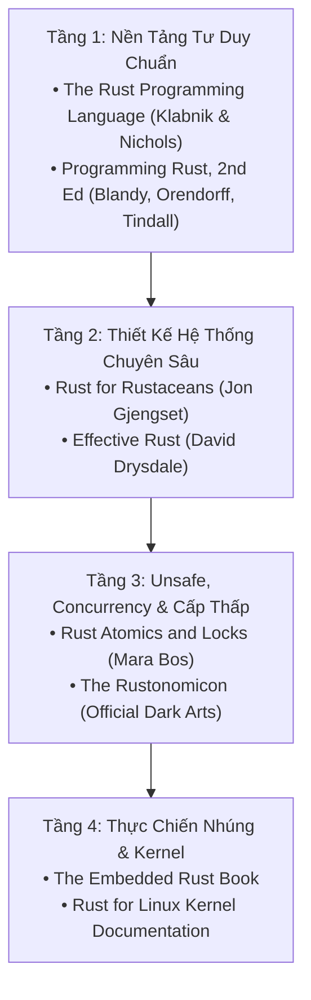

# CHUYÊN ĐỀ 07: THƯ VIỆN TÀI NGUYÊN, CÔNG CỤ KIỂM CHỨNG (MIRI, CLIPPY, EXPAND) & GITHUB REPOS

> Thuộc bộ cẩm nang: [[00_Rust_Mastery_Index|Rust Mastery Handbook]]
> Tham chiếu đối sánh: [[09_Recommended_Resources_and_Repos|Chuyên đề 09 (C/C++): Thư Viện Tài Nguyên, GitHub Repos & Sách Kinh Điển Khuyên Đọc]]

---

## 1. Lộ Trình Đọc Sách Kinh Điển Cho Kỹ Sư Hệ Thống & Nhúng

Để đi từ mức "biết cú pháp cơ bản" lên mức "làm chủ bản chất phần cứng, trình biên dịch và viết thư viện chuẩn mực", đây là lộ trình 4 tầng sách kinh điển nhất của thế giới Rust:

### 1.1. *Rust for Rustaceans: Idiomatic Programming for Experienced Developers* — Jon Gjengset
- **Tại sao phải đọc?** Cuốn sách gối đầu giường để bước từ Intermediate lên Senior/Staff Rust Engineer. Jon Gjengset (tiến sĩ MIT) giải phẫu cặn kẽ:
  - Bố cục bộ nhớ, Fat pointers, Variance (Subtyping), Higher-Rank Trait Bounds (`for<'a>`).
  - Nghệ thuật thiết kế API với Trait, Sealed Traits, Typestate Pattern và Zero-allocations.
  - Bản chất của `Pin
`, `Waker`, cơ chế `async/await` và quy tắc viết `unsafe` không dính UB.

### 1.2. *Rust Atomics and Locks: Low-Level Concurrency in Practice* — Mara Bos
- **Tại sao phải đọc?** Tác giả Mara Bos là trưởng nhóm Thư viện Chuẩn Rust (Rust Library Team Lead). Đây là một trong những cuốn sách viết về lập trình đa luồng cấp phần cứng xuất sắc nhất từng được xuất bản (không chỉ cho Rust mà cho cả C/C++):
  - Giải thích tường tận bộ đệm phần cứng CPU (MESI Cache Coherency, Store Buffers) và đối chiếu từng lệnh Assembly trên **x86_64 vs ARM64** cho cả 5 mức `Ordering`.
  - Hướng dẫn tự tay viết lại từ con số 0 (từ `UnsafeCell` và `Atomic*` cùng syscall `futex`): `SpinLock`, `Channel`, `Arc<T>`, `Mutex<T>`, `RwLock<T>` và `Condvar`.

### 1.3. *Programming Rust: Fast, Safe Systems Development (2nd Edition)* — Jim Blandy, Jason Orendorff & Leonora Tindall
- Cuốn sách có hệ thống sơ đồ minh họa bố cục bộ nhớ (Stack, Heap, Fat Pointers, String, Vec, HashMap, Closure layout) trực quan và chính xác nhất cho kỹ sư chuyển từ C/C++ sang Rust.

### 1.4. *The Rustonomicon: The Dark Arts of Unsafe Rust* & *The Reference*
- Tài liệu chính thức của đội ngũ phát triển trình biên dịch `rustc`. Bắt buộc phải đọc trước khi viết bất kỳ dòng code `unsafe`, FFI, `#[repr(...)]`, `MaybeUninit`, hay `Drop` tùy chỉnh nào.

---

## 2. Bộ Công Cụ Giải Phẫu Mã Máy & Kiểm Chứng Toàn Diện Của Hệ Sinh Thái Rust

Một trong những ưu thế vượt trội của Rust so với C/C++ là bộ công cụ phân tích chính quy đi kèm trình biên dịch:

| Công cụ / Lệnh CLI | Vai trò & Sức mạnh thực chiến |
| :--- | :--- |
| **`cargo +nightly miri test`** | **Vũ khí tối thượng chống Undefined Behavior (Tương đương Valgrind + ASan + UBSan + TSan gộp lại ở mức toán học!):** Miri thực thi trực tiếp mã trung gian MIR của `rustc`, phát hiện chính xác 100% mọi vi phạm **Stacked Borrows / Tree Borrows**, đọc bộ nhớ chưa khởi tạo, lệch biên (Unaligned reference), rò rỉ bộ nhớ và Data Race! |
| **`cargo clippy -- -W clippy::pedantic`** | Bộ phân tích tĩnh thông minh với hơn **700 quy tắc kiểm tra** về hiệu năng (ví dụ: cấp phát thừa, truyền giá trị lớn không cần thiết), độ an toàn và phong cách viết code chuẩn Rust. |
| **`cargo expand`** | Bung toàn bộ kết quả sau khi chạy **Declarative Macros (`macro_rules!`)** và **Procedural Macros (`#[derive(...)]`, `#[tokio::main]`)** ra thành mã nguồn Rust thuần túy. Giúp bạn nhìn tận mắt code mà trình biên dịch thực sự biên dịch! |
| **`cargo show-asm` (`cargo-show-asm`)** | Xuất trực tiếp mã máy **Assembly (x86/ARM)**, **LLVM IR** hoặc **MIR** của bất kỳ hàm Rust nào ngay trên Terminal (hoặc dùng trực tiếp trên **[Compiler Explorer - godbolt.org](https://godbolt.org)** với trình biên dịch `rustc -C opt-level=3`). |
| **`cargo llvm-lines`** | Thống kê chính xác hàm Generic nào đang sinh ra nhiều dòng lệnh LLVM IR nhất do Monomorphization, giúp tối ưu hóa thời gian biên dịch và giảm dung lượng Flash (Code size). |
| **`cargo bloat` & `cargo size`** | Phân tích dung lượng từng hàm và từng phân vùng (`.text`, `.rodata`, `.data`, `.bss`) trong file nhị phân ELF (cực kỳ quan trọng cho lập trình nhúng Bare-metal). |
| **`kani` / `loom`** | **Model Checkers:** `loom` thử nghiệm toàn bộ các hoán vị xen kẽ luồng (Thread interleavings) có thể xảy ra của thuật toán Lock-free Atomic; `kani` chứng minh hình thức (Formal Verification) không có panic/overflow. |

---

## 3. Các GitHub Repositories Mẫu Mực Cần Clone & Nghiên Cứu

Khi muốn học cách tổ chức dự án, viết Safe Abstraction bọc quanh Unsafe, và tối ưu hóa phần cứng đỉnh cao, hãy đọc trực tiếp mã nguồn của các dự án sau:

| Dự án / Repository | Đường dẫn GitHub | Điểm tinh hoa cần mổ xẻ & học tập |
| :--- | :--- | :--- |
| **Rust Standard Library (`core`, `alloc`, `std`)** | [`rust-lang/rust`](https://github.com/rust-lang/rust/tree/master/library) | Mã nguồn chuẩn mực nhất thế giới về cách viết Rust: `core::ptr::NonNull`, `core::mem::MaybeUninit`, `alloc::vec::Vec`, `alloc::sync::Arc` và các tối ưu hóa Niche. |
| **Rust for Linux Kernel** | [`Rust-for-Linux/linux`](https://github.com/Rust-for-Linux/linux/tree/rust-next/rust/kernel) | Cách xây dựng lớp trừu tượng Zero-Cost bọc quanh nhân Linux C: `Opaque<T>`, `ARef<T>`, Intrusive Linked List đã được Pin (`pin-init`), SpinLock và Driver PCI/Network/Block. |
| **Embassy (Embedded Async RTOS)** | [`embassy-rs/embassy`](https://github.com/embassy-rs/embassy) | Đỉnh cao của lập trình nhúng Bare-metal hiện đại (`#![no_std]`): Async Executor không dùng Heap, HAL an toàn kiểu (Typestate DMA/GPIO/SPI/UART) cho STM32, nRF, RP2040, ESP32. |
| **Tock Embedded OS** | [`tock/tock`](https://github.com/tock/tock) | Hệ điều hành nhúng bảo mật cao dùng kiến trúc Capsule, tận dụng triệt để `Cell` / `TakeCell` / `MapCell` để chia sẻ tài nguyên phần cứng tĩnh không cần cấp phát động. |
| **Tokio Async Runtime** | [`tokio-rs/tokio`](https://github.com/tokio-rs/tokio) | Kiến trúc Work-Stealing Scheduler đa nhân, Lock-free Queue, Intrusive Waker List và tích hợp `mio` / `io_uring`. |
| **Ripgrep (`rg`)** | [`BurntSushi/ripgrep`](https://github.com/BurntSushi/ripgrep) | Tối ưu hóa I/O cực hạn, SIMD vectorization, Zero-copy slice parsing (`&[u8]`, `Cow<str>`) và kiến trúc workspace đa crate rõ ràng. |
| **Serde Framework** | [`serde-rs/serde`](https://github.com/serde-rs/serde) | Nghệ thuật thiết kế Trait và Procedural Macro cho phép tuần tự hóa/giải tuần tự hóa Zero-Copy (`Deserialize<'de>`) không tốn chi phí runtime. |

---

## 4. Liên Kết Tới Phòng Thực Nghiệm (Code Lab)

Toàn bộ lý thuyết trong 7 chuyên đề đã được hiện thực hóa thành 6 chương trình thực nghiệm tự kiểm chứng tại thư mục [`code_lab/`](file:///home/thinh/Obsidian/Rust_Mastery_Handbook/code_lab/):
1. [`01_memory_layout_and_niche.rs`](file:///home/thinh/Obsidian/Rust_Mastery_Handbook/code_lab/01_memory_layout_and_niche.rs) — Kiểm chứng `#[repr(Rust)]` vs `#[repr(C)]` và Niche Optimization.
2. [`02_ownership_and_interior_mutability.rs`](file:///home/thinh/Obsidian/Rust_Mastery_Handbook/code_lab/02_ownership_and_interior_mutability.rs) — Thực nghiệm Borrowing, `Cell`, `RefCell`, `Rc` và `Arc`.
3. [`03_repr_packed_and_volatile.rs`](file:///home/thinh/Obsidian/Rust_Mastery_Handbook/code_lab/03_repr_packed_and_volatile.rs) — Thực nghiệm `#[repr(packed)]`, `&raw const` và `read_volatile`/`write_volatile`.
4. [`04_fat_pointers_and_dispatch.rs`](file:///home/thinh/Obsidian/Rust_Mastery_Handbook/code_lab/04_fat_pointers_and_dispatch.rs) — Giải phẫu Fat Pointers 16-byte (`&[T]`, `&dyn Trait`) và Static vs Dynamic Dispatch.
5. [`05_maybe_uninit_and_unsafe_ffi.rs`](file:///home/thinh/Obsidian/Rust_Mastery_Handbook/code_lab/05_maybe_uninit_and_unsafe_ffi.rs) — Quản lý bộ nhớ chưa khởi tạo bằng `MaybeUninit<T>` và giao tiếp `extern "C"`.
6. [`06_fearless_concurrency_atomics.rs`](file:///home/thinh/Obsidian/Rust_Mastery_Handbook/code_lab/06_fearless_concurrency_atomics.rs) — Đa luồng không cấp phát với `std::thread::scope`, `AtomicUsize` và `Mutex<T>`.
