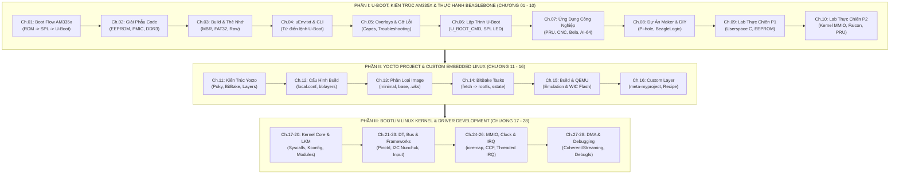

# 🦴🐧 Giáo Trình Nghiên Cứu Toàn Diện: U-Boot, BeagleBone Black (TI AM335x), Yocto Project & Bootlin Linux Kernel (Mastery Edition)

Bộ tài liệu này được biên soạn và hợp nhất chuyên sâu dành riêng cho việc **học tập, nghiên cứu và phát triển hệ thống nhúng Linux toàn diện (28 chương + 6 bộ code thực chiến)**:
1. **Phần I (Chương 01 – 10)**: Kiến trúc bootloader **Das U-Boot**, vi xử lý **Texas Instruments AM335x** (Cortex-A8 + PRU-ICSS) và thực hành trực tiếp trên bo mạch **BeagleBone Black**.
2. **Phần II (Chương 11 – 16)**: Hệ thống xây dựng bản phân phối **Yocto Project / Poky / BitBake** (Scarthgap 5.0 LTS).
3. **Phần III (Chương 17 – 28)**: Kiến trúc **Linux Kernel & Device Driver Development** chuẩn hóa theo **446 slides khóa học chính thức của Bootlin** ([linux-kernel-slides.pdf](./linux-kernel-slides.pdf)).

Tài liệu được thiết kế tương thích hoàn hảo với cơ chế liên kết ghi chú của **Obsidian**, tích hợp sơ đồ **Mermaid**, giải phẫu mã nguồn C/Device Tree, kho mã nguồn mẫu (`code_examples/`) và 18 bài thực hành **Hands-on Practical Labs**.

---

## 🗺️ LỘ TRÌNH HỌC TẬP TỔNG THỂ (28 CHƯƠNG TỪ A ĐẾN Z)

---

## 📘 PHẦN I: KIẾN TRÚC U-BOOT, PHẦN CỨNG BEAGLEBONE BLACK & LAB THỰC CHIẾN (CHƯƠNG 01 – 10)

| Chương | Tên Chuyên Đề | Nội dung chính & Kỹ năng đạt được |
| :---: | :--- | :--- |
| **01** | [Chương 1: Tổng Quan Kiến Trúc Boot Flow AM335x](./docs/01_Tong_Quan_Kien_Truc_Boot_Flow_AM335x.md) | Phân tầng 4 giai đoạn khởi động; Giải mã chi tiết tại sao cần SPL/MLO; Giới hạn 109 KB Internal SRAM; Chân `SYSBOOT[15:0]`, nút S2, Cold vs Warm Reset; Bản đồ bộ nhớ 512MB DDR3. |
| **02** | [Chương 2: Giải Phẫu Mã Nguồn U-Boot Cho BeagleBone](./docs/02_Giai_Phau_Ma_Nguon_UBoot_Cho_BeagleBone.md) | Phân tích `am335x_evm_defconfig`; Thư mục `board/ti/am335x/` (`board.c`, `board.h`, `mux.c`); Đọc EEPROM ID `A335BNLT`; Kỹ thuật port U-Boot cho Custom Board; Nâng áp PMIC TPS65217C lên 1.325V; Cấu hình DDR3 timing; Phân tích `am335x_evm.h` và Device Tree trong U-Boot (`u-boot,dm-spl`). |
| **03** | [Chương 3: Thực Hành Build U-Boot & Tạo Thẻ Nhớ Boot](./docs/03_Thuc_Hanh_Build_UBoot_Va_Tao_The_Nho_Boot.md) | Cài đặt Toolchain ARM `gcc-arm-linux-gnueabihf`; Clone mã nguồn Denx U-Boot; Biên dịch ra `MLO` và `u-boot.img`; Kiểm tra GP Header bằng `hexdump`; Phân vùng MBR bằng `parted`; Quy tắc sao chép `MLO` vào FAT32; Phương pháp Raw Flashing vào eMMC (`seek=1 bs=128k`). |
| **04** | [Chương 4: Cấu Hình uEnv.txt & Từ Điển Lệnh U-Boot CLI](./docs/04_Cau_Hinh_uEnv_Va_Tap_Lenh_UBoot_CLI.md) | Cơ chế `env import`; File cấu hình `uEnv.txt` mẫu hoàn chỉnh giải thích từng biến (`console`, `loadaddr`, `fdtaddr`, `bootargs`, `uenvcmd`); Từ điển tra cứu toàn diện các lệnh U-Boot CLI: quản lý MMC (`mmc`), hệ thống file (`fatload`, `ext4load`, `load`), biến môi trường (`setenv`, `saveenv`), khởi động (`bootz`), can thiệp RAM & thanh ghi (`md`, `mw`, `mm`), Device Tree (`fdt`). |
| **05** | [Chương 5: Kỹ Thuật Nâng Cao, Repo Mẫu & Gỡ Lỗi](./docs/05_Cac_Ky_Thuat_Nang_Cao_Va_Phan_Tich_Repo_Mau.md) | Phân tích kỹ thuật từ `RobertCNelson/boot-scripts`: Cape Manager (Device Tree Overlays trong U-Boot), UUID tự động cho RootFS; Hướng dẫn thực hành nạp Kernel thủ công từng lệnh qua UART Console; Cẩm nang chẩn đoán 4 sự cố kinh điển: UART im lặng, chuỗi "CCCC...", treo ở SPL, treo sau "Starting kernel...". |
| **06** | [Chương 6: Hướng Dẫn Lập Trình Custom & Phát Triển U-Boot](./docs/06_Huong_Dan_Lap_Trinh_Custom_Va_Phat_Trien_UBoot.md) | Khám phá cấu trúc bên trong U-Boot; Những kỹ năng học được (Hardware Bring-up, Driver Model DM, Memory Map, Bare-metal); 2 Quy trình chỉnh sửa code (Standalone vs Yocto `devtool`); 3 Ví dụ thực hành: Tạo lệnh CLI mới (`U_BOOT_CMD`), điều khiển GPIO LED ngay trong SPL, vá động Device Tree trước khi jump vào Linux. |
| **07** | [Chương 7: Hệ Sinh Thái Ứng Dụng Thực Tế & Dự Án BeagleBone](./docs/07_He_Sinh_Thai_Ung_Dung_Thuc_Te_Va_Du_An_BeagleBone.md) | Phân tích sức mạnh độc nhất của vi xử lý AM335x: Hệ thống PRU-ICSS (2 nhân RISC 200MHz, 5ns/cycle, zero-jitter), PREEMPT_RT Real-Time Linux; Ứng dụng tự động hóa công nghiệp (Machinekit CNC, OpenPLC, EtherCAT Slave, CAN bus SocketCAN); Robot học (BeagleBone Blue, EduMIP, ArduPilot Linux native); Xử lý âm thanh siêu độ trễ Bela Platform (<1ms latency); Các dòng bo mạch thế hệ mới: BeagleBone AI-64 (8.0 TOPS TDA4VM) và BeaglePlay (Single Pair Ethernet 1km). |
| **08** | [Chương 8: Dự Án Đời Thường, DIY & Home Lab Với BeagleBone](./docs/08_Cac_Du_An_Maker_DIY_Va_Home_Lab_Voi_BeagleBone.md) | Đánh giá BeagleBone trong đời sống thường nhật so với RPi và ESP32 (lợi thế eMMC không lo hỏng nguồn, 7 kênh ADC, 65+ chân GPIO); Hướng dẫn chi tiết 5 dự án thực chiến: Pi-hole DNS server chặn quảng cáo "bất tử", BeagleLogic phân tích logic 14 kênh 100MSPS qua PulseView, đọc dữ liệu ô tô OBD-II qua CAN bus, trạm tưới cây đa chậu ADC, Audiophile music streamer; 4 lưu ý kỹ thuật sống còn (ADC 1.8V, GPIO 3.3V, nguồn jack DC 5V/2A, công cụ `config-pin`). |
| **09** | [Chương 9: Thực Hành Toàn Diện Với BBB, Thẻ Nhớ & UART (Phần 1)](./docs/09_Thuc_Hanh_Toan_Dien_Voi_BBB_The_Nho_Va_UART_Phan_1_Co_So_Va_Trung_Cap.md) | Thiết kế riêng cho bộ 3 công cụ (BBB + Thẻ nhớ + UART): Đấu nối J1 UART0; **Lab 1**: Code C Userspace (`bbb_diag.c`) đọc thanh ghi vật lý `DEVICE_ID` (`0x44E10600`) qua `/dev/mem`, đọc chip EEPROM `I2C0` (`0x50`) và điều khiển 4 đèn LED `USR0..3`; **Lab 2**: Viết lệnh CLI U-Boot (`cmd_bbb_hwinfo.c`) giải mã chân `SYSBOOT[4:0]` nút nhấn S2 và điều khiển thanh ghi `GPIO1` trực tiếp trong U-Boot. |
| **10** | [Chương 10: Thực Hành Toàn Diện Với BBB, Thẻ Nhớ & UART (Phần 2)](./docs/10_Thuc_Hanh_Toan_Dien_Voi_BBB_The_Nho_Va_UART_Phan_2_Chuyen_Sau_Kernel_Falcon_PRU.md) | **Lab 3**: Viết Linux Kernel Module (`bbb_mmio_kmod.c`) dùng `ioremap()` điều khiển thanh ghi nguyên tử `GPIO_SETDATAOUT`/`CLEARDATAOUT` qua `/proc/bbb_mmio`; **Lab 4**: Tối ưu thời gian boot `< 2 giây` với **U-Boot Falcon Mode** (`spl export fdt`); **Lab 5**: Porting U-Boot vượt qua kiểm tra EEPROM cho Custom Board; **Lab 6**: Lập trình nhân thời gian thực `PRU0` (200MHz, 5ns/cycle) giao tiếp qua `RPMsg`. |

---

## 🐧 PHẦN II: YOCTO PROJECT & CUSTOM EMBEDDED LINUX DISTRIBUTION (CHƯƠNG 11 – 16)

| Chương | Tên Chuyên Đề | Nội dung chính & Kỹ năng đạt được |
| :---: | :--- | :--- |
| **11** | [Chương 11 (Yocto 1): Kiến Trúc Tổng Quan & Khái Niệm Cốt Lõi](./docs/11_Yocto_Kien_Truc_Tong_Quan_Va_Khai_Niem_Cot_Loi.md) | Bản chất của Yocto Project; 4 trụ cột: Poky, BitBake, OE-Core, Metadata; Phân loại Recipes (`.bb`), Appends (`.bbappend`), Classes (`.bbclass`), Configuration (`.conf`); Kiến trúc Layer phân tầng (`meta-*`) và nguyên lý tách biệt BSP/Distro/App. |
| **12** | [Chương 12 (Yocto 2): Giải Phẫu local.conf & bblayers.conf](./docs/12_Yocto_Giai_Phau_File_Cau_Hinh_local_conf_Va_bblayers_conf.md) | Giải thích từng chỉ thị trong `local.conf`: `MACHINE`, `DISTRO`, `PACKAGE_CLASSES` (ipk/deb/rpm), `EXTRA_IMAGE_FEATURES` (`debug-tweaks`, `tools-debug`, `ssh-server`), `DL_DIR` & `SSTATE_DIR` (tối ưu tốc độ build 80%), quy tắc override hiện đại với dấu `:`. Quản lý Layer qua `bblayers.conf` và công cụ `bitbake-layers`. |
| **13** | [Chương 13 (Yocto 3): Các Loại Image Tiêu Chuẩn & Phân Vùng Đĩa](./docs/13_Yocto_Cac_Loai_Image_Tieu_Chuan_Va_Y_Nghia.md) | Phân tích 5 loại Image chuẩn (`core-image-minimal`, `core-image-base`, `core-image-full-cmdline`, `core-image-sato`, `core-image-weston`); Cơ chế phân vùng bộ nhớ (`IMAGE_ROOTFS_EXTRA_SPACE` vs phần dung lượng trống trên thẻ nhớ & file `.wks` Kickstart); Cơ chế BitBake tìm kiếm và thêm lệnh image mới. |
| **14** | [Chương 14 (Yocto 4): Quy Trình BitBake Task Execution Flow](./docs/14_Yocto_Quy_Trinh_BitBake_Task_Execution_Flow.md) | Vòng đời tác vụ của một Recipe: `do_fetch` $\rightarrow$ `do_unpack` $\rightarrow$ `do_patch` $\rightarrow$ `do_configure` $\rightarrow$ `do_compile` $\rightarrow$ `do_install` (thư mục giả lập `${D}`) $\rightarrow$ `do_package` $\rightarrow$ `do_rootfs`; Cơ chế mã băm Signature Generator và Shared State Cache (`sstate-cache`); Từ điển lệnh BitBake (`-c listtasks`, `-c menuconfig`, `-c cleansstate`, `-e`). |
| **15** | [Chương 15 (Yocto 5): Thực Hành Build Image & Chạy Mô Phỏng QEMU](./docs/15_Yocto_Thuc_Hanh_Step_By_Step_Build_Image_Va_Emulation.md) | Cài đặt gói phụ thuộc trên Ubuntu; Clone Poky LTS **Scarthgap 5.0**; Khởi tạo `oe-init-build-env`; Cấu hình và build `core-image-minimal`; Chạy mô phỏng máy ảo bằng `runqemu`; Hướng dẫn build cho bo mạch thật BeagleBone Black (`MACHINE = "beaglebone-yocto"`), nạp file `.wic` vào thẻ nhớ MicroSD. |
| **16** | [Chương 16 (Yocto 6): Tạo Custom Layer, Viết Recipe C & Custom Image](./docs/16_Yocto_Tao_Custom_Layer_Viet_Recipe_Va_Custom_Image.md) | Sử dụng `bitbake-layers create-layer` và `add-layer`; Viết mã nguồn C (`main.c`, `Makefile`) và đóng gói thành `my-app_1.0.bb`; Hướng dẫn thực chiến tùy biến `my-custom-image` và `my-iot-image`: vị trí file, thêm gói `IMAGE_INSTALL`, bật tính năng `IMAGE_FEATURES`, tăng dung lượng đĩa `IMAGE_ROOTFS_EXTRA_SPACE`, tạo user/mật khẩu, và chạy script post-process. |

---

## 🛠️ PHẦN III: LINUX KERNEL ARCHITECTURE & DRIVER DEVELOPMENT — BOOTLIN 446 SLIDES (CHƯƠNG 17 – 28)

> Toàn bộ 12 chương dưới đây được đối chiếu và chuẩn hóa trực tiếp từ tài liệu gốc [linux-kernel-slides.pdf](./linux-kernel-slides.pdf) (446 slides) của **Bootlin**.

| Chương | Tên Chuyên Đề | Slide Gốc & Practical Labs |
| :---: | :--- | :--- |
| **17** | [Chương 17 (Bootlin Kernel 1): Linux Kernel Introduction](./docs/17_Bootlin_Kernel_01_Linux_Kernel_Introduction.md) | **Slide 17–22**: Vai trò Kernel, Monolithic Architecture, User Space vs Kernel Space, System Calls, Pseudo filesystems (`procfs`, `sysfs`, `devtmpfs`).  🧪 **Lab 1**: Benchmark độ trễ System Call Trap vs User Space; Khám phá `/proc` & `/sys`. |
| **18** | [Chương 18 (Bootlin Kernel 2): Linux Kernel Sources](./docs/18_Bootlin_Kernel_02_Linux_Kernel_Sources.md) | **Slide 23–48**: Chu kỳ Merge Window/RC/LTS, cấu trúc cây mã nguồn (`arch/`, `drivers/`, `fs/`), giới hạn Kernel Stack cố định (4KB/8KB/16KB), không dùng `libc`, GPLv2 & User-space Drivers (UIO, `i2c-dev`, `spidev`, `libusb`).  🧪 **Lab 2**: Clone nguồn Kernel; Tra cứu `start_kernel()` bằng `cscope`/`ctags`; Kiểm tra Coding Style với `checkpatch.pl`. |
| **19** | [Chương 19 (Bootlin Kernel 3): Kernel Usage - Config, Build & Boot](./docs/19_Bootlin_Kernel_03_Linux_Kernel_Usage_Config_Build_Boot.md) | **Slide 49–91**: Hệ thống `Kconfig`/`menuconfig`, biên dịch chéo (`ARCH`, `CROSS_COMPILE`), `zImage` (`bootz`) vs `Image` (`booti`), cơ chế truyền `bootargs` qua node `/chosen` của Device Tree, quản lý Modules (`modprobe`, `insmod`, `rmmod`).  🧪 **Lab 3**: Biên dịch chéo Kernel ARM64 và khởi động trên QEMU. |
| **20** | [Chương 20 (Bootlin Kernel 4): Developing Kernel Modules](./docs/20_Bootlin_Kernel_04_Developing_Kernel_Modules.md) | **Slide 92–108**: Cấu trúc LKM (`module_init`/`module_exit`, `__init`/`__exit`), `MODULE_LICENSE`, xuất hàm `EXPORT_SYMBOL_GPL`, tham số `module_param()`, Kbuild Makefile.  🧪 **Lab 4**: Viết Out-of-tree Module nhận tham số và điều chỉnh động qua `/sys/module/`. |
| **21** | [Chương 21 (Bootlin Kernel 5): Hardware Description & Device Tree](./docs/21_Bootlin_Kernel_05_Hardware_Description_Device_Tree.md) | **Slide 109–175**: Cú pháp Device Tree (`.dts`, `.dtsi`, `.dtb`), cây kế thừa Device Tree trên **BeagleBone Black** (`am33xx.dtsi` $\rightarrow$ `am335x-boneblack.dts`), kiểm chuẩn YAML Bindings (`dtbs_check`), Pin Muxing & Subsystem `pinctrl-single` (`AM33XX_PADCONF`).  🧪 **Lab 5**: Khai báo node I2C Nunchuk (`joystick@52`) và biên dịch với `dtc`. |
| **22** | [Chương 22 (Bootlin Kernel 6): Linux Device & Driver Model](./docs/22_Bootlin_Kernel_06_Device_Driver_Model.md) | **Slide 176–223**: Unified Device Model (`bus_type`, `device`, `device_driver`), Platform Drivers, I2C Subsystem (`i2c_master_send`/`i2c_master_recv`, chữ ký `probe()` 1 tham số trên Kernel $\ge$ 6.3).  🧪 **Lab 6**: Viết I2C Driver đọc dữ liệu tay cầm Wii Nunchuk. |
| **23** | [Chương 23 (Bootlin Kernel 7): Kernel Frameworks & Char Drivers](./docs/23_Bootlin_Kernel_07_Kernel_Frameworks_Char_Drivers.md) | **Slide 224–265**: Major/Minor (`dev_t`), `cdev` & `file_operations`, `copy_to_user`/`copy_from_user`, Input Subsystem & Polled Input (`input_setup_polling`), Managed APIs (`devm_*`), liên kết cấu trúc dữ liệu (`input_set_drvdata`).  🧪 **Lab 7**: Tích hợp Nunchuk Polled Input Driver và kiểm thử với `evtest`. |
| **24** | [Chương 24 (Bootlin Kernel 8): Memory Management & I/O Memory](./docs/24_Bootlin_Kernel_08_Memory_Management_IO_Memory.md) | **Slide 266–299**: Virtual Memory, Page/Buddy Allocator, SLUB Allocator (`kmalloc` vs `vmalloc`, `GFP_KERNEL` vs `GFP_ATOMIC`), bản đồ `/proc/iomem` thực tế của **BeagleBone Black** (`0x44E07000` GPIO0, `0x4804C000` GPIO1, `0x44E09000` UART0), `devm_platform_ioremap_resource()`, `readl`/`writel`.  🧪 **Lab 8**: Ánh xạ MMIO thanh ghi GPIO để điều khiển đèn LED. |
| **25** | [Chương 25 (Bootlin Kernel 9): Clock, Power & Misc Subsystem](./docs/25_Bootlin_Kernel_09_Clock_Power_Misc_Subsystem.md) | **Slide 300–315**: Common Clock Framework (`devm_clk_get`, `clk_prepare_enable`), Reset Framework, System Suspend/Resume & Runtime PM (`pm_runtime_enable`/`pm_runtime_get_sync` trên AM335x), Subsystem `miscdevice`.  🧪 **Lab 9**: Viết Driver Serial UART `/dev/feserial` kết hợp CCF Clock, Runtime PM và `miscdevice`. |
| **26** | [Chương 26 (Bootlin Kernel 10): Processes, Scheduling, Interrupts & Locking](./docs/26_Bootlin_Kernel_10_Processes_Scheduling_Interrupts_Concurrency.md) | **Slide 316–374**: Process vs Interrupt Context, Wait Queues (`wait_event_interruptible`), Top-half vs Bottom-half (`devm_request_threaded_irq`, Workqueues, Softirqs), Concurrency & Locking (Spinlocks `spin_lock_irqsave` vs Mutexes, Atomic, RCU).  🧪 **Lab 10**: Lập trình ngắt nút bấm GPIO Threaded IRQ với Spinlock & Wait Queue. |
| **27** | [Chương 27 (Bootlin Kernel 11): Direct Memory Access (DMA)](./docs/27_Bootlin_Kernel_11_Direct_Memory_Access_DMA.md) | **Slide 375–400**: Nguyên lý DMA, bài toán Cache Coherency, Coherent Mapping (`dma_alloc_coherent`) vs Streaming Mapping (`dma_map_single`), Slave DMA Engine Framework.  🧪 **Lab 11**: Cấp phát Coherent DMA Buffer và kiểm tra địa chỉ bus vật lý. |
| **28** | [Chương 28 (Bootlin Kernel 12): Kernel Debugging & Advanced APIs](./docs/28_Bootlin_Kernel_12_Kernel_Debugging_Useful_APIs.md) | **Slide 401–446 & Slide 264**: `printk`/`dev_dbg`, Dynamic Debug, `debugfs`, `scripts/dtc/dtx_diff`, phân tích Kernel Oops (`decode_stacktrace.sh`), `kgdb`, Magic SysRq, macro `container_of`, `mmap` (`remap_pfn_range`), Circular Linked Lists (`struct list_head`).  🧪 **Lab 12**: Tạo giao diện `debugfs` và phân tích Kernel Oops. |

---

## 💻 KHO MÃ NGUỒN MINH HỌA THỰC CHIẾN (`code_examples/`)

| Phân hệ | File mã nguồn / Kịch bản | Mục đích & Tính năng |
| :--- | :--- | :--- |
| **01. Userspace C** | [`bbb_diag.c`](./code_examples/01_userspace_c_diag/bbb_diag.c) & [`Makefile`](./code_examples/01_userspace_c_diag/Makefile) | Đọc `DEVICE_ID` (`0x44E10600`), giải mã EEPROM `I2C0 0x50`, điều khiển 4 đèn LED `USR0..3` và chạy hiệu ứng Knight Rider qua UART. |
| **02. U-Boot Custom & Porting** | [`cmd_bbb_hwinfo.c`](./code_examples/02_uboot_custom_cmd_and_porting/cmd_bbb_hwinfo.c) | Lệnh U-Boot `bbb_hwinfo` đọc thanh ghi `SYSBOOT` (kiểm tra nút S2) và điều khiển 4 đèn LED ngay tại dấu nhắc `=>`. |
| **02. U-Boot Custom & Porting** | [`0001-am335x-custom-board-bypass-eeprom-and-spl-led.patch`](./code_examples/02_uboot_custom_cmd_and_porting/0001-am335x-custom-board-bypass-eeprom-and-spl-led.patch) | Bản vá Git cho `board/ti/am335x/board.c`: Giả lập ID `A335BNLT` khi không có EEPROM và bật sáng đèn `USR0` ngay trong SPL. |
| **02. U-Boot Custom & Porting** | [`uEnv_sdcard_boot.txt`](./code_examples/02_uboot_custom_cmd_and_porting/uEnv_sdcard_boot.txt) | Kịch bản `uEnv.txt` mẫu chuẩn xác nạp `zImage` và `.dtb` từ thẻ nhớ MicroSD kèm xuất log ra cổng UART0. |
| **03. Falcon Mode Fast Boot** | [`falcon_mode.cfg`](./code_examples/03_falcon_mode_fastboot/falcon_mode.cfg) & [`falcon_mode_uart_commands.txt`](./code_examples/03_falcon_mode_fastboot/falcon_mode_uart_commands.txt) | Cấu hình `CONFIG_SPL_OS_BOOT=y` và quy trình chạy lệnh `spl export fdt` trên UART để SPL nhảy thẳng vào Linux trong `< 2 giây`. |
| **04. Linux Kernel Module** | [`bbb_mmio_kmod.c`](./code_examples/04_linux_kernel_module_mmio/bbb_mmio_kmod.c) & [`Makefile`](./code_examples/04_linux_kernel_module_mmio/Makefile) | Driver nhân Linux ánh xạ `CONTROL_MODULE` (`0x44E10000`) và `GPIO1` (`0x4804C000`) qua `ioremap()`, tạo giao diện `/proc/bbb_mmio` điều khiển trực tiếp từ UART. |
| **05. PRU Real-Time (5ns)** | [`pru0_firmware.c`](./code_examples/05_pru_realtime_rpmsg/pru0_firmware.c) & [`pru_host_uart_test.sh`](./code_examples/05_pru_realtime_rpmsg/pru_host_uart_test.sh) | Firmware C cho nhân RISC PRU0 200MHz định thời chính xác bằng `__delay_cycles()` và truyền tin qua `/dev/rpmsg_pru30`. |
| **06. SD Card Flasher** | [`prepare_bbb_sdcard.sh`](./code_examples/06_sdcard_flasher_and_uart_scripts/prepare_bbb_sdcard.sh) | Kịch bản tự động phân vùng thẻ nhớ MBR (FAT32 + EXT4) và sao chép `MLO` đầu tiên theo quy chuẩn ROM Code AM335x. |

---

## 📚 TÀI LIỆU GỐC & CỔNG THÔNG TIN TRA CỨU CHÍNH THỨC

1. **Bootlin Official Kernel & Driver Slides (Bản PDF gốc trong kho)**: [linux-kernel-slides.pdf](./linux-kernel-slides.pdf) | Bản text trích xuất: [extracted_slides.txt](./extracted_slides.txt)
2. **Denx Das U-Boot Mainline**: [https://github.com/u-boot/u-boot](https://github.com/u-boot/u-boot)
3. **BeagleBoard.org U-Boot Mirror**: [https://github.com/beagleboard/u-boot](https://github.com/beagleboard/u-boot)
4. **Robert C. Nelson Boot Scripts & Kernel Builder**: [https://github.com/RobertCNelson/boot-scripts](https://github.com/RobertCNelson/boot-scripts) | [https://github.com/RobertCNelson/bb-kernel](https://github.com/RobertCNelson/bb-kernel)
5. **Texas Instruments AM335x Technical Reference Manual (TRM)**: Document mã hiệu **SPRUH73** (Chương 4: *PRU-ICSS*, Chương 9: *Control Module*, Chương 25: *GPIO*, Chương 26: *Initialization*).
6. **Yocto Project Official Documentation**: [https://docs.yoctoproject.org/](https://docs.yoctoproject.org/)
7. **OpenEmbedded Layer Index**: [https://layers.openembedded.org/](https://layers.openembedded.org/)
8. **Poky Source Repository**: [https://git.yoctoproject.org/poky](https://git.yoctoproject.org/poky)
