# 🦴 Giáo Trình Nghiên Cứu Chuyên Sâu: U-Boot & Bootloader Architecture Trên BeagleBone Black (TI AM335x)

Bộ tài liệu này được biên soạn và hệ thống hóa chuyên sâu dành riêng cho việc **học tập, nghiên cứu và phát triển hệ thống nhúng Linux** xoay quanh bootloader **Das U-Boot** và vi xử lý **Texas Instruments AM335x** (Cortex-A8) trên bo mạch **BeagleBone Black**.

Tài liệu được thiết kế tương thích hoàn hảo với cơ chế liên kết ghi chú của **Obsidian**, tích hợp sơ đồ tuần tự **Mermaid**, giải phẫu mã nguồn C/Device Tree và các bài thực hành **Hands-on Lab**.

---

## 🗺️ LỘ TRÌNH HỌC TẬP & DANH SÁCH CÁC CHƯƠNG (CURRICULUM ROADMAP)

```mermaid
graph LR
    Ch1["Chương 1: Kiến Trúc Boot Flow<br>(ROM -> SPL -> U-Boot -> Kernel)"] --> Ch2["Chương 2: Giải Phẫu Mã Nguồn<br>(C Code, EEPROM, PMIC, DDR3)"]
    Ch2 --> Ch3["Chương 3: Thực Hành Build & Flash<br>(Cross-compile, MBR, FAT32, Raw)"]
    Ch3 --> Ch4["Chương 4: uEnv.txt & U-Boot CLI<br>(Từ điển lệnh, Memory Debugging)"]
    Ch4 --> Ch5["Chương 5: Nâng Cao & Gỡ Lỗi<br>(Capes Overlays, UUID, Troubleshooting)"]
    Ch5 --> Ch6["Chương 6: Lập Trình Custom & Dev<br>(Thêm lệnh CLI, SPL Driver, DTB patch)"]
    Ch6 --> Ch7["Chương 7: Ứng Dụng Công Nghiệp<br>(PRU Real-time, CNC, Bela DSP, Edge AI)"]
    Ch7 --> Ch8["Chương 8: Dự Án Maker & Home Lab<br>(Pi-hole, BeagleLogic, OBD-II, Audio)"]
```

---

| Chương | Tên Chuyên Đề | Nội dung chính & Kỹ năng đạt được |
| :---: | :--- | :--- |
| **01** | [Chương 1: Tổng Quan Kiến Trúc Boot Flow AM335x](./docs/01_Tong_Quan_Kien_Truc_Boot_Flow_AM335x.md) | Phân tầng 4 giai đoạn khởi động; Giải mã chi tiết tại sao cần SPL/MLO; Giới hạn 109 KB Internal SRAM; Chân `SYSBOOT[15:0]`, nút S2, Cold vs Warm Reset; Bản đồ bộ nhớ 512MB DDR3. |
| **02** | [Chương 2: Giải Phẫu Mã Nguồn U-Boot Cho BeagleBone](./docs/02_Giai_Phau_Ma_Nguon_UBoot_Cho_BeagleBone.md) | Phân tích `am335x_evm_defconfig`; Thư mục `board/ti/am335x/` (`board.c`, `board.h`, `mux.c`); Đọc EEPROM ID `A335BNLT`; Kỹ thuật port U-Boot cho Custom Board; Nâng áp PMIC TPS65217C lên 1.325V; Cấu hình DDR3 timing; Phân tích `am335x_evm.h` và Device Tree trong U-Boot (`u-boot,dm-spl`). |
| **03** | [Chương 3: Thực Hành Build U-Boot & Tạo Thẻ Nhớ Boot](./docs/03_Thuc_Hanh_Build_UBoot_Va_Tao_The_Nho_Boot.md) | Cài đặt Toolchain ARM `gcc-arm-linux-gnueabihf`; Clone mã nguồn Denx U-Boot; Biên dịch ra `MLO` và `u-boot.img`; Kiểm tra GP Header bằng `hexdump`; Phân vùng MBR bằng `parted`; Quy tắc sao chép `MLO` vào FAT32; Phương pháp Raw Flashing vào eMMC (`seek=1 bs=128k`). |
| **04** | [Chương 4: Cấu Hình uEnv.txt & Từ Điển Lệnh U-Boot CLI](./docs/04_Cau_Hinh_uEnv_Va_Tap_Lenh_UBoot_CLI.md) | Cơ chế `env import`; File cấu hình `uEnv.txt` mẫu hoàn chỉnh giải thích từng biến (`console`, `loadaddr`, `fdtaddr`, `bootargs`, `uenvcmd`); Từ điển tra cứu toàn diện các lệnh U-Boot CLI: quản lý MMC (`mmc`), hệ thống file (`fatload`, `ext4load`, `load`), biến môi trường (`setenv`, `saveenv`), khởi động (`bootz`), can thiệp RAM & thanh ghi (`md`, `mw`, `mm`), Device Tree (`fdt`). |
| **05** | [Chương 5: Kỹ Thuật Nâng Cao, Repo Mẫu & Gỡ Lỗi](./docs/05_Cac_Ky_Thuat_Nang_Cao_Va_Phan_Tich_Repo_Mau.md) | Phân tích kỹ thuật từ `RobertCNelson/boot-scripts`: Cape Manager (Device Tree Overlays trong U-Boot), UUID tự động cho RootFS; Hướng dẫn thực hành nạp Kernel thủ công từng lệnh qua UART Console; Cẩm nang chẩn đoán 4 sự cố kinh điển: UART im lặng, chuỗi "CCCC...", treo ở SPL, treo sau "Starting kernel...". |
| **06** | [Chương 6: Hướng Dẫn Lập Trình Custom & Phát Triển U-Boot](./docs/06_Huong_Dan_Lap_Trinh_Custom_Va_Phat_Trien_UBoot.md) | Khám phá cấu trúc bên trong U-Boot; Những kỹ năng học được (Hardware Bring-up, Driver Model DM, Memory Map, Bare-metal); 2 Quy trình chỉnh sửa code (Standalone vs Yocto `devtool`); 3 Ví dụ thực hành: Tạo lệnh CLI mới (`U_BOOT_CMD`), điều khiển GPIO LED ngay trong SPL, vá động Device Tree trước khi jump vào Linux. |
| **07** | [Chương 7: Hệ Sinh Thái Ứng Dụng Thực Tế & Dự Án BeagleBone](./docs/07_He_Sinh_Thai_Ung_Dung_Thuc_Te_Va_Du_An_BeagleBone.md) | Phân tích sức mạnh độc nhất của vi xử lý AM335x: Hệ thống PRU-ICSS (2 nhân RISC 200MHz, 5ns/cycle, zero-jitter), PREEMPT_RT Real-Time Linux; Ứng dụng tự động hóa công nghiệp (Machinekit CNC, OpenPLC, EtherCAT Slave, CAN bus SocketCAN); Robot học (BeagleBone Blue, EduMIP, ArduPilot Linux native); Xử lý âm thanh siêu độ trễ Bela Platform (<1ms latency); Các dòng bo mạch thế hệ mới: BeagleBone AI-64 (8.0 TOPS TDA4VM) và BeaglePlay (Single Pair Ethernet 1km); Lộ trình 3 giai đoạn từ cơ bản đến chuyên gia kèm bảng tra cứu GitHub repositories chính thống. |
| **08** | [Chương 8: Dự Án Đời Thường, DIY & Home Lab Với BeagleBone](./docs/08_Cac_Du_An_Maker_DIY_Va_Home_Lab_Voi_BeagleBone.md) | Đánh giá BeagleBone trong đời sống thường nhật so với RPi và ESP32 (lợi thế eMMC không lo hỏng nguồn, 7 kênh ADC, 65+ chân GPIO); Hướng dẫn chi tiết 5 dự án thực chiến: Pi-hole DNS server chặn quảng cáo "bất tử", BeagleLogic phân tích logic 14 kênh 100MSPS qua PulseView, đọc dữ liệu ô tô OBD-II qua CAN bus, trạm tưới cây đa chậu ADC, Audiophile music streamer; 4 lưu ý kỹ thuật sống còn (ADC 1.8V, GPIO 3.3V, nguồn jack DC 5V/2A, công cụ `config-pin`). |

---

## 🔗 LIÊN KẾT HỆ SINH THÁI GHI CHÚ TRONG VAULT (CROSS-REFERENCES)

Bộ tài liệu này kết nối trực tiếp với chuỗi tài liệu **Linux Kernel Architecture** trong cùng Vault Obsidian của bạn:

- 📄 **Cấu hình Bootloader truyền `bootargs` vào Kernel**: Xem chi tiết tại [Chương 3: Linux Kernel Usage - Config, Build & Boot](../Linux_Bootlin/docs/03_Linux_Kernel_Usage_Config_Build_Boot.md).
- 📄 **Cú pháp Device Tree và cơ chế Pinctrl**: Xem chi tiết tại [Chương 5: Hardware Description & Device Tree](../Linux_Bootlin/docs/05_Hardware_Description_Device_Tree.md).
- 📄 **Lập trình Memory-Mapped I/O (MMIO)**: Xem chi tiết tại [Chương 8: Memory Management & I/O Memory](../Linux_Bootlin/docs/08_Memory_Management_IO_Memory.md).

---

## 📚 TÀI NGUYÊN & GITHUB REPOSITORIES THAM KHẢO

1. **Denx Das U-Boot Mainline**: [https://github.com/u-boot/u-boot](https://github.com/u-boot/u-boot)
2. **BeagleBoard.org U-Boot Mirror**: [https://github.com/beagleboard/u-boot](https://github.com/beagleboard/u-boot)
3. **Robert C. Nelson Boot Scripts**: [https://github.com/RobertCNelson/boot-scripts](https://github.com/RobertCNelson/boot-scripts)
4. **Robert C. Nelson Kernel & U-Boot Builder**: [https://github.com/RobertCNelson/bb-kernel](https://github.com/RobertCNelson/bb-kernel)
5. **Texas Instruments AM335x Technical Reference Manual (TRM)**: Document mã hiệu **SPRUH73** (Chương 26: *Initialization*).
