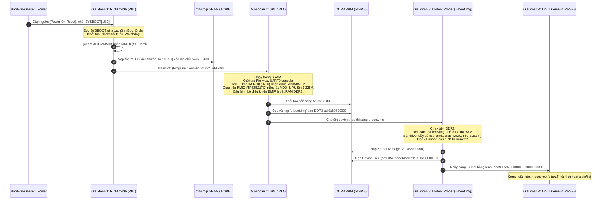

# 🧭 Chương 1: Tổng Quan Kiến Trúc Boot Flow Trên BeagleBone Black (TI AM335x)

> **Tài liệu tham khảo nền tảng**:
> - Texas Instruments AM335x Technical Reference Manual (TRM) — Document SPRUH73, Chapter 26: *Initialization*.
> - U-Boot Documentation: *AM335x EVM Boot Sequence*.

---

## 1. GIỚI THIỆU TỔNG QUAN

Khác với máy tính cá nhân x86/x64 có BIOS/UEFI tiêu chuẩn hóa và nạp trực tiếp bootloader từ ổ cứng vào RAM hệ thống, các hệ thống nhúng SoC nền tảng ARM (như **Texas Instruments AM335x** trên bo mạch **BeagleBone Black**) phải trải qua một quy trình khởi động phân tầng gồm **4 giai đoạn (Multi-stage Boot Process)**.

Nguyên nhân cốt lõi của quy trình phân tầng này bắt nguồn từ:
1. **Bộ nhớ RAM ngoài (DDR3) chưa hoạt động** ngay khi cấp nguồn.
2. **Bộ nhớ nội (Internal SRAM) trong chip rất nhỏ** (chỉ có 128 KB, khả dụng thực tế 109 KB).
3. **ROM Code tích hợp trong chip không biết trước cấu hình phần cứng cụ thể** của từng bo mạch thương mại (loại chip RAM, hãng sản xuất chip nhớ, xung nhịp mong muốn, loại chip quản lý nguồn PMIC).

---

## 2. SƠ ĐỒ TOÀN CẢNH BOOT FLOW 4 GIAI ĐOẠN



---

## 3. CHI TIẾT TỪNG GIAI ĐOẠN KHỞI ĐỘNG

### 3.1. Giai đoạn 1: ROM Bootloader (RBL / ROM Code)

- **Vị trí vật lý**: Nằm trong khối nhớ On-Chip ROM của SoC AM335x (dải địa chỉ `0x00020000` đến `0x0002BFFF`, kích thước 48KB - 64KB). Đây là đoạn mã được hãng bán dẫn Texas Instruments nạp cứng (mask ROM) trong quá trình quang khắc chip; người dùng **không thể can thiệp, xóa hay nạp lại**.
- **Khi nào chạy?**: Ngay khi chân `PWRONRSTn` (Power-On Reset) được kích hoạt và trả về mức logic cao (High).

#### Các công việc RBL thực hiện:
1. **Thiết lập xung nhịp cơ sở**: Sử dụng bộ dao động nội hoặc thạch anh ngoài (24 MHz trên BeagleBone Black) để cấp xung nhịp cơ sở tối thiểu cho nhân ARM Cortex-A8.
2. **Kích hoạt Watchdog Timer**: Mặc định Watchdog Timer được kích hoạt với chu kỳ khoảng 3 phút. Nếu bootloader các giai đoạn sau không kịp vô hiệu hóa hoặc reset watchdog, chip sẽ tự động reset.
3. **Lấy mẫu trạng thái chân `SYSBOOT[15:0]`**:
   - Tại sườn lên của tín hiệu `PWRONRSTn`, trạng thái điện áp của 16 chân `SYSBOOT` được chốt vào thanh ghi điều khiển `control_status` (`0x44E10040`).
   - Các bit `SYSBOOT[4:0]` quy định danh sách thứ tự ưu tiên các thiết bị tìm kiếm bootloader (**Boot Device List**).

| Cấu hình chân | Giá trị bit `SYSBOOT[4:0]` | Chế độ khởi động | Thứ tự thiết bị ưu tiên tìm kiếm |
| :--- | :--- | :--- | :--- |
| **Mặc định (Không bấm nút S2)** | `11100b` (28 thập phân) | **eMMC Boot** | **MMC1 (onboard eMMC)** $\rightarrow$ **SPI0** $\rightarrow$ **UART0** $\rightarrow$ **USB0** |
| **Bấm giữ nút S2 khi cắm nguồn** | `11000b` (24 thập phân) | **SD Card Boot** | **SPI0** $\rightarrow$ **MMC0 (MicroSD slot)** $\rightarrow$ **UART0** $\rightarrow$ **USB0** |

> [!IMPORTANT]
> **Khác biệt sống còn giữa Cold Reset và Warm Reset**:
> - Chân `SYSBOOT` chỉ được vi xử lý đọc tại thời điểm **Cold Power-On Reset** (khi mới cấp nguồn).
> - Nút bấm **RESET (S1)** trên bo mạch BeagleBone Black chỉ kích hoạt tín hiệu Warm Reset (`WARMRSTn`), vốn **không lấy mẫu lại** các chân SYSBOOT.
> - Do đó, nếu muốn ép BeagleBone Black boot từ thẻ nhớ MicroSD bằng nút **S2 (BOOT)**, bạn **bắt buộc phải giữ nút S2 trong lúc cắm nguồn hoặc cắm cáp USB**, sau đó giữ thêm 2-3 giây rồi mới nhả tay!

4. **Tìm kiếm file `MLO`**:
   - Nếu khởi động từ thẻ MMC/SD: RBL hỗ trợ đọc bảng phân vùng **MBR** và các hệ thống tệp **FAT12 / FAT16 / FAT32**.
   - RBL duyệt tìm trong thư mục gốc của phân vùng đầu tiên (phân vùng có cờ Bootable) để tìm file có tên chính xác là `MLO`.
   - File `MLO` phải có cấu trúc **GP Header (General Purpose Header)** gồm 8 byte ở đầu:
     - Byte 0-3: Kích thước file SPL nhị phân.
     - Byte 4-7: Địa chỉ nạp đích trong On-Chip SRAM (`0x402F0400`).
   - RBL sao chép toàn bộ nội dung file `MLO` vào SRAM tại địa chỉ `0x402F0400`, sau đó chuyển Program Counter (PC) về địa chỉ này để bắt đầu thực thi SPL.

---

### 3.2. Giai đoạn 2: Secondary Program Loader (SPL / MLO)

#### Tại sao kích thước SPL bị giới hạn nghiêm ngặt ở 109 KB?
Hãy xem xét bản đồ bộ nhớ On-Chip SRAM của AM335x:

```
Địa chỉ bắt đầu      Địa chỉ kết thúc     Dung lượng     Mục đích sử dụng
0x402F0000          0x402F03FF          1 KB           Bảng Vector ngắt & biến ROM Code
0x402F0400          0x4030B7FF          109 KB         VÙNG DÀNH CHO SPL (MLO THỰC THI TẠI ĐÂY)
0x4030B800          0x4030FFFF          18 KB          ROM Code Stack & Vùng nhớ nội bộ TI
-----------------------------------------------------------------------------------------
Tổng dung lượng On-Chip SRAM:            128 KB
```

Bởi vì ROM Code chiếm dụng phần đầu và phần đuôi của SRAM, dung lượng trống an toàn tối đa cho SPL chỉ là **109 KB**. Trong mã nguồn U-Boot, thông số này được định nghĩa cố định:
```c
#define CONFIG_SPL_MAX_SIZE    (109 * 1024)
```
Nếu mã nguồn SPL sau khi build vượt quá 109 KB, trình liên kết (linker) sẽ báo lỗi tràn bộ nhớ ngay lập tức.

#### Nhiệm vụ cụ thể của SPL:
1. **Thiết lập lại hệ thống xung nhịp (Clock PLLs)**:
   - Chuyển đổi xung nhịp MPU PLL từ 24 MHz lên tần số hoạt động chính thức (thường là 550 MHz - 1000 MHz).
   - Cấu hình Core PLL (400 MHz), Per PLL (192 MHz cho các ngoại vi UART, I2C, SPI), DDR PLL (400 MHz).
2. **Cấu hình Pin Muxing ban đầu**:
   - Mux chân cho UART0 (`uart0_rxd`, `uart0_txd`) để xuất log console chẩn đoán sớm.
   - Mux chân cho I2C0 và MMC0/MMC1.
3. **Đọc EEPROM trên bo mạch qua I2C0**:
   - Giao tiếp với chip EEPROM tại địa chỉ I2C `0x50` để đọc chuỗi nhận dạng board ID. Với BeagleBone Black, chuỗi này là `A335BNLT`.
4. **Cấu hình IC quản lý nguồn PMIC (TPS65217C)**:
   - SoC AM335x không thể chạy ở 1 GHz nếu điện áp cấp cho nhân MPU chỉ ở mức 1.1V.
   - SPL gửi các lệnh I2C tới chip PMIC TPS65217C để tăng điện áp đường `VDD_MPU` từ 1.1V lên **1.325V**, đồng thời ổn định đường nguồn `VDD_DDR` ở mức **1.5V** cho DDR3.
5. **Khởi tạo bộ nhớ ngoài DDR3 RAM (EMIF4D)**:
   - Thiết lập các thanh ghi điều khiển bộ nhớ EMIF với thông số timing chính xác cho thanh RAM DDR3 512MB (400 MHz).
   - Từ thời điểm này, toàn bộ 512MB DDR3 (dải địa chỉ `0x80000000` đến `0x9FFFFFFF`) đã sẵn sàng lưu trữ dữ liệu.
6. **Nạp U-Boot Proper (`u-boot.img`)**:
   - SPL đọc file `u-boot.img` từ thẻ nhớ (hoặc eMMC), giải mã header và nạp vào DDR3 tại địa chỉ mặc định `0x80800000`.
   - SPL thực hiện lệnh nhảy tới entry point của `u-boot.img`.

---

### 3.3. Giai đoạn 3: U-Boot Proper (`u-boot.img`)

Chạy hoàn toàn trong bộ nhớ DDR3, U-Boot Proper là một "hệ điều hành mini" độc lập với đầy đủ tính năng:
1. **Relocation (Tự di dời vùng nhớ)**:
   - Khi khởi chạy tại `0x80800000`, U-Boot tính toán kích thước tổng thể của RAM (512MB).
   - Để tránh xung đột khi sau này nạp Linux Kernel Image và Ramdisk (thường nạp ở vùng nhớ thấp từ `0x82000000`), U-Boot tự sao chép chính nó lên **vùng nhớ cao nhất của DDR3** (sát mốc `0x9FFFFFFF`) và tiếp tục chạy từ vị trí mới.
2. **Kích hoạt các Subsystem ngoại vi**:
   - Trình điều khiển Ethernet CPSW (PHY LAN8710A) và nạp MAC address từ EEPROM.
   - Trình điều khiển USB Dual-Role Controller.
   - Trình điều khiển hiển thị HDMI (NXP TDA19988).
   - Command Line Shell (CLI) tương tác qua UART0 với baudrate 115200.
3. **Phân tích môi trường & Kịch bản khởi động**:
   - Tìm kiếm file `uEnv.txt` trên phân vùng boot hoặc thư mục `/boot` của phân vùng rootfs.
   - Thực thi các biến kịch bản được định nghĩa sẵn (`bootcmd` hoặc `uenvcmd`).
4. **Nạp OS Kernel và Device Tree**:
   - Nạp Linux Kernel Image (`zImage`) vào RAM tại `0x82000000`.
   - Nạp Device Tree Blob (`am335x-boneblack.dtb`) vào RAM tại `0x88000000`.
   - (Tùy chọn) Nạp các file Device Tree Overlay (`.dtbo`) và merge trực tiếp vào DTB trong RAM.
5. **Bàn giao quyền kiểm soát cho Linux**:
   - Thiết lập chuỗi tham số `bootargs` vào nút `/chosen/bootargs` trong Device Tree.
   - Vô hiệu hóa ngắt, xả sạch bộ nhớ đệm D-Cache/I-Cache.
   - Đặt các thanh ghi ARM:
     - `r0 = 0`
     - `r1 = 0xFFFFFFFF` (Báo cho Kernel biết phần cứng được mô tả qua DTB chứ không dùng ATAGS cũ)
     - `r2 = 0x88000000` (Địa chỉ con trỏ trỏ tới DTB trong RAM)
   - Gọi lệnh `bootz 0x82000000 - 0x88000000` để bắt đầu thực thi Kernel.

---

### 3.4. Giai đoạn 4: Linux Kernel & Root Filesystem

1. Nhân Linux bắt đầu chạy tại `0x82000000`, tự giải nén chính nó sang bộ nhớ đích.
2. Kernel đọc và phân tích cấu trúc cây thiết bị từ địa chỉ được thanh ghi `r2` chỉ định (`0x88000000`).
3. Khởi tạo bộ nhớ ảo (MMU), trình lập lịch (Process Scheduler), các ngắt IRQ và gắn kết các driver thiết bị tương ứng với các chuỗi `compatible` trong Device Tree.
4. Gắn kết phân vùng RootFS được khai báo trong `bootargs` (ví dụ `root=/dev/mmcblk0p2`).
5. Khởi chạy tiến trình không gian người dùng đầu tiên (User Space Process PID 1): `/sbin/init` hoặc `systemd`.

---

## 4. TỔNG KẾT BẢN ĐỒ VÙNG NHỚ (MEMORY MAP TRÊN BEAGLEBONE BLACK)

```
+---------------------+ 0x9FFFFFFF (Cuối dải 512MB RAM)
| U-Boot Relocated    |  (U-Boot Proper tự dời lên đỉnh RAM)
| Stack & BSS         |
+---------------------+
|                     |
| Vùng trống          |
|                     |
+---------------------+ 0x88080000 (rdaddr)
| RAMDisk / Initrd    |  (Dành cho file initramfs nếu có)
+---------------------+ 0x88000000 (fdtaddr)
| Device Tree Blob    |  (am335x-boneblack.dtb)
+---------------------+
| Vùng trống          |
+---------------------+ 0x82000000 (loadaddr)
| Linux Kernel Image  |  (zImage)
+---------------------+ 0x80800000
| Entry U-Boot Proper |  (Nơi SPL nạp u-boot.img vào ban đầu)
+---------------------+ 0x80000000 (Bắt đầu dải 512MB DDR3 RAM)
```

---

## 5. CÂU HỎI ÔN TẬP & TỰ ĐÁNH GIÁ (SELF-CHECK)

1. **Tại sao ta không thể gộp SPL và U-Boot Proper thành một file duy nhất để nạp trực tiếp?**
   - *Gợi ý*: Xem xét giới hạn 109 KB của Internal SRAM và trạng thái của bộ nhớ DDR3 khi mới cấp nguồn.
2. **Nếu BeagleBone Black bị treo ở trạng thái các đèn LED sáng đứng im không nhấp nháy, bạn sẽ đo điện áp hoặc kiểm tra tín hiệu tại đâu trước tiên?**
   - *Gợi ý*: Kiểm tra cáp Serial UART0, kiểm tra điện áp cấp nguồn 5V/PMIC, kiểm tra trạng thái chân boot S2.
3. **Thanh ghi nào trên AM335x phản ánh trạng thái các chân SYSBOOT?**
   - *Đáp án*: Thanh ghi `control_status` tại địa chỉ `0x44E10040`.
