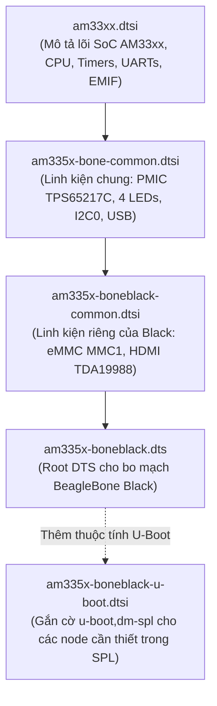

# 🔬 Chương 2: Giải Phẫu Mã Nguồn U-Boot Cho BeagleBone Black

> **Mã nguồn đối chiếu**:
> - Repository chính thức: [https://github.com/u-boot/u-boot](https://github.com/u-boot/u-boot)
> - Nhánh BeagleBoard: [https://github.com/beagleboard/u-boot](https://github.com/beagleboard/u-boot)

---

## 1. BẢN ĐỒ THƯ MỤC MÃ NGUỒN LIÊN QUAN

Trong toàn bộ cây mã nguồn đồ sộ của U-Boot, các thư mục và tệp tin trực tiếp định hình nên bản build cho BeagleBone Black (TI AM335x) bao gồm:

```
u-boot/
├── configs/
│   └── am335x_evm_defconfig          # Cấu hình Kconfig chuẩn cho họ AM335x
├── board/ti/am335x/
│   ├── Kconfig                        # Khai báo tùy chọn cấu hình cho board
│   ├── Makefile                       # Quy tắc biên dịch module board
│   ├── board.c                        # Khởi tạo phần cứng board, đọc EEPROM, bật DDR3
│   ├── board.h                        # Struct EEPROM, các hàm inline board_is_*
│   └── mux.c                          # Khởi tạo Pin Multiplexing cho các ngoại vi
├── include/configs/
│   └── am335x_evm.h                   # Macro bản đồ bộ nhớ (loadaddr, fdtaddr) và bootcmd
├── arch/arm/mach-omap2/
│   ├── am33xx/                        # Mã nguồn cấp thấp cho SoC AM33xx (clocks, ddr, sys_info)
│   └── hw_data.c                      # Bảng thông số PLL và điện áp danh định
└── arch/arm/dts/
    ├── am33xx.dtsi                    # Device Tree mô tả SoC AM33xx
    ├── am335x-bone-common.dtsi        # Cấu hình chung cho họ BeagleBone (PMIC, LEDs, UART0)
    ├── am335x-boneblack-common.dtsi   # Cấu hình riêng cho BeagleBone Black (eMMC, HDMI)
    ├── am335x-boneblack.dts           # DTS hoàn chỉnh của BeagleBone Black
    └── am335x-boneblack-u-boot.dtsi   # Các node gắn cờ riêng cho U-Boot SPL (u-boot,dm-spl)
```

---

## 2. PHÂN TÍCH `configs/am335x_evm_defconfig`

File `am335x_evm_defconfig` là tập hợp các chỉ thị Kconfig được định hình sẵn. Đây là cấu hình hợp nhất (unified) dùng chung cho tất cả các biến thể board AM335x (EVM, BeagleBone White, BeagleBone Black, PocketBeagle).

### Các chỉ thị cốt lõi:

```ini
# Kiến trúc phần cứng
CONFIG_ARM=y
CONFIG_ARCH_OMAP2PLUS=y
CONFIG_AM33XX=y
CONFIG_TARGET_AM335X_EVM=y

# Cấu hình SPL (Secondary Program Loader)
CONFIG_SPL=y
CONFIG_SPL_TEXT_BASE=0x402F0400       # Địa chỉ nạp vào On-Chip SRAM của AM335x
CONFIG_SPL_MAX_SIZE=0x1B400           # Giới hạn kích thước SPL: đúng 109 KB (111616 bytes)
CONFIG_SPL_BSS_START_ADDR=0x80a00000  # Vùng nhớ BSS của SPL đặt tại DDR3 sau khi RAM được bật
CONFIG_SPL_BSS_MAX_SIZE=0x80000       # 512 KB BSS

# Hỗ trợ nạp SPL từ thẻ nhớ MMC/SD
CONFIG_SPL_MMC=y
CONFIG_SPL_FS_FAT=y                   # Cho phép SPL đọc phân vùng FAT32 để tìm u-boot.img
CONFIG_SPL_FS_EXT4=y                  # Cho phép SPL đọc phân vùng ext4
CONFIG_SYS_MMCSD_FS_BOOT_PARTITION=1  # Phân vùng mặc định chứa bootloader: Partition 1

# Trình điều khiển Driver Model (DM) trong U-Boot
CONFIG_DM=y
CONFIG_DM_GPIO=y
CONFIG_DM_I2C=y
CONFIG_DM_MMC=y
CONFIG_DM_ETH=y
CONFIG_DM_SERIAL=y

# Thiết bị mô tả phần cứng Device Tree
CONFIG_DEFAULT_DEVICE_TREE="am335x-boneblack"
CONFIG_OF_CONTROL=y
CONFIG_OF_SPL_REMOVE_PROPS="pinctrl-0 pinctrl-names" # Tối ưu hóa kích thước DTB trong SPL
```

---

## 3. PHÂN TÍCH MÃ NGUỒN CẤP BO MẠCH (`board/ti/am335x/`)

Thư mục `board/ti/am335x/` là nơi chứa toàn bộ logic C để cấu hình phần cứng đặc thù của BeagleBone Black.

### 3.1. Cấu trúc định danh EEPROM (`board.h` & `board.c`)

Trên bo mạch BeagleBone Black, một chip EEPROM giao tiếp qua bus I2C0 tại địa chỉ `0x50` được nhà sản xuất nạp sẵn thông tin nhận dạng bo mạch.

Trong file `board/ti/am335x/board.h`:

```c
/* Cấu trúc header EEPROM trên các board TI AM335x */
struct am335x_baseboard_id {
    unsigned int  magic;     /* 4 bytes Magic number: 0xEE3355AA */
    char name[8];            /* 8 bytes Board Name (chuỗi ASCII) */
    char version[4];         /* 4 bytes Hardware Revision (ví dụ '00A5', '00B0', '00C0') */
    char serial[12];         /* 12 bytes Serial Number */
    char config[32];         /* Cấu hình mở rộng */
    char mac_addr[3][6];     /* 3 địa chỉ MAC cho Ethernet CPSW */
};
```

Trong file `board/ti/am335x/board.c`:

```c
/* Hàm kiểm tra chuỗi định danh BeagleBone Black */
static inline int board_is_bone_lt(void)
{
    /* So sánh chuỗi name đọc được từ EEPROM với "A335BNLT" */
    return board_ti_is("A335BNLT");
}

/* Các hàm kiểm tra các dòng board khác cùng họ */
static inline int board_is_bone(void)
{
    return board_ti_is("A335BONE"); /* BeagleBone White (dùng DDR2) */
}

static inline int board_is_pb(void)
{
    return board_ti_is("A335PBGL"); /* PocketBeagle */
}
```

> [!TIP]
> **Kỹ thuật Port U-Boot cho Custom Board (Board tự thiết kế)**:
> Khi bạn thiết kế một bo mạch nhúng tùy biến dùng chip AM335x nhưng **không gắn chip EEPROM I2C**, hoặc chip EEPROM chưa được nạp firmware ban đầu, U-Boot mặc định sẽ không nhận dạng được board và bị treo.
> **Cách khắc phục đơn giản nhất**:
> Mở file `board/ti/am335x/board.h` hoặc `board.c`, chỉnh sửa hàm `board_is_bone_lt()` thành:
> ```c
> static inline int board_is_bone_lt(void)
> {
>     return 1; /* Luôn ép U-Boot nhận diện là BeagleBone Black */
> }
> ```
> Khi đó, toàn bộ quy trình cấu hình DDR3 và pin mux của BeagleBone Black sẽ tự động được áp dụng cho custom board của bạn!

---

### 3.2. Cấu hình nguồn PMIC qua I2C0 (`board.c`)

Vi xử lý Cortex-A8 trên BeagleBone Black có khả năng chạy ở tốc độ 1.0 GHz (1000 MHz), nhưng ở điện áp mặc định khi bật nguồn (1.1V), chip chỉ chạy an toàn ở xung nhịp thấp (~550 MHz).

Để đạt được hiệu năng cao, hàm `scale_vcores()` trong `board.c` giao tiếp với IC quản lý nguồn **TPS65217C** qua I2C0:

```c
void scale_vcores(void)
{
    int val;

    if (board_is_bone_lt()) {
        /* 
         * Thiết lập điện áp đường VDD_MPU cấp cho lõi CPU Cortex-A8:
         * Tăng từ 1.1V lên 1.325V (tương ứng với OPP100 hoặc Nitro mode 1GHz)
         */
        if (tps65217_voltage_update(TPS65217_DEFDCDC2,
                                    TPS65217_DCDC_VOLT_SEL_1325MV)) {
            puts("Lỗi: Không thể cấu hình VDD_MPU trên PMIC!\n");
            return;
        }

        /* 
         * Thiết lập điện áp đường VDD_CORE cấp cho ngoại vi và bus nội:
         * Đặt ở mức 1.10V
         */
        if (tps65217_voltage_update(TPS65217_DEFDCDC3,
                                    TPS65217_DCDC_VOLT_SEL_1100MV)) {
            puts("Lỗi: Không thể cấu hình VDD_CORE trên PMIC!\n");
            return;
        }
    }
}
```

---

### 3.3. Khởi tạo bộ nhớ ngoài DDR3 RAM (`board.c`)

Sau khi nguồn điện đã ổn định, hàm `sdram_init()` được gọi để khởi tạo bộ điều khiển nhớ EMIF (External Memory Interface).

```c
/* Bảng tham số thanh ghi PHY và Timing cho chip nhớ DDR3 trên BeagleBone Black */
static const struct emif_regs ddr3_beagleblack_emif_reg_data = {
    .sdram_config         = 0x61C05332, /* DDR3, 16-bit bus, 8 banks, CAS=6 */
    .ref_ctrl             = 0x00000C30, /* Chu kỳ refresh 7.8 us */
    .sdram_tim1           = 0x0AAAD4DB,
    .sdram_tim2           = 0x266B7FDA,
    .sdram_tim3           = 0x501F867F,
    .zq_config            = 0x50074BE4, /* ZQ Calibration */
    .emif_ddr_phy_ctlr_1  = 0x00100207,
};

void sdram_init(void)
{
    if (board_is_bone_lt()) {
        /*
         * Cấu hình DDR3 chạy ở tần số xung nhịp 400 MHz (tương đương 800 MT/s).
         * config_ddr() sẽ nạp các giá trị timing vào EMIF4D controller
         * và thực hiện chu trình khóa DDR PHY DLL.
         */
        config_ddr(400, &ioregs_bonelt,
                   &ddr3_beagleblack_data,
                   &ddr3_beagleblack_cmd_ctrl_data,
                   &ddr3_beagleblack_emif_reg_data, 0);
    }
}
```

Sau khi hàm `config_ddr()` thực thi thành công, thanh DDR3 RAM 512MB bắt đầu tiếp nhận các lệnh đọc/ghi tại dải địa chỉ `0x80000000 - 0x9FFFFFFF`.

---

### 3.4. Pin Multiplexing (`mux.c`)

Mỗi chân trên chip AM335x có thể gán cho tối đa 8 chức năng khác nhau (Mode 0 đến Mode 7). Hàm `enable_board_pin_mux()` trong `mux.c` xác định cấu hình chân cho các ngoại vi:

```c
void enable_board_pin_mux(void)
{
    if (board_is_bone_lt()) {
        /* Cấu hình chân UART0 Console (J1 header) */
        configure_module_pin_mux(uart0_pin_mux);

        /* Cấu hình chân I2C0 (kết nối PMIC và EEPROM) */
        configure_module_pin_mux(i2c0_pin_mux);

        /* Cấu hình chân MMC0 (khe thẻ nhớ MicroSD) */
        configure_module_pin_mux(mmc0_pin_mux);

        /* Cấu hình chân MMC1 (chip eMMC 8-bit trên bo mạch) */
        configure_module_pin_mux(mmc1_pin_mux);

        /* Cấu hình Ethernet PHY RMII/MII LAN8710A */
        configure_module_pin_mux(rgmii1_pin_mux);
    }
}
```

---

## 4. PHÂN TÍCH `include/configs/am335x_evm.h`

File header này chứa các định nghĩa vĩ mô (macro) về địa chỉ bộ nhớ và các câu lệnh khởi động mặc định:

```c
/* Bản đồ địa chỉ nạp trên DDR3 RAM (Base: 0x80000000) */
#define MEM_LAYOUT_ENV_SETTINGS \
    "loadaddr=0x82000000\0"       /* Nạp Linux Kernel zImage */ \
    "fdtaddr=0x88000000\0"        /* Nạp Device Tree Blob (.dtb) */ \
    "fdt_addr_r=0x88000000\0" \
    "rdaddr=0x88080000\0"         /* Nạp RAMDisk / Initramfs */ \
    "ramdisk_addr_r=0x88080000\0" \
    "scriptaddr=0x80000000\0"     /* Nạp file script boot */ \
    "bootm_size=0x10000000\0"     /* Kích thước vùng nhớ U-Boot quản lý (256MB) */

/* Chuỗi macro tìm kiếm và import cấu hình uEnv.txt */
#define BOOTENV_DEV_LEGACY_MMC(devtypeu, devtypen, devnum) \
    "loadbootenv=load mmc ${mmcdev} ${loadaddr} ${bootenvfile}\0" \
    "importbootenv=echo Importing environment from mmc ...; " \
        "env import -t -r ${loadaddr} ${filesize}\0"
```

Khi U-Boot khởi động, nó thực thi chuỗi lệnh `bootcmd`:
1. Quét tìm thiết bị MMC 0 (MicroSD) và MMC 1 (eMMC).
2. Kiểm tra xem có file `uEnv.txt` trên phân vùng FAT hoặc thư mục `/boot` trên ext4 không.
3. Nếu có, nạp vào địa chỉ `loadaddr` (`0x82000000`), sau đó gọi lệnh `env import` để đưa các biến vào môi trường U-Boot hiện hành.
4. Nếu biến `uenvcmd` được định nghĩa trong `uEnv.txt`, U-Boot sẽ gọi `run uenvcmd`.

---

## 5. CẤU TRÚC DEVICE TREE TRONG U-BOOT

Device Tree trong U-Boot được lưu trữ tại `arch/arm/dts/`:



### Điểm đặc biệt của file `am335x-boneblack-u-boot.dtsi`:
Vì SPL chỉ có dung lượng SRAM hạn chế (109 KB), trình biên dịch Device Tree (`dtc`) sẽ cắt bỏ tất cả các node thiết bị không cần thiết. Để chỉ định cho SPL giữ lại driver nào, U-Boot sử dụng thuộc tính đặc biệt:

```dts
&mmc1 {
    u-boot,dm-spl;        /* Chỉ định cho SPL giữ lại driver MMC1 để nạp u-boot.img */
};

&i2c0 {
    u-boot,dm-spl;        /* Giữ lại I2C0 để đọc EEPROM và cấu hình PMIC trong SPL */
};

&uart0 {
    u-boot,dm-pre-reloc;   /* Giữ lại UART0 từ giai đoạn trước relocation */
};
```

---

## 6. TỔNG KẾT BÀI HỌC

Qua việc phân tích mã nguồn U-Boot cho BeagleBone Black, chúng ta nắm được:
1. `am335x_evm_defconfig` là cấu hình gốc xác lập kiến trúc và các cờ tối ưu hóa kích thước cho SPL.
2. `board/ti/am335x/board.c` đóng vai trò "trái tim" trong việc nhận diện phần cứng qua chuỗi `A335BNLT`, kích hoạt PMIC TPS65217C và thiết lập timing cho bộ nhớ DDR3 512MB.
3. Kỹ thuật ghi đè hàm `board_is_bone_lt()` là bí quyết then chốt khi port U-Boot sang các phần cứng tự thiết kế (Custom Boards).
4. `include/configs/am335x_evm.h` quy định bản đồ bộ nhớ chuẩn xác, đảm bảo Kernel và DTB không bị nạp đè lên nhau.
