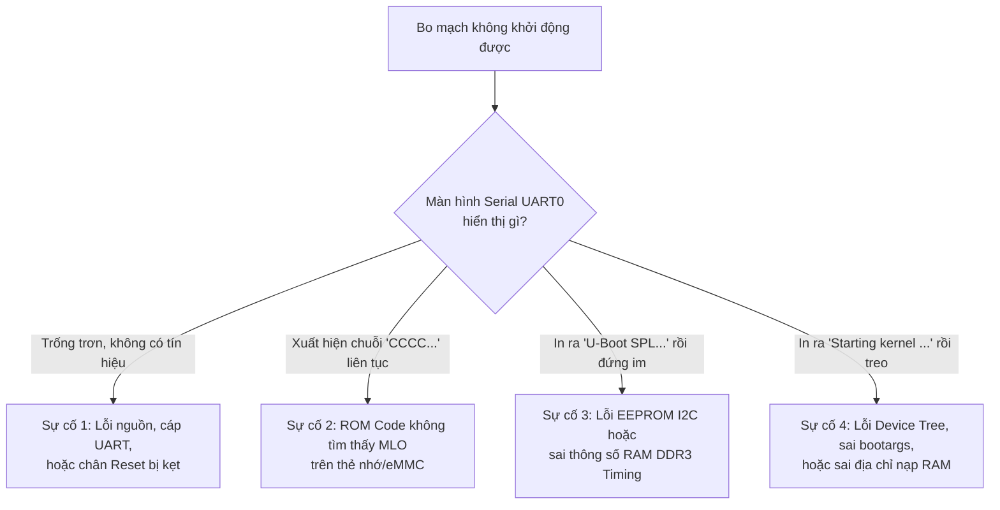

# 🚀 Chương 5: Kỹ Thuật Nâng Cao, Phân Tích Repo Mẫu & Cẩm Nang Gỡ Lỗi

> **Nội dung chương**:
> 1. Phân tích các kỹ thuật chuyên sâu từ các GitHub Repository nổi tiếng của cộng đồng BeagleBoard.
> 2. Cơ chế nạp Device Tree Overlays (Cape Manager) trực tiếp trong U-Boot.
> 3. Bài thực hành nạp Kernel thủ công từng bước qua UART Serial Console.
> 4. Cẩm nang xử lý các tình huống lỗi thực tế (Troubleshooting & Debugging Guide).

---

## 1. PHÂN TÍCH CÁC REPOSITORY MẪU TỪ CỘNG ĐỒNG BEAGLEBOARD

Cộng đồng BeagleBoard và kỹ sư kỳ cựu **Robert C. Nelson** (@RobertCNelson) đã duy trì các repository tiêu chuẩn định hình cách thức boot của hàng triệu bo mạch BeagleBone trên toàn thế giới:

### 1.1. Repository `RobertCNelson/boot-scripts`
- **Địa chỉ GitHub**: [https://github.com/RobertCNelson/boot-scripts](https://github.com/RobertCNelson/boot-scripts)
- **Ý nghĩa**: Chứa các kịch bản boot canonical (`boot.scr`, `uEnv.txt`, kịch bản cape overlay) được nạp sẵn trên các image Debian/Ubuntu chính thức của BeagleBoard.org.

#### Hai kỹ thuật đột phá được triển khai trong repository này:

#### A. Kỹ thuật tự động dò tìm Root Partition bằng UUID (`finduuid`)
Trong các hệ thống nhúng Linux, việc gán cứng `root=/dev/mmcblk0p2` rất nguy hiểm vì:
- Khi boot từ thẻ nhớ MicroSD: Thẻ nhớ là `mmcblk0`, eMMC là `mmcblk1`.
- Khi boot từ eMMC: eMMC trở thành `mmcblk1` (hoặc `mmcblk0` tùy thuộc vào thứ tự probe của driver kernel).

Robert C. Nelson giải quyết vấn đề này bằng lệnh `part uuid` của U-Boot:
```bash
# Lấy chuỗi UUID ngẫu nhiên duy nhất của phân vùng 2 trên MMC 0
part uuid mmc 0:2 uuid

# Gán vào bootargs sử dụng cú pháp root=UUID=...
setenv bootargs console=${console} root=UUID=${uuid} rootfstype=ext4 rootwait
```
Khi Linux Kernel khởi động, `udev` hoặc `systemd` sẽ tìm kiếm phân vùng theo đúng mã định danh UUID, hoàn toàn không bị ảnh hưởng bởi thứ tự đánh số thiết bị của phần cứng.

---

#### B. Cơ chế nạp Device Tree Overlays (Cape Manager) trong U-Boot
Trước đây trên kernel 3.8.x, việc quản lý các bo mạch mở rộng (Capes) được thực hiện trong Userspace qua `sysfs` (`cape_mgr`). Cơ chế này gây mất ổn định và đã bị loại bỏ khỏi Linux Kernel mainline.

Thay vào đó, Robert C. Nelson đã chuyển toàn bộ logic nạp Cape vào **U-Boot**:
1. U-Boot nạp file Device Tree gốc vào RAM:
   ```bash
   load mmc 0:2 0x88000000 /boot/dtbs/am335x-boneblack.dtb
   fdt addr 0x88000000
   ```
2. Mở rộng kích thước bộ nhớ đệm của DTB để có chỗ chứa các node mới:
   ```bash
   fdt resize 8192
   ```
3. Đọc danh sách các overlay được khai báo trong `uEnv.txt`:
   ```ini
   enable_uboot_overlays=1
   uboot_overlay_addr4=/boot/dtbs/overlays/BB-UART1-00A0.dtbo
   uboot_overlay_addr5=/boot/dtbs/overlays/BB-I2C1-00A0.dtbo
   ```
4. U-Boot lặp qua từng file `.dtbo`, tải vào một địa chỉ RAM tạm (`0x89000000`) và thực thi lệnh gộp:
   ```bash
   load mmc 0:2 0x89000000 /boot/dtbs/overlays/BB-UART1-00A0.dtbo
   fdt apply 0x89000000
   ```
5. Khi lệnh `bootz 0x82000000 - 0x88000000` được gọi, Kernel tiếp nhận một cây Device Tree đã được gộp hoàn chỉnh phần cứng của các Cape, đảm bảo driver tương ứng khởi chạy ngay từ giây đầu tiên!

---

### 1.2. Repository `RobertCNelson/bb-kernel`
- **Địa chỉ GitHub**: [https://github.com/RobertCNelson/bb-kernel](https://github.com/RobertCNelson/bb-kernel)
- **Ý nghĩa**: Kho mã nguồn tự động hóa việc build Linux Kernel và U-Boot cho BeagleBone Black.
- **Cấu trúc kịch bản**:
  - Script `build_kernel.sh`: Tự động tải toolchain ARM, tải mã nguồn kernel tương ứng, áp dụng hàng trăm bản vá (patches) tối ưu cho phần cứng AM335x (PRU subsystem, HDMI audio fix, PMIC TPS65217C dynamic frequency scaling).
  - Tích hợp công cụ tạo gói `.deb` giúp cài đặt kernel trực tiếp trên hệ điều hành Debian chạy trên BeagleBone.

---

## 2. BÀI THỰC HÀNH: KHỞI ĐỘNG HỆ THỐNG THỦ CÔNG QUA UART CONSOLE

Đây là bài tập kinh điển của kỹ sư nhúng: **Không dùng `uEnv.txt` tự động, tự tay gõ từng dòng lệnh trong U-Boot CLI để đưa board vào hệ điều hành Linux.**

### Trình tự các bước thực hiện trên cửa sổ lệnh U-Boot (`=>`):

```bash
# Bước 1: Kiểm tra các thiết bị lưu trữ MMC
=> mmc list
OMAP SD/MMC: 0
OMAP SD/MMC: 1

# Bước 2: Chuyển sang MMC 0 (MicroSD) và kiểm tra bảng phân vùng
=> mmc dev 0
switch to partitions #0, OK
mmc0 is current device

=> mmc part
Partition Map for MMC device 0  --   Partition Type: DOS
Part    Start Sector    Num Sectors     UUID            Type
  1     2048            131072          00000000-01     0c Boot
  2     133120          15138816        00000000-02     83

# Bước 3: Nạp Kernel zImage từ phân vùng 2 (/boot/) vào RAM tại 0x82000000
=> load mmc 0:2 0x82000000 /boot/vmlinuz-5.10.168-ti-r72
10168320 bytes read in 654 ms (14.8 MiB/s)

# Bước 4: Nạp Device Tree Blob vào RAM tại 0x88000000
=> load mmc 0:2 0x88000000 /boot/dtbs/am335x-boneblack.dtb
62464 bytes read in 21 ms (2.8 MiB/s)

# Bước 5: Kiểm tra và xem thử nội dung Device Tree trong RAM
=> fdt addr 0x88000000
=> fdt print /model
model = "TI AM335x BeagleBone Black"

# Bước 6: Thiết lập tham số dòng lệnh Linux Kernel
=> setenv bootargs console=ttyS0,115200n8 root=/dev/mmcblk0p2 ro rootfstype=ext4 rootwait earlycon

# Bước 7: Kích hoạt khởi động Kernel!
=> bootz 0x82000000 - 0x88000000
```

### Log xuất hiện trên màn hình khi Kernel bắt đầu chạy:

```
Kernel image @ 0x82000000 [ 0x000000 - 0x9b2800 ]
## Flattened Device Tree blob at 0x88000000
   Booting using the fdt blob at 0x88000000
   Loading Device Tree to 8fff0000, end 8ffff400 ... OK

Starting kernel ...

[    0.000000] Booting Linux on physical CPU 0x0
[    0.000000] Linux version 5.10.168-ti-r72 (root@build-server) ...
[    0.000000] CPU: ARMv7 Processor [413fc082] revision 2 (ARMv7), cr=10c5387d
[    0.000000] Machine model: TI AM335x BeagleBone Black
[    1.245012] mmc0: new high speed SDHC card at address aaaa
[    1.258902] mmcblk0: mmc0:aaaa SU16G 14.8 GiB 
[    1.265431]  mmcblk0: p1 p2
[    2.102341] EXT4-fs (mmcblk0p2): mounted filesystem with ordered data mode.
[    2.894120] Welcome to Debian GNU/Linux 11 (bullseye)!
```

---

## 3. CẨM NANG XỬ LÝ SỰ CỐ & GỠ LỖI THỰC TẾ (TROUBLESHOOTING GUIDE)

Khi làm việc với U-Boot trên phần cứng thực tế, các lỗi sau đây là phổ biến nhất:



---

### Sự cố 1: Serial UART0 im lặng hoàn toàn, không có bất kỳ tín hiệu nào
- **Nguyên nhân tiềm ẩn**:
  1. Cáp USB-to-UART nối sai chân (nhầm lẫn giữa TX và RX). Chân TX của mạch nạp phải nối vào RX của board, chân RX nối vào TX.
  2. Nguồn 5V không đủ dòng: SoC AM335x khi khởi động cần dòng đỉnh (peak current) lên tới 500mA - 1A. Cắm vào cổng USB máy tính yếu có thể khiến chip bị sụt áp liên tục.
  3. Mạch dao động thạch anh 24 MHz không dao động hoặc chân `PWRONRSTn` bị treo ở mức LOW.
- **Cách khắc phục**:
  - Dùng đồng hồ VOM đo điện áp cấp tại chân VDD 5V và chân SYS 3.3V xem có đủ không.
  - Kiểm tra xem đèn LED nguồn (POWER LED) có sáng xanh ổn định không.

---

### Sự cố 2: UART0 xuất hiện chuỗi ký tự "CCCC..." liên tục
- **Hiện tượng**: Trên cửa sổ terminal xuất hiện chuỗi ký tự:
  ```
  CCCCCCCCCCCCCCCCCCCCCC...
  ```
- **Bản chất kỹ thuật**:
  - ROM Code của AM335x đã chạy!
  - ROM Code đã quét danh sách thiết bị boot (eMMC $\rightarrow$ SD Card) nhưng **KHÔNG TÌM THẤY file `MLO` hợp lệ**.
  - Do đó, ROM Code rơi xuống thiết bị ưu tiên tiếp theo trong danh sách: **UART0 Boot**. Ký tự `C` chính là tín hiệu yêu cầu nạp file qua giao thức **XMODEM** gửi từ ROM Code qua UART!
- **Cách khắc phục**:
  1. Kiểm tra xem bạn đã **nhấn giữ nút S2 (BOOT Button)** khi cấp nguồn chưa (để ép chip chuyển sang đọc MicroSD thay vì eMMC).
  2. Kiểm tra định dạng thẻ nhớ: Phân vùng 1 **phải là MBR (không được là GPT)** và phải được đặt cờ **boot**.
  3. Kiểm tra file `MLO`: File phải được đặt tên chính xác là `MLO` (viết hoa toàn bộ), nằm ở thư mục gốc của phân vùng FAT32.
  4. Format lại phân vùng boot bằng lệnh: `sudo mkfs.vfat -F 32 -n "BOOT" /dev/sdX1` và copy `MLO` đầu tiên.

---

### Sự cố 3: Treo ở dòng `U-Boot SPL 202x.xx ...`
- **Hiện tượng**:
  ```
  U-Boot SPL 2024.01 (Oct 10 2026 - 22:30:00 +0700)
  Trying to boot from MMC1
  <Treo tại đây, không in tiếp U-Boot Proper>
  ```
- **Bản chất kỹ thuật**:
  - SPL đã chạy trong On-Chip SRAM thành công!
  - Nhưng SPL gặp lỗi ở một trong 3 tác vụ tiếp theo:
    1. Đọc chip EEPROM I2C thất bại hoặc board ID không khớp với `A335BNLT`.
    2. Cấu hình PMIC thất bại khiến điện áp VDD_MPU/VDD_DDR bị ngắt.
    3. Bộ nhớ DDR3 bị lỗi timing khiến việc nạp `u-boot.img` từ thẻ nhớ vào DDR3 bị hỏng dữ liệu.
- **Cách khắc phục**:
  - Nếu làm việc trên bo mạch tùy biến (Custom Board không có EEPROM), kiểm tra lại hàm `board_is_bone_lt()` trong file `board.c` (đảm bảo hàm luôn `return 1;`).
  - Kiểm tra file `u-boot.img` trên thẻ nhớ có bị hỏng hoặc thiếu không.

---

### Sự cố 4: Treo sau dòng `Starting kernel ...`
- **Hiện tượng**:
  ```
  Starting kernel ...
  <Màn hình đứng im hoàn toàn, không có log của Linux Kernel>
  ```
- **Bản chất kỹ thuật**:
  - U-Boot đã hoàn thành nhiệm vụ và đã chuyển Program Counter sang nhân Linux.
  - Nhưng Linux Kernel không thể in log ra console vì một trong các lý do:
    1. **Sai cấu hình cổng console trong `bootargs`**:
       - Trên Kernel 4.x/5.x trở lên, tên driver UART là `ttyS0`. Nếu bạn cấu hình nhầm là `ttyO0`, Kernel vẫn boot nhưng log bị đẩy vào hư vô!
    2. **Xung đột vùng nhớ**: Địa chỉ nạp `loadaddr` (`0x82000000`) và `fdtaddr` (`0x88000000`) bị đặt quá gần nhau khiến Kernel khi giải nén đã ghi đè lên Device Tree Blob.
    3. **Device Tree không tương thích**: File `.dtb` được biên dịch từ phiên bản kernel khác với file `zImage`.
- **Cách khắc phục**:
  - Bổ sung tham số `earlycon=uart8250,mmio32,0x44e09000` vào `bootargs` trong `uEnv.txt`. Tham số này cho phép Kernel xuất log trực tiếp ra thanh ghi phần cứng UART0 mà không cần chờ nạp driver serial.
  - Đảm bảo sử dụng cặp file `zImage` và `am335x-boneblack.dtb` được build từ **cùng một phiên bản mã nguồn kernel**.

---

## 4. TỔNG KẾT CHƯƠNG

1. Kỹ thuật `UUID` và `Device Tree Overlays` là hai trụ cột hiện đại giúp hệ thống nhúng BeagleBone linh hoạt và ổn định trong môi trường công nghiệp.
2. Nắm vững kỹ năng boot thủ công qua UART giúp kỹ sư nhúng tự tin gỡ lỗi bất kỳ giai đoạn nào của quá trình khởi động.
3. Bảng chẩn đoán 4 sự cố kinh điển giúp bạn tiết kiệm hàng giờ đồng hồ khi xử lý các lỗi phần cứng và phần mềm thực tế.
