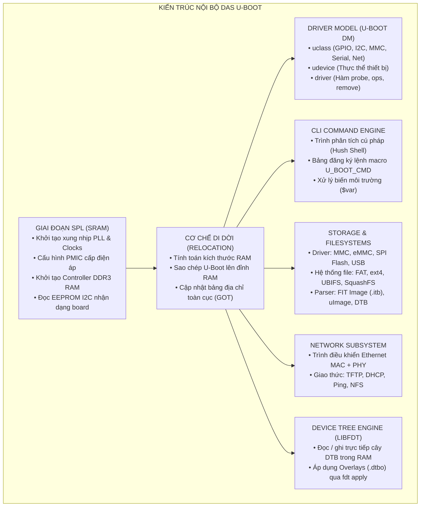
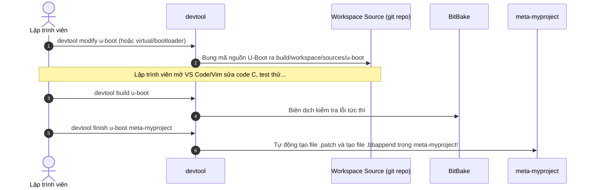

# 🛠️ Chương 6: Lập Trình Nâng Cao, Can Thiệp Mã Nguồn & Phát Triển Tính Năng Mới Trong U-Boot

> **Mục tiêu học tập chuyên sâu**:
> 1. Hiểu rõ cấu trúc giải phẫu nội bộ của U-Boot (Internal Subsystems).
> 2. Xác định các kiến thức cốt lõi và kỹ năng nghề nghiệp gặt hái được khi học U-Boot.
> 3. Nắm vững 2 phương pháp chỉnh sửa U-Boot: Phát triển độc lập (Standalone) và Phát triển trong Yocto Project (dùng `devtool`).
> 4. Thực hành các ví dụ cụ thể: Viết lệnh CLI mới bằng `U_BOOT_CMD`, điều khiển GPIO trong SPL, và quy trình tạo patch cho Yocto.

---

## 1. TRONG U-BOOT CÓ NHỮNG GÌ? (GIẢI PHẪU KIẾN TRÚC NỘI BỘ)

Khác với định kiến cho rằng U-Boot chỉ là một "đoạn code nạp file đơn giản", **U-Boot thực chất là một hệ điều hành trần (Bare-metal Operating System) mini hoàn chỉnh**, không có phân trang ảo (không bật MMU cho user space) nhưng sở hữu đầy đủ hệ sinh thái quản lý tài nguyên:



---

## 2. HỌC ĐƯỢC GÌ TỪ U-BOOT? (KỸ NĂNG & TƯ DUY NGHỀ NGHIỆP)

Học và làm chủ U-Boot mang lại cho kỹ sư nhúng những kỹ năng nền tảng mà lập trình ứng dụng cấp cao không thể có được:

| Lĩnh vực học được | Giá trị thực tiễn & Kỹ năng nghề nghiệp |
| :--- | :--- |
| **1. Tư duy Hardware Bring-up** | Hiểu chính xác những gì diễn ra ở cấp độ phần cứng ngay khi cấp nguồn: từ trạng thái Reset của vi xử lý, cấp nguồn PMIC, ổn định thạch anh dao động, cấu hình PLL, đến kích hoạt thanh RAM DDR3. |
| **2. Làm chủ Bản đồ bộ nhớ & Cache** | Nắm vững sự khác biệt giữa On-Chip SRAM và DDR3 RAM; hiểu rõ nguyên lý hoạt động của CPU Cache (D-Cache, I-Cache) và tại sao phải Flush/Invalidate Cache trước khi nhảy vào Kernel để tránh lỗi đồng bộ dữ liệu. |
| **3. Kỹ năng Board Porting** | Đây là kỹ năng đắt giá hàng đầu: Khi công ty thiết kế một bo mạch mới (dùng chip TI, NXP, Rockchip hay STM32MP1), bạn biết chính xác cần sửa file nào (`board.c`, `mux.c`, `defconfig`, `dts`) để đưa hệ điều hành Linux lên bo mạch đó. |
| **4. Lập trình Driver Bare-metal** | Học cách điều khiển trực tiếp các thanh ghi ngoại vi (MMIO) thông qua các macro `readl()`, `writel()`, `clrbits_le32()`, `setbits_le32()` mà không cần thư viện trừu tượng của OS. |
| **5. Kỹ năng gỡ lỗi mức số 0 (Zero-level Debugging)** | Sử dụng UART Register dump, JTAG, OpenOCD, hoặc các lệnh can thiệp bộ nhớ `md`, `mw` để tìm ra lỗi treo cứng phần cứng trước khi Linux kịp in ra bất kỳ dòng log nào. |

---

## 3. CÁCH CHỈNH SỬA U-BOOT: HAI QUY TRÌNH THỰC CHIẾN

### QUY TRÌNH 1: Phát triển độc lập (Standalone U-Boot Development)
Quy trình này áp dụng khi bạn muốn sửa code nhanh, biên dịch tức thì và nạp thẻ nhớ kiểm tra mà không cần chờ Yocto:

1. **Vào thư mục mã nguồn U-Boot**:
   ```bash
   cd ~/u-boot
   ```
2. **Sửa đổi mã nguồn**:
   - Thêm lệnh CLI: Sửa trong thư mục `cmd/`.
   - Sửa khởi tạo phần cứng board: Sửa trong `board/ti/am335x/board.c` hoặc `mux.c`.
   - Sửa cấu hình bộ nhớ/môi trường: Sửa trong `include/configs/am335x_evm.h`.
3. **Biên dịch**:
   ```bash
   export ARCH=arm
   export CROSS_COMPILE=arm-linux-gnueabihf-
   make am335x_evm_defconfig
   make -j$(nproc)
   ```
4. **Nạp vào thẻ nhớ MicroSD**:
   ```bash
   sudo cp MLO /media/$USER/BOOT/
   sudo cp u-boot.img /media/$USER/BOOT/
   sync
   ```

---

### QUY TRÌNH 2: Phát triển U-Boot trong Yocto Project (Dùng `devtool`)
Trong môi trường công nghiệp, khi U-Boot được quản lý bởi Yocto Project, công cụ chuẩn mực nhất để can thiệp mã nguồn là **`devtool`**:



#### Các lệnh thực thi chi tiết:
```bash
# Bước 1: Kích hoạt môi trường Yocto
cd ~/yocto-lab/poky
source oe-init-build-env build

# Bước 2: Yêu cầu devtool trích xuất mã nguồn U-Boot ra workspace để sửa
devtool modify u-boot

# Mã nguồn U-Boot sẽ nằm tại: workspace/sources/u-boot/
# Bạn mở mã nguồn này ra chỉnh sửa bằng VS Code hoặc nano:
cd workspace/sources/u-boot/
# Sửa file board.c, cmd/...

# Bước 3: Build thử nghiệm ngay trong Yocto để xem code có lỗi không
devtool build u-boot

# Bước 4: Commit thay đổi vào git nội bộ của workspace
git add .
git commit -m "feat: Add custom boot logic and LED indicator"

# Bước 5: Đóng gói thay đổi thành patch vĩnh viễn vào layer meta-myproject
devtool finish u-boot meta-myproject
```
Sau bước 5, `devtool` sẽ **tự động sinh ra file patch** và tạo file `recipes-bsp/u-boot/u-boot_%.bbappend` trong layer `meta-myproject` của bạn! Mỗi lần build sau, Yocto sẽ tự động áp dụng bản vá này.

---

## 4. CÁC VÍ DỤ THỰC CHIẾN MINH HỌA

---

### VÍ DỤ 1: TỰ VIẾT MỘT LỆNH U-BOOT CLI HOÀN TOÀN MỚI (`cmd/hello_thinh.c`)

Bạn muốn thêm một lệnh mang tên `hello_thinh` vào U-Boot console (`=> hello_thinh [tên] [số_lần]`).

#### Bước 1: Tạo file mã nguồn C trong thư mục `cmd/` của U-Boot:
Tạo file: `cmd/hello_thinh.c`:

```c
#include <common.h>
#include <command.h>
#include <vsprintf.h>

/*
 * Hàm xử lý chính khi người dùng gõ lệnh trên U-Boot Console
 * argc: Số lượng tham số truyền vào
 * argv: Mảng các chuỗi tham số (argv[0] là tên lệnh)
 */
static int do_hello_thinh(struct cmd_tbl *cmdtp, int flag, int argc, char *const argv[])
{
    const char *name = "Developer Thinh";
    int count = 1;

    /* Nếu người dùng có truyền tên: hello_thinh <name> */
    if (argc >= 2) {
        name = argv[1];
    }

    /* Nếu người dùng có truyền số lần lặp: hello_thinh <name> <count> */
    if (argc >= 3) {
        count = simple_strtoul(argv[2], NULL, 10);
    }

    printf("\n======================================================\n");
    printf("   [U-Boot Custom Command] Xin chao tu Bootloader!    \n");
    printf("======================================================\n");

    for (int i = 1; i <= count; i++) {
        printf(" -> (%d/%d) Hello %s! U-Boot san sang nap Kernel.\n", i, count, name);
    }
    printf("\n");

    return CMD_RET_SUCCESS; /* Trả về 0 (Thành công) */
}

/*
 * Đăng ký lệnh vào bảng lệnh hệ thống bằng Macro U_BOOT_CMD
 * Cú pháp:
 * U_BOOT_CMD(tên_lệnh, max_args, lặp_lại_khi_nhấn_enter, hàm_xử_lý, hướng_dẫn_ngắn, hướng_dẫn_chi_tiết)
 */
U_BOOT_CMD(
    hello_thinh, 3, 1, do_hello_thinh,
    "In loi chao tuy bien va kiem tra he thong U-Boot",
    "[name] [count]\n"
    "    - name: Ten nguoi dung can chao (Mac dinh: Developer Thinh)\n"
    "    - count: So lan lap lai loi chao (Mac dinh: 1)\n"
);
```

#### Bước 2: Đăng ký file vào hệ thống build (`cmd/Makefile`):
Mở file `cmd/Makefile` và thêm dòng:
```makefile
obj-y += hello_thinh.o
```

#### Bước 3: Biên dịch và chạy thử trên U-Boot Console:
Khi vào dấu nhắc lệnh `=>`, bạn gõ:
```bash
=> hello_thinh
======================================================
   [U-Boot Custom Command] Xin chao tu Bootloader!    
======================================================
 -> (1/1) Hello Developer Thinh! U-Boot san sang nap Kernel.

=> hello_thinh Embedded_Linux 3
======================================================
   [U-Boot Custom Command] Xin chao tu Bootloader!    
======================================================
 -> (1/3) Hello Embedded_Linux! U-Boot san sang nap Kernel.
 -> (2/3) Hello Embedded_Linux! U-Boot san sang nap Kernel.
 -> (3/3) Hello Embedded_Linux! U-Boot san sang nap Kernel.
```

---

### VÍ DỤ 2: ĐIỀU KHIỂN PHẦN CỨNG BẬT ĐÈN LED NGAY TRONG GIAI ĐOẠN SPL

Trên BeagleBone Black, đèn LED `USR0` được nối với chân **GPIO1_21** (Tương đương chân số: $1 \times 32 + 21 = 53$).

Bạn muốn: **Ngay khi SPL vừa chạy trong On-Chip SRAM (trước khi DDR3 được bật), đèn LED này phải sáng lên lập tức** để kỹ sư nhìn thấy bằng mắt thường rằng chip đã bắt đầu khởi động!

#### Vị trí chỉnh sửa:
Mở file: `board/ti/am335x/board.c`, tìm tới hàm khởi tạo sớm `spl_board_init()`:

```c
#include <asm/gpio.h>

#define GPIO_TO_PIN(bank, gpio)    ((bank) * 32 + (gpio))
#define BEAGLEBONE_USR_LED0         GPIO_TO_PIN(1, 21) /* GPIO1_21 = Chân 53 */

void spl_board_init(void)
{
    /* Yêu cầu quyền điều khiển chân GPIO 53 */
    if (gpio_request(BEAGLEBONE_USR_LED0, "usr_led0") == 0) {
        /* Cấu hình chân là OUTPUT, giá trị ban đầu là 1 (Bật sáng LED) */
        gpio_direction_output(BEAGLEBONE_USR_LED0, 1);
        
        /* In thông báo xác nhận ra UART0 sớm */
        puts("[SPL Stage] Da bat sang den USR LED 0 thanh cong!\n");
    }

    /* Tiếp tục các logic khởi tạo mặc định khác... */
}
```

Khi nạp bản build này vào thẻ nhớ và cắm điện, đèn LED USR0 trên bo mạch sẽ **sáng rực lên ngay từ mili-giây đầu tiên**, giúp bạn chẩn đoán ngay bo mạch có nhận thẻ nhớ hay không mà không cần nhìn vào màn hình máy tính!

---

### VÍ DỤ 3: GHI ĐÈ BẢN MÔ TẢ PHẦN CỨNG BẰNG DEVICE TREE OVERLAY TRONG U-BOOT

Thay vì phải biên dịch lại mã nguồn Linux Kernel mỗi khi thay đổi ngoại vi, bạn có thể lập trình cho U-Boot tự động thay đổi cấu hình Device Tree trước khi trao quyền cho Linux:

Trong file cấu hình môi trường hoặc script:
```bash
# Nạp Device Tree gốc vào RAM
load mmc 0:2 0x88000000 /boot/dtbs/am335x-boneblack.dtb
fdt addr 0x88000000

# Trực tiếp thay đổi một thông số trong Device Tree bằng lệnh CLI:
# Ví dụ: Sửa trạng thái của node serial UART1 thành "okay" (bật ngoại vi):
fdt set /ocp/serial@48022000 status "okay"

# Kiểm tra lại xem thuộc tính đã đổi chưa:
fdt print /ocp/serial@48022000 status
# Kết quả: status = "okay"

# Khởi động Kernel với Device Tree đã chỉnh sửa động:
bootz 0x82000000 - 0x88000000
```

---

## 5. TỔNG KẾT BÀI HỌC

1. **U-Boot là một trường đại học thu nhỏ về lập trình hệ thống**: Nắm vững U-Boot giúp bạn tự tin làm việc với bất kỳ kiến trúc chip nào (ARM32, ARM64, RISC-V).
2. Khi phát triển U-Boot trong môi trường Yocto, luôn ghi nhớ bộ công cụ **`devtool modify` $\rightarrow$ `devtool build` $\rightarrow$ `devtool finish`** để giữ layer sạch sẽ và tái sử dụng bản vá chuẩn xác.
3. Macro **`U_BOOT_CMD`** và hệ thống driver **U-Boot Driver Model** là 2 công cụ quyền năng nhất để bạn mở rộng tính năng và giao tiếp phần cứng theo ý muốn.
