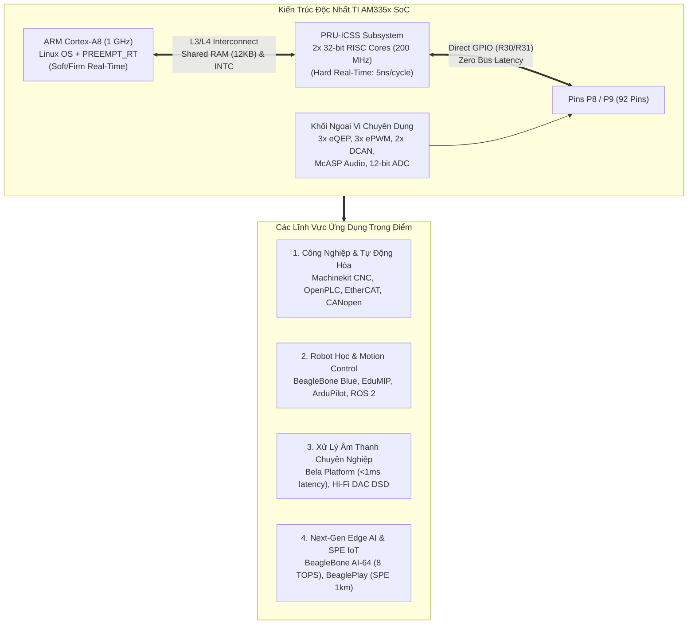
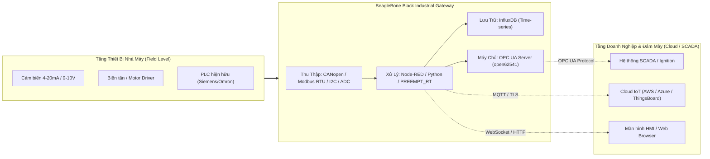

# 🚀 Chương 7: Hệ Sinh Thái Ứng Dụng Thực Tế & Các Dự Án Chuyên Sâu Với Họ Bo Mạch BeagleBone

---

## 🧭 1. TỔNG QUAN VỊ THẾ CỦA HỌ BO MẠCH BEAGLEBONE

Họ bo mạch **BeagleBone** (đặc biệt là **BeagleBone Black - BBB**, **PocketBeagle**, **BeagleBone Blue**, **BeagleBone AI-64**, và **BeaglePlay**) giữ một vị thế độc nhất vô nhị trong thế giới máy tính đơn bo (Single Board Computer - SBC). 

Trong khi Raspberry Pi và các dòng SBC nền Rockchip/Allwinner hướng phần lớn tài nguyên vào giải trí đa phương tiện (GPU mạnh, HDMI 4K, video decoding), thì kiến trúc vi xử lý **Texas Instruments Sitara (AM335x, AM625x, TDA4VM)** trên BeagleBone được thiết kế từ gốc rễ cho **công nghiệp, điều khiển thời gian thực (Hard Real-Time), truyền thông tin cậy và tự động hóa chuyên sâu**.



---

## 2. KIẾN TRÚC PHẦN CỨNG ĐỘC NHẤT CỦA AM335X TRÊN BEAGLEBONE

### 2.1. Giải Phẫu Hệ Thống PRU-ICSS (Programmable Real-Time Unit & Industrial Communication Subsystem)

Điểm cốt lõi khiến BeagleBone Black (BBB) vượt trội hoàn toàn so với Raspberry Pi trong điều khiển chính xác là hệ thống phụ **PRU-ICSS**.

```
                   +-------------------------------------------------+
                   |             TI Sitara AM335x SoC                |
                   |                                                 |
                   |   +--------------------+                        |
                   |   | ARM Cortex-A8 1GHz |                        |
                   |   | (Linux / RT_PREEMPT|                        |
                   |   +---------+----------+                        |
                   |             |                                   |
                   |    =========v========= L3/L4 Interconnect ===   |
                   |             |                        |          |
                   |   +---------+------------------------+------+   |
                   |   |         PRU-ICSS Subsystem              |   |
                   |   |                                         |   |
                   |   |  +--------------+    +---------------+  |   |
                   |   |  |  PRU Core 0   |    |  PRU Core 1   |  |   |
                   |   |  | (32-bit RISC) |    | (32-bit RISC) |  |   |
                   |   |  |   200 MHz    |    |   200 MHz     |  |   |
                   |   |  |  8KB I-RAM   |    |  8KB I-RAM    |  |   |
                   |   |  |  8KB D-RAM   |    |  8KB D-RAM    |  |   |
                   |   |  +-------+------+    +-------+-------+  |   |
                   |   |          |                   |          |   |
                   |   |    [R30/R31 Regs]      [R30/R31 Regs]   |   |
                   |   |   (Direct In/Out)     (Direct In/Out)   |   |
                   |   |          |                   |          |   |
                   |   |  +-------v-------------------v-------+  |   |
                   |   |  |       12 KB Shared RAM            |  |   |
                   |   |  |   PRU INTC (Interrupt Controller) |  |   |
                   |   |  +-----------------------------------+  |   |
                   |   +-----------------------------------------+   |
                   +-------------------------------------------------+
                                  |                 |
                             P8/P9 Pins        P8/P9 Pins
                         (Hard Real-Time)  (Hard Real-Time)
```

#### A. Bản Chất Kỹ Thuật Của PRU
- **2 nhân vi xử lý RISC 32-bit độc lập:** Chạy ở xung nhịp **200 MHz**.
- **Thực thi đơn chu kỳ (Single-Cycle Execution):** Hầu như toàn bộ lệnh PRU (cộng, trừ, shift, gán bit, jump) thực thi trong đúng **1 chu kỳ xung nhịp = 5 nanoseconds (ns)**! Không có bộ đệm Instruction Cache gây miss, không có dự đoán nhánh (branch prediction penalty). Mã nạp vào chạy với tính xác định (determinism) tuyệt đối tới từng chu kỳ xung clock.
- **Truy cập I/O cấp độ thanh ghi trực tiếp (Zero-Latency Direct I/O):**
  - **Thanh ghi `R30`:** Xuất trực tiếp dữ liệu ra chân GPIO ngoài (GPO). Viết `SET R30.t5` sẽ kéo chân logic lên cao chỉ trong 5ns mà không cần đi qua bus trung gian hay chờ trọng tài bus (bus arbitration).
  - **Thanh ghi `R31`:** Đọc trực tiếp mức logic chân GPIO (GPI) hoặc kích hoạt ngắt trực tiếp (Interrupt generation).

#### B. Cơ Chế Giao Tiếp Linux (ARM) và PRU: Remoteproc & RPMsg
Trên các kernel hiện đại (4.19 / 5.10 / 6.1+), kiến trúc chuẩn hóa là:
- **`remoteproc` (pru_rproc):** Driver nhân Linux quản lý vòng đời của 2 nhân PRU. Nó chịu trách nhiệm cấp nguồn, cấp xung, cấu hình bộ ngắt PRU INTC, nạp file firmware ELF đã biên dịch từ thư mục `/lib/firmware/` vào I-RAM của PRU và khởi động/dừng core:
  ```bash
  # Nạp và khởi chạy firmware cho PRU 0
  echo "am335x-pru0-fw" > /sys/class/remoteproc/remoteproc1/firmware
  echo "start" > /sys/class/remoteproc/remoteproc1/state
  ```
- **`rpmsg` (Remote Processor Messaging):** Giao thức truyền tin dựa trên VirtIO. ARM Linux và PRU trao đổi dữ liệu thông qua hai hàng đợi vòng (vrings) nằm trong vùng nhớ dùng chung (Shared DDR RAM). Phía Linux ánh xạ thành character device `/dev/rpmsg_pru30`, cho phép ứng dụng C/C++/Python gửi nhận dữ liệu với PRU như một file thông thường.

#### C. So Sánh PRU Của BeagleBone Với Raspberry Pi & Các SBC Khác

| Tiêu Chí Kỹ Thuật | BeagleBone Black (PRU-ICSS) | Raspberry Pi 4 / 5 | SBC + STM32/RP2040 Ngoài |
| :--- | :--- | :--- | :--- |
| **Kiến trúc thời gian thực** | **Native On-Chip:** 2 nhân RISC 200MHz nằm ngay trên bus nội SoC | Không có coprocessor thời gian thực nội SoC | Phải kết nối vi điều khiển ngoài qua USB / SPI / UART |
| **Độ trễ phản hồi ngắt (Jitter)** | **5 nanoseconds (ns)** (Tuyệt đối không Jitter) | Vài chục micro giây đến hàng mili giây (do Linux scheduler) | Tùy thuộc bus giao tiếp (USB jitter: 1-2 ms; SPI: 10-50 µs) |
| **Truy cập I/O** | Ghi trực tiếp thanh ghi `R30`/`R31` (1 cycle) | Ghi qua Memory-Mapped GPIO của BCM SoC | Chạy trên MCU riêng, tốn băng thông truyền dữ liệu về SBC |
| **Chia sẻ bộ nhớ (Memory Sharing)** | Truy cập trực tiếp Shared RAM 12KB và DDR RAM vật lý | Không có | Phải đóng gói qua UART/SPI/USB packet |
| **Bit-Banging giao thức cấp nano giây** | **Cực tốt**, độ chính xác chu kỳ đơn | Thất bại nếu chạy từ Linux Userspace | Tốt trên MCU, nhưng khó stream dữ liệu lớn liên tục |

#### D. Các Tác Vụ Mà PRU Giải Quyết Vượt Trội:
1. **Phát xung bước (Step Pulse Generation) cho CNC:** Có thể tạo xung tần số lên tới 1 - 2 MHz trên nhiều trục đồng thời mà không bị méo dạng hay bỏ lỡ xung (hiện tượng gây hỏng phôi gia công ở RPi).
2. **Bit-banging giao thức cấp nano giây (DMX512, 1-Wire, Manchester):** DMX512 yêu cầu tín hiệu Break tối thiểu 88µs và Mark-After-Break 8µs; PRU tạo chính xác tới từng chu kỳ clock 5ns.
3. **Điều khiển dải LED WS2812B (NeoPixel) không Jitter:** WS2812B yêu cầu mã hóa xung thời gian nghiêm ngặt (T0H = 400ns, T0L = 850ns). Trên Linux thông thường, chỉ cần một ngắt mạng hay chuyển đổi tiến trình (context switch) sẽ làm sai lệch chu kỳ bit khiến toàn bộ dải LED bị chớp giật. PRU xuất xung song song hàng chục dải LED đồng thời mà không tốn 1% CPU của ARM.
4. **Software UARTs:** Tạo thêm 4 - 8 cổng UART mềm với baud rate bất kỳ (kể cả tốc độ dị thường như 31250 bps của MIDI) trên các chân GPIO bất kỳ.
5. **ADC Sampling siêu tốc:** PRU có thể tự động kích hoạt ADC nội 12-bit hoặc đọc SPI ADC ngoài với tần số hàng trăm kHz, đưa vào ringbuffer mà không làm phiền Linux Kernel.

---

### 2.2. PREEMPT_RT Real-Time Linux: Mô Hình Phân Tầng Thời Gian Thực 3 Lớp

BeagleBone mang đến sự kết hợp hoàn hảo mà không một vi điều khiển hay máy tính đơn bo đơn thuần nào có được:

```
[ LỚP 3: NON REAL-TIME ] 
    User Space Linux: Web Dashboard, Node-RED, REST API, MQTT, Database
    ----------------------------------------------------------------------
[ LỚP 2: FIRM / SOFT REAL-TIME (~20-50 µs Latency) ]
    ARM Cortex-A8 + Kernel PREEMPT_RT:
    - Thuật toán động học nghịch (Inverse Kinematics)
    - Quỹ đạo chuyển động đa trục (Trajectory Planning)
    - Phân tích G-Code / IEC 61131-3 logic
    ----------------------------------------------------------------------
[ LỚP 1: HARD REAL-TIME (5 ns Latency, Zero Jitter) ]
    PRU-ICSS (2 Cores RISC 200MHz):
    - Xuất chuỗi xung điều khiển động cơ bước (Step/Dir)
    - Đọc Encoder quadrature phản hồi vòng kín
    - Bit-banging giao thức thời gian thực (EtherCAT / Profibus)
```

---

## 3. CÁC ỨNG DỤNG THỰC TẾ TRONG CÔNG NGHIỆP (INDUSTRIAL AUTOMATION & IOT)

### 3.1. PLC Thời Gian Thực & CNC Controller Đa Trục

```
                 +--------------------------------------------------+
                 |            BeagleBone Black / Machinekit         |
                 |                                                  |
                 |  +--------------------+  +--------------------+  |
                 |  | Linux PREEMPT_RT   |  |     PRU-ICSS       |  |
G-Code Input --->|  | - Motion Planner   |  | - PRU Stepgen      |==|==> Pulse Trains (MHz)
(SD / Ethernet)  |  | - Kinematics Model |==| - Step/Dir Output  |  |    (To Stepper Drivers)
                 |  | - HAL (Hardware    |  | - Encoder Feedback |<=|=== Quadrature Encoders
                 |  |   Abstraction Layer|  |   (Zero Jitter)    |  |
                 |  +--------------------+  +--------------------+  |
                 +--------------------------------------------------+
```

#### A. Dự Án Machinekit / LinuxCNC
- **Giải pháp Machinekit trên BeagleBone Black:** 
  - Tách rời hoàn toàn bộ máy điều khiển: ARM Cortex-A8 chạy lớp **HAL (Hardware Abstraction Layer)** và tính toán quỹ đạo (Trajectory Calculation).
  - Module `hal_pru_generic` nạp firmware chuyên biệt vào PRU. PRU đảm nhiệm việc tạo xung bước cực kỳ mượt mà lên tới hàng trăm kHz trên mỗi trục, đồng thời đọc xung phản hồi từ cảm biến hành trình (Limit switches) với độ trễ phản ứng tức thời.
- **Các bo mở rộng (Cape) tiêu biểu:** **CRAMPS Cape**, **Replicape** (điều khiển máy in 3D công nghiệp, máy phay CNC 3-5 trục).

#### B. OpenPLC Trên BeagleBone
- **OpenPLC:** Nền tảng điều khiển logic lập trình mã nguồn mở đầu tiên hỗ trợ đầy đủ tiêu chuẩn **IEC 61131-3** (Ladder Logic - LD, Structured Text - ST, Function Block Diagram - FBD).
- Kết hợp với phần cứng AM335x, BeagleBone biến thành một bộ PLC công nghiệp thay thế cho Siemens S7-1200 hay Allen-Bradley trong các dây chuyền chi phí thấp:
  - Chu kỳ quét (Scan Cycle) được cố định ở mức **1ms - 5ms** thông qua nhân Linux Real-Time.

---

### 3.2. Mạng Giao Tiếp Công Nghiệp (Fieldbus & Industrial Ethernet)

- **CAN Bus (Controller Area Network):** AM335x tích hợp sẵn **2 bộ điều khiển DCAN độc lập** (Bosch D_CAN, CAN 2.0B tốc độ 1 Mbps). Hệ điều hành nhận diện trực tiếp dưới dạng giao tiếp mạng **SocketCAN** (`candump can0`, `cansend can0 123#DEADBEEF`).
- **Modbus RTU / Modbus TCP:** Cổng RS-485 cách ly quang qua UART phần cứng (hỗ trợ chân tự động đảo chiều truyền nhận Hardware RTS Flow Control trên AM335x).
- **EtherCAT Slave Controller (ESC):** Nhờ hệ thống PRU-ICSS, Texas Instruments cung cấp gói **PRU-ICSS Industrial Software**, biến 2 nhân PRU thành một **EtherCAT Slave Controller (ESC)** chuyên dụng bằng phần mềm, tương thích hoàn toàn với Beckhoff ET1100 mà không cần mua thêm chip ASIC đắt tiền.
- **Profibus & PROFINET:** Hỗ trợ firmware PRU cho **PROFIBUS DP Slave** và **PROFINET RT**.

---

### 3.3. SCADA & Industrial Edge Gateway



---

## 4. ROBOT HỌC & ĐIỀU KHIỂN TỰ ĐỘNG (ROBOTICS & MOTION CONTROL)

### 4.1. Bo Mạch Chuyên Dụng BeagleBone Blue & Dự Án EduMIP

**BeagleBone Blue** là bo mạch máy tính All-in-One duy nhất chuyên biệt hoàn toàn cho robot học:
- **Tích hợp trên board:** IMU 9 trục MPU-9250, Khí áp kế BMP280, 4 kênh cầu H động cơ DC (TB6612FNG), 4 cổng đọc Encoder eQEP, 8 kênh PWM 6V cho servo/ESC (lái bởi PRU), mạch sạc pin LiPo 2S kèm cân bằng cell, Wi-Fi và Bluetooth.
- **Thư viện `librobotcontrol`:** Cung cấp bộ lọc Kalman cho IMU 9 trục, vòng lặp điều khiển PID tần số 200Hz - 1000Hz.
- **Robot EduMIP:** Dự án con lắc ngược tự cân bằng 2 bánh từ Đại học UCSD chạy thuật toán phản hồi trạng thái toàn phần (LQR).
- **ArduPilot Linux Native:** Chạy trực tiếp mã nguồn ArduCopter, ArduPlane, ArduRover như một tiến trình thời gian thực trên Linux, lái motor qua PRU và truyền video nén về trạm mặt đất qua Wi-Fi.

### 4.2. ROS 1 & ROS 2 (Robot Operating System)
- Cài đặt trực tiếp trên hệ điều hành Debian/Ubuntu trên BeagleBone.
- Các node định vị và dẫn đường (Nav2, SLAM) chạy trên nhân Linux; giao tiếp phần cứng I/O thông qua Micro-ROS hoặc driver C++ đọc trực tiếp từ eQEP/PRU.

---

## 5. XỬ LÝ ÂM THANH CHUYÊN NGHIỆP & DSP (HI-FI AUDIO & SYNTHESIZERS)

### 5.1. Nền Tảng Âm Thanh Siêu Độ Trễ Thấp Bela (bela.io)

```
+-----------------------------------------------------------------------+
|              KIẾN TRÚC ĐỘC PHÁ CỦA BELA TRÊN BEAGLEBONE               |
|                                                                       |
|  [ LINUX THƯỜNG / RASPBERRY PI ]                                      |
|  Audio In -> ALSA Driver -> JACK/Pulse -> User Buffer -> Audio Out    |
|  => Độ trễ (Latency): 10ms - 50ms (Không thể dùng cho nhạc cụ sống)   |
|                                                                       |
|  [ KIẾN TRÚC BELA TRÊN BEAGLEBONE BLACK ]                            |
|  Audio In (Codec TLV320AIC3104 / 8x 16-bit ADC)                       |
|       |                                                               |
|  [PRU Cores] <--- Truy cập trực tiếp cấp mẫu (Sample-by-Sample)       |
|       |           Không qua ALSA Driver!                              |
|  [Xenomai / RT Thread] (Buffer siêu nhỏ: 2, 4, 8 samples!)           |
|       |                                                               |
|  Audio Out (Sub-millisecond Latency: < 1ms từ ngón tay đến âm thanh)  |
+-----------------------------------------------------------------------+
```

- **Độ trễ kỷ lục dưới 1ms (< 1ms):** Bỏ qua hoàn toàn tầng ALSA của Linux. PRU điều khiển trực tiếp bus McASP và SPI ADC với bộ đệm cực nhỏ (2 - 4 samples).
- **Phần cứng Bela Cape:** 2 kênh audio stereo 16-bit/44.1kHz, 8 ngõ vào Analog 16-bit, 8 ngõ ra Analog 16-bit, 16 ngõ vào/ra số GPIO lấy mẫu ở tần số 44.1kHz đồng bộ theo từng mẫu âm thanh (sample-accurate).
- **Ngôn ngữ hỗ trợ:** C/C++ (ARM NEON), Pure Data (`libpd`), FAUST, SuperCollider, Csound.

### 5.2. Audiophile DAC & McASP DSD
- Khối **McASP** hỗ trợ 4 serializers, truyền nhận TDM, S/PDIF và xuất tín hiệu **DSD (Direct Stream Digital)** nguyên bản.
- **Botic Driver (Miero):** Cấu hình McASP làm việc ở chế độ Slave Clock với thạch anh kép Crystek CCHD-957, biến BeagleBone Black thành music server Bit-Perfect PCM 384kHz/32-bit và DSD512 xuất sang các chip DAC tham chiếu như ESS ES9038PRO, AKM AK4499.

---

## 6. CÁC THẾ HỆ BEAGLEBONE MỚI VÀ HƯỚNG ĐI HIỆN ĐẠI

### 6.1. BeagleBone AI-64: Quái Kiệt Xử Lý Edge AI (8.0 TOPS)
- **Chipset:** Texas Instruments **TDA4VM** (Jacinto 7 chuẩn ô tô Automotive Grade).
- **Cấu hình tính toán:**
  - 2 nhân 64-bit ARM Cortex-A72 @ 2.0 GHz.
  - Nhân DSP vector **C7x** (1.0 GHz, 80 GFLOPS, 512-bit SIMD).
  - Khối gia tốc phần cứng **MMA (Matrix Multiply Accelerator)** đạt hiệu năng AI **8.0 TOPS (INT8)**.
  - Bộ xử lý thị giác phần cứng: VPAC (ISP camera) và DMPAC (Dense Optical Flow & Stereo Depth).
  - 4 nhân Cortex-R5F đạt chuẩn an toàn chức năng ASIL-D.
- **Ứng dụng:** Xe tự hành nhà kho (AMR / AGV), kiểm tra khuyết tật sản phẩm tự động (Machine Vision Inspection) chạy trực tiếp các mô hình YOLOv8, Mobilenet-SSD ở 30 - 60 FPS.

### 6.2. BeaglePlay: Đơn Giản Hóa IoT Với Single Pair Ethernet (SPE)
- **Chipset:** TI AM6254 (Quad Cortex-A53 + PRU-ICSS).
- **Single Pair Ethernet (SPE - 10BASE-T1L):** Chỉ cần **1 cặp dây xoắn duy nhất** truyền dữ liệu mạng 10 Mbps và cấp nguồn (PoDL) với cự ly lên tới **1 KILOMÉT (1000m)**!
- **Mạng không dây Sub-1 GHz:** Tích hợp vi điều khiển TI CC1352P7 chạy Zephyr RTOS, hỗ trợ mạng cảm biến tầm xa Wi-SUN Mesh và BLE.
- **Cổng kết nối nhanh:** Khe cắm MikroBUS (hơn 1.500 bo Click Boards) và chuẩn cắm Qwiic / Grove.

---

## 7. GỢI Ý LỘ TRÌNH DỰ ÁN THỰC HÀNH (TỪ CƠ BẢN ĐẾN CHUYÊN GIA)

```mermaid
timeline
    title Lộ Trình Khai Phá Sức Mạnh BeagleBone
    section Giai Đoạn 1: Cơ Bản
        Môi trường & Linux Kernel : Flash Debian IoT, SSH USB, uEnv.txt
        Giao tiếp Ngoại vi : Sysfs GPIO, Libgpiod, I2C, SPI C++
        Thời gian thực Cơ bản : PREEMPT_RT testing với cyclictest
        Mạng Ô tô / Công nghiệp : Cấu hình SocketCAN loopback
    section Giai Đoạn 2: Trung Cấp
        Lập trình PRU-ICSS : Viết C cho PRU với Remoteproc & RPMsg
        Bit-Banging Chính Xác : Lái dải LED WS2812B không Jitter
        Motion Control Vòng kín : Đọc eQEP Encoder & xuất ePWM lái Motor
        Industrial IoT Gateway : Modbus RTU sang MQTT, SCADA Node-RED
    section Giai Đoạn 3: Chuyên Gia
        Máy Phay CNC Đa Trục : Triển khai Machinekit với PRU stepgen
        Ultra-Low Latency DSP : Xây dựng Synth với Bela Platform (<1ms)
        Fieldbus Nâng Cao : Thiết lập EtherCAT Slave trên PRU
        Edge AI & Tự Hành : BeagleBone AI-64 + ROS 2 + TI Deep Learning
```

---

## 8. BẢNG TRA CỨU DỰ ÁN & REPOSITORIES THAM KHẢO

| Lĩnh Vực | Tên Dự Án / Tài Nguyên | Đường Dẫn Tham Khảo & Kho Mã Nguồn |
| :--- | :--- | :--- |
| **PRU-ICSS** | **TI PRU Software Support Package** | [git.ti.com/pru-software-support-package](https://git.ti.com/cgit/pru-software-support-package/pru-software-support-package/) |
| **PRU-ICSS** | **PRU Cookbook (GS. Mark A. Yoder)** | [markayoder.github.io/PRUCookbook](https://markayoder.github.io/PRUCookbook/) |
| **CNC & Motion** | **Machinekit Repository** | [github.com/machinekit/machinekit](https://github.com/machinekit/machinekit) |
| **Robotics** | **Strawson Design `librobotcontrol`** | [github.com/strawsondesign/librobotcontrol](https://github.com/strawsondesign/librobotcontrol) |
| **Robotics** | **Dự Án Robot Cân Bằng EduMIP** | [modlab.ucsd.edu/edumip](https://modlab.ucsd.edu/edumip/) |
| **Robotics** | **ArduPilot Cho BeagleBone Blue** | [ardupilot.org/copter/docs/common-beagle-bone-blue](https://ardupilot.org/copter/docs/common-beagle-bone-blue.html) |
| **Pro Audio** | **Bela Platform Core Repository** | [github.com/BelaPlatform/Bela](https://github.com/BelaPlatform/Bela) |
| **Pro Audio** | **Trang Chủ Nền Tảng Bela** | [bela.io](https://bela.io/) |
| **Audiophile** | **Botic Linux Driver Cho McASP (Miero)** | [github.com/miero/botic-kernel](https://github.com/miero/botic-kernel) |
| **Industrial** | **OpenPLC Project (IEC 61131-3)** | [github.com/thiagoralves/OpenPLC_v3](https://github.com/thiagoralves/OpenPLC_v3) |
| **Industrial** | **open62541 C-based OPC UA Server** | [github.com/open62541/open62541](https://github.com/open62541/open62541) |
| **Industrial** | **TI Industrial Protocols (EtherCAT/Profinet)** | [ti.com/tool/PRU-ICSS-INDUSTRIAL-SW](https://www.ti.com/tool/PRU-ICSS-INDUSTRIAL-SW) |
| **Edge AI** | **BeagleBone AI-64 Hardware & Docs** | [github.com/beagleboard/beaglebone-ai-64](https://github.com/beagleboard/beaglebone-ai-64) |
| **Edge AI** | **TI EdgeAI TDA4VM Documentation** | [github.com/TexasInstruments/edgeai-tidl-tools](https://github.com/TexasInstruments/edgeai-tidl-tools) |
| **SPE & IoT** | **BeaglePlay Hardware & Zephyr OS** | [github.com/beagleboard/beagleplay](https://github.com/beagleboard/beagleplay) |
| **Linux Kernel** | **Robert C. Nelson BeagleBoard Builder** | [github.com/RobertCNelson/bb-kernel](https://github.com/RobertCNelson/bb-kernel) |
