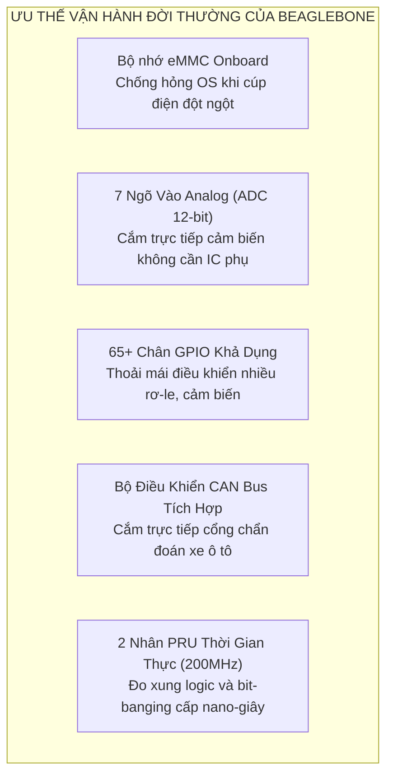
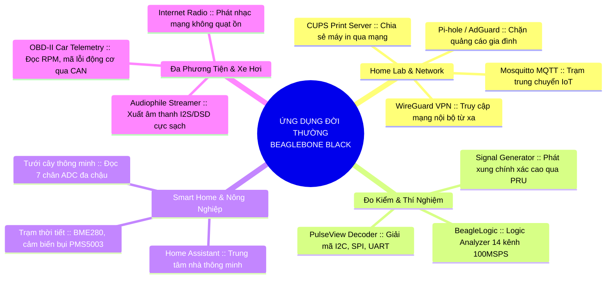

# 🛠️ Chương 8: Tuyển Tập Dự Án Đời Thường, DIY & Home Lab Với BeagleBone Black

---

## 🧭 1. BEAGLEBONE BLACK – "CHIẾN BINH THẦM LẶNG" CỦA GIỚI MAKER & HOME LAB

Khi nhắc đến máy tính đơn bo (Single Board Computer - SBC), cộng đồng thường nghĩ ngay đến **Raspberry Pi** nhờ đồ họa mạnh hoặc **ESP32** cho các tác vụ IoT chạy pin nhỏ gọn. Tuy nhiên, **BeagleBone Black (BBB)** lại sở hữu một vị thế độc nhất vô nhị.

Nếu Raspberry Pi giống như một chiếc PC mini hướng tới giải trí đa phương tiện, thì BeagleBone Black lại là **cầu nối hoàn hảo giữa một máy tính Linux hoàn chỉnh và một vi điều khiển công nghiệp siêu chính xác**. Nhờ sở hữu bộ nhớ flash **eMMC onboard**, **7 kênh ADC**, **65+ chân GPIO**, cổng mạng **Ethernet độc lập**, bộ điều khiển **CAN Bus phần cứng**, và cặp vi xử lý thời gian thực **PRU 200 MHz**, BeagleBone Black là lựa chọn tối thượng cho các dự án đòi hỏi **độ bền 24/7/365, đo đạc thông số thực tế và khả năng chống sập nguồn tuyệt đối**.



---

## 2. SO SÁNH THỰC TẾ: BEAGLEBONE BLACK vs. RASPBERRY PI vs. ESP32

| Tiêu chí | BeagleBone Black (BBB) | Raspberry Pi 4 / 5 | ESP32 (ESP32-S3 / C3) |
| :--- | :--- | :--- | :--- |
| **Kiến trúc & CPU** | TI Sitara AM3358 1 lõi Cortex-A8 @ 1.0 GHz | Broadcom 4 lõi Cortex-A72/A76 (1.5 - 2.4 GHz) | Xtensa 2 lõi 32-bit @ 240 MHz hoặc RISC-V |
| **Hệ điều hành** | Linux đầy đủ (Debian, BeagleBoard OS, RT-Linux) | Linux đầy đủ (Raspberry Pi OS, Ubuntu) | RTOS (FreeRTOS) / Bare-metal, MicroPython |
| **Bộ nhớ RAM** | 512 MB DDR3L | 2 GB / 4 GB / 8 GB LPDDR4 | 512 KB SRAM (+ 2-8 MB PSRAM) |
| **Bộ nhớ lưu trữ** | **Tích hợp 4GB eMMC** + Khe thẻ microSD | Chỉ có khe thẻ microSD (RPi 5 thêm PCIe M.2 NVMe) | Flash SPI onboard (4 - 16 MB) |
| **Ngõ vào Analog (ADC)** | **7 kênh 12-bit tích hợp** (AIN0 - AIN6) | **0 (Không có ADC)**, phải gắn IC ngoài (MCP3008) | 16-18 kênh 12-bit (độ tuyến tính trung bình) |
| **Số lượng GPIO** | **65+ chân khả dụng** (2 header 46 chân P8/P9) | 40 chân (khoảng 26-28 GPIO thực tế) | 20 - 36 chân |
| **Xử lý thời gian thực** | **2x PRU 200 MHz** (chu kỳ lệnh 5ns, song song) | Kém (hệ điều hành Linux can thiệp ngắt) | Rất tốt (FreeRTOS thời gian thực) |
| **Giao tiếp CAN Bus** | **2 bộ điều khiển CAN tích hợp** (DCAN) | Không có (cần module MCP2515 ngoài qua SPI) | 1-2 bộ điều khiển TWAI/CAN tích hợp |
| **Kết nối mạng** | Ethernet 10/100 Mbps (Ethernet độc lập) | Gigabit Ethernet, Wi-Fi Dual Band, Bluetooth 5.0 | Wi-Fi 2.4GHz & Bluetooth LE tích hợp |
| **Đồ họa / Video** | Micro-HDMI (tối đa 720p/1080p, giải mã nhẹ) | Dual micro-HDMI 4K@60Hz, GPU mạnh mẽ | Không có (hoặc xuất màn hình SPI/I2S nhỏ) |
| **Công suất tiêu thụ** | ~1.5W - 2.5W (rất mát, không cần quạt) | ~4W - 12W (nóng, cần tản nhiệt / quạt) | ~0.1W - 0.5W (siêu tiết kiệm điện, pin tốt) |

### Nhận định lựa chọn thực tế:
- **Chọn Raspberry Pi khi**: Bạn cần xem video 4K, làm máy tính cá nhân để bàn lướt web, làm trạm giả lập máy game 3D nặng (PS1, N64, PSP) hoặc máy chủ xử lý dữ liệu nặng.
- **Chọn ESP32 khi**: Bạn làm các thiết bị IoT pin nhỏ gọn (cảm biến cửa, nút bấm không dây, đèn ngủ thông minh) chỉ cần kết nối Wi-Fi/Bluetooth với chi phí vài chục nghìn đồng.
- **Chọn BeagleBone Black khi**: Bạn cần một **hệ thống Linux bền bỉ chạy 24/7 không lo mất điện hỏng thẻ nhớ**, cần đo đạc nhiều tín hiệu Analog/Cảm biến, cần làm thiết bị đo kiểm Logic Analyzer bỏ túi, hoặc giao tiếp với mạng ô tô / công nghiệp.

---

## 3. CÁC ỨNG DỤNG ĐỜI THƯỜNG PHỔ BIẾN CỦA BEAGLEBONE BLACK



---

## 4. TUYỂN TẬP 5 DỰ ÁN MAKER THỰC HÀNH TỪNG BƯỚC

---

### DỰ ÁN 1: MÁY CHỦ DNS PI-HOLE "BẤT TỬ" CHẶN QUẢNG CÁO TOÀN GIA ĐÌNH

> **Mục tiêu**: Lắp đặt một trạm lọc quảng cáo, mã độc và theo dõi ở tầng mạng cho toàn bộ thiết bị trong nhà (Smart TV, Smartphone, Tablet, PC). Chạy 24/7/365 trên eMMC bền bỉ không lo mất điện.

```
[ Internet ] <---> [ Router Wi-Fi Gia Đình ] <==== LAN ====> [ BeagleBone Black (Pi-hole DNS) ]
                            |                                           (Cố định IP: 192.168.1.200)
                            +---- Wi-Fi ----> [ Smart TV / Điện thoại / Laptop ]
```

* **Linh kiện chuẩn bị**:
  * 01 Bo mạch BeagleBone Black Rev C (4GB eMMC).
  * 01 Nguồn 5V/2A DC jack cắm chân tròn (2.1mm).
  * 01 Cáp mạng RJ45 cắm trực tiếp vào Router gia đình.
* **Các bước thực hiện**:
  1. **Nạp hệ điều hành vào eMMC**:
     - Tải bản image *Debian IoT* từ trang chủ beagleboard.org, flash vào thẻ microSD.
     - Cắm thẻ nhớ vào BBB, giữ nút **Boot (S2)** rồi cắm nguồn. Đợi 4 đèn LED chớp kiểu "Cylon" (chạy qua lại) đến khi 4 đèn cùng sáng đứng yên là hoàn thành việc flash vào eMMC. Rút thẻ nhớ ra và khởi động lại.
  2. **Cài đặt Pi-hole chỉ với một dòng lệnh**:
     ```bash
     curl -sSL https://install.pi-hole.net | bash
     ```
     - Làm theo hướng dẫn trên màn hình: Chọn card mạng `eth0`, chọn upstream DNS (Cloudflare 1.1.1.1 hoặc Google 8.8.8.8), bật giao diện Web Admin.
     - Đặt mật khẩu đăng nhập web: `sudo pihole -a -p`.
  3. **Áp dụng vào Router gia đình**:
     - Đăng nhập trang quản trị Router, đổi địa chỉ **Primary DNS** thành IP của BBB (`192.168.1.200`).
     - Truy cập `http://192.168.1.200/admin` để theo dõi biểu đồ quảng cáo bị chặn theo thời gian thực.

---

### DỰ ÁN 2: THIẾT BỊ PHÂN TÍCH LOGIC 14 KÊNH 100 MSPS (BEAGLELOGIC + PULSEVIEW)

> **Mục tiêu**: Biến BeagleBone thành máy đo kiểm phân tích tín hiệu số chuyên nghiệp tương đương các thiết bị Saleae Logic đắt tiền, bắt trọn xung nhịp I2C, SPI, UART, PWM ở tần số cao.

```
[ Vi điều khiển cần đo (Arduino/ESP32) ] --- Tín hiệu SDA/SCL/TX/RX ---> [ Level Shifter 3.3V ] ---> [ Header P8 BBB ] 
                                                                                                          |
[ Máy tính để bàn PC (PulseView) ] <====== Cáp mạng LAN hoặc USB OTG ====== [ BeagleLogic PRU Core ] <----+
```

* **Linh kiện chuẩn bị**:
  * 01 Bo mạch BeagleBone Black.
  * 01 Cáp Mini-USB (hoặc cáp mạng LAN).
  * 01 Mạch đệm chuyển mức logic 5V <-> 3.3V để bảo vệ chân vi xử lý.
  * Dây kẹp đo logic (Logic probe hooks).
* **Các chân tín hiệu lấy mẫu (Header P8)**:
  * Kênh 0 đến 11 tương ứng các chân: `P8.45`, `P8.46`, `P8.43`, `P8.44`, `P8.41`, `P8.42`, `P8.39`, `P8.40`, `P8.27`, `P8.29`...
* **Các bước thực hiện**:
  1. **Kích hoạt BeagleLogic trên BBB**:
     ```bash
     sudo nano /boot/uEnv.txt
     # Thêm dòng kích hoạt overlay:
     uboot_overlay_pru=/lib/firmware/BEAGLELOGIC-00A0.dtbo
     ```
     - Khởi động lại: `sudo reboot`. Kiểm tra node: `ls -l /dev/beaglelogic`.
  2. **Kết nối máy tính qua Sigrok / PulseView**:
     - Trên máy tính cài **PulseView**, chọn thiết bị kết nối là `BeagleLogic (TCP)`, nhập địa chỉ IP của BeagleBone (`192.168.7.2` nếu cắm qua USB).
  3. **Đo kiểm tín hiệu thực tế**:
     - Nối kẹp đo vào chân tín hiệu I2C (SDA, SCL) của cảm biến.
     - Bấm **Run** trên PulseView, thêm bộ giải mã (Protocol Decoder) `I2C`: PulseView sẽ tự động giải mã ra mã hex địa chỉ cảm biến và byte dữ liệu đọc/ghi chuẩn xác từng micro-giây!

---

### DỰ ÁN 3: BỘ ĐỌC DỮ LIỆU & CHẨN ĐOÁN XE HƠI OBD-II QUA CAN BUS

> **Mục tiêu**: Tận dụng bộ điều khiển CAN tích hợp trên BBB để giải mã và hiển thị dữ liệu hoạt động của ô tô (vòng tua động cơ RPM, tốc độ xe, nhiệt độ làm mát, đọc mã lỗi xe).

```
[ Cổng OBD-II trên Xe Hơi ]
  Chân 6 (CAN-H)  -----------------> [ Chân CAN-H ]  Mạch Thu Phát CAN
  Chân 14 (CAN-L) -----------------> [ Chân CAN-L ]  SN65HVD230 (3.3V)
  Chân 4/5 (GND)  -----------------> [ Chân GND   ]         |
                                                            | RX/TX
                                                            v
[ BeagleBone Black ] <=== P9.24 (CAN1_RX) & P9.26 (CAN1_TX) + 3.3V Power
```

* **Linh kiện chuẩn bị**:
  * 01 Bo mạch BeagleBone Black.
  * 01 Module thu phát CAN Bus **SN65HVD230** (lưu ý: bắt buộc dùng chip 3.3V, không dùng module MCP2551 5V vì sẽ gây cháy chân BBB).
  * 01 Cáp chuyển đổi OBD-II đực (Male) sang dây nối rời.
* **Các bước thực hiện**:
  1. **Cấu hình chân và kích hoạt giao diện `can0`**:
     ```bash
     sudo config-pin p9.24 can
     sudo config-pin p9.26 can
     sudo ip link set can0 up type can bitrate 500000
     ```
  2. **Lắng nghe gói tin CAN của xe**:
     ```bash
     sudo apt-get install can-utils
     candump can0
     ```
  3. **Gửi lệnh truy vấn vòng tua máy (RPM - PID `0x0C`) bằng Python**:
     ```python
     import can
     bus = can.interface.Bus(channel='can0', bustype='socketcan')
     
     # Frame chuẩn truy vấn Mode 01, PID 0C
     msg = can.Message(arbitration_id=0x7DF, data=[0x02, 0x01, 0x0C, 0, 0, 0, 0, 0], is_extended_id=False)
     bus.send(msg)
     
     response = bus.recv(timeout=1.0)
     if response and response.arbitration_id == 0x7E8:
         A = response.data[3]
         B = response.data[4]
         rpm = ((A * 256) + B) / 4.0
         print(f"Vòng tua động cơ xe: {rpm} RPM")
     ```

---

### DỰ ÁN 4: HỆ THỐNG TƯỚI CÂY TỰ ĐỘNG & QUAN TRẮC VƯỜN THÔNG MINH

> **Mục tiêu**: Tận dụng 7 ngõ vào ADC tích hợp của BBB để đo độ ẩm của nhiều chậu cây khác nhau, kết hợp cảm biến khí hậu BME280 và điều khiển van điện từ tưới nước tự động qua Node-RED.

```
[ Cảm biến độ ẩm đất 1 ] -- (Cầu phân áp max 1.8V) ---> Chân P9.39 (AIN0)
[ Cảm biến độ ẩm đất 2 ] -- (Cầu phân áp max 1.8V) ---> Chân P9.40 (AIN1)
[ Cảm biến khí hậu BME280 ] -------------------------> Chân P9.19 (SCL) & P9.20 (SDA)
[ Module Relay 4 kênh ]  <---------------------------- Chân P8.11, P8.12 (GPIO)
                                                                |
                                                                v
                                                    [ Máy bơm 12V / Van từ ]
```

* **Lưu ý kỹ thuật then chốt**:
  - Chân ADC trên BBB **chỉ nhận tối đa 1.8V**. Cảm biến độ ẩm thông thường xuất ra từ 0 - 3.0V, do đó cần dùng 2 điện trở làm cầu chia áp (ví dụ: $R_1 = 12k\Omega$, $R_2 = 10k\Omega$) để điện áp đi vào chân `P9.39 (AIN0)` luôn $\le 1.8V$!
* **Đọc ADC siêu nhanh từ Linux IIO**:
  ```bash
  cat /sys/bus/iio/devices/iio:device0/in_voltage0_raw
  ```
  *(Giá trị trả về từ `0` đến `4095` tương ứng 0 đến 1.8V).*

---

### DỰ ÁN 5: TRẠM PHÁT NHẠC SỐ AUDIOPHILE HI-RES (VOLUMIO / MPD)

> **Mục tiêu**: Tận dụng chất lượng xuất âm thanh jitter cực thấp của BeagleBone Black để xây dựng một đầu phát nhạc mạng chất lượng cao kết nối với dàn âm thanh gia đình.

```
[ Mạng LAN / Wi-Fi ] 
         |
         v
[ BeagleBone Black (Chạy Volumio / MPD) ] === Cáp USB Audio ===> [ USB DAC ngoài ] ===> [ Ampli & Loa ]
         |
         +--- Hỗ trợ: Spotify Connect, Apple AirPlay, NAS Music Server, Web Radio
```

* Cài đặt bản image **Volumio for BeagleBone Black** lên thẻ nhớ hoặc eMMC.
* Cắm USB DAC ngoài vào cổng USB của BeagleBone.
* Kết nối Spotify, AirPlay hoặc ổ cứng mạng NAS. Bo mạch hoạt động hoàn toàn im lặng (không quạt), không nóng, phát nhạc Bit-Perfect cực sạch.

---

## 5. BỐN LƯU Ý KỸ THUẬT "SỐNG CÒN" KHI CHƠI PHẦN CỨNG TRÊN BBB

1. **Giới hạn điện áp ADC là 1.8V (CỰC KỲ NGUY HIỂM)**:
   - Các chân analog `AIN0` đến `AIN6` (trên Header P9) chỉ nhận tối đa **1.8V**.
   - **Cảnh báo**: Cắm điện áp 3.3V hoặc 5V trực tiếp vào chân ADC sẽ làm chết cụm ADC và có thể gây hỏng vĩnh viễn vi xử lý AM335x.
2. **Các chân GPIO là mức logic 3.3V (Không chịu được 5V)**:
   - Tất cả các chân GPIO trên Header P8 và P9 đều chạy ở 3.3V (**Not 5V-tolerant**). Khi nối với Arduino Uno 5V, bắt buộc phải dùng mạch chuyển mức logic (Logic Level Shifter).
3. **Ưu tiên cấp nguồn 5V qua Jack DC tròn (Barrel Jack)**:
   - Cổng Mini-USB chỉ cấp được khoảng 500mA từ máy tính, rất dễ sụt áp gây reset khi cắm USB Wi-Fi hay kích nhiều rơ-le. Luôn dùng nguồn **5V/2A DC jack tròn (2.1mm)** để chạy 24/7.
4. **Làm quen với công cụ đổi chế độ chân (`config-pin`)**:
   - Kiểm tra chế độ chân: `config-pin -q p9.14`
   - Đổi chế độ chân sang GPIO / PWM: `config-pin p9.14 pwm` hoặc `config-pin p8.11 gpio`

---

## 6. DANH MỤC TÀI LIỆU & REPOSITORIES THAM KHẢO

| Dự Án / Công Cụ | Kho Mã Nguồn & Tài Liệu | Giá Trị Học Tập |
| :--- | :--- | :--- |
| **Sách Exploring BeagleBone** | [exploringbeaglebone.com](http://exploringbeaglebone.com/) \| [github.com/derekmolloy/exploringBB](https://github.com/derekmolloy/exploringBB) | Giáo trình thực hành C/C++ và Linux nhúng mẫu mực nhất thế giới. |
| **BeagleLogic** | [github.com/abhishek-kakkar/BeagleLogic](https://github.com/abhishek-kakkar/BeagleLogic) | Toàn bộ mã nguồn driver kernel và firmware PRU cho Logic Analyzer 100MSPS. |
| **BeagleBoard Overlays** | [github.com/beagleboard/bb-overlays](https://github.com/beagleboard/bb-overlays) | Kho Device Tree Overlays cấu hình chân PWM, UART, I2C, SPI, CAN. |
| **Python Periphery** | [github.com/vsergeev/python-periphery](https://github.com/vsergeev/python-periphery) | Thư viện Python nhẹ điều khiển GPIO, PWM, I2C, SPI qua Linux cdev/sysfs. |
| **SocketCAN Utils** | [github.com/linux-can/can-utils](https://github.com/linux-can/can-utils) | Bộ tiện ích dòng lệnh chuẩn (`candump`, `cansend`) đọc dữ liệu mạng ô tô. |
