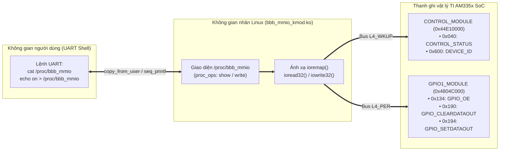
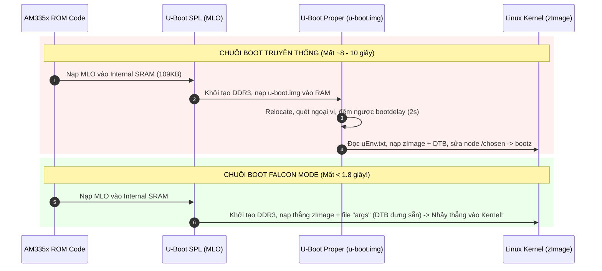

# 🚀 Chương 10: Thực Hành Toàn Diện Với BeagleBone Black, Thẻ Nhớ & UART (Phần 2: Cấp Độ Chuyên Sâu - Kernel MMIO, Falcon Mode, Porting & PRU)

> [!NOTE]
> Chương này hiện thực hóa toàn bộ các chủ đề **Cấp độ Chuyên sâu** trong bảng phân tầng kiến thức của bạn:
> 1. **AM335x Technical Reference Manual (Văn kiện SPRUH73 - Texas Instruments)**: Lập trình Kernel Module ánh xạ trực tiếp thanh ghi vật lý MMIO (`ioremap`, `ioread32`, `iowrite32`).
> 2. **Boot Time Optimization & U-Boot Falcon Mode Seminar (Michael Opdenacker - Bootlin)**: Cấu hình `SPL` nạp thẳng `zImage` và nhảy vào Linux Kernel trong `< 2 giây`, bỏ qua hoàn toàn `u-boot.img`.
> 3. **Processor SDK Linux U-Boot Board Porting Guide (Texas Instruments)**: Kỹ thuật loại bỏ kiểm tra EEPROM I2C0 (`0x50`) cho bo mạch tự thiết kế (Custom Board) và bật đèn báo hiệu ngay trong `SPL`.
> 4. **PRU-ICSS Real-Time Firmware & Remoteproc**: Lập trình nhân RISC 200MHz chạy chu kỳ 5ns song song với Linux và giao tiếp qua kênh `/dev/rpmsg_pru30`.

---

## 🔴 1. LAB 3: VIẾT LINUX KERNEL MODULE ĐIỀU KHIỂN THANH GHI MMIO (`bbb_mmio_kmod.c`)

* **Mã nguồn đầy đủ**: [bbb_mmio_kmod.c](file:///home/thinh/Obsidian/UBoot_BeagleBone/code_examples/04_linux_kernel_module_mmio/bbb_mmio_kmod.c) và [Makefile](file:///home/thinh/Obsidian/UBoot_BeagleBone/code_examples/04_linux_kernel_module_mmio/Makefile).
* **Recipe Yocto đã tích hợp & build thành công**: [bbb-mmio-kmod_1.0.bb](file:///home/thinh/yocto-lab/meta-myproject/recipes-kernel/bbb-mmio-kmod/bbb-mmio-kmod_1.0.bb).

### 1.1. Giải phẫu bản đồ bộ nhớ MMIO trong Kernel Space (Theo SPRUH73 TRM)



#### Tại sao dùng `GPIO_SETDATAOUT` (`0x194`) và `GPIO_CLEARDATAOUT` (`0x190`) thay vì ghi trực tiếp vào `GPIO_DATAOUT` (`0x13C`)?
Theo **TI AM335x TRM (SPRUH73) - Chương 25.3.4.3**:
- Nếu bạn muốn bật 1 chân GPIO bằng thanh ghi `GPIO_DATAOUT` (`0x13C`), bạn phải thực hiện 3 bước (*Read-Modify-Write*): Đọc `GPIO_DATAOUT` $\rightarrow$ Phép OR bit (`|=`) $\rightarrow$ Ghi lại `GPIO_DATAOUT`. Nếu có một ngắt (Interrupt) xen vào giữa bước đọc và bước ghi, trạng thái của các chân GPIO khác trong cùng Bank 1 sẽ bị ghi đè sai lệch (Race Condition)!
- Để giải quyết triệt để, TI thiết kế cặp thanh ghi nguyên tử (**Atomic Set/Clear**):
  - Ghi bit `1` vào vị trí tương ứng của **`GPIO_SETDATAOUT` (`0x4804C194`)**: Chỉ kéo đúng chân đó lên mức CAO (`3.3V`), các chân có bit `0` giữ nguyên trạng thái cũ chỉ trong **1 chu kỳ ghi duy nhất**.
  - Ghi bit `1` vào vị trí tương ứng của **`GPIO_CLEARDATAOUT` (`0x4804C190`)**: Chỉ kéo đúng chân đó xuống mức THẤP (`0V`).

### 1.2. Các lệnh thực hành nạp Kernel Module và kiểm tra trên cổng UART

Khi đã đăng nhập vào BeagleBone qua cổng UART:

```bash
# 1. Nạp module hạt nhân vào Linux Kernel
root@beaglebone:~# modprobe bbb_mmio_kmod
# (Hoặc nếu chép file rời: insmod bbb_mmio_kmod.ko)

# 2. Kiểm tra thông báo từ Kernel ring buffer
root@beaglebone:~# dmesg | tail -n 3
[   42.150120] bbb_mmio: Dang khoi tao driver MMIO cho TI AM335x...
[   42.156410] bbb_mmio: Khoi tao thanh cong! Hay dung lenh 'cat /proc/bbb_mmio'

# 3. Đọc bảng trạng thái thanh ghi phần cứng trực tiếp từ Kernel
root@beaglebone:~# cat /proc/bbb_mmio
```

**Kết quả hiển thị trên màn hình UART**:
```text
================================================================
 BẢNG TRẠNG THÁI THANH GHI AM335X (ĐỌC TỪ KERNEL SPACE MMIO)
================================================================
1. CONTROL_MODULE (Phys: 0x44E10000 -> Virt: c9080000)
   + DEVICE_ID      (Offset 0x600) : 0x2B94402F (Silicon Rev Code: 2)
   + CONTROL_STATUS (Offset 0x040) : 0x0040031C (SYSBOOT[4:0] = 0x1C)

2. GPIO1_MODULE   (Phys: 0x4804C000 -> Virt: c9084000)
   + GPIO_OE        (Offset 0x134) : 0xFE1FFFFF
   + GPIO_DATAOUT   (Offset 0x13C) : 0x00200000
   + Trạng thái 4 đèn LED Onboard  : USR0=[1] USR1=[0] USR2=[0] USR3=[0]
================================================================
```

**Điều khiển bật/tắt 4 đèn LED trực tiếp ở cấp độ thanh ghi Kernel**:
```bash
# Bật sáng rực cả 4 đèn LED USR0..3
root@beaglebone:~# echo on > /proc/bbb_mmio

# Đảo trạng thái riêng đèn USR2
root@beaglebone:~# echo led2 > /proc/bbb_mmio

# Tắt toàn bộ 4 đèn LED USR0..3
root@beaglebone:~# echo off > /proc/bbb_mmio

# Gỡ bỏ driver khi hoàn tất bài tập
root@beaglebone:~# rmmod bbb_mmio_kmod
```

---

## 🔴 2. LAB 4: TỐI ƯU HÓA KHỞI ĐỘNG SIÊU TỐC (< 2 GIÂY) VỚI U-BOOT FALCON MODE

* **Tài liệu đối chiếu**: *Boot Time Optimization & U-Boot Falcon Mode Seminar (Michael Opdenacker - Bootlin)*.
* **File cấu hình & kịch bản lệnh**:
  - Kconfig Fragment: [falcon_mode.cfg](file:///home/thinh/Obsidian/UBoot_BeagleBone/code_examples/03_falcon_mode_fastboot/falcon_mode.cfg)
  - Tập lệnh UART: [falcon_mode_uart_commands.txt](file:///home/thinh/Obsidian/UBoot_BeagleBone/code_examples/03_falcon_mode_fastboot/falcon_mode_uart_commands.txt)

### 2.1. Bản chất kỹ thuật của Falcon Mode



### 2.2. Tại sao cần lệnh `spl export fdt`?
Khi chạy ở chế độ thông thường, lệnh `bootz 0x82000000 - 0x88000000` trong U-Boot Proper không chỉ nhảy vào địa chỉ `0x82000000`, mà trước đó nó **chỉnh sửa cây Device Tree tại `0x88000000` ngay trên RAM**:
- Chèn chuỗi `bootargs` vào node `/chosen`.
- Điền kích thước bộ nhớ DDR3 RAM thực tế (`0x20000000` = 512MB) vào node `/memory`.

Trong **Falcon Mode**, vì `u-boot.img` bị bỏ qua hoàn toàn, `SPL` rất nhỏ gọn nên không muốn tốn thời gian phân tích và sửa đổi cây Device Tree. Do đó, ta dùng lệnh **`spl export fdt`** một lần duy nhất trong U-Boot để **tạo sẵn bức ảnh chụp (snapshot) của cây Device Tree sau khi đã nhúng `bootargs`**, rồi lưu xuống thẻ nhớ thành file tên là **`args`**!

### 2.3. Từng bước thực hiện trên giao diện UART

Tại dấu nhắc `=>` trên màn hình UART của BeagleBone Black:

```text
# Bước 1: Nạp zImage và Device Tree gốc từ phân vùng 1 (FAT32) của thẻ nhớ vào RAM
=> mmc dev 0
=> fatload mmc 0:1 0x82000000 zImage
=> fatload mmc 0:1 0x88000000 am335x-boneblack.dtb

# Bước 2: Thiết lập bootargs tối ưu tốc độ (thêm quiet và lpj=4980736 cho Cortex-A8 1GHz)
=> setenv bootargs console=ttyS0,115200n8 root=/dev/mmcblk0p2 rw rootfstype=ext4 rootwait quiet lpj=4980736

# Bước 3: Xuất cây Device Tree đã nhúng bootargs ra RAM (tại 0x88000000)
=> spl export fdt 0x82000000 - 0x88000000
   Loading Device Tree to 8ffef000, end 8ffff8a5 ... OK
   Argument image is now in RAM: 0x8ffef000

# Bước 4: Ghi vùng nhớ DTB vừa tạo xuống phân vùng FAT32 của thẻ nhớ với tên file là "args"
=> fatwrite mmc 0:1 0x8ffef000 args 0x18000

# Bước 5: Khởi động lại để kiểm nghiệm!
=> reset
```

Ngay sau khi gõ `reset`, bạn sẽ thấy trên cửa sổ UART: Ngay sau dòng `U-Boot SPL`, hệ thống **nhảy thẳng vào Linux Kernel** mà không hề xuất hiện banner của U-Boot Proper nữa!

---

## 🔴 3. LAB 5: PORTING U-BOOT CHO BO MẠCH TÙY BIẾN (BYPASS EEPROM & BẬT LED SPL)

* **Tài liệu đối chiếu**: *Processor SDK Linux U-Boot Board Porting Guide (Texas Instruments)*.
* **File bản vá (Git Patch)**: [0001-am335x-custom-board-bypass-eeprom-and-spl-led.patch](file:///home/thinh/Obsidian/UBoot_BeagleBone/code_examples/02_uboot_custom_cmd_and_porting/0001-am335x-custom-board-bypass-eeprom-and-spl-led.patch).

### 3.1. Bài toán thực tế khi làm phần cứng mới (Custom Hardware)
Mã nguồn U-Boot mặc định của TI (`board/ti/am335x/board.c`) dùng chung cho cả chục loại bo mạch khác nhau (AM335x EVM, EVM-SK, BeagleBone White, BeagleBone Black). Để phân biệt đang chạy trên bo mạch nào, hàm `read_eeprom()` trong giai đoạn SPL đọc chip EEPROM tại `I2C0 0x50`:
- Nếu đọc được chuỗi `"A335BNLT"` $\rightarrow$ Cấu hình xung nhịp DDR3 ở **400MHz** (cho chip RAM Kingston/Micron trên BBB).
- Nếu bo mạch mới của bạn **không hàn chip EEPROM** (hoặc EEPROM mới mua về còn trắng tinh `0xFF`), SPL sẽ báo lỗi `Incorrect magic number (0xffffffff) in EEPROM` và **dừng khởi tạo RAM DDR3**, khiến bo mạch hoàn toàn "chết lâm sàng"!

### 3.2. Cách áp dụng bản vá trong [0001-am335x-custom-board-bypass-eeprom-and-spl-led.patch](file:///home/thinh/Obsidian/UBoot_BeagleBone/code_examples/02_uboot_custom_cmd_and_porting/0001-am335x-custom-board-bypass-eeprom-and-spl-led.patch)

Trong hàm `read_eeprom()` của `board/ti/am335x/board.c`, bản vá thêm cơ chế dự phòng (Fallback) tự động điền cấu trúc `struct ti_am_eeprom` trong SRAM:

```c
	/* Thử đọc EEPROM I2C0 thực tế trước */
	rc = ti_i2c_eeprom_am_get(CONFIG_EEPROM_BUS_ADDRESS,
				  CONFIG_EEPROM_CHIP_ADDRESS);
	if (rc == 0)
		return 0;

	/* Nếu không có EEPROM, tự động điền hồ sơ của BeagleBone Black Rev C */
	puts("SPL/U-Boot: EEPROM not found or blank! Using hardcoded A335BNLT profile.\n");
	ep->header = 0xEE3355AA;
	strlcpy(ep->name, "A335BNLT", sizeof(ep->name));
	strlcpy(ep->version, "00C0", sizeof(ep->version));
	strlcpy(ep->serial, "2026CUSTOM01", sizeof(ep->serial));
	return 0;
```

Đồng thời ngay cuối hàm `sdram_init()`, bản vá gọi `gpio_direction_output(53, 1)` để **bật sáng đèn `USR0` ngay khi DDR3 vừa khởi tạo xong trong SPL**. Khi cắm nguồn, chỉ cần nhìn thấy đèn `USR0` bật sáng tức thì là kỹ sư phần cứng biết chắc chắn: Nguồn PMIC tốt, Thạch anh 24MHz tốt, ROM Code đã nạp SPL tốt, và cấu hình DDR3 đã chạy thành công!

---

## 🔴 4. LAB 6: LẬP TRÌNH THỜI GIAN THỰC VỚI NHÂN PRU0 (200MHz) & GIAO TIẾP RPMSG QUA UART

* **Tài liệu đối chiếu**: *TI AM335x TRM (Chương 4: PRU-ICSS)* & *PRU Cookbook (GS. Mark A. Yoder)*.
* **Mã nguồn đầy đủ**:
  - Firmware C cho PRU0: [pru0_firmware.c](file:///home/thinh/Obsidian/UBoot_BeagleBone/code_examples/05_pru_realtime_rpmsg/pru0_firmware.c)
  - Kịch bản kiểm thử trên UART: [pru_host_uart_test.sh](file:///home/thinh/Obsidian/UBoot_BeagleBone/code_examples/05_pru_realtime_rpmsg/pru_host_uart_test.sh)

### 4.1. Giải phẫu độ chính xác 5 nano-giây trong `pru0_firmware.c`
Nhân PRU0 chạy ở xung nhịp cố định **200 MHz** (không có bộ chia tần tiết kiệm điện gây biến thiên xung nhịp như nhân ARM). Mỗi chu kỳ máy của PRU kéo dài đúng:
$$T_{\text{cycle}} = \frac{1}{200 \times 10^6\text{ Hz}} = 5\text{ nanoseconds (ns)}$$

Trong mã nguồn [pru0_firmware.c](file:///home/thinh/Obsidian/UBoot_BeagleBone/code_examples/05_pru_realtime_rpmsg/pru0_firmware.c), khi nhận được gói tin từ Linux gửi xuống qua `/dev/rpmsg_pru30`, nhân PRU0 bật sáng đèn `USR3` trong đúng **20.000.000 chu kỳ** (`20,000,000 * 5ns = 100.000000 ms`) rồi tắt:

```c
GPIO1_SETDATAOUT = USR3_LED_MASK;
__delay_cycles(20000000); /* Chính xác tuyệt đối 100.000000 mili-giây! */
GPIO1_CLEARDATAOUT = USR3_LED_MASK;
```

### 4.2. Thực thi kịch bản kiểm thử trên màn hình UART

```bash
# Chạy kịch bản tự động nạp firmware vào PRU0 và trao đổi 3 gói tin qua RPMsg
root@beaglebone:~# bash pru_host_uart_test.sh
```

**Kết quả hiển thị trên cửa sổ UART**:
```text
=================================================================
 KIỂM TRA & GIAO TIẾP VỚI NHÂN THỜI GIAN THỰC PRU0 (200MHz RISC)
=================================================================
[1/4] Dừng nhân PRU0 (nếu đang chạy)...
[2/4] Thiết lập tệp firmware (am335x-pru0-fw) cho PRU0...
[3/4] Khởi chạy nhân PRU0 (start)...
      -> Trạng thái PRU0 hiện tại: running
[4/4] Kênh VirtIO RPMsg (/dev/rpmsg_pru30) đã sẵn sàng! Gửi thử 3 gói tin:
[PRU0 @ 200MHz] Msg #1 OK! Da nhay USR3 dung 20,000,000 cycles (100.000ms). Nhan: Hello_PRU_Packet_1
[PRU0 @ 200MHz] Msg #2 OK! Da nhay USR3 dung 20,000,000 cycles (100.000ms). Nhan: Hello_PRU_Packet_2
[PRU0 @ 200MHz] Msg #3 OK! Da nhay USR3 dung 20,000,000 cycles (100.000ms). Nhan: Hello_PRU_Packet_3
```
